# LOOPS Craftsmanship — Diagramas e Passo a Passo Formalizados

> Fase 2, Onda 1 — formalizacao. Converte os loops e processos canonicos do Nucleo de Craftsmanship em **diagramas mermaid prontos** + **passo a passo numerado** (entrada/saida por etapa) + **pontos de gate** (onde um teste ou revisao decide seguir ou voltar).
> Pronto para a Fase 3 (visual) e para virar comportamento de agent.
>
> **Convencao de gate:** `◇` = decisao; um gate retorna ao passo anterior (LACO) ou avanca. Verde = suite de testes passando. A regra-mae transversal a quase todos os loops: **nunca avance com a barra vermelha — reverta e reduza o passo** (small steps + green bar).

## Indice dos loops formalizados

| # | Loop canonico | Autor | Pergunta que responde |
|---|---|---|---|
| L1 | TDD Red-Green-Refactor | Beck | Como deixar a feature emergir guiada por teste? |
| L2 | Refatoracao Disciplinada | Fowler | Como melhorar estrutura sem mudar comportamento? |
| L3 | Tidy First? | Beck | Arrumo antes, depois ou registro para depois? |
| L4 | Legacy Code Change Algorithm | Feathers | Como mudar codigo sem testes com seguranca? |
| L5 | Characterization Test / Golden Master | Feathers | Como travar o comportamento atual antes de tocar? |
| L6 | Smell -> Pattern | Kerievsky | Quando refatorar *em direcao a* / *para longe de* um padrao? |
| L7 | Selecao de padrao (forward) + gate anti-patternitis | GoF / Kerievsky | Aplico o padrao agora ou adio (YAGNI)? |
| L8 | Mikado Method | Brandolini/Ellnestam | Como fazer mudanca grande sem build quebrado? |
| L9 | PPP — Pseudocode Programming Process | McConnell | Como passar do design ao codigo sem buraco? |
| L10 | Design It Twice + comentar antes | Ousterhout | Como achar a interface mais profunda antes de codar? |
| L11 | Outside-In / Double Loop | GOOS | Como dirigir feature da aceitacao ate a unidade? |
| L12 | Mutation Testing Loop | DeMillo / PIT / Stryker | A suite verifica de verdade ou e teatro? |
| — | **Loop mestre do agent de codigo** | sintese | Ciclo unico que combina todos |

---

## L1 — TDD Red-Green-Refactor (Beck)

> O loop algoritmico central: o teste vem antes, dirige o design e e o oraculo que fecha o ciclo sem humano no meio. Tamanho do passo calibrado pela ansiedade (confiante = passo grande; inseguro = baby steps).

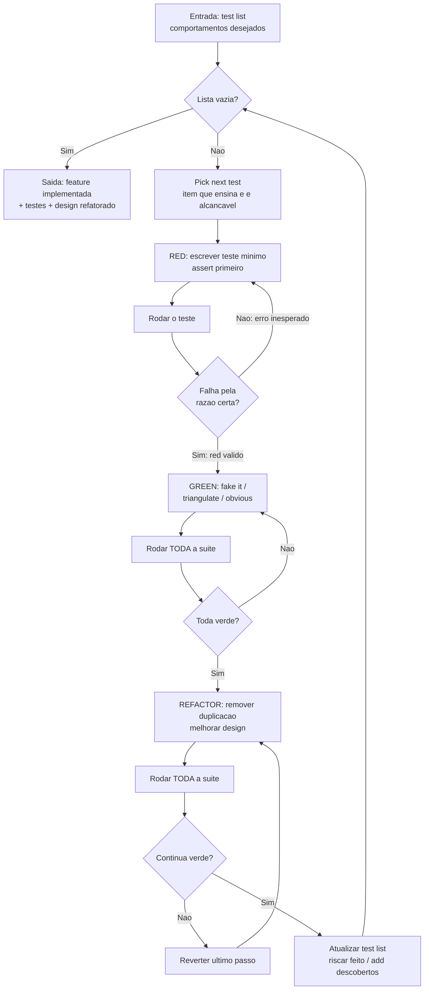

**Passo a passo**
1. **Entrada — test list.** Entrada: lista de comportamentos desejados. Saida: fila de trabalho.
2. **Pick next test.** Escolhe o item que ensina algo e e alcancavel em um passo. Saida: alvo do ciclo. *(decisao: tamanho do passo)*
3. **Red.** Escreve o teste minimo (assert primeiro, trabalha pra tras ate os inputs). Saida: teste novo.
4. **Rodar o teste / ver falhar pela razao certa.** Saida: red valido (falha coerente, nao erro de compilacao acidental).
5. **Green.** Faz passar do jeito mais simples — *fake it* (retorna constante), *triangulation* (segundo exemplo forca generalizar) ou *obvious implementation*. Saida: teste verde.
6. **Rodar toda a suite.** Saida: confirmacao de que nada quebrou.
7. **Refactor.** Remove duplicacao e smells mantendo verde (chama L2 internamente). Saida: design melhorado.
8. **Atualizar test list** e voltar ao passo 2 ate esvaziar.

**Gates**
- **G1 (red valido)** — `◇ Falha pela razao certa?` Nao → reescreve o teste (red invalido nao conta).
- **G2 (green)** — `◇ Toda a suite verde?` Nao → volta a implementar; nunca refatora sobre vermelho.
- **G3 (refactor seguro)** — `◇ Continua verde apos refatorar?` Nao → reverte o passo de refatoracao.
- **G4 (criterio de saida)** — `◇ Lista vazia?` Sim → entrega.

---

## L2 — Loop de Refatoracao Disciplinada (Fowler)

> Melhora a estrutura interna sem alterar o comportamento observavel, em passos atomicos sempre verdes. Two Hats: refatorar e adicionar feature sao chapeus separados — nunca no mesmo passo/commit.

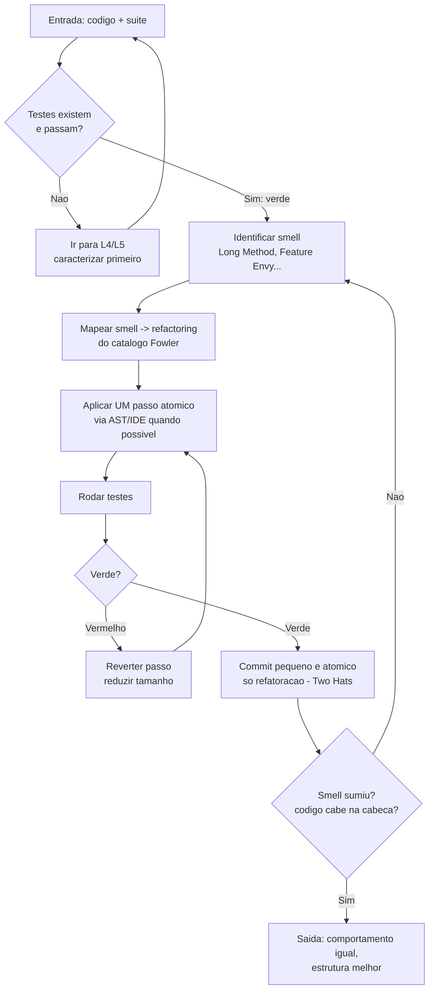

**Passo a passo**
1. **Garantir rede.** Entrada: codigo + suite. Saida: testes verdes. *(se nao ha cobertura → desvia para L4/L5)*
2. **Identificar smell.** Entrada: codigo. Saida: smell nomeado (Long Method, Feature Envy, Data Clumps, Shotgun Surgery...).
3. **Escolher refactoring.** Mapeia smell → tecnica de cura no catalogo. Saida: tecnica escolhida.
4. **Aplicar passo minusculo.** Uma transformacao atomica (Extract Function, Move Function...). Prefira AST/IDE. Saida: codigo alterado.
5. **Rodar testes.** Saida: verde/vermelho.
6. **Commit.** Commit pequeno e atomico, so de refatoracao. Saida: historico granular e reversivel.
7. **Repetir** ate o smell desaparecer.

**Gates**
- **G0 (rede de seguranca)** — `◇ Testes existem e passam?` Nao → vai para L4/L5 antes de tocar.
- **G1 (passo seguro)** — `◇ Verde?` Vermelho → reverte e reduz o passo (nunca empilha quebra).
- **G2 (Two Hats no commit)** — commit so de refatoracao; se ha teste de comportamento novo, e feature, nao refatoracao.
- **G3 (criterio de saida)** — `◇ Smell sumiu / cabe na cabeca?` Nao → novo ciclo.

---

## L3 — Ciclo "Tidy First?" (Beck)

> Decide *quando* arrumar: antes da mudanca (tidy first), depois (tidy after) ou registrar para depois (tidy later). Tidying = guard clause, explaining variable, dead code removal, normalizar simetrias — sempre com comportamento intacto e commit separado.

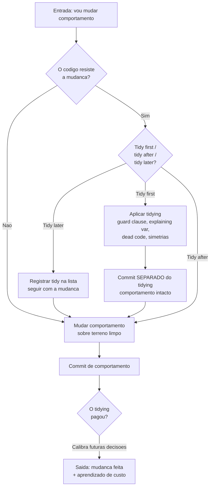

**Passo a passo**
1. **Detectar atrito.** Ao ir mudar comportamento, avalia se o codigo resiste. Entrada: intencao de mudanca.
2. **Decidir o momento do tidy.** *(decisao: tidy first / after / later)*
3. **Aplicar tidying** (se first/after). Saida: codigo mais legivel, comportamento inalterado.
4. **Commit separado** do tidying. Saida: revisao mais barata (diff de estrutura isolado do diff de comportamento).
5. **Mudar comportamento** sobre terreno limpo. Saida: feature/fix.
6. **Avaliar a economia.** O tidying compensou? Loop de aprendizado que calibra a decisao do passo 2 nas proximas vezes.

**Gates**
- **G1 (atrito)** — `◇ Codigo resiste?` Nao → muda direto, sem cerimonia.
- **G2 (momento)** — `◇ first/after/later?` decide a ordem; *later* nunca bloqueia a entrega.
- **G3 (commit limpo)** — tidying e comportamento NUNCA no mesmo commit (Two Hats aplicado a tidying).
- **G4 (feedback)** — `◇ O tidying pagou?` alimenta a heuristica futura (nao bloqueia).

---

## L4 — Legacy Code Change Algorithm (Feathers)

> Legacy = codigo sem testes. Para mudar com seguranca preciso de testes; para testar preciso quebrar dependencias. Este algoritmo resolve o no em 5 passos e, ao final, entra no loop de refatoracao (L2).

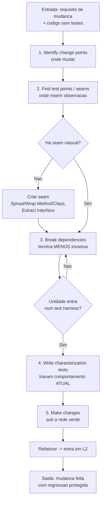

**Passo a passo**
1. **Identify change points.** Entrada: requisito + codigo. Saida: locais a alterar.
2. **Find test points / seams.** Onde alterar comportamento sem editar in-place (object/link/preprocessing seam). *(decisao: ha seam natural?)*
3. **Break dependencies.** Isola a unidade com a tecnica minima (Sprout/Wrap/Extract Interface/Parameterize/Extract-and-Override). Sub-laco ate a unidade rodar isolada. Saida: unidade testavel.
4. **Write characterization tests.** Captura o comportamento atual, mesmo "errado". Saida: rede de seguranca (ver L5).
5. **Make changes & refactor.** Muda protegido e entra em L2. Saida: mudanca com cobertura nova.

**Gates**
- **G1 (seam)** — `◇ Ha seam natural?` Nao → cria via Sprout/Wrap (nao mergulha no emaranhado).
- **G2 (isolamento)** — `◇ Unidade entra no harness?` Nao → continua quebrando dependencia (menos invasiva possivel).
- **G3 (rede antes de mudar)** — characterization tests verdes sao **pre-condicao** de qualquer mudanca de comportamento.

---

## L5 — Characterization Test / Golden Master (Feathers)

> Mecanica de criar a rede: o teste **revela** o comportamento real em vez de o especificar. Para outputs grandes, o Golden Master captura um baseline e compara diffs.

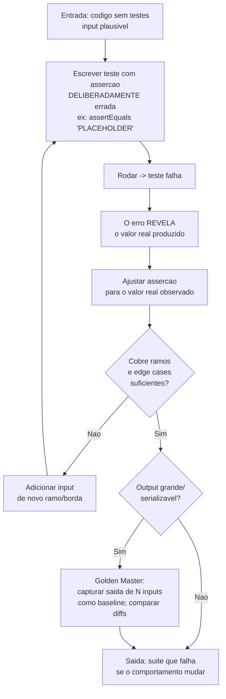

**Passo a passo**
1. **Teste com assercao errada de proposito.** Entrada: codigo + input plausivel. Saida: teste que falha.
2. **Rodar e ler o valor real** no output do erro.
3. **Ajustar a assercao** para o valor observado — documenta o que o codigo FAZ, nao o que deveria.
4. **Expandir** para ramos e edge cases ate sentir confianca.
5. **Golden Master** (outputs grandes): baseline de N inputs; diff vazio = comportamento preservado.

**Gates**
- **G1 (confianca de cobertura)** — `◇ Ramos/bordas suficientes?` Nao → adiciona caso.
- **G2 (estrategia de output)** — `◇ Output grande?` Sim → Golden Master por diff; Nao → assercoes pontuais.
- **G3 (merge)** — Golden Master **diff vazio** e condicao de merge (rastreavel, anti-regressao).

---

## L6 — Smell -> Pattern / Refactoring to Patterns (Kerievsky)

> Padroes sao **alvos de refatoracao**, nao decisao antecipada. Refatora-se *toward*, *away from* ou *toward an alternative* sob pressao de smells — e so se a abstracao resultante for mais profunda (esconde mais do que expoe).

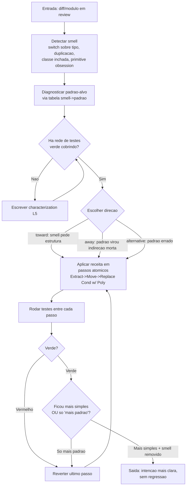

**Passo a passo**
1. **Detectar smell.** Entrada: codigo. Gatilhos: Switch sobre tipo, Conditional Complexity, Divergent Change, Shotgun Surgery.
2. **Diagnosticar padrao-alvo.** Ex.: conditional sobre tipo → Strategy/State; construcao complexa → Factory/Creation Method.
3. **Garantir rede.** Pre-condicao: testes verdes (senao, L5 primeiro).
4. **Escolher direcao.** *toward* / *away from* / *toward alternative*.
5. **Aplicar receita** em passos atomicos (a ponte mais usada: *Replace Conditional with Polymorphism*), rodando testes entre cada passo.
6. **Validar simplificacao.** Saida: smell removido E intencao mais clara.

**Gates**
- **G1 (rede)** — `◇ Testes verdes cobrindo?` Nao → caracteriza (L5).
- **G2 (passo seguro)** — `◇ Verde?` Vermelho → reverte.
- **G3 (gate de valor)** — `◇ Mais simples ou so mais padrao?` So mais padrao → **reverte** (a abstracao precisa ser *deep*, nao *shallow*).

---

## L7 — Selecao de padrao forward + gate anti-patternitis (GoF / YAGNI)

> O caminho *forward*: do problema ao padrao, com freio YAGNI. So aplica se ha variacao concreta **hoje** e a abstracao e mais profunda que o codigo direto. Inclui o gate de defesa contra overengineering.

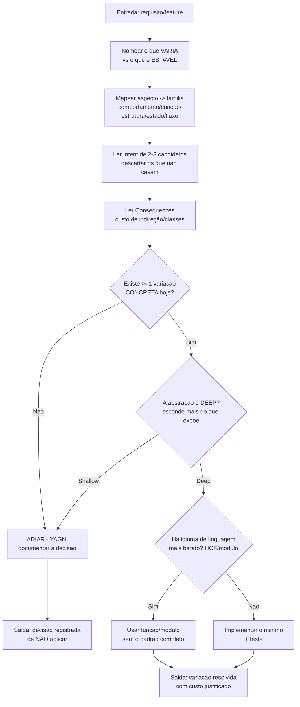

**Passo a passo**
1. **Nomear a forca de variacao.** O que muda vs. o que e estavel. Saida: aspecto que varia.
2. **Mapear aspecto → familia.** Comportamental / criacional / estrutural / estado / fluxo.
3. **Ler Intent** dos 2-3 candidatos; descartar os que nao casam o sintoma.
4. **Ler Consequences;** contabilizar custo (indireção, nº de classes, acoplamento).
5. **Gate YAGNI + deep.** *(decisoes abaixo)*
6. **Implementar o minimo** com o idioma mais barato (funcao > classe quando possivel) + teste.

**Gates**
- **G1 (YAGNI)** — `◇ >=1 variacao concreta hoje?` Nao → adia e documenta (anti Speculative Generality).
- **G2 (deep vs shallow)** — `◇ A abstracao e deep?` Shallow → nao vale; adia.
- **G3 (idioma barato)** — `◇ Ha HOF/modulo que resolve?` Sim → evita a cerimonia do padrao completo.
- **Gate anti-patternitis (em PR):** cada padrao presente suporta ≥1 variacao real em uso? Nenhuma interface com 1 implementacao especulativa? Nenhum Singleton mutavel global? A indireção **revela** a intencao? Falha → simplificar / refatorar *away*.

---

## L8 — Mikado Method (mudanca grande sem build quebrado)

> Para refatoracoes grandes: em vez de empilhar quebras, **reverte tudo** e ataca as folhas do grafo de dependencias, commitando cada folha verde na main. O codigo praticamente NUNCA fica quebrado.

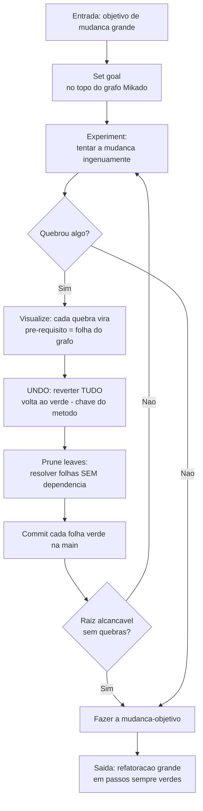

**Passo a passo**
1. **Set goal.** Escreve o objetivo no topo do grafo. Entrada: meta de mudanca.
2. **Experiment.** Tenta a mudanca de forma ingenua. Saida: lista de quebras.
3. **Visualize.** Cada quebra vira um pre-requisito (folha/filho no grafo).
4. **Undo.** Reverte TUDO — volta ao estado verde. *(este e o coracao do metodo)*
5. **Prune leaves.** Resolve primeiro as folhas sem dependencias; commit cada uma verde na main (sem branch longo).
6. **Subir a arvore** das folhas a raiz ate a mudanca-objetivo ser alcancavel sem quebrar.

**Gates**
- **G1 (descoberta)** — `◇ Quebrou algo?` Sim → registra como folha e **reverte tudo** (nunca conserta empilhando).
- **G2 (ordem)** — so se resolve folha **sem dependencia** pendente.
- **G3 (raiz)** — `◇ Raiz alcancavel sem quebras?` Nao → novo experiment; Sim → executa o objetivo.
- **Invariante:** o build/main fica verde apos cada commit (revert > empilhar quebra).

---

## L9 — PPP / Pseudocode Programming Process (McConnell)

> A ponte do design ao codigo: escreve pseudocodigo de alto nivel ("o que"), refina ate ~1 linha de pseudo por ~1 linha de codigo, e o pseudocodigo vira a estrutura/comentarios da rotina.

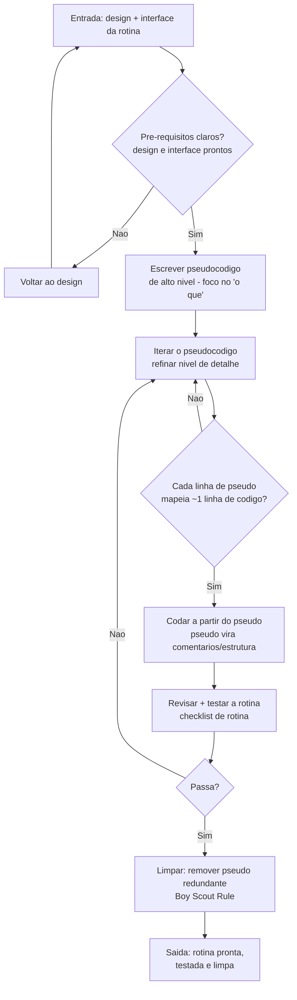

**Passo a passo**
1. **Pre-requisitos.** Confirma design e interface claros. *(decisao: pronto para codar?)*
2. **Pseudocodigo de alto nivel.** Linguagem natural, foco no "o que". Saida: esqueleto.
3. **Iterar.** Refina ate cada linha de pseudo mapear ~1 linha de codigo. Laço de refinamento.
4. **Codar a partir do pseudo.** O pseudocodigo vira comentarios/estrutura. Saida: rotina.
5. **Revisar e testar.** Checklist de rotina + testes. *(decisao: passa?)*
6. **Limpar.** Remove pseudo redundante, aplica Boy Scout Rule. Saida: rotina limpa.

**Gates**
- **G1 (design pronto)** — `◇ Pre-requisitos claros?` Nao → volta ao design (nao coda no escuro).
- **G2 (granularidade)** — `◇ ~1 pseudo : ~1 codigo?` Nao → continua refinando.
- **G3 (revisao/teste)** — `◇ Passa?` Nao → volta a iterar o pseudo/codigo.

---

## L10 — Design It Twice + comentar a interface antes de codar (Ousterhout)

> Antes de implementar, esboce **duas** abordagens radicalmente diferentes, compare profundidade/red flags, hibridize — e escreva o comentario de interface **antes** do corpo (se o comentario fica dificil/longo, a interface esta ruim: design check barato).

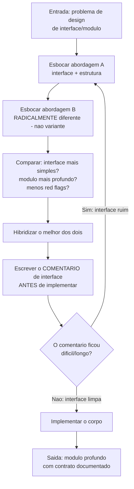

**Passo a passo**
1. **Abordagem A.** Esboca interface + estrutura. Entrada: problema de design.
2. **Abordagem B.** Esboca uma alternativa radicalmente diferente (nao uma variante).
3. **Comparar.** Qual tem interface mais simples / modulo mais profundo / menos red flags?
4. **Hibridizar** o melhor dos dois. Saida: design candidato.
5. **Comentar a interface ANTES de codar.** Saida: contrato escrito.
6. **Implementar** o corpo.

**Gates**
- **G1 (duas opcoes reais)** — B precisa ser **radicalmente** diferente; variante trivial nao conta.
- **G2 (comment-first check)** — `◇ Comentario dificil/longo?` Sim → a interface esta ruim, volta a desenhar (o comentario e o detector barato de interface rasa).

---

## L11 — Outside-In / Double Loop (GOOS)

> Dois loops aninhados: o externo dirige pela aceitacao (de fora pra dentro); o interno e o TDD unitario (L1). "Listen to the tests" — dor no teste e sinal de problema de design.

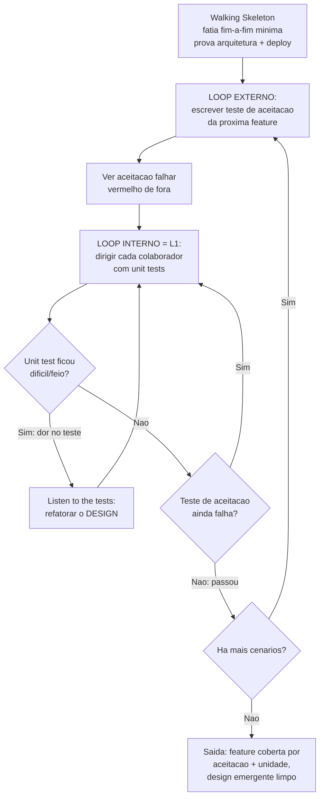

**Passo a passo**
1. **Walking Skeleton.** Fatia fim-a-fim minima que builda, roda e deploya. Saida: esqueleto que prova arquitetura + pipeline.
2. **Loop externo (aceitacao).** Escreve um teste de aceitacao da proxima feature; ve falhar.
3. **Loop interno (unidade = L1).** Dirige cada colaborador com unit tests, descobrindo interfaces.
4. **Listen to the tests.** Se um unit test ficou dificil/feio → refatora o design (nao forca o mock).
5. **Verificar aceitacao.** Ainda falha → mais ciclos internos; passou → proximo cenario.

**Gates**
- **G1 (sinal de design)** — `◇ Unit test dificil/feio?` Sim → refatora design (extrai Humble Object, inverte dependencia).
- **G2 (aceitacao)** — `◇ Aceitacao ainda falha?` Sim → continua loop interno; o teste externo e o criterio de "feito".
- **G3 (mais cenarios)** — `◇ Ha mais cenarios?` Sim → novo loop externo.

---

## L12 — Mutation Testing Loop (DeMillo / PIT / Stryker)

> Mede a qualidade da **suite**, nao do codigo: injeta mutantes e conta quantos a suite mata. Mutante sobrevivente = asserção fraca (test theatre) ou mutante equivalente (ignorar). Roda incremental no diff do PR para nao estourar o CI.

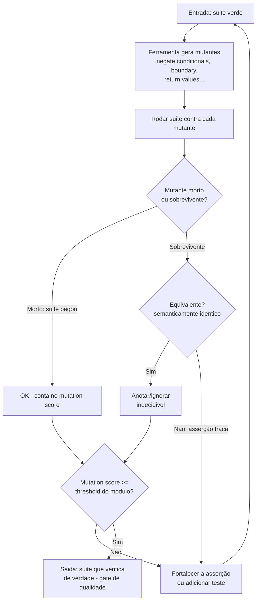

**Passo a passo**
1. **Entrada:** suite verde (baseline calculado uma vez localmente).
2. **Gerar mutantes** (operadores: negate conditionals, boundary, return values...).
3. **Rodar a suite** contra cada mutante. *(decisao: morto vs sobrevivente)*
4. **Triagem do sobrevivente:** equivalente → anota/ignora; asserção fraca → fortalece.
5. **Gate de score** por modulo (ex.: 80% em dominio critico; sem gate em glue). Em CI: incremental sobre o diff.

**Gates**
- **G1 (sobrevivente)** — `◇ Morto ou sobrevivente?` Sobrevivente → investiga.
- **G2 (equivalente)** — `◇ Mutante equivalente?` Sim → ignora (indecidivel); Nao → fortalece asserção.
- **G3 (threshold)** — `◇ Score >= threshold?` Nao → reforca testes; Sim → passa o gate.

---

## Loop mestre do agent de codigo

> Ciclo operacional unico que um agent de IA segue ao implementar codigo, combinando os loops acima: **entender → testar antes → implementar minimo → refatorar com rede → gate de qualidade → entregar**. Cada decisao reaproveita um dos loops L1–L12. A regra inviolavel: **nunca declara "Done" com suite vermelha ou sem teste novo**, e **edicao de refatoracao estrutural passa por engine AST quando possivel** (mitiga os ~7-8% de refatoracoes inseguras de LLM cru).

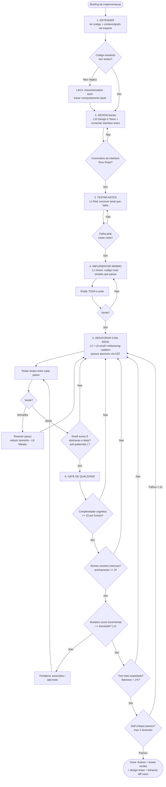

**Passo a passo do ciclo operacional**
1. **Entender.** Le codigo + contexto (grafo de impacto / RAG). *Achado de pesquisa: o agent se beneficia mais de contexto que de instrucao TDD seca.* Gate: codigo legado → L4/L5 antes.
2. **Design barato (L10).** Esboca, hibridiza, e escreve o comentario de interface ANTES. Gate: comentario limpo = interface boa.
3. **Testar antes (L1 Red).** Escreve o teste que falha pela razao certa.
4. **Implementar minimo (L1 Green).** Codigo mais simples que passa; suite toda verde.
5. **Refatorar com rede (L2 + L6).** Smell → refactoring → pattern em passos atomicos; vermelho → reverte (L8 Mikado). Gate: deep, nao shallow (anti-patternitis L7).
6. **Gate de qualidade.** Complexidade cognitiva ≤ 15; nomes-intencao; aninhamento ≤ 3; mutation score incremental ≥ threshold (L12); Two Hats; flakiness < 1%; self-critique adversarial (max 2 iteracoes).
7. **Done.** So com suite verde **e** teste novo **e** behavior diff vazio.

**Gates-mestre (resumo)**

| Etapa | Gate | Falha → |
|---|---|---|
| Entender | Codigo tem testes? | Nao → L4/L5 caracteriza |
| Design | Comentario de interface limpo? | Nao → redesenha (L10) |
| Testar antes | Red valido (falha pela razao certa)? | Nao → reescreve teste |
| Implementar | Suite toda verde? | Nao → ajusta implementacao |
| Refatorar | Verde apos cada passo? | Vermelho → reverte e reduz (L8) |
| Refatorar | Abstracao deep, smell removido? | Nao → continua / reverte padrao (L7) |
| Qualidade | Cognitiva ≤15, nomes, aninhamento ≤3 | Nao → refatora |
| Qualidade | Mutation score ≥ threshold | Nao → fortalece asserções (L12) |
| Qualidade | Two Hats + flakiness <1% + self-critique | Nao → corrige (max 2x) |
| Entrega | Suite verde + teste novo + diff vazio | Nao → **bloqueia "Done"** |

---

## Notas de fidelidade (honestidade intelectual)

- **Tensao L2/L7 vs decomposicao:** os loops usam "deep module" (Ousterhout) como criterio de saida da refatoracao — nunca limite de linha cego. Extrai por intencao e profundidade, nao por contagem. (Debate Martin × Ousterhout, vencido pragmaticamente por Ousterhout no design.)
- **TDD nao e dogma:** L1 e default para logica algoritmica/dominio; opcional para glue/UI. O inegociavel transversal e a **rede de testes existir antes do merge**, nao a coreografia exata.
- **Mutation > cobertura:** o gate de qualidade usa mutation score (sinal honesto), nao cobertura de linha (gamificavel / test theatre).
- **LLM cru e inseguro:** refatoracao estrutural do agent deve passar por engine AST validado (padrao RefactoringMirror) — characterization tests + behavior diff vazio sao a rede que torna refatoracao por IA confiavel.

---

## L13 — BDD / Specification by Example (Adzic / Smart)

> Transforma exemplos concretos de negocio em especificacao executavel e living documentation: Three Amigos derivam regras, Gherkin formaliza, ATDD automatiza, e o relatorio verde e o contrato vivo entre requisito e teste.

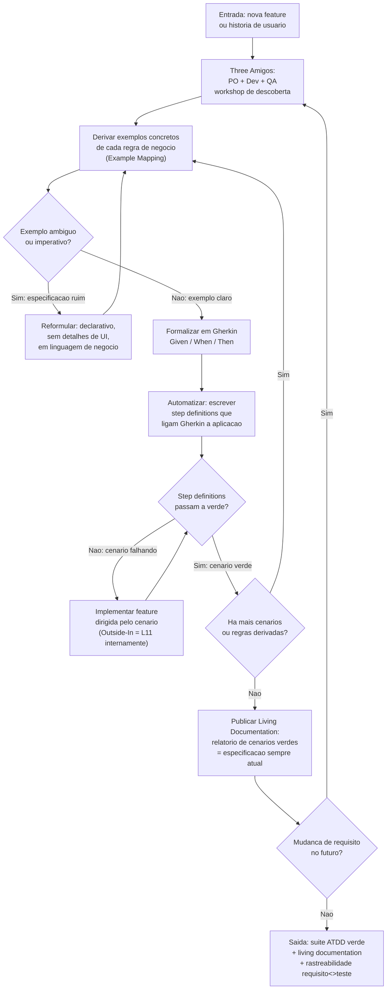

**Passo a passo**
1. **Three Amigos.** PO, Dev e QA reunidos antes de codar. Entrada: historia ou feature. Saida: regras de negocio + exemplos concretos + perguntas em aberto.
2. **Example Mapping.** Para cada regra, derivar pelo menos dois exemplos (happy path e borda). Gate: exemplo declarativo, em linguagem de negocio, sem referencia a UI ou a implementacao.
3. **Formalizar em Gherkin.** Converter cada exemplo em cenario Given/When/Then. Uma acao de negocio por cenario; sem conjuncoes (`E`) em demasia.
4. **Automatizar (step definitions).** Escrever o codigo que liga cada step ao sistema real. Saida: teste ATDD executavel.
5. **Implementar feature.** Cenario falhando dirige o loop Outside-In (L11) internamente. Laço ate o cenario ficar verde.
6. **Living Documentation.** Relatorio de cenarios verdes publicado automaticamente no CI. Cada mudanca re-executa e re-publica.

**Gates**
- **G1 (qualidade do exemplo)** — `◇ Exemplo ambiguo ou imperativo?` Sim → reformular antes de formalizar (imperative smell: menciona botao, URL, campo de tela).
- **G2 (cobertura de cenarios)** — `◇ Ha mais cenarios ou regras derivadas?` Nao → so entao implementar; cenario incompleto nao vai para o step 4.
- **G3 (verde ATDD)** — `◇ Step definitions passam?` Nao → implementar; cenario e o criterio de Done externo.
- **G4 (manutencao)** — `◇ Mudanca de requisito?` Sim → volta ao Three Amigos (nao edita Gherkin diretamente sem o workshop).

---

## L14 — Property-Based Testing (QuickCheck / Hypothesis / fast-check)

> Em vez de exemplos pontuais, especifica invariantes universais: o framework gera N casos aleatorios, encontra uma falha e aplica shrinking para reduzir ao menor contra-exemplo reproduzivel; o bug fixado vira seed permanente na suite.

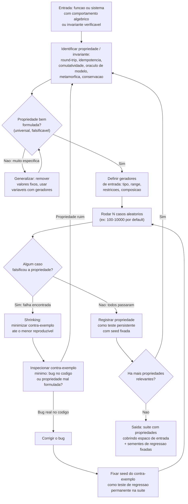

**Passo a passo**
1. **Identificar propriedade.** Entrada: funcao ou sistema. Padroes canonicos (QuickCheck / Hypothesis): round-trip (encode→decode = identidade), idempotencia (f(f(x)) = f(x)), comutatividade/associatividade, oraculo de modelo (implementacao simples vs. rapida), metamorfica (f(transform(x)) = transform(f(x))), conservacao (soma antes = soma depois). Saida: hipotese universal.
2. **Validar formulacao.** Gate: a propriedade e universal (vale para qualquer entrada valida) e falsificavel (ha contra-exemplos possiveis). Propriedade que sempre passa por construcao matematica nao testa nada.
3. **Definir geradores.** Tipo de dado, range, restricoes de dominio (ex.: inteiros positivos, strings nao vazias, listas de tamanho 1-100). Composicao de geradores para estruturas aninhadas.
4. **Rodar N casos.** O framework sorteia N entradas e verifica a propriedade em cada uma. Default: 100 casos; critico de seguranca: 1000+. Saida: PASS ou primeiro caso que falsifica.
5. **Shrinking.** Ao encontrar falha, o framework reduz o contra-exemplo ao minimo reproduzivel (remove elementos, diminui valores) ate nao conseguir reduzir mais. Saida: menor entrada que provoca o bug.
6. **Diagnosticar.** Propriedade mal formulada → reformular (passo 1). Bug real → corrigir e fixar a seed como teste de regressao permanente.
7. **Integrar.** Propriedades aprovadas entram na suite normal; seeds de contra-exemplos passados sao re-executadas em cada CI run (anti-regressao).

**Gates**
- **G1 (formulacao)** — `◇ Propriedade universal e falsificavel?` Nao → generalizar; propriedade trivial e teatro.
- **G2 (falha encontrada)** — `◇ Algum caso falsificou?` Sim → shrinking obrigatorio antes de diagnosticar (nunca debugar o caso grande).
- **G3 (diagnostico)** — `◇ Bug real ou propriedade ruim?` Propriedade ruim → reformular (nao tentar workaround na implementacao). Bug real → corrigir e fixar seed.
- **G4 (regressao)** — seed do contra-exemplo fixada na suite: um bug property-based encontrado **nunca** pode regredir silenciosamente.

---

## L15 — Branch by Abstraction em nivel de codigo (Fowler / Lemaire)

> Para substituir um componente grande sem big-bang: cria uma abstracao (interface/camada) sobre o que vai mudar, aponta todos os clientes para ela, implementa o substituto por tras de feature flag, compara em parallel run e migra gradualmente ate remover o componente antigo.

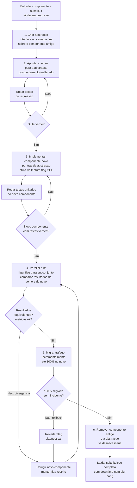

**Passo a passo**
1. **Criar abstracao.** Entrada: componente a substituir em producao. Escreve interface ou camada fina que o componente antigo implementa imediatamente. Saida: contrato estavel.
2. **Apontar clientes.** Todos os chamadores passam a depender da abstracao, nao do concreto antigo. Gate: suite verde antes de avancar.
3. **Implementar o novo por tras da flag.** O novo componente fica oculto atras de feature flag OFF. Saida: codigo dual — antigo operando, novo existindo mas silencioso.
4. **Parallel run.** Liga a flag para subconjunto de trafego; executa antigo e novo lado a lado; compara resultados. Gate: resultados equivalentes e metricas de negocio/performance ok.
5. **Migrar gradualmente.** Aumenta o peso da flag ate 100% no novo. Em cada incremento: observar alertas, manter rollback disponivel.
6. **Remover o antigo.** Com 100% migrado e estavel, apaga o componente antigo e, se nao mais necessaria, a propria abstracao. Saida: codigo mais simples.

**Gates**
- **G1 (rede antes de apontar)** — `Suite verde?` Nao → corrige o apontamento dos clientes (nao adianta seguir com regressao).
- **G2 (novo testado isolado)** — `Novo componente com testes verdes?` Nao → implementa mais antes de ligar a flag.
- **G3 (parallel run)** — `Resultados equivalentes?` Nao → corrige e mantém a flag restrita; jamais expande trafego com divergencia.
- **G4 (100% migrado)** — `Incidente no rollout?` Sim → reverte flag (rollback instantaneo sem deploy); diagnostica antes de retomar.
- **Invariante:** o componente antigo fica em producao e funcional em CADA etapa; nunca ha janela sem comportamento servido.

---

## L16 — Database refactoring com transition period (Ambler / Sadalage)

> Schema de banco e o legado mais dificil: consumidores externos dependem das colunas por nome. A tecnica mantem schema antigo e novo coexistindo, sincronizados por triggers ou views, durante uma janela de deprecacao; so entao remove o antigo.

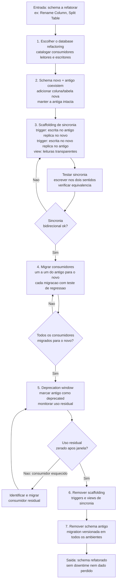

**Passo a passo**
1. **Escolher o refactoring e mapear consumidores.** Entrada: schema atual. Cataloga todos os leitores e escritores (apps, jobs, scripts, relatorios) da entidade a mudar. Saida: mapa de impacto.
2. **Adicionar o schema novo sem remover o antigo.** Ex.: Rename Column → adiciona coluna nova com o nome correto; a coluna antiga permanece. Saida: schema dual.
3. **Scaffolding de sincronia.** Cria triggers (INSERT/UPDATE em ambos sentidos) e views que tornam leituras transparentes. Saida: os dois schemas em sincronia bidirecional.
4. **Migrar consumidores incrementalmente.** Cada app/job migrado para o schema novo e validado com teste de regressao antes do proximo. Saida: cada consumidor usando o novo.
5. **Deprecation window.** Marca o schema antigo como deprecated; monitora uso residual por metrica (query analyzer, logs). Janela tipica: 1 sprint a varias semanas conforme risco.
6. **Remover scaffolding.** Triggers e views de sincronia sao removidos quando ninguem mais usa o antigo.
7. **Remover o schema antigo.** Migration versionada (numerada) aplicada em dev → staging → producao. Saida: schema limpo.

**Gates**
- **G1 (sincronia bidirecional)** — `Sincronia ok?` Nao → corrige triggers antes de migrar qualquer consumidor (consumidor migrando com sincronia quebrada = dados inconsistentes).
- **G2 (cada consumidor)** — `Todos migrados?` Nao → continua migrando um a um; nunca remove o antigo com consumidor vivo.
- **G3 (uso residual)** — `Uso zerado?` Nao → identifica e migra o consumidor esquecido antes de fechar a janela.
- **G4 (migracao versionada)** — o script de remocao do antigo e numerado e idempotente; roda em todos os ambientes na mesma ordem.
- **Invariante:** dados nao sao perdidos em nenhuma etapa; rollback e possivel ate o passo 6 (reativar triggers, nao servir do antigo).

---

## L17 — Composicao de padroes POSA top-down (Buschmann / GoF / idiomas)

> Padroes existem em tres niveis de granularidade (arquitetural / design / idioma). O fluxo correto e top-down: escolhe o padrao arquitetural que realiza os requisitos de sistema, deriva os design patterns que realizam cada componente, desce aos idiomas da linguagem-alvo, e verifica consistencia vertical entre os tres niveis — com gate anti-patternitis em cada descida.

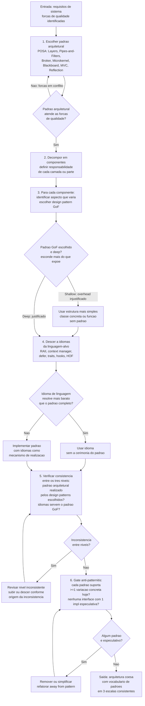

**Passo a passo**
1. **Escolher padrao arquitetural.** Entrada: requisitos + forcas de qualidade (modificabilidade → Layers; processamento de fluxo → Pipes-and-Filters; extensibilidade → Microkernel; distribuicao → Broker; aprendizado emergente → Blackboard; interface interativa → MVC). Saida: padrao arquitetural + consequencias documentadas.
2. **Decompor em componentes.** Para cada parte do padrao arquitetural (ex.: camada de apresentacao, dominio, dados em Layers), define responsabilidade clara. Saida: mapa de componentes.
3. **Escolher design pattern GoF por componente.** Para cada componente, identifica o aspecto que varia (comportamento → Strategy/Observer; criacao → Factory; estrutura → Decorator/Adapter; estado → State). Gate deep: a abstracao esconde mais do que expoe? Se shallow, usa estrutura simples.
4. **Descer a idiomas.** Para cada design pattern, verifica se um idioma da linguagem-alvo resolve o problema de forma mais barata (ex.: HOF substitui Strategy em linguagem funcional; context manager realiza RAII em Python; decorator sintatico realiza Decorator GoF em Python/TypeScript).
5. **Verificar consistencia vertical.** Os idiomas realizam os design patterns? Os design patterns realizam o padrao arquitetural? Se ha inconsistencia em algum nivel, revisa o nivel de origem.
6. **Gate anti-patternitis.** Para cada padrao nos tres niveis: existe variacao concreta hoje que o justifica? Ha interface com uma unica implementacao especulativa? Se sim, remove ou simplifica (refatora away from pattern).

**Gates**
- **G1 (forcas atendidas)** — `Padrao arquitetural atende as forcas?` Nao → escolhe outro (ex.: Pipes-and-Filters tem processamento sequencial obrigatorio — se a ordem nao e deterministica, Blackboard e melhor).
- **G2 (deep vs shallow no GoF)** — `Padrao GoF e deep?` Shallow → usa estrutura simples; overhead de indireção nao justificado.
- **G3 (idioma mais barato)** — `Idioma resolve mais barato?` Sim → usa o idioma sem o padrao completo; menos cerimonia, mesmo resultado.
- **G4 (consistencia vertical)** — `Inconsistencia entre niveis?` Sim → revisa o nivel de origem da inconsistencia (nao forca o nivel inferior a compensar decisao ruim no superior).
- **G5 (anti-patternitis)** — `Algum padrao especulativo?` Sim → remove (YAGNI aplicado a todos os tres niveis).
