# LOOPS Onda 10 — Frontend & Web Platform

Os loops operacionais da camada de **frontend e web platform** — destilados dos domínios 38-42 em diagramas de fluxo prontos pra virar comportamento de agent. Da escolha da estratégia de rendering ao pipeline do browser, da otimização de LCP/INP à auditoria de acessibilidade, do layout fluido sem overflow à tipografia com clamp.

## Índice dos loops

- **W1-W3** — Frontend Architecture & Rendering (estratégia de rendering, gestão de estado, waterfall de fetch)
- **W4-W6** — Web Platform & Browser Internals (pipeline de rendering, event loop, layout thrashing)
- **W7-W9** — Web Performance & Core Web Vitals (otimizar LCP, reduzir INP, budget no CI)
- **W10-W12** — Accessibility & Inclusive Design (auditoria WCAG, decisão de ARIA, gestão de foco)
- **W13-W15** — CSS Architecture & Layout (layout fluido sem overflow, tipografia fluida, metodologia CSS)

---

## W1 — Escolher estratégia de rendering (CSR/SSR/SSG/ISR/RSC/islands)

> A escolha entre as estratégias de rendering é decisão de produto (SEO, frescor de dados, interatividade), não de framework.

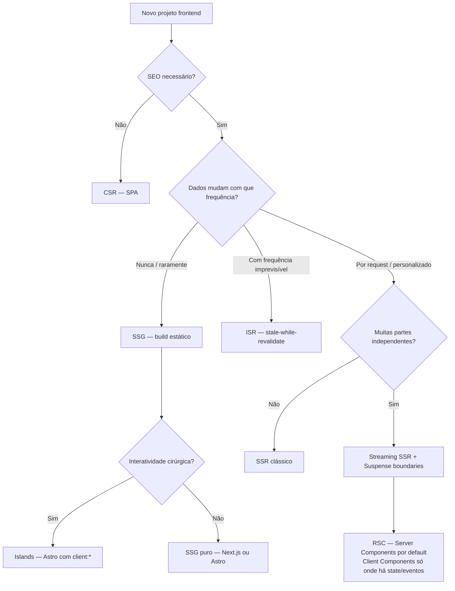

---

## W2 — Decisão de gestão de estado

> Roteia o estado pela origem: server-state vai pro TanStack Query (cache + invalidação), UI local fica em useState, e só o compartilhado vira store global mínima.

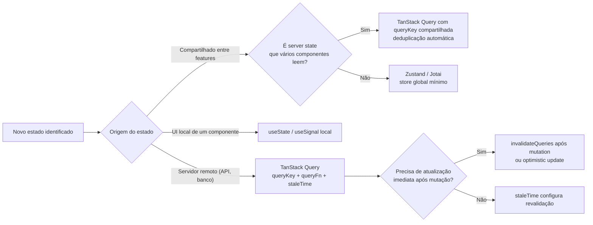

---

## W3 — Eliminar waterfall de data fetching

> Detecta fetches independentes que estão em série (waterfall acidental) e os paraleliza, com Suspense boundaries separados e prefetch na intenção de navegar.

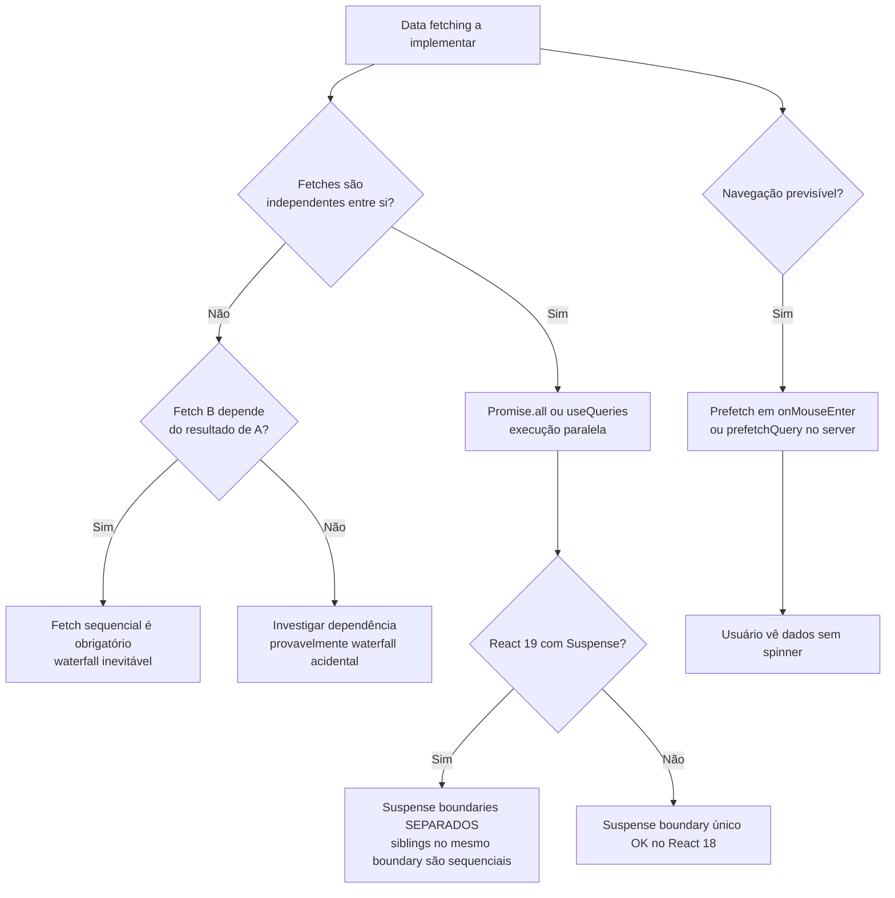

---

## W4 — Pipeline de rendering do browser

> Do byte HTML ao pixel: parse → DOM/CSSOM → render tree → layout → paint → composite. Saber onde cada mudança reverbera evita reflows caros.

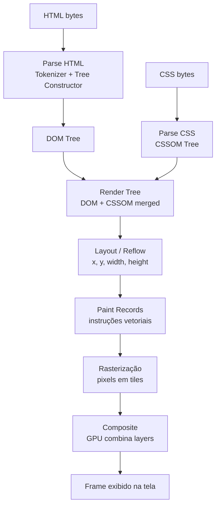

---

## W5 — Não bloquear a main thread (event loop)

> O event loop coordena tasks, microtasks, rAF e idle work. Trabalho pesado vai pra Web Worker ou requestIdleCallback pra manter 60fps.

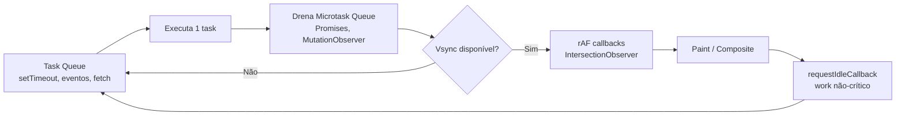

---

## W6 — Evitar layout thrashing (batch read/write)

> Agrupa todas as leituras de geometria antes das escritas de estilo, eliminando o forced synchronous layout que mata a performance.

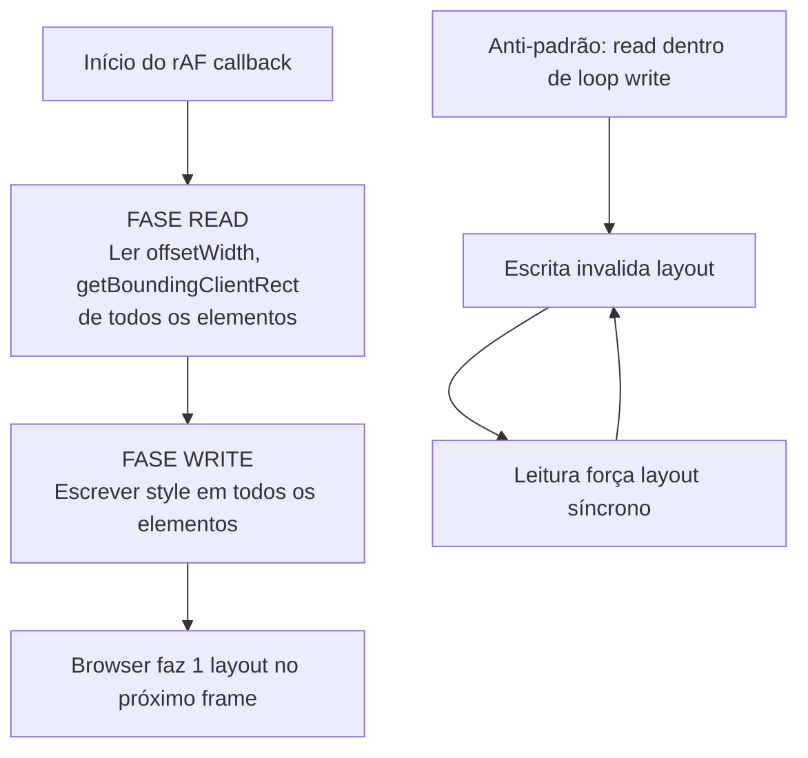

---

## W7 — Otimizar LCP (passo a passo)

> Mede o LCP no campo (P75), identifica o elemento e a sub-parte dominante (TTFB / load delay / load duration / render delay) e ataca a causa certa.

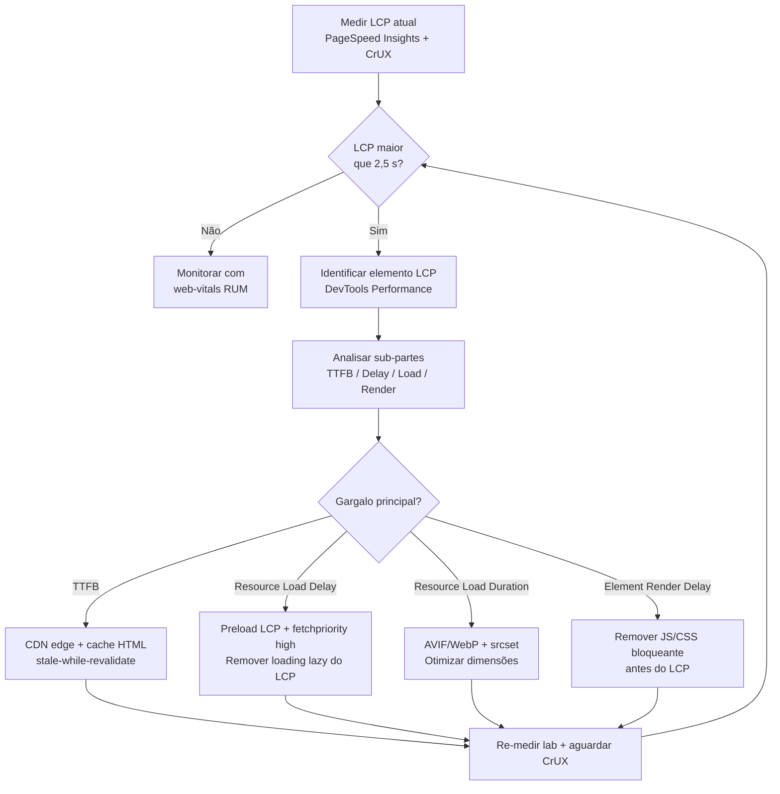

---

## W8 — Reduzir INP (interatividade)

> Identifica a interação mais lenta e otimiza a fase dominante: input delay (quebrar long tasks), processing (enxugar handler) ou presentation (evitar thrashing).

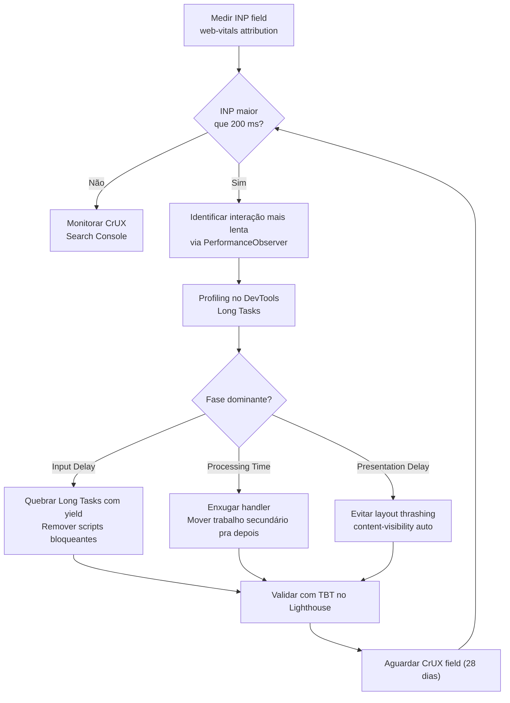

---

## W9 — Orçamento de performance no CI

> Define budgets (LCP, TBT, KB de bundle) e trava o deploy com size-limit + Lighthouse CI — regressão de performance vira build vermelho.

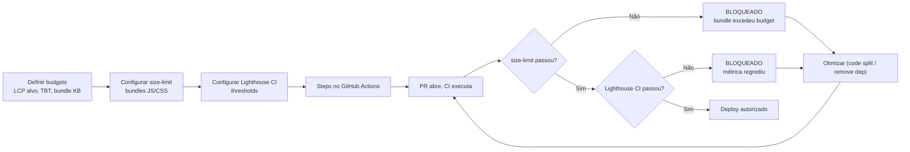

---

## W10 — Auditoria WCAG de uma página (3 camadas)

> Automação (axe/Lighthouse) pega ~30%; teclado pega foco e operabilidade; screen reader confirma nome/role/estado. As três camadas se completam.

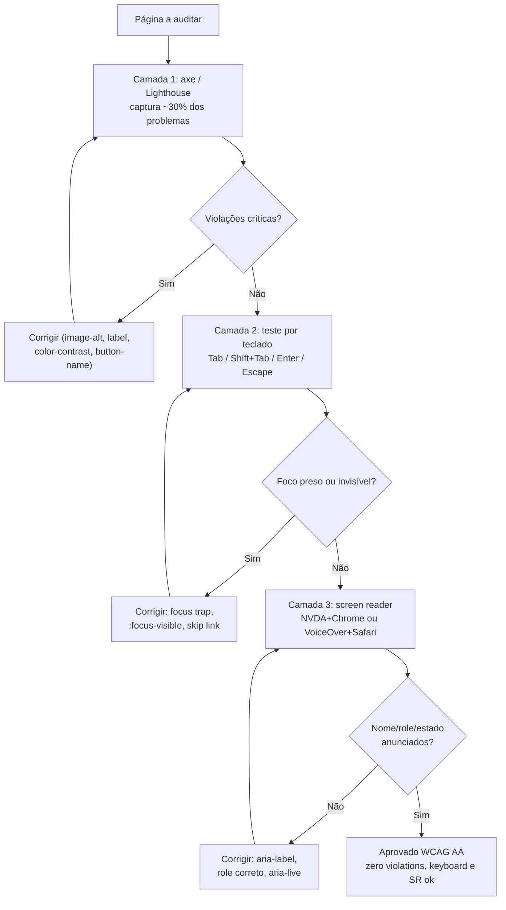

---

## W11 — Decisão de uso de ARIA (HTML semântico primeiro)

> A primeira regra do ARIA é não usar ARIA: se existe elemento nativo, use-o. ARIA entra só como complemento ou em padrões custom do APG.

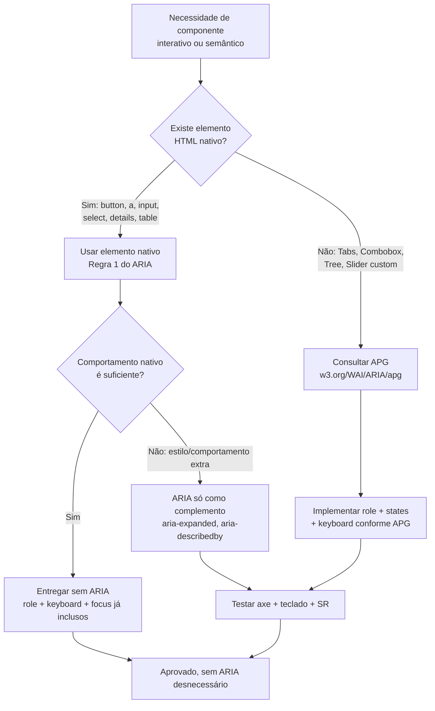

---

## W12 — Gestão de foco em componente modal

> Abrir salva o trigger e move o foco pro modal; trap prende o Tab dentro; fechar restaura o foco ao trigger. É o padrão APG Dialog.

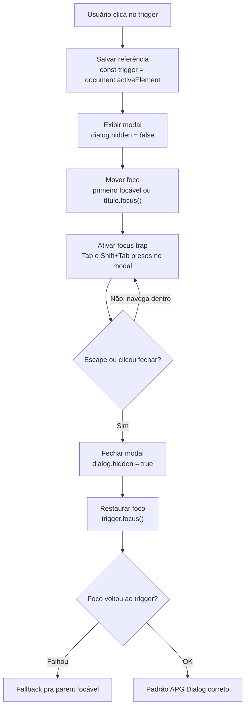

---

## W13 — Layout fluido sem overflow (mobile → desktop)

> Audita o overflow horizontal, aplica box-sizing + img max-width, troca larguras fixas por min()/clamp() e valida com screenshot a 320px.

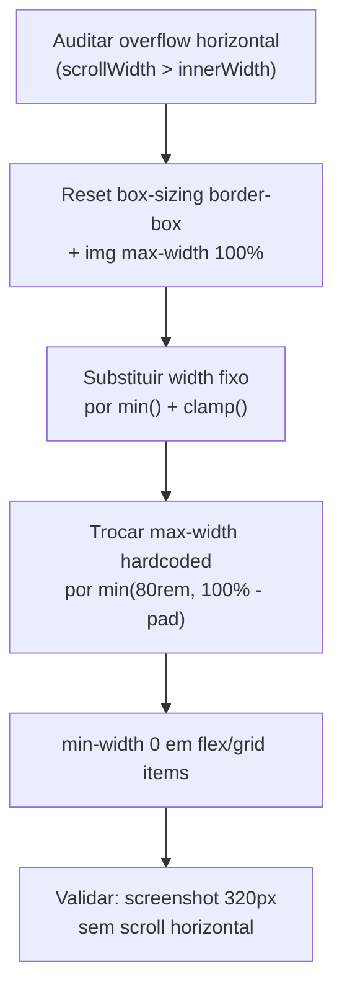

---

## W14 — Tipografia fluida com clamp (sem dead-zone)

> Gera a escala fluida (Utopia) entre viewport mín/máx, garante que nenhum step de headline cai na dead-zone 32-48px e declara tokens `--step-N` via clamp.

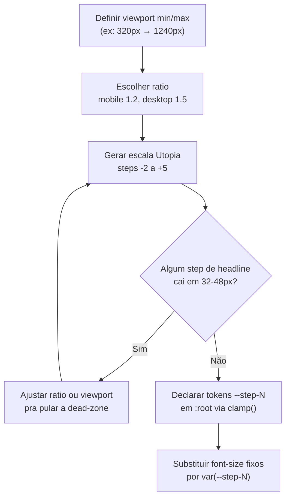

---

## W15 — Escolher metodologia de arquitetura CSS

> Roteia entre CUBE, ITCSS+BEM e utility-first/Tailwind conforme existência de design system, tamanho do time e framework.

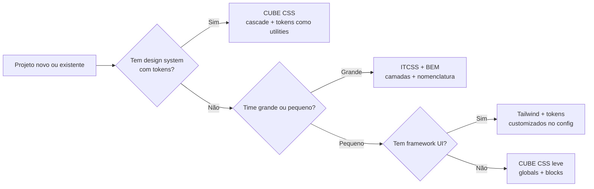

---

## W16 — Diagnosticar e corrigir CLS

> Identifica a causa raiz do layout shift (imagem sem dimensões, fonte com FOUT, banner injetado, conteúdo dinâmico acima do fold) e aplica o fix correto para cada origem, validando com CrUX até atingir CLS ≤ 0,1.

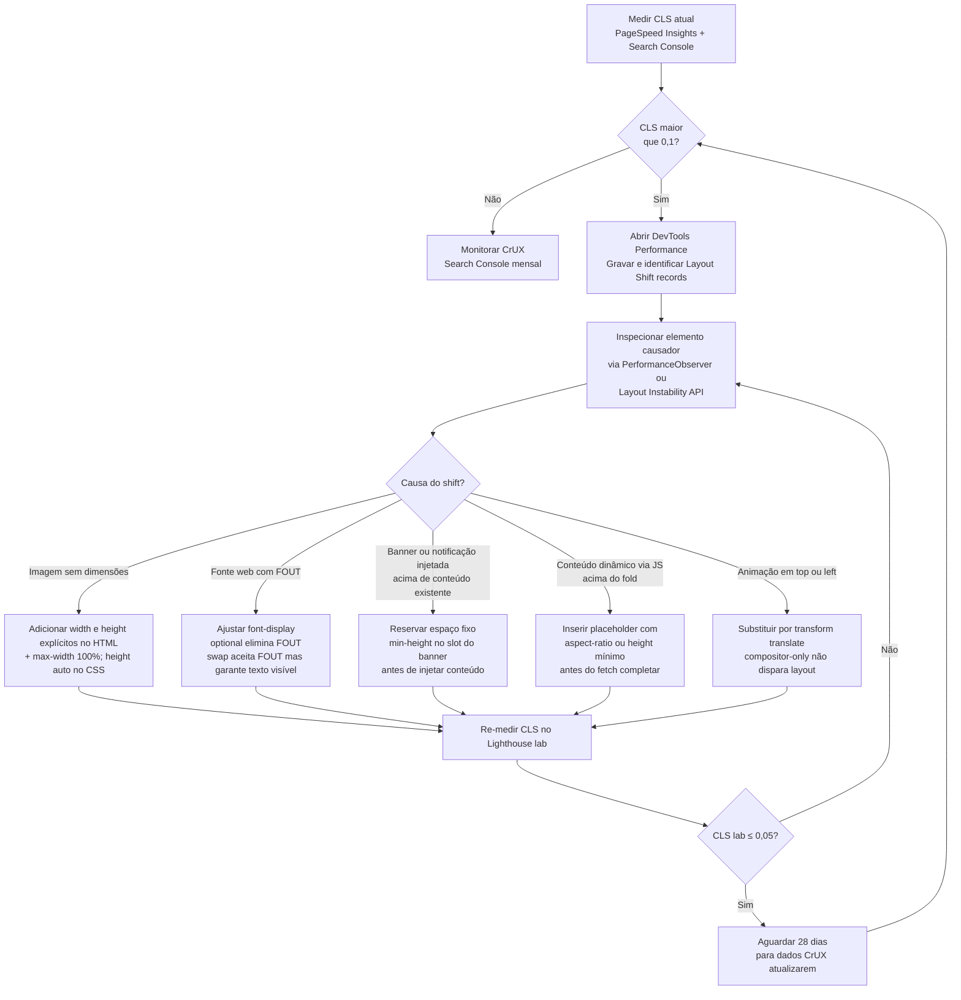

---

## W17 — Service Worker: registrar, escolher estratégia e invalidar cache

> Registra o SW, roteia cada tipo de recurso para a estratégia de cache correta (cache-first para assets com hash, network-first para APIs, stale-while-revalidate para dados secundários, network-only para transações), versiona o cache e invalida no activate para evitar servir respostas obsoletas.

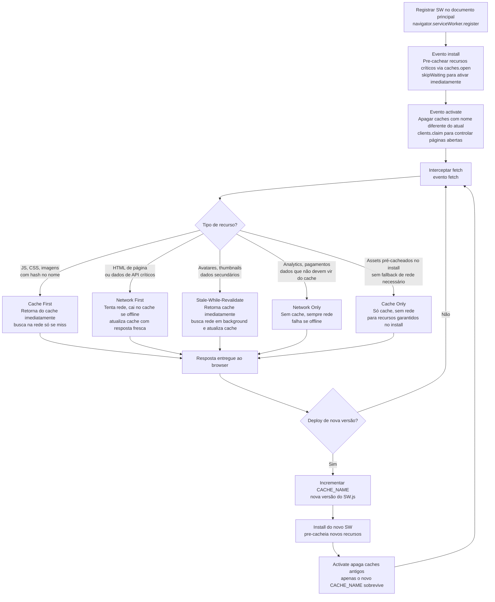
