# LOOPS Onda 11 — Design Systems, Motion & Product Craft

Os loops operacionais da camada de **design systems, motion e craft de produto** — destilados dos domínios 43-47 em diagramas de fluxo prontos pra virar comportamento de agent. Da arquitetura de tokens à API de componente, do teste de usabilidade à escala tipográfica, da timeline GSAP à estrutura de uma LP de alta conversão.

## Índice dos loops

- **W1-W3** — Design Systems Engineering (tokens 3 camadas, API de componente, design-to-code)
- **W4-W6** — UX Research & Interaction Design (continuous discovery, teste de usabilidade, avaliação heurística)
- **W7-W9** — Visual & Brand Systems (escala tipográfica, sistema de cor, composição com Gestalt)
- **W10-W12** — Motion, Animation & Creative Coding (justificar animação, timeline GSAP, scroll-driven)
- **W13-W15** — Conversion & Persuasion Engineering (estruturar LP, diagnosticar fricção, prova social ética)

---

## W1 — Arquitetura de tokens (primitivo → semântico → componente)

> Estrutura os tokens em 3 camadas e trava o gate: nenhum componente consome primitivo direto — só token semântico, pra theming e rebrand não quebrarem.

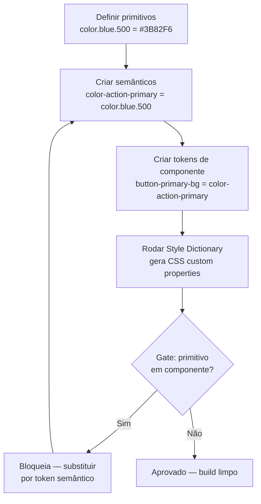

---

## W2 — Desenhar API de componente (configuração vs composição)

> Decide a API pública pela variabilidade de conteúdo: props simples, compound components com context, ou slots nomeados — com story cobrindo os estados reais.

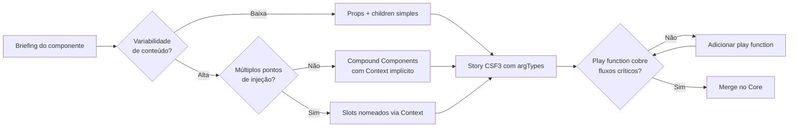

---

## W3 — Pipeline design-to-code

> Fecha o loop Figma → tokens JSON → Style Dictionary → código → Storybook → Chromatic, com gate de regressão visual no CI.

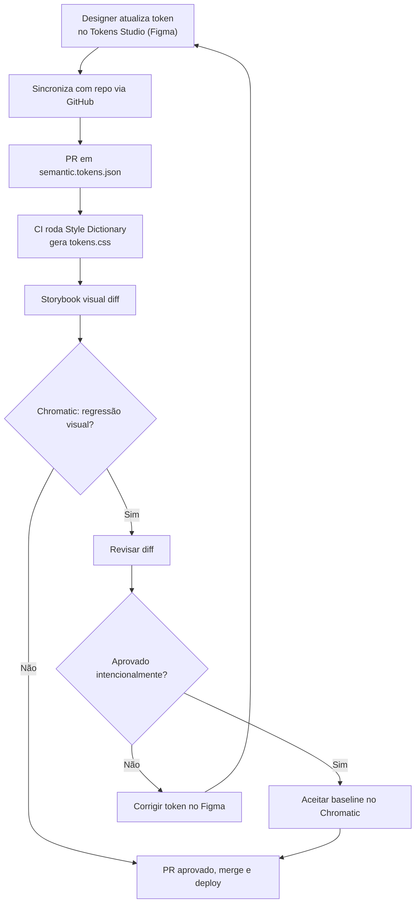

---

## W4 — Continuous discovery (opportunity solution tree)

> Cadência semanal de entrevistas alimentando a árvore de oportunidades, com teste das assumptions críticas antes de construir qualquer solução.

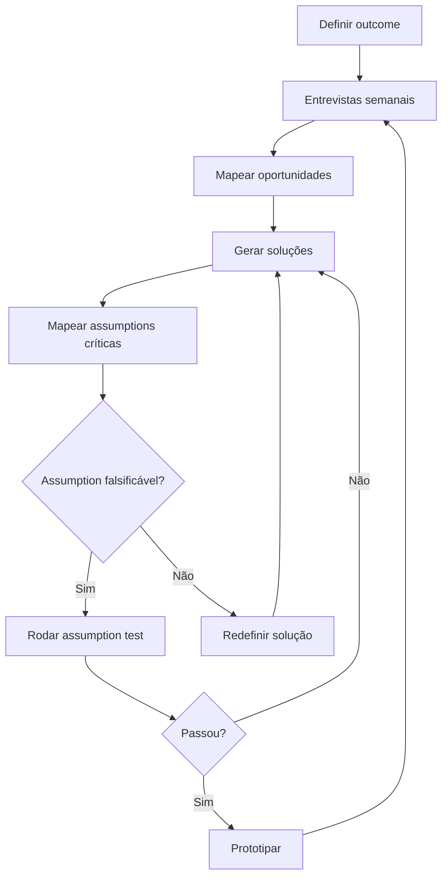

---

## W5 — Teste de usabilidade iterativo

> 5 usuários da persona primária por rodada (pegam ~85% dos problemas), think-aloud, síntese por severidade, corrige e repete.

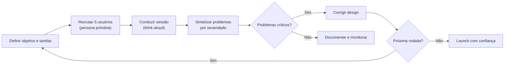

---

## W6 — Avaliação heurística de Nielsen

> 3-5 especialistas inspecionam a interface independentemente com as 10 heurísticas, consolidam e priorizam por severidade.

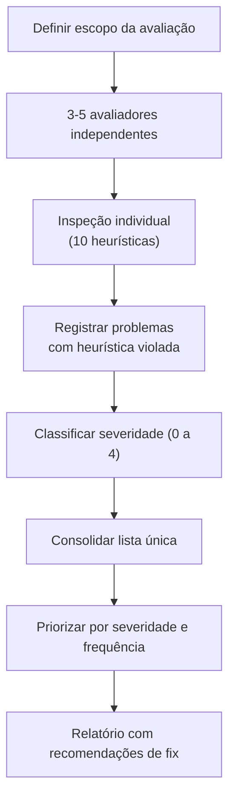

---

## W7 — Construir escala tipográfica e ritmo vertical

> Escala modular fluida com clamp() entre viewport mín/máx, fugindo da dead-zone 32-48px, com leading por papel e medida em ch.

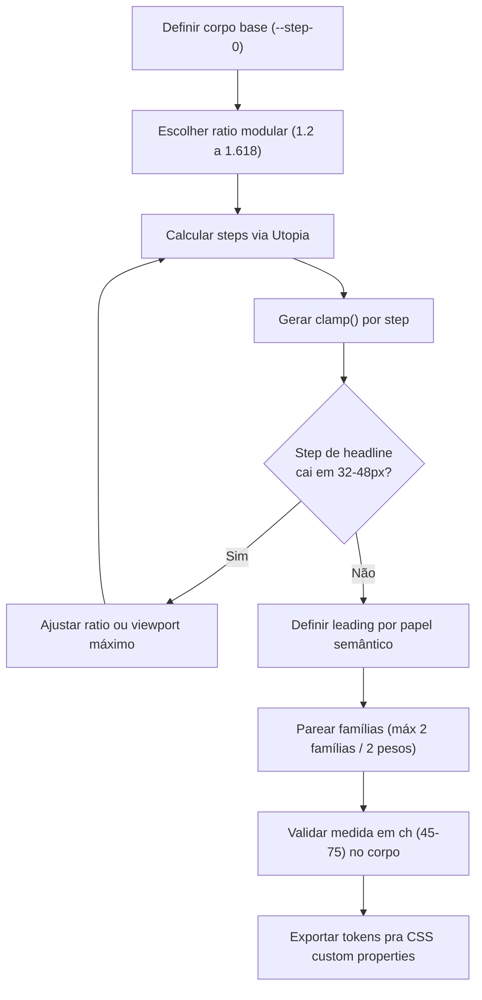

---

## W8 — Sistema de cor (primitivo → semântico → funcional)

> Constrói as escalas neutra e de acento, mapeia semânticos e funcionais sobre primitivos, e valida contraste WCAG AA em contexto real (não em swatch isolado).

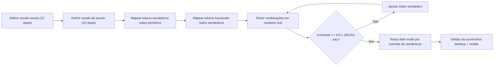

---

## W9 — Composição com hierarquia visual e Gestalt

> Define grid tipográfico, força assimetria intencional sobre simetria trivial, aplica Gestalt (proximidade, figura-fundo) e adiciona identity layer (grain, `#0A0A0A` não `#000`).

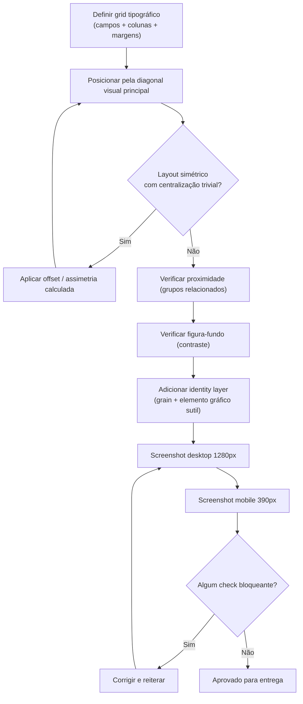

---

## W10 — Decidir se uma animação se justifica

> Toda animação passa pelo filtro "o que o usuário aprende com isso?": se não comunica estado/feedback/hierarquia, é decoração e sai. E sempre respeita prefers-reduced-motion.

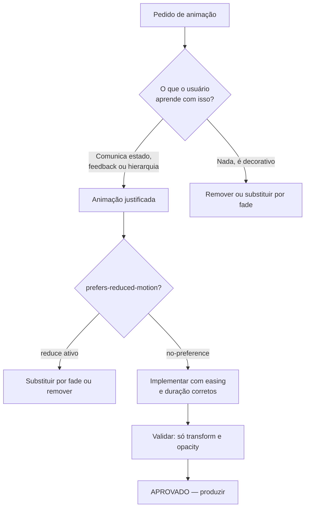

---

## W11 — Construir timeline GSAP com easing e stagger

> Orquestra a sequência por hierarquia visual (herói primeiro), usa defaults de duração/ease, position parameter e stagger espacial, validando 60fps e reduced-motion.

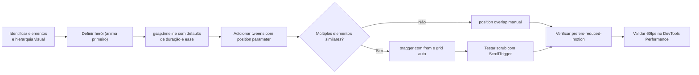

---

## W12 — Scroll-driven animation com performance

> Escolhe CSS scroll-driven nativo ou GSAP ScrollTrigger pela necessidade de suporte, com feature detection e fallback para prefers-reduced-motion.

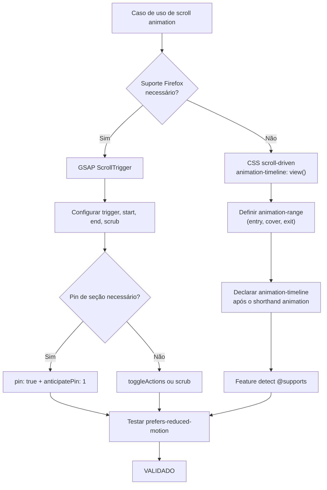

---

## W13 — Estruturar uma LP de alta conversão

> Da proposta de valor (resultado, não feature) às objeções e prova, escreve copy na voz do cliente, distribui sinais de confiança e valida no teste dos 5 segundos.

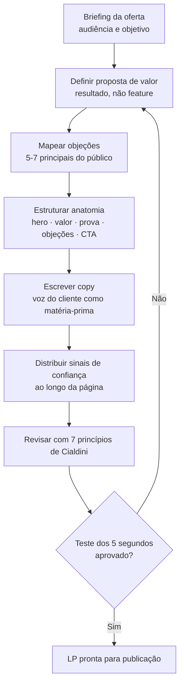

---

## W14 — Diagnosticar fricção no funil (Fogg B=MAP)

> Acha a etapa de maior queda e diagnostica qual variável faltou — motivação, habilidade ou prompt — atacando preferencialmente a fricção (habilidade), a alavanca mais confiável.

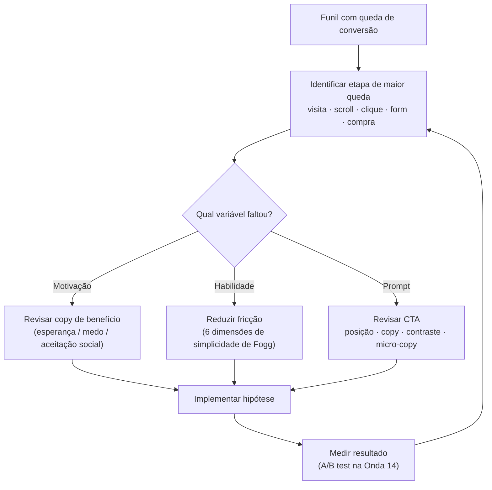

---

## W15 — Aplicar prova social e gatilhos de Cialdini com ética

> Coleta material real (depoimento com resultado + foto + cargo), distribui os gatilhos por seção e passa pelo checklist ético de Brignull — escassez real, nada de dark pattern.

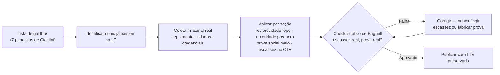

---

## W16 — Decisão e parametrização de spring physics

> Decide quando spring supera cubic-bezier (interrupções, inputs rápidos, peso percebido) e parametriza stiffness/damping/mass para o perfil de personalidade da marca — duração emergente, nunca fixada — validando com prefers-reduced-motion.

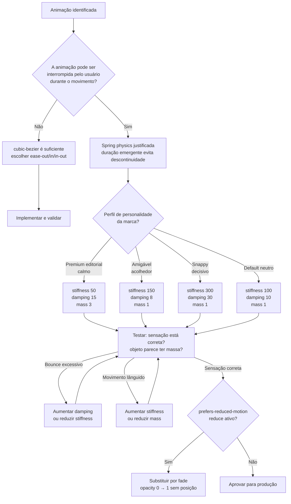

---

## W17 — Escalar para WebGL e Three.js

> Decide quando WebGL se justifica (efeitos impossíveis em CSS), configura a cena com os cinco primitivos, cria ShaderMaterial com uniforms de tempo e mouse, fecha o loop rAF — com fallback 2D se GPU indisponível, prefers-reduced-motion e gate de 60fps.

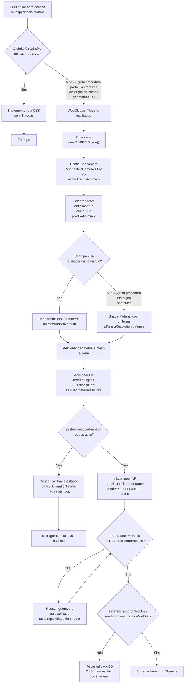
