# LOOPS Onda 12 — Data, Analytics & ML Engineering

Os loops operacionais da camada de **dados, analytics e ML** — destilados dos domínios 48-51 em diagramas de fluxo prontos pra virar comportamento de agent. Do pipeline ELT idempotente ao star schema dimensional, do ciclo de vida de ML ao data contract de PII.

## Índice dos loops

- **W1-W3** — Data Engineering & Pipelines (ELT idempotente, batch vs streaming, gate de qualidade)
- **W4-W6** — Data Modeling & Analytics Engineering (star schema, SCD, pipeline dbt com testes)
- **W7-W9** — ML Engineering & MLOps (ciclo de vida ML, data drift, feature store sem skew)
- **W10-W12** — Data Governance, Lineage & Privacy (data contract, proteger PII, lineage de métrica)

---

## W1 — Pipeline ELT idempotente (ingestão → transformação → serving)

> Sequência completa com camada raw imutável, gate de data contract e transformações via UPSERT — reprocessável sem duplicar.

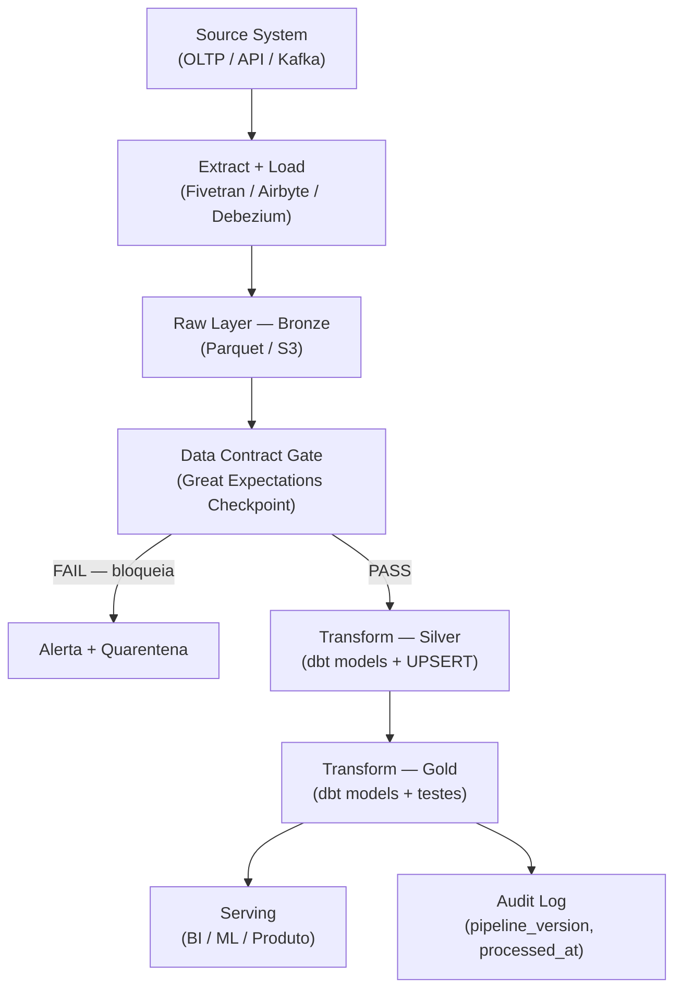

---

## W2 — Escolher batch vs streaming (Lambda/Kappa)

> Gate de decisão arquitetural pela latência exigida: streaming, micro-batch, batch ou as arquiteturas híbridas Kappa/Lambda.

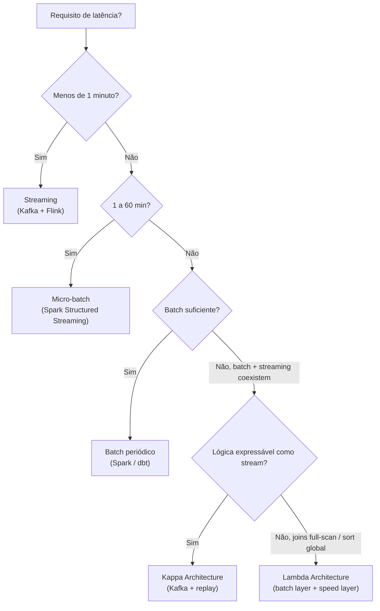

---

## W3 — Gate de qualidade com data contract

> Antes de promover camada, valida o contrato (nullability, unicidade, range); falha bloqueia e manda o dado pra quarentena, não alerta passivamente.

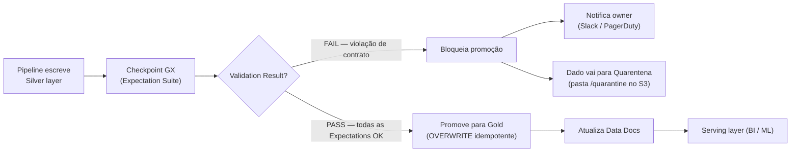

---

## W4 — Modelar um star schema dimensional

> Os 4 passos de Kimball: selecionar o processo, declarar o grão atômico, identificar dimensões e fatos (aditivos), com bus matrix de conformed dimensions.

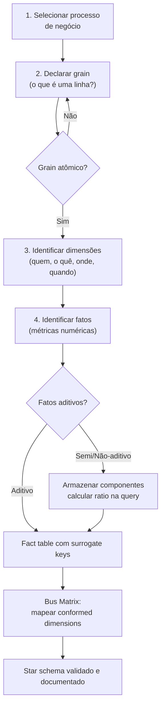

---

## W5 — Tratar Slowly Changing Dimension (SCD)

> Decide a estratégia de SCD por atributo (Type 1/2/3/4) pelo valor histórico, e implementa Type 2 com snapshot dbt e surrogate key.

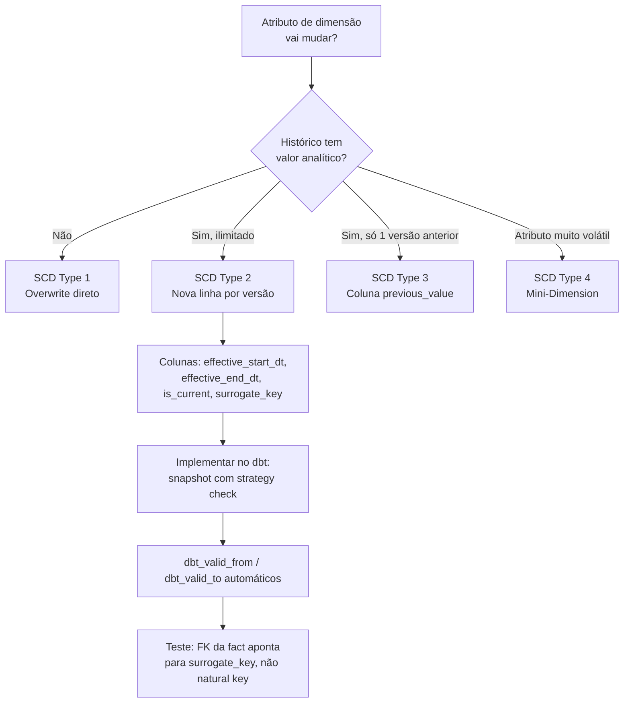

---

## W6 — Pipeline dbt com testes e lineage

> Camadas staging → intermediate → marts com testes de qualidade (unique/not_null/relationships), freshness de sources, lineage e semantic layer com definição única de métrica.

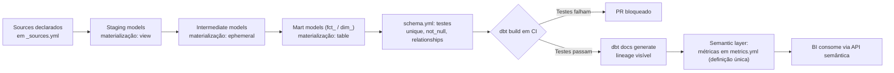

---

## W7 — Ciclo de vida ML (dados → treino → deploy → monitorar → retreino)

> O loop fechado de ML em produção: do dado bruto ao modelo vivo e autorregulado, com gate de aprovação e retreino disparado por violação de threshold.

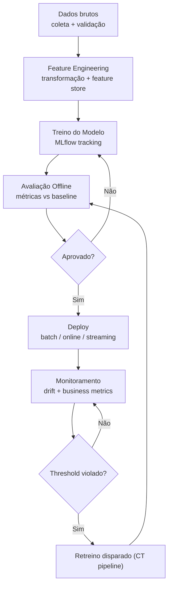

---

## W8 — Detectar e responder a data drift

> Compara a janela atual com a de referência via teste estatístico (PSI/KS); conforme a severidade, estabiliza, alerta ou dispara retreino com shadow/canary.

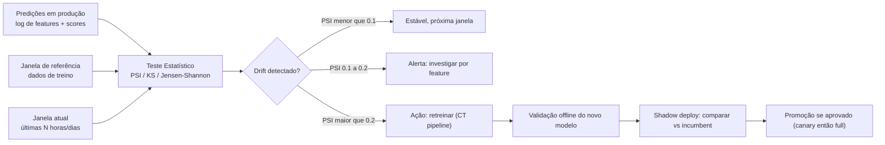

---

## W9 — Feature store (offline e online sem train-serve skew)

> Uma única definição de feature versionada, materializada em backend offline (treino) e online (serving), garantindo zero divergência entre treino e produção.

```mermaid
flowchart TD
    A["Feature View Definition<br/>código Python versionado"] --> B["Feast Apply<br/>sincroniza registry"]
    B --> C["Feature Registry<br/>fonte de verdade de schemas"]
    C --> D["Materialização Offline<br/>BigQuery / Snowflake"]
    C --> E["Materialização Online<br/>Redis / DynamoDB"]
    D --> F["get_historical_features<br/>point-in-time correct joins"]
    E --> G["get_online_features<br/>baixa latência"]
    F --> H["Dataset de Treino<br/>sem data leakage"]
    G --> I["Serving em Produção<br/>mesmo schema garantido"]
    H --> J["Modelo Treinado"]
    I --> J
    J --> K["Zero Train-Serve Skew<br/>uma implementação, dois backends"]
```

---

## W10 — Implementar um data contract (produtor → consumidor)

> Formaliza o schema + qualidade + SLA + owner num contrato versionado, classifica PII e breaking changes, e valida automaticamente no CI a cada mudança.

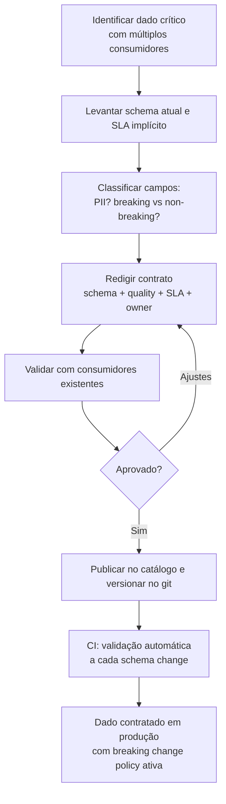

---

## W11 — Classificar e proteger PII (minimização → anonimização)

> Inventaria e auto-detecta PII, e por campo decide remover (minimização), pseudonimizar (hash) ou anonimizar (agregar), documentando a base legal e monitorando acesso.

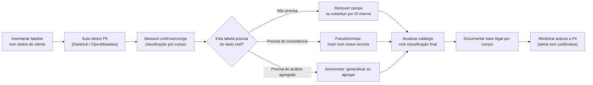

---

## W12 — Rastrear lineage de uma métrica até a origem

> Quando uma métrica diverge, navega o lineage de coluna upstream até achar onde a definição ou o dado de origem difere, e fecha com definição canônica + data contract.

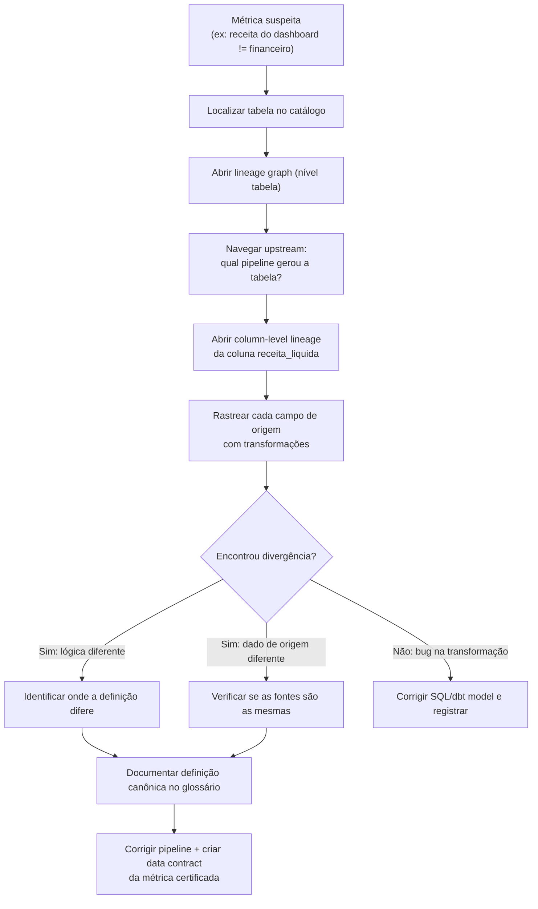

---

## W13 — Gate de Responsible ML antes do deploy

> Avalia fairness por subgrupo, obtém explicabilidade SHAP/LIME, audita viés nos dados de treino e documenta limitações em model card — o modelo só é promovido se todos os gates passarem.

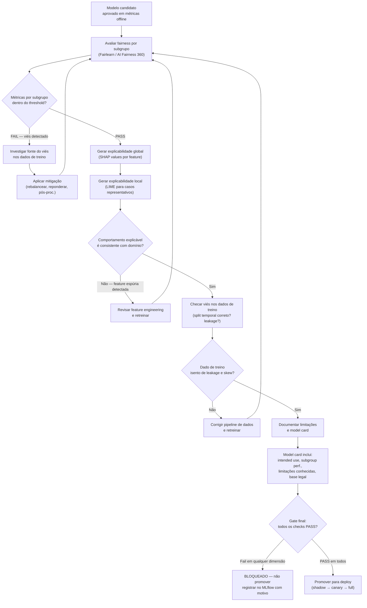

---

## W14 — Escolher modo de serving do modelo

> Decide entre batch, online real-time e streaming com base na latência exigida, volume de entidades, freshness necessária e custo operacional — cada nó justifica o desvio ao padrão anterior.

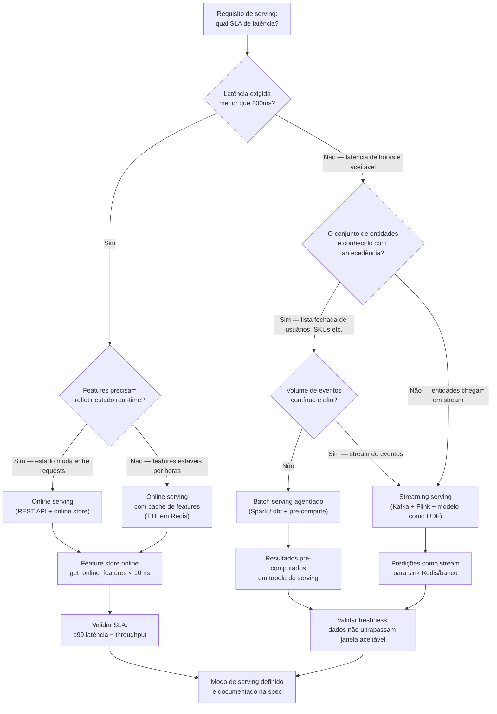

---

## W15 — Resposta a solicitação LGPD de titular e notificação ANPD de incidente

> Cobre dois fluxos Art. 18 LGPD: (A) resposta a direitos do titular — acesso, correção, exclusão, portabilidade — com verificação de identidade, execução via lineage e prazo legal; (B) notificação à ANPD em incidente com PII dentro do prazo regulatório.

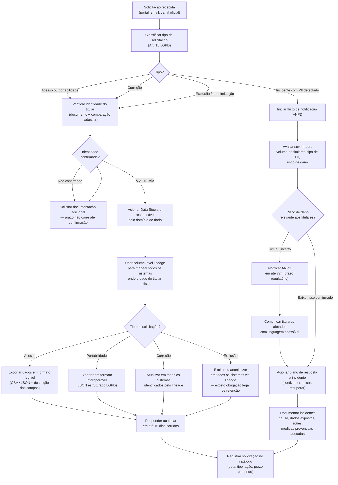
