# LOOPS — Onda 13: Operability, Performance & Economics

> Os workflows operacionais dos domínios 52-55 destilados em diagramas de fluxo. Cada um é um loop canônico pronto pra virar comportamento de agent: como instrumentar e enxergar dentro do sistema (52), como sustentá-lo sob carga (53), como mantê-lo barato — incluindo o custo de IA (54) e como tratar a plataforma interna como produto (55). Cobrem a operação madura: ver, escalar, pagar e servir.

## W1 — Instrumentação OTel: do zero ao trace correlacionado

> Pipeline pra instrumentar um serviço novo com correlação trace-log-metric desde o primeiro deploy.

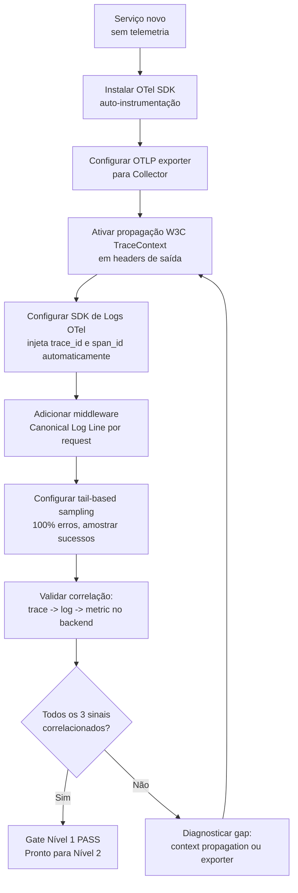

## W2 — Auditoria de alert fatigue

> Processo pra reduzir ruído de on-call e restaurar confiança nos alertas: cada page tem que ter ação humana e runbook.

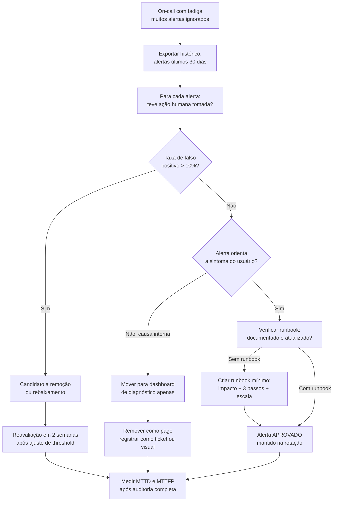

## W3 — Debugging de falha em agent loop com OTel

> Diagnóstico de comportamento anômalo de um agente instrumentado: do alerta de budget ao eval de regressão.

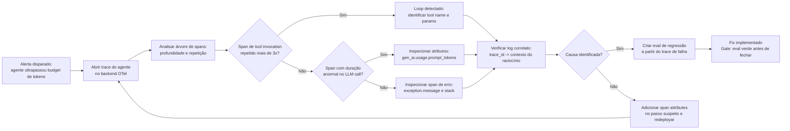

## W4 — Diagnóstico de bottleneck com USE Method

> Enumera recursos, coleta Utilization/Saturation/Errors de cada um, isola o gargalo e drilla até a causa raiz.

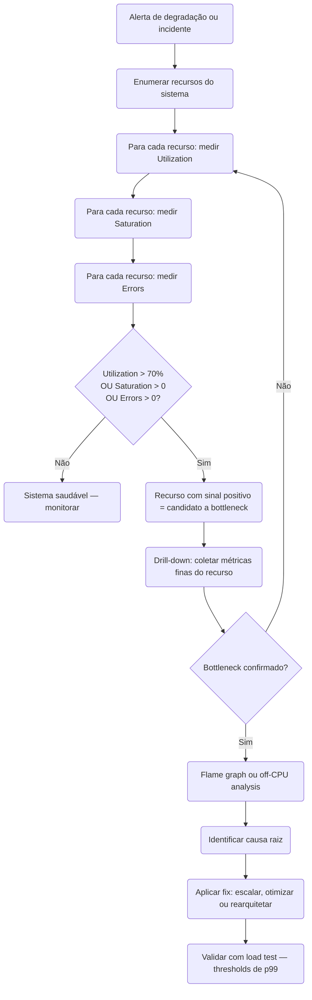

## W5 — Capacity planning com Little's Law

> Parte do SLO de latência e do throughput de pico pra derivar o número de instâncias com headroom — validado pela Universal Scalability Law.

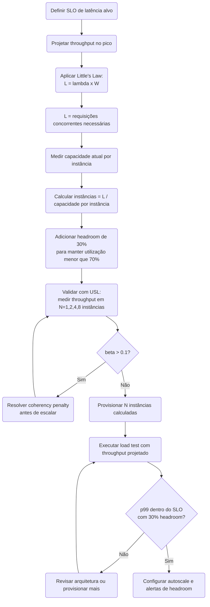

## W6 — Load testing como gate de CI

> Integra smoke, load e validação de threshold em cada deploy pra barrar regressão de performance antes do merge.

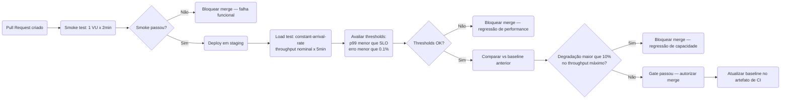

## W7 — Model routing: decisão de tier de modelo

> Dada uma task, escolhe o tier de LLM por custo×qualidade e estima o custo de tokens antes de executar.

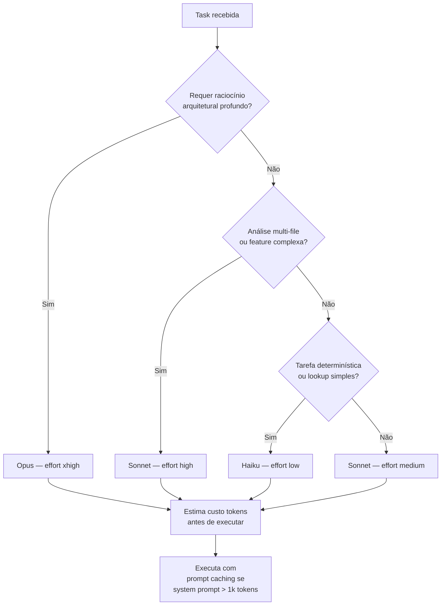

## W8 — Prompt caching ROI: viabilidade de cache

> Decide se e como implementar prompt caching com base em tamanho do prompt e frequência de reuso, medindo o hit rate.

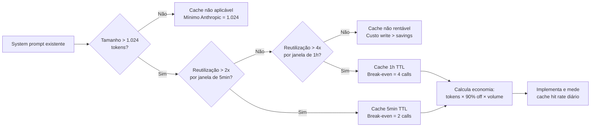

## W9 — Monitoramento de custo por unidade

> Estabelece unit economics em produto com IA: do custo por unidade de valor à correção quando ele cresce mais que a receita.

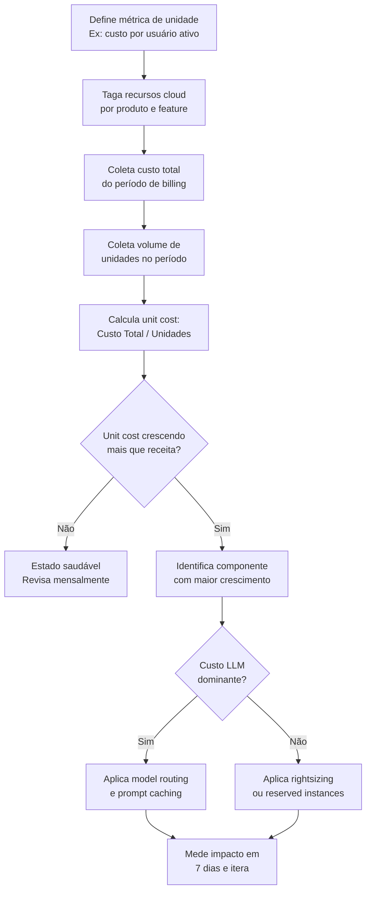

## W10 — Golden path self-service: do briefing à produção

> Do formulário no portal ao serviço catalogado em produção sem ticket — e o que acontece quando o time diverge do caminho pavimentado.

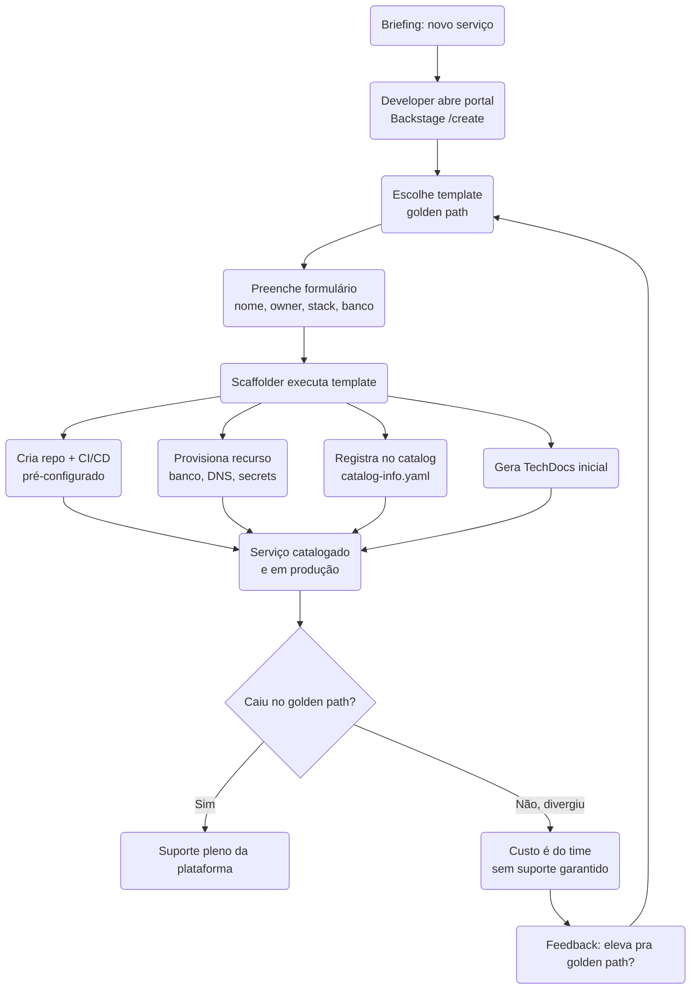

## W11 — TVP: evolução incremental validada de plataforma

> Evolui a plataforma interna do nível wiki ao self-service completo, validando adoção e impacto no DORA dos times consumidores a cada degrau.

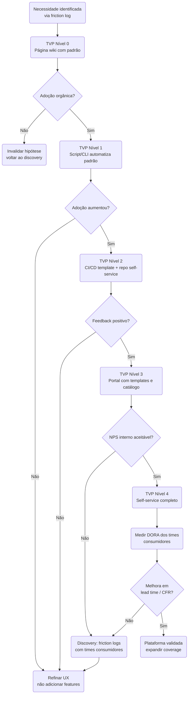

## W12 — DX audit: diagnóstico SPACE + DevEx

> Cruza dados objetivos de sistema com percepção (survey SPACE) e friction logs pra achar a dimensão de maior atrito e priorizar o backlog da plataforma.

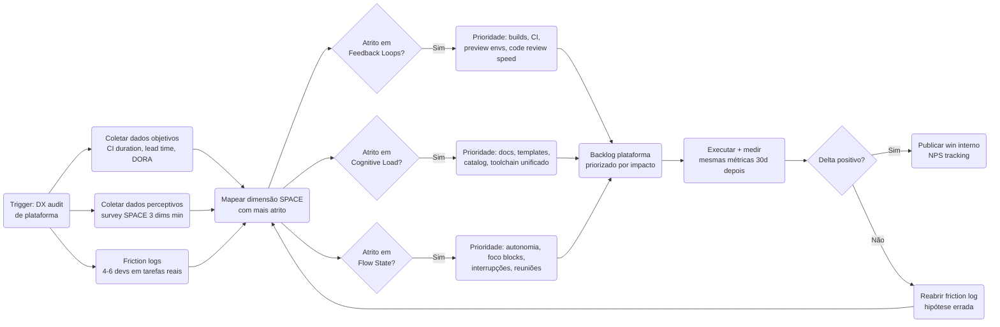

## W13 — Estratégia de cache: escolha de camada e proteção anti-stampede

> Decide qual camada de cache usar, qual política de escrita aplicar, define o TTL e protege chaves quentes contra stampede via mutex ou XFetch.

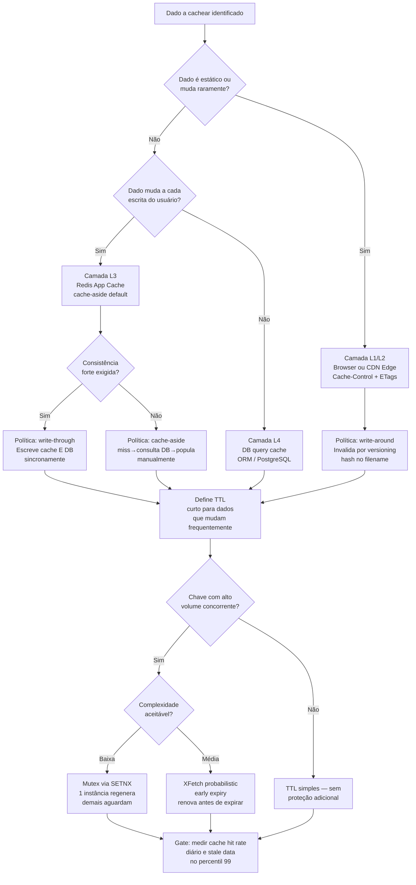

## W14 — Backpressure e proteção sob saturação

> Detecta saturação do serviço, aplica rate limiting com token ou leaky bucket, aciona load shedding, isola recursos com bulkhead e abre o circuit breaker quando o downstream degrada.

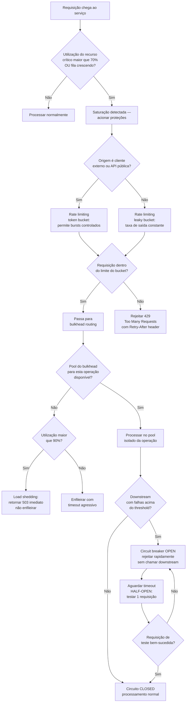

## W15 — Latência de cauda e fan-out

> Calcula o impacto real do p99 em sistemas com fan-out para N backends usando a fórmula de Dean e Barroso, decide quando usar hedged requests após o p95 e cancela o perdedor com tied requests.

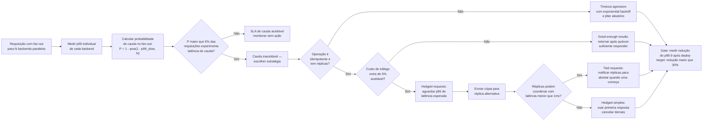

## W16 — AKF Scale Cube: decidir o eixo de escala

> Dado o gargalo atual, aplica o AKF Scale Cube para escolher entre replicação horizontal no eixo X, decomposição funcional no eixo Y ou sharding de dados no eixo Z, na ordem correta de complexidade.

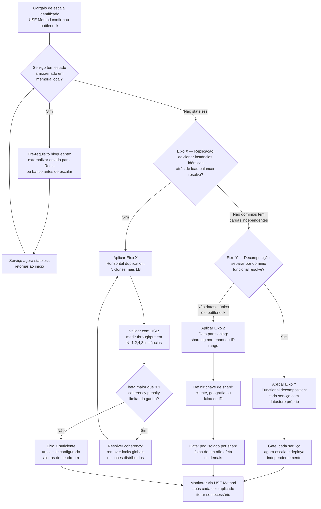
