# LOOPS — Onda 14: Delivery Surfaces & Practice

> Os workflows operacionais dos domínios 56-60 — a última leva, onde o software encontra o usuário e a prática que o sustenta. Como entregar na superfície móvel (56), oferecer APIs como produto e eventos como contrato (57), crescer com experimentação rigorosa (58), documentar como engenharia pra humanos e agentes (59) e fazer tudo isso com eficiência energética (60). Fecham a base: a prática madura de levar software ao mundo.

## W1 — Decisão de stack cross-platform

> Escolhe nativo, KMP, Flutter ou React Native por fidelidade exigida, time e superfície de APIs nativas — tratando a decisão como produto, não como gosto técnico.

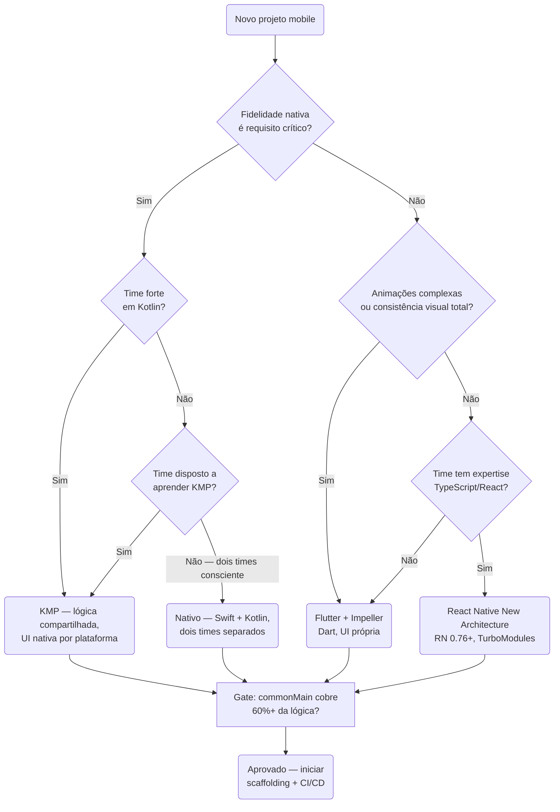

## W2 — Offline-first: fila de mutações

> Toda ação afeta o estado local na hora (optimistic UI) e entra numa fila durável que sincroniza ao reconectar, com idempotência e merge de conflito.

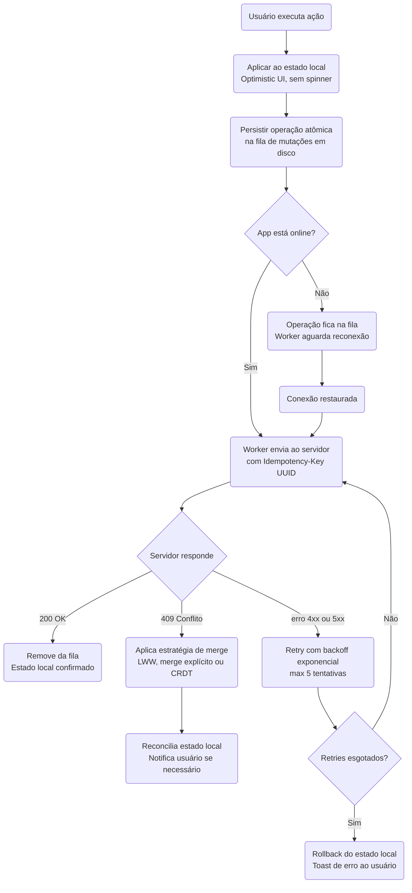

## W3 — Release mobile com OTA seguro

> Separa mudança nativa (passa pela loja) de mudança JS/assets (OTA), sempre com rollout gradual monitorado e rollback testado.

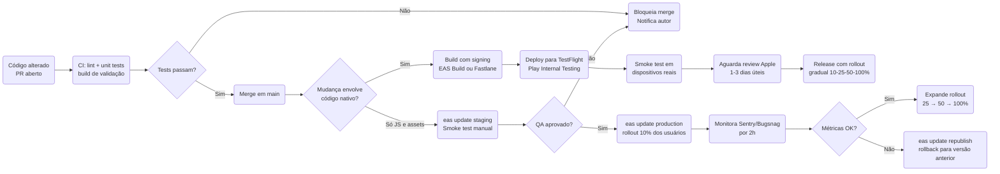

## W4 — Lifecycle de API: do design ao gate de produção

> Contract-first com OpenAPI, lint automático, design review e detecção de breaking change antes de qualquer endpoint chegar à produção.

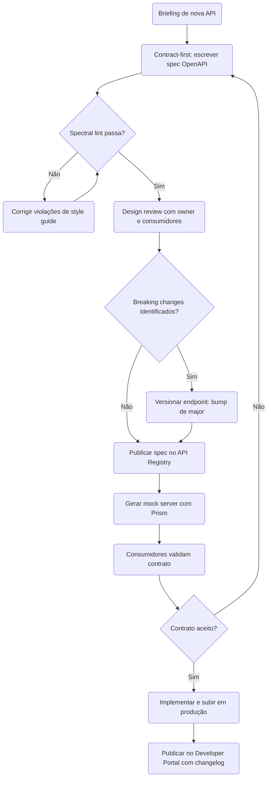

## W5 — Entrega event-driven com outbox e schema registry

> Publica eventos de domínio de forma atômica via outbox, com schema registrado como contrato e consumo idempotente.

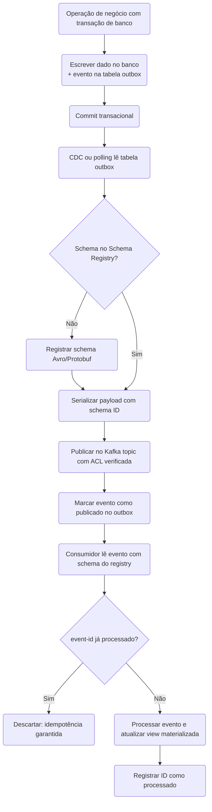

## W6 — Plataforma de webhooks com retry e replay

> Entrega confiável de webhooks a terceiros: assinatura HMAC, retry com backoff, dead letter queue e replay sob demanda.

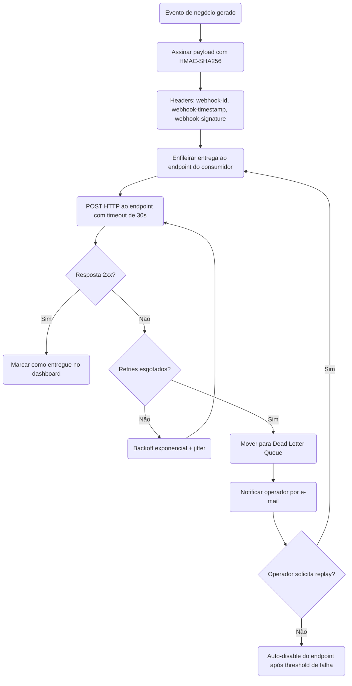

## W7 — Ciclo de experimento confiável

> A/B com rigor: declara OEC e guardrails antes de ligar, checa SRM, evita peeking e só escala quem melhora o OEC sem degradar guardrail.

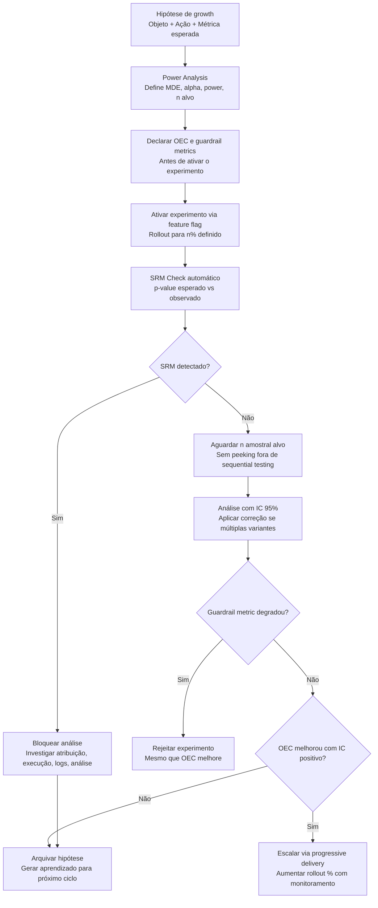

## W8 — Progressive delivery com feature flags

> Libera por anéis (interno → beta → % progressivo) protegido por flag, com kill switch, monitoramento de guardrail e limpeza obrigatória da flag.

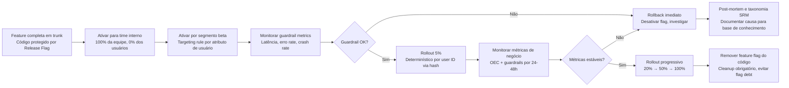

## W9 — Growth loop e priorização de hipóteses

> Mapeia o loop de crescimento do produto, gera e prioriza hipóteses por ICE/PXL, e alimenta o north-star com o que vence — medido contra holdout permanente.

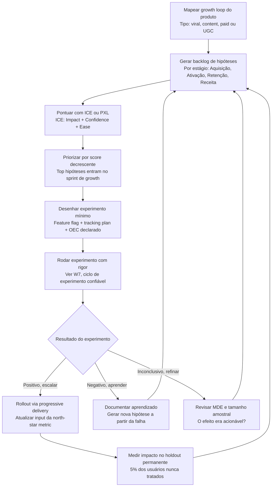

## W10 — Classificação Diátaxis antes de escrever

> Antes de escrever qualquer doc, identifica qual dos 4 modos (tutorial, how-to, reference, explanation) atende a necessidade — e nunca mistura modos no mesmo arquivo.

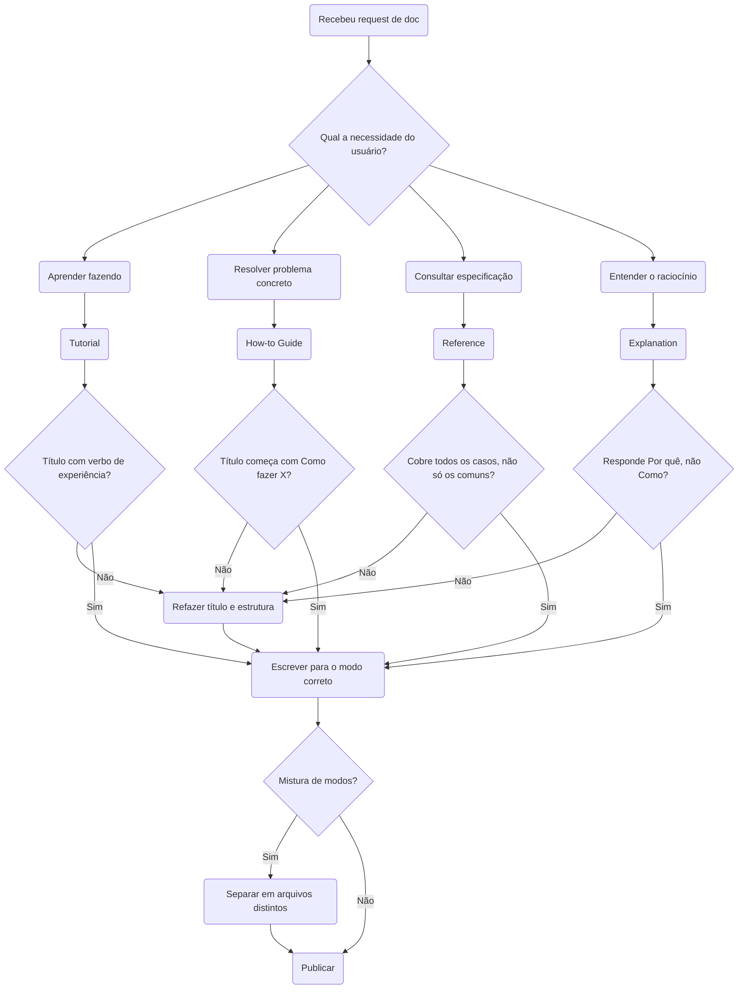

## W11 — Lifecycle de ADR: registrar e superseder decisão

> Registra decisão arquitetural como ADR imutável; quando muda, cria nova ADR que supersede a antiga — preservando o raciocínio auditável.

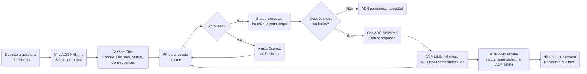

## W12 — Docs-as-code: pipeline de CI para documentação

> Doc vive no repo e passa por CI como código — lint de estrutura e estilo, checagem de links, build do site e teste dos snippets — antes do merge.

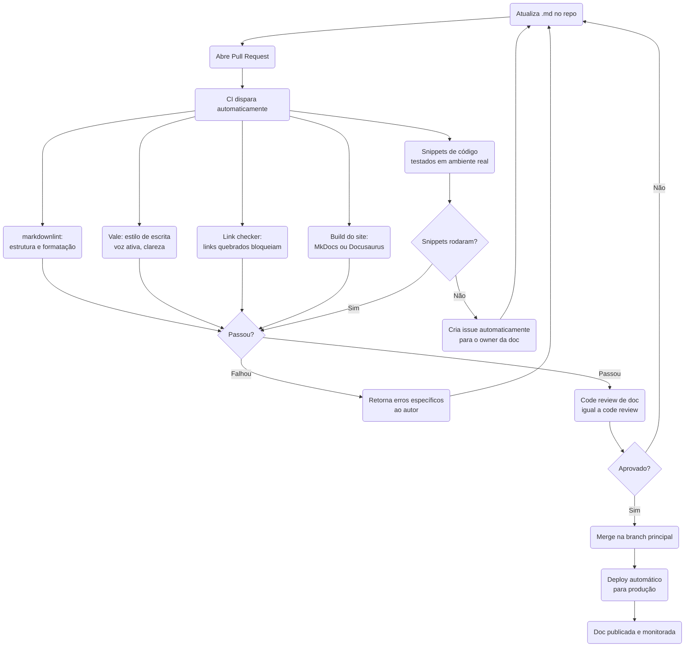

## W13 — Green SDLC loop

> Embute eficiência de carbono em cada fase do ciclo (não como bolt-on final): define a unidade funcional, mede o SCI baseline e só entrega o que reduz vs baseline.

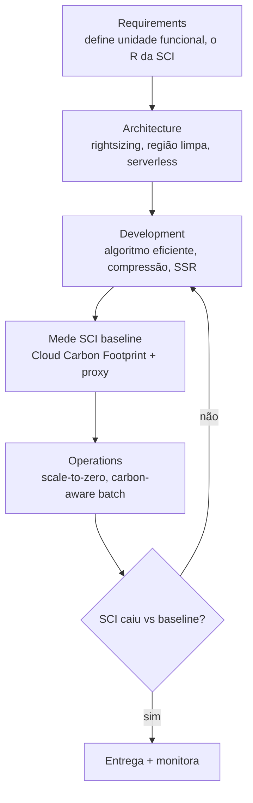

## W14 — Carbon-aware batch scheduling

> Desloca workload não-urgente para a janela e a região de menor intensidade de carbono, usando sinal de rede elétrica em tempo real.

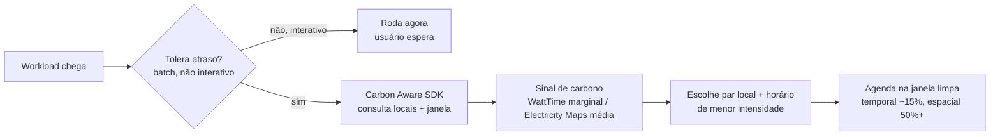

## W15 — Green AI model routing

> O menor modelo que resolve a tarefa é a maior alavanca de IA verde — e a inferência (não o treino) domina a energia operacional acumulada.

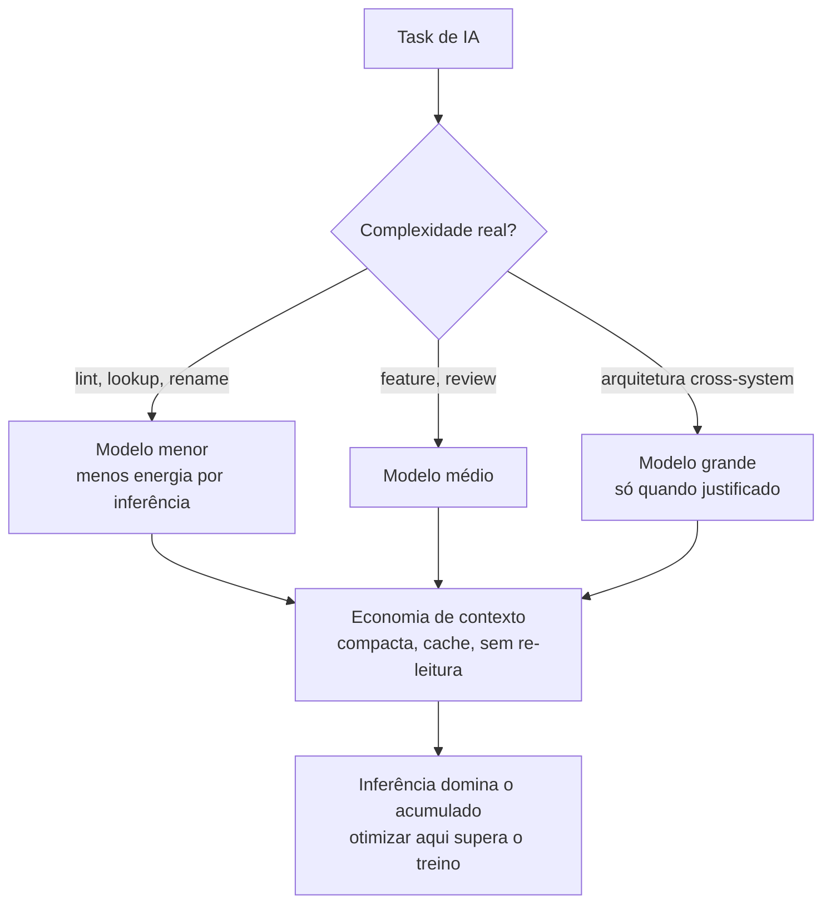

## W16 — GraphQL Federation: publicar subgraph com segurança

> PR de schema passa por rover subgraph check no CI, composição do supergraph é validada, operações em uso são verificadas contra breaking changes e só então o subgraph é publicado — com DataLoader anti-N+1 como requisito de implementação.

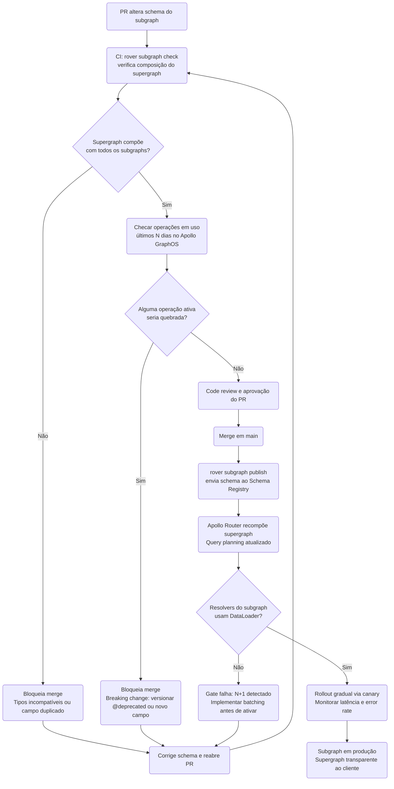

## W17 — Deprecation e sunset de API

> Anuncia a deprecação com headers Deprecation e Sunset, comunica consumidores, mantém a versão antiga pelo período prometido, mede uso residual e só remove quando o tráfego chega a zero.

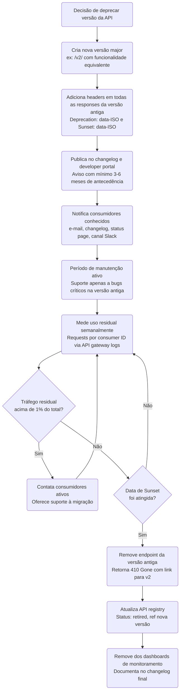

## W18 — Runbook lifecycle: do alerta à automação progressiva

> Alerta sem runbook dispara criação com a anatomia de 5 seções do Google SRE; runbook é vinculado ao alerta; progressivamente automatizado; cobertura e MTTR são métricas de maturidade operacional.

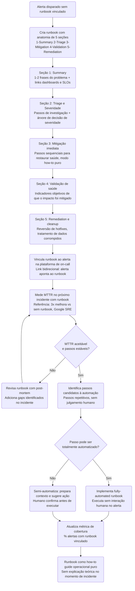

## W19 — Knowledge base para agentes de IA: doc como substrato de grounding

> Engenheira documentação para consumo de máquina: modo Diátaxis declarado por arquivo, frontmatter rico para RAG, chunks auto-suficientes, CLAUDE.md e MEMORY.md como reference e how-to guide, documentação como gate anti-invenção.

```mermaid
flowchart LR
    A("Request de nova documentação<br/>para consumo de agente de IA") --> B("Classificar modo Diátaxis<br/>How-to Guide, Reference ou Explanation")
    B --> C{"Qual modo?"}
    C -->|"How-to Guide"| D("Regras operacionais: .claude/rules/*.md<br/>Passos diretos, sem explicação teórica no corpo")
    C -->|"Reference"| E("CLAUDE.md, schemas, vocabulário canônico<br/>Consulta, não leitura linear")
    C -->|"Explanation"| F("ADRs, contexto de decisão<br/>Por que a restrição existe, não como executar")
    D --> G("Frontmatter rico para RAG<br/>titulo, tipo, dominio, status, owner, created")
    E --> G
    F --> G
    G --> H("Garantir auto-suficiência de cada seção<br/>Chunk lido isoladamente sem perder significado")
    H --> I("Declarar modo Diátaxis no frontmatter<br/>tipo: how-to | reference | explanation | tutorial")
    I --> J("Verificar: agente pode anchorar decisão neste doc?<br/>Teste: ação coberta pela doc ou agente precisa inventar?")
    J --> K{"Doc cobre a ação<br/>sem ambiguidade?"}
    K -->|Não| L("Preencher lacuna antes de publicar<br/>Lacuna de doc = permissão implícita de invenção")
    L --> J
    K -->|Sim| M("Versionar no repositório como PR<br/>Doc muda por PR, rastreável e revertível")
    M --> N("Vincular ao CLAUDE.md do projeto<br/>Referência explícita para o agente encontrar")
    N --> O("Gate: lint automático do CLAUDE.md<br/>Links válidos, seções esperadas presentes")
    O --> P{"Lint passa?"}
    P -->|Não| Q("Corrige antes de merge")
    Q --> O
    P -->|Sim| R("Knowledge base como gate anti-invenção<br/>Agente ancorado, não alucinando")
```
