# LOOPS — Design & Arquitetura: Diagramas Prontos

> Formaliza os workflows canonicos de **Arquitetura**, **DDD** e **Requisitos/Produto/Sistemas**
> em diagramas mermaid + passo a passo numerado (entrada/saida) + pontos de gate.
> Pronto para a Fase 3 (visual) e para virar comportamento de agent arquiteto.
>
> Convencao dos diagramas:
> - `([texto])` = entrada/inicio · `[texto]` = passo · `{texto}` = decisao/gate
> - aresta tracejada com label = **laco** (volta) · `:::gate` = ponto de gate critico
> - Todo `{gate}` no passo a passo esta marcado com **GATE** e o criterio de aprovacao.

---

## Indice dos loops

| # | Workflow canonico | Origem | Saida principal |
|---|---|---|---|
| L1 | Derivacao de arquitetura por atributos de qualidade (ADD-light) | Richards/Ford · Bass/SEI | Estilo + boundaries + ADRs + fitness functions |
| L2 | Avaliacao de trade-off (ATAM resumido) | Bass/Clements/Kazman (SEI) | Relatorio de riscos + sensitivity/tradeoff points |
| L3 | Ciclo de vida de ADR (ADR lifecycle) | Nygard · MADR 4.0.0 | ADR imutavel versionado |
| L4 | EventStorming -> bounded contexts | Brandolini · Evans | Lista de contexts + Context Map + UL |
| L5 | Decomposicao de monolito (The Hard Parts + Strangler Fig) | Ford et al. · Newman | Topologia distribuida incremental + contratos |
| L6 | Mudanca evolutiva guiada por fitness function | Ford/Parsons/Kua | Mudanca promovida sob governanca automatizada |
| L7 | Descoberta de requisito -> outcome -> story | Torres · Patton · Adzic · Cohn | Story INVEST com key examples testaveis |
| — | **Loop mestre do agent arquiteto** | sintese | Decisao arquitetural fundamentada ponta a ponta |

---

## L1 — Derivacao de arquitetura por atributos de qualidade (ADD-light + ATAM-light)

> Traduz requisitos em estrutura via trade-off explicito. Os atributos de qualidade (ASRs) dirigem
> a arquitetura — nao as features, nem a tecnologia da moda (P4).

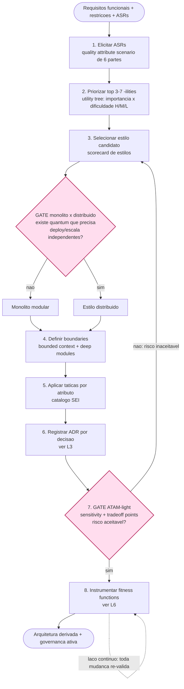

### Passo a passo (entrada -> saida)
1. **Elicitar ASRs** — entrada: requisitos + restricoes. Para cada um, escreva um *quality attribute scenario* de 6 partes (source -> stimulus -> artifact -> environment -> response -> response measure). Saida: lista de ASRs com cenarios.
2. **Priorizar top 3-7 "-ilities"** — entrada: ASRs. Monte uma *utility tree* (atributo -> refinamento -> cenario) marcando (importancia x dificuldade) = H/M/L. Saida: drivers (H,H).
3. **Selecionar estilo candidato** — entrada: drivers. Case atributos com scorecard (layered, modular monolith, event-driven, microservices, space-based, microkernel). Saida: estilo candidato.
4. **Definir boundaries** — entrada: estilo. Decompor por bounded context (L4) + information hiding (deep modules). Saida: componentes + quanta.
5. **Aplicar taticas** — entrada: boundaries + atributos. availability -> redundancia/failover; performance -> caching/concorrencia; modifiability -> encapsulation; security -> limit access/authenticate. Saida: decisoes taticas.
6. **Registrar ADR** — entrada: cada decisao estrutural. Saida: ADR versionado (L3).
7. **Avaliar (ATAM-light)** — entrada: arquitetura. Identifique sensitivity points e tradeoff points. Saida: relatorio de risco.
8. **Instrumentar fitness functions** — entrada: atributos criticos. Saida: governanca continua (L6).

### Pontos de gate
- **GATE G1 — Monolito x distribuido.** Aprova distribuir SOMENTE se existe um quantum com necessidade real de deploy/escala/time independentes E DevOps maduro. Default: **monolito modular primeiro** (consenso 2024-2026). Reprovado -> monolito modular.
- **GATE S7 — ATAM-light.** Aprova se nenhum tradeoff point gera risco inaceitavel. Reprovado -> **laco de volta ao passo 3** (re-selecionar estilo).

---

## L2 — Avaliacao de trade-off (ATAM resumido)

> Avalia uma arquitetura ja candidata contra cenarios priorizados, expondo onde decisoes afetam
> multiplos atributos em direcoes opostas (tradeoff points).

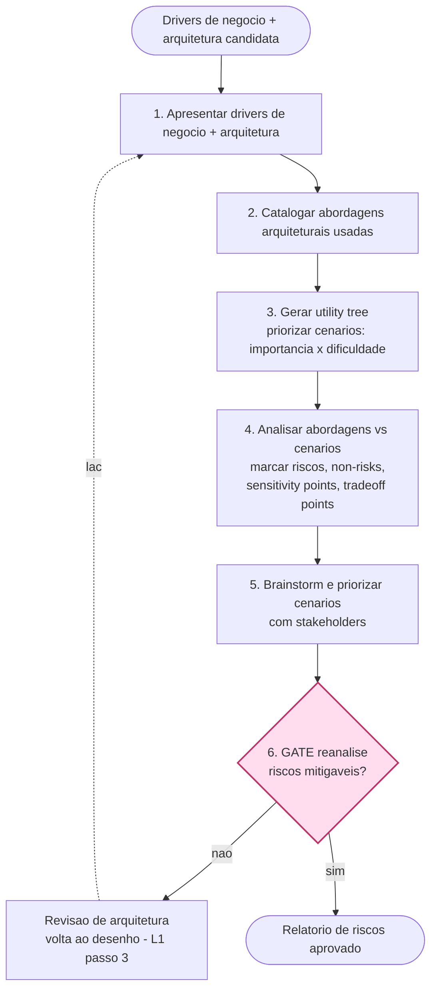

### Passo a passo (entrada -> saida)
1. **Apresentar drivers** — entrada: contexto de negocio + arquitetura. Saida: alinhamento de stakeholders.
2. **Catalogar abordagens** — entrada: arquitetura. Liste estilos/padroes usados. Saida: inventario de abordagens.
3. **Gerar utility tree** — entrada: ASRs. Priorize cenarios (importancia x dificuldade). Saida: cenarios ranqueados.
4. **Analisar abordagens vs cenarios** — entrada: cenarios + abordagens. Saida: riscos, non-risks, **sensitivity points** (afeta muito 1 atributo), **tradeoff points** (afeta >=2 atributos em direcoes opostas).
5. **Brainstorm e priorizar cenarios** — entrada: analise. Stakeholders votam. Saida: cenarios criticos confirmados.
6. **Reanalisar** — entrada: riscos. Saida: relatorio de riscos.

### Pontos de gate
- **GATE A6 — Riscos mitigaveis?** Aprova se todo risco critico tem mitigacao viavel. Reprovado -> **laco para revisao de arquitetura** (reabre L1 a partir do passo 3).

---

## L3 — Ciclo de vida de ADR (ADR lifecycle, MADR/Nygard)

> Um ADR e imutavel apos aceito. Mudou a decisao? Cria-se um novo ADR com status `superseded by`
> referenciando o anterior — o historico permanece rastreavel.

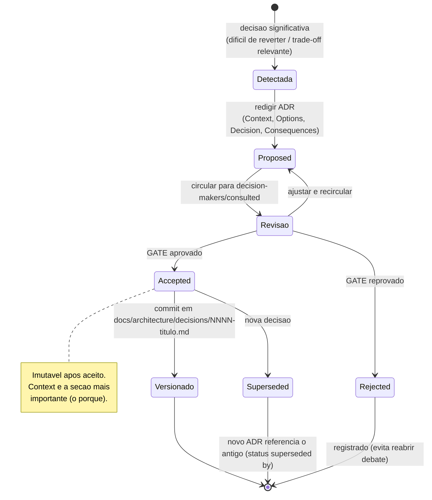

### Passo a passo (entrada -> saida)
1. **Detectar decisao significativa** — entrada: design em andamento. Gatilho: algo dificil/caro de reverter ou com trade-off relevante. Saida: candidato a ADR.
2. **Redigir ADR** — entrada: candidato. Secoes: Context and Problem Statement, Decision Drivers, Considered Options, Decision Outcome, Consequences (bom E ruim), Pros/Cons por opcao. Titulo como problema-solucao ("Use X para Y"). Saida: ADR em status `proposed`.
3. **Circular para revisao** — entrada: ADR proposed. Papeis RACI: decision-makers, consulted, informed. Saida: parecer.
4. **Status Accepted** — entrada: aprovacao. Versionar junto ao codigo. Saida: ADR imutavel.
5. **Supersede quando mudar** — entrada: nova decisao. Cria novo ADR `superseded by ADR-NNNN`; o antigo vira `superseded`. Saida: historico imutavel encadeado.

### Pontos de gate
- **GATE Revisao -> Accepted.** Aprova se a decisao tem Context factual, opcoes consideradas (incluindo rejeitadas) e consequencias negativas explicitadas. Reprovado -> `rejected` (registrado para nao reabrir) ou `proposed` (ajustar).
- **Regra de imutabilidade.** Nunca editar um ADR aceito — sempre supersede. Garante rastreabilidade.

---

## L4 — EventStorming -> bounded contexts

> Descobre as fronteiras REAIS do negocio (linguisticas), nao as inventa. Heuristica central de
> Brandolini: **mudanca de vocabulario = fronteira de contexto**; nao resolver duplicatas cedo.

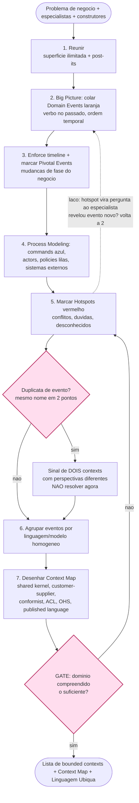

### Passo a passo (entrada -> saida)
1. **Reunir** — entrada: problema de negocio. Junte quem conhece o negocio E quem vai construir. Saida: grupo alinhado.
2. **Caos exploratorio (Big Picture)** — entrada: conhecimento tacito. Cole todos os *domain events* (laranja, passado). Saida: linha do tempo bruta.
3. **Enforce a timeline** — entrada: eventos. Ordene; marque *pivotal events*. Saida: esqueleto temporal ("Goldilocks state").
4. **Process Modeling** — entrada: eventos ordenados. Adicione commands (azul), actors, policies (lilas), sistemas externos (rosa), read models (verde). Saida: fluxo causal completo.
5. **Mapear hotspots** — entrada: fluxo. Marque (vermelho) conflitos/duvidas. Saida: perguntas ao especialista.
6. **Agrupar por linguagem homogenea** — entrada: eventos + hotspots resolvidos. Cada cluster coeso = candidato a **bounded context**. Saida: clusters.
7. **Desenhar Context Map** — entrada: contexts. Defina o padrao de relacao de cada par. Saida: mapa de relacoes = criterio de decomposicao em servicos/modulos/agentes.

### Pontos de gate
- **GATE E6 — Duplicata de evento.** O mesmo nome em dois pontos NAO e erro: e **pista de boundary** (dois contexts). Nao resolver cedo.
- **GATE G2 — Dominio compreendido?** Aprova se nao restam hotspots criticos e cada cluster tem linguagem consistente. Reprovado -> **laco para resolver hotspots** (passo 5).

---

## L5 — Decomposicao de monolito (The Hard Parts + Strangler Fig)

> So distribui o que prova precisar. Avalie disintegrators vs integrators por candidato; extraia
> um boundary por vez via Strangler Fig, com ACL entre o novo servico e o legado.

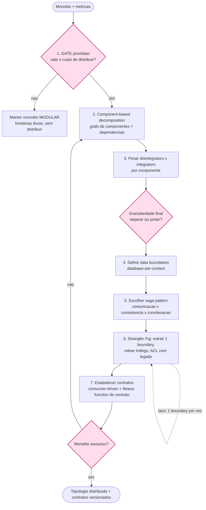

### Passo a passo (entrada -> saida)
1. **Avaliar prontidao** — entrada: monolito + metricas. Saida: decisao distribuir/nao. Se nao -> monolito modular.
2. **Component-based decomposition** — entrada: monolito. Mapeie componentes logicos e dependencias. Saida: grafo de componentes.
3. **Disintegrators x integrators** — entrada: grafo. Disintegrators (escopo/SRP, codigo volatil, escala diferenciada, fault tolerance, seguranca, extensibilidade) vs integrators (transacao ACID, dados acoplados, latencia, workflow). Saida: granularidade por candidato.
4. **Data boundaries** — entrada: granularidade. Decida database-per-context. Saida: distribuicao de dados.
5. **Saga pattern** — entrada: transacoes cross-service. Saida: padrao de transacao distribuida (cada passo publica via outbox).
6. **Strangler Fig** — entrada: 1 boundary. Extraia, roteie trafego, use ACL com o legado. Saida: servico extraido.
7. **Contratos** — entrada: interfaces. consumer-driven contracts versionados. Saida: contratos + fitness function de contrato.

### Pontos de gate
- **GATE M1 — Prontidao.** Aprova distribuir so se o custo de distribuicao se paga (DevOps maduro, dor concreta). Reprovado -> monolito modular. (Evita o anti-padrao *distributed monolith*.)
- **GATE G3 — Granularidade.** Evita nano-services (fino demais) e mega-services (grosso demais).
- **GATE G4 — Esvaziou?** Reprovado -> **laco** repete passos 2-7 para o proximo componente.

---

## L6 — Mudanca evolutiva guiada por fitness function

> Arquitetura nao e diagrama estatico: e um conjunto de propriedades a proteger no tempo. Mudanca
> = incremental + guiada, validada por fitness functions no pipeline ("rules live in code").

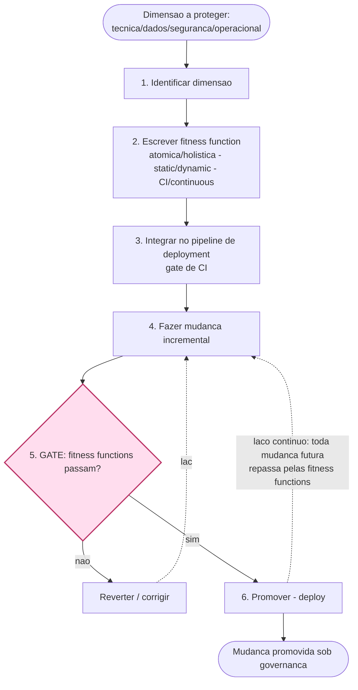

### Passo a passo (entrada -> saida)
1. **Identificar dimensao a proteger** — entrada: atributo critico. Saida: alvo de governanca.
2. **Escrever fitness function** — entrada: dimensao. Escolha o tipo: **atomic** (1 aspecto) x **holistic**; **static** (ciclos, camadas) x **dynamic** (latencia); **triggered/CI** x **continuous**; **automated** x **manual**. Saida: teste executavel (ex.: ArchUnit `noClasses().that().resideInAPackage("..domain..").should().dependOnClassesThat().resideInAPackage("..infrastructure..")`).
3. **Integrar no pipeline** — entrada: fitness function. Saida: gate de CI ativo.
4. **Mudanca incremental** — entrada: alvo de evolucao. Saida: codigo alterado.
5. **Executar fitness functions** — entrada: build. Saida: pass/fail.
6. **Promover** — entrada: build aprovado. Saida: deploy.

### Pontos de gate
- **GATE F5 — Fitness functions passam?** Reprovado -> **laco reverter/corrigir** (passo 4). Aprovado -> promove.
- **Higiene.** Manter poucas e de alto sinal — fitness functions frageis/ruidosas viram debito.

---

## L7 — Descoberta de requisito -> outcome -> story

> O fio que antecede o codigo: do desejo difuso ao requisito verificavel amarrado a um outcome.
> Combina Continuous Discovery (OST), Story Mapping/Slicing (SPIDR+INVEST) e Specification by Example.

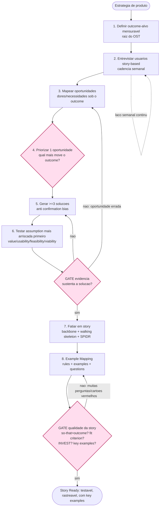

### Passo a passo (entrada -> saida)
1. **Definir outcome-alvo** — entrada: estrategia. Outcome mensuravel ligado a negocio. Saida: raiz do OST.
2. **Entrevistar usuarios** — entrada: usuarios. Historias reais de comportamento (nao opiniao), cadencia semanal. Saida: snapshots de experiencia.
3. **Mapear oportunidades** — entrada: historias. Extraia dores/necessidades sob o outcome. Saida: camada de opportunities.
4. **Priorizar 1 oportunidade** — entrada: opportunities. Saida: oportunidade-alvo.
5. **Gerar >=3 solucoes** — entrada: oportunidade. Saida: camada de solutions.
6. **Testar assumptions** — entrada: solucoes. Teste a hipotese mais arriscada e desconhecida primeiro (desejabilidade/usabilidade/factibilidade/viabilidade). Saida: evidencia.
7. **Fatiar em story** — entrada: solucao validada. backbone narrativo -> walking skeleton -> SPIDR (Spike/Path/Interface/Data/Rules). Saida: story vertical.
8. **Example Mapping** — entrada: story. Story (amarelo) + Rules (azul) + Examples (verde, incl. contra-exemplo) + Questions (rosa). Saida: criterios Given/When/Then = testes.

### Pontos de gate
- **GATE R4 — Priorizacao.** Escolhe a oportunidade que mais move o outcome.
- **GATE G5 — Evidencia.** Aprovado -> story slicing. Reprovado -> **laco para nova solucao (5)** ou **reavaliar oportunidade (3)** e atualizar o OST (OST e documento vivo, nao entregavel).
- **GATE G6 — Qualidade da story.** Aprova se: `so that` = outcome; tem **fit criterion** quantificado (Volere); passa **INVEST**; tem **key examples** concretos prontos para virar teste; e rastreavel (feature->story->exemplo->teste). Muitas perguntas/cartoes vermelhos -> **laco** (quebrar/refinar, passo 8).

---

## Loop mestre do agent arquiteto

> Diagrama unico que um agent de IA segue para tomar uma decisao arquitetural **fundamentada**,
> encadeando os sete loops: entender o requisito/outcome -> modelar o dominio -> escolher o estilo
> por trade-off -> registrar o ADR -> definir a fitness function -> validar. Cada `{GATE}` e um ponto
> onde o agent NAO avanca sem satisfazer o criterio; cada aresta tracejada e um laco de aprendizado.

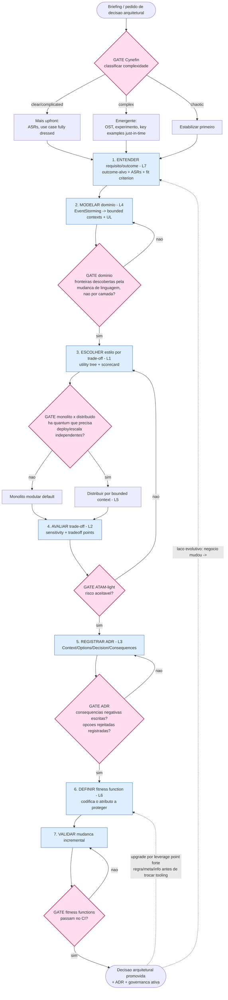

### Os 6 gates inegociaveis do agent arquiteto

| Gate | Pergunta de aprovacao | Reprovado -> |
|---|---|---|
| **Cynefin** | A complexidade foi classificada (clear/complicated/complex/chaotic)? | Calibra cerimonia (upfront x emergente) |
| **Dominio** | As fronteiras vieram de mudanca de linguagem (bounded context), nao de camada tecnica? | Volta a modelar (L4) |
| **Monolito x distribuido** | Existe um quantum que REALMENTE precisa de deploy/escala/time independentes? | Monolito modular (default) |
| **ATAM-light** | Sensitivity/tradeoff points identificados e risco aceitavel? | Re-seleciona estilo (L1.3) |
| **ADR** | 1 decisao, Context factual, opcoes rejeitadas e consequencias negativas escritas? | Reescreve o ADR |
| **Fitness function** | O atributo critico esta codificado como teste e passa no CI? | Corrige a mudanca |

### Sequencia canonica (mnemonico)
**Entender -> Modelar -> Escolher -> Avaliar -> Registrar -> Proteger -> Validar.**
Cada etapa cita seu loop (L7 -> L4 -> L1 -> L2 -> L3 -> L6 -> L6), e nenhuma avanca sem cruzar o gate.

### Aplicacao direta a squads de agentes (verificavel)
- **Agente = bounded context** (L4): linguagem ubiqua propria; overlap de escopo entre agentes = boundary errado (sinal de duplicata do EventStorming).
- **Orquestrador = Process Manager**: roteia por verbos/capabilities, nao executa dominio.
- **Handoff = consumer-driven contract** (L3+L5): artefato versionado validado na entrada (Idempotent Receiver).
- **ACL interno -> user-facing**: traduzir codinomes/@agents/paths para linguagem de negocio = fitness function automatizavel (zero vazamento de estrutura interna).
- **ADR automatico** (L3): toda escolha estrutural do squad (novo agente, novo boundary, novo contrato) gera um ADR.
- **Evolucao fitness-function-driven** (L6): gate de qualidade (sem invencao de fontes, formato correto, sem vazamento) roda como teste antes de promover. **Eval-driven development**: key examples = golden dataset.
- **Upgrade por leverage point forte** (L7/Meadows): mude regra/meta/fluxo de informacao (prompt de sistema, criterios de gate, contexto injetado) ANTES de trocar modelo/temperatura.

---

## L8 — Impact Mapping (Goal -> Actors -> Impacts -> Deliverables)

> Conecta o que se constroi ao PORQUE de negocio, tratando deliverables como hipoteses testaveis
> de impacto — combate direto a feature factory. Fonte: Adzic (Impact Mapping, 2012).

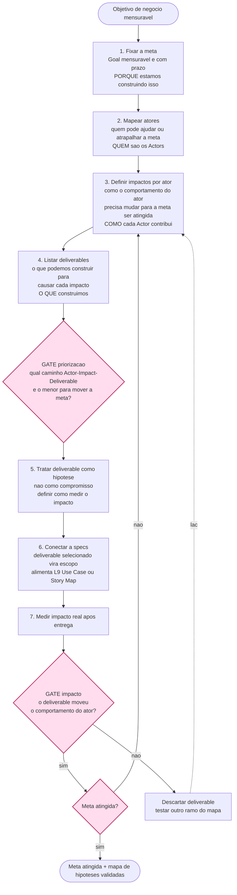

### Passo a passo (entrada -> saida)
1. **Fixar a meta (Goal)** — entrada: objetivo de negocio. A meta deve ser mensuravel e ter prazo. Responde ao PORQUE. Saida: raiz do impact map.
2. **Mapear atores (Actors)** — entrada: contexto. Liste quem pode ajudar ou atrapalhar a meta (usuarios, clientes, times, sistemas). Saida: 1o nivel de ramos.
3. **Definir impactos (Impacts)** — entrada: ator. Para cada ator: "como seu comportamento precisa mudar para a meta ser atingida?" Saida: 2o nivel de ramos.
4. **Listar deliverables** — entrada: impacto. O que podemos construir para causar este impacto? Tratar como hipoteses, nao compromissos. Saida: folhas do mapa.
5. **Priorizar por impacto** — entrada: deliverables. Qual caminho Actor->Impact->Deliverable e o menor investimento para mover a meta? Saida: aposta priorizada.
6. **Tratar deliverable como hipotese** — entrada: deliverable selecionado. Definir como medir se o impacto aconteceu. Saida: criterio de validacao.
7. **Conectar a specs** — entrada: deliverable validado como escopo. Saida: entrada para use cases (L9) ou story map (L12).

### Pontos de gate
- **GATE G1 — Priorizacao.** Escolhe o caminho de menor investimento que mais move a meta. Evita features sem elo claro a impacto de ator.
- **GATE G2 — Impacto real.** Reprovado -> **laco descarta o deliverable** e testa outro ramo. O mapa e documento vivo; ramos sem impacto sao podados.
- **GATE G3 — Meta atingida.** Reprovado -> **laco de volta ao passo 3** (novos impactos/atores). Aprovado -> ciclo encerrado.

---

## L9 — Use Case Writing de Cockburn (Fully Dressed)

> Captura comportamento como contrato entre stakeholders e o sistema, ancorado no nivel
> sea-level — o mais util para definir fronteiras de aplicacao e gerar key examples.
> Fonte: Cockburn, Writing Effective Use Cases (2000).

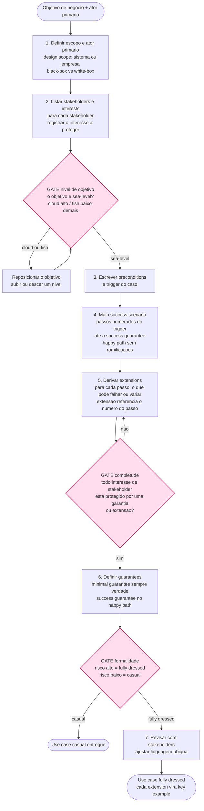

### Passo a passo (entrada -> saida)
1. **Definir escopo e ator primario** — entrada: objetivo de negocio. Estabeleca design scope (sistema ou empresa) e black-box vs white-box. Identifique o ator primario (quem inicia). Saida: cabecalho do caso.
2. **Listar stakeholders e interests** — entrada: contexto. Para cada stakeholder, registre o interesse que o sistema deve proteger. Esta lista e o motor de completude. Saida: inventario de interesses.
3. **Fixar nivel de objetivo (sea-level)** — entrada: objetivo candidato. Sea-level = objetivo do usuario em uma sessao. Cloud = muito estrategico; fish = subfuncao. Reposicione ate atingir sea-level. Saida: caso ancorado.
4. **Escrever main success scenario** — entrada: trigger e preconditions. Passos numerados do gatilho ate a garantia de sucesso. Apenas o happy path, sem ramificacoes. Saida: cenario principal.
5. **Derivar extensions** — entrada: cada passo do main scenario. Pergunte "o que pode falhar ou variar aqui?" Escreva extensao `3a.`, `3b.`, etc. referenciando o passo. Saida: variantes e falhas mapeadas.
6. **Definir guarantees** — entrada: interesses dos stakeholders. Minimal guarantees (sempre verdadeiro) e success guarantees (caminho feliz). Saida: contrato completo.
7. **Calibrar formalidade** — entrada: nivel de risco. Alto risco -> fully dressed; baixo -> casual. Revisar com stakeholders e ajustar termos. Saida: use case calibrado.

### Pontos de gate
- **GATE G1 — Nivel sea-level.** Reprovado -> reposicionar (subir ou descer). Cloud demais = caso de negocio; fish demais = passo interno.
- **GATE G2 — Completude.** Reprovado -> adicionar extension cobrindo o interesse em falta. Cada extension e um potencial key example para os testes (Adzic).
- **GATE G3 — Formalidade.** Calibra cerimonia sem perder cobertura. Risco alto -> fully dressed com todos os campos. Baixo -> casual (2-5 linhas).

---

## L10 — Systems Modeling de Meadows (Estoques, Fluxos, Loops, Leverage Points)

> Diagnostica qualquer sistema dinamico — software, organizacao, ecossistema de agentes —
> pela estrutura, nao pelos eventos superficiais. Fonte: Meadows, Thinking in Systems (2008).

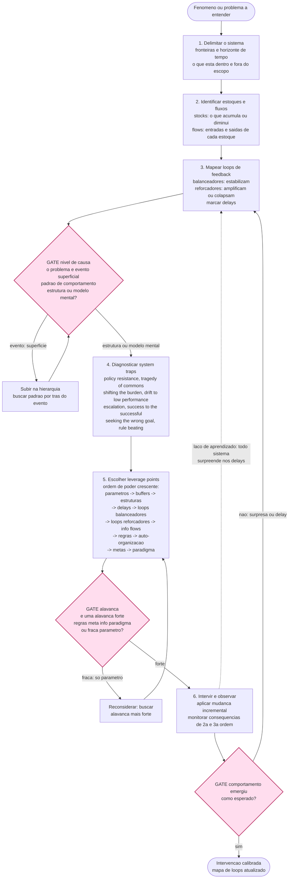

### Passo a passo (entrada -> saida)
1. **Delimitar o sistema** — entrada: fenomeno ou problema. Defina fronteiras (o que entra e sai do modelo) e horizonte de tempo relevante. Saida: escopo do sistema.
2. **Identificar estoques e fluxos** — entrada: sistema delimitado. Estoques = o que acumula (usuarios, divida tecnica, capacidade, confianca). Fluxos = entradas e saidas de cada estoque. Saida: estrutura basica.
3. **Mapear loops de feedback** — entrada: estoques e fluxos. Loops balanceadores (B) estabilizam; loops reforcadores (R) amplificam. Marque delays com seta dupla. Saida: diagrama causal.
4. **Diagnosticar system traps** — entrada: loops mapeados. Confronte com os 8 archetypes. Saida: armadilha identificada com sintoma e causa estrutural.
5. **Escolher leverage points** — entrada: traps e estrutura. Prefira alavancas fortes (regras, metas, fluxos de informacao, paradigma) sobre fracas (parametros). Saida: intervencao priorizada.
6. **Intervir e observar** — entrada: alavanca escolhida. Aplique de forma incremental; monitore consequencias de 2a e 3a ordem e delays. Saida: comportamento novo do sistema.

### Pontos de gate
- **GATE G1 — Nivel de causa.** Eventos sao sintomas; a causa real esta na estrutura ou no modelo mental. Subir na hierarquia ate atingir o nivel estrutural antes de intervir.
- **GATE G2 — Qualidade da alavanca.** Reprovado (so parametro) -> buscar alavanca mais forte. Mude regra/meta/fluxo de informacao antes de ajustar um numero (ex.: mudar o prompt de sistema antes de ajustar temperatura do LLM).
- **GATE G3 — Comportamento emergiu?** Reprovado -> **laco de volta ao passo 3** (o mapa de loops ainda estava incompleto). Sistemas complexos surpreendem — delays mascaram o efeito da intervencao.

---

## L11 — Product Kata de Perri (Melhoria Cientifica Orientada a Outcome)

> Loop de melhoria iterativa que evita a build trap: mede onde estamos, define onde queremos
> chegar, identifica obstaculos e experimenta sistematicamente. Fonte: Perri, Escaping the Build Trap (2018).

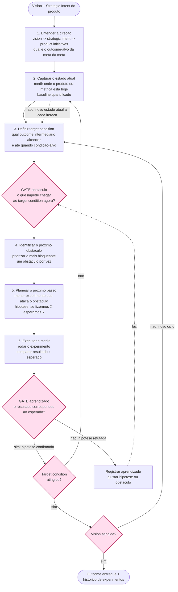

### Passo a passo (entrada -> saida)
1. **Entender a direcao** — entrada: vision e strategic intent. Percorra o strategy stack (vision -> strategic intent -> product initiatives -> options). Saida: outcome-alvo da iteracao.
2. **Capturar o estado atual** — entrada: metricas do produto. Meca onde o produto esta hoje. Saida: baseline quantificado.
3. **Definir target condition** — entrada: baseline + direcao. Qual outcome intermediario alcancar e ate quando? Saida: condicao-alvo com prazo.
4. **Identificar o obstaculo** — entrada: gap entre atual e target. O que impede chegar la agora? Priorize o mais bloqueante. Saida: obstaculo principal.
5. **Planejar o proximo experimento** — entrada: obstaculo. Menor intervencao que ataca o obstaculo; formule como hipotese (se fizermos X, esperamos Y). Saida: experimento definido.
6. **Executar e medir** — entrada: experimento. Execute; compare resultado com esperado. Saida: evidencia de aprendizado.

### Pontos de gate
- **GATE G1 — Obstaculo bloqueante.** O Kata exige clareza sobre o que impede o avanco. Sem obstaculo claro, o experimento e cego.
- **GATE G2 — Aprendizado.** Hipotese refutada e aprendizado valido (nao falha). Registre e ajuste — **laco de volta ao passo 4** com novo obstaculo ou hipotese.
- **GATE G3 — Target condition atingido.** Reprovado -> **laco de volta ao passo 2** (medir novo estado atual). Aprovado -> verificar se a vision foi atingida.
- **GATE G4 — Vision atingida.** Reprovado -> **laco de volta ao passo 3** com novo target. O Kata e continuo; a condicao-alvo sobe a cada ciclo.

---

## L12 — Story Mapping de Patton (Backbone, Walking Skeleton, Slices por Outcome)

> Substitui o backlog plano por um mapa narrativo: backbone horizontal da jornada,
> detalhe vertical, e slices por outcome que fatiam releases de forma que cada um
> entregue valor utilizavel. Fonte: Patton, User Story Mapping (2014).

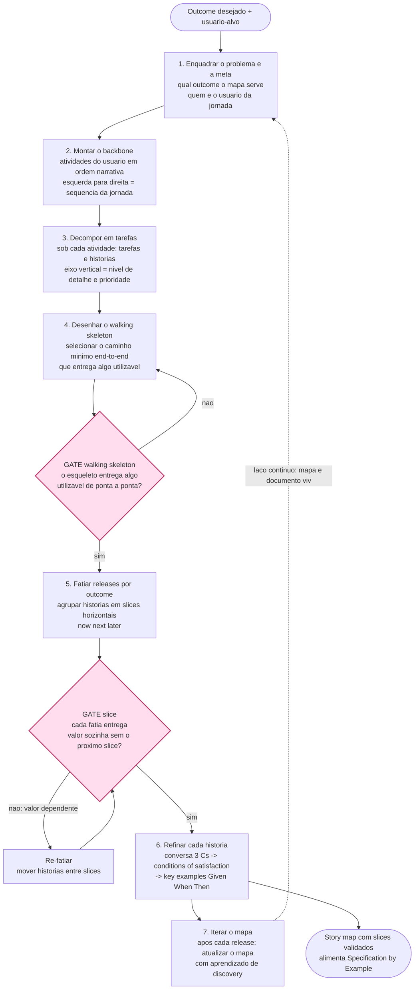

### Passo a passo (entrada -> saida)
1. **Enquadrar o problema e a meta** — entrada: outcome desejado + usuario-alvo. O mapa serve um outcome, nao um projeto generico. Saida: objetivo do mapa.
2. **Montar o backbone** — entrada: jornada do usuario. Liste atividades em ordem narrativa da esquerda para a direita (sequencia temporal). Saida: espinha dorsal do mapa.
3. **Decompor em tarefas** — entrada: cada atividade. Abaixo de cada atividade, liste as tarefas e historias (eixo vertical = mais detalhe e menor prioridade). Saida: corpo do mapa.
4. **Desenhar o walking skeleton** — entrada: corpo do mapa. Selecione o conjunto minimo de historias que cobrem o fluxo completo de ponta a ponta. Saida: esqueleto que anda.
5. **Fatiar releases por outcome** — entrada: mapa completo. Trace linhas horizontais agrupando historias em slices (now/next/later). Cada slice entrega um resultado utilizavel. Saida: plano de releases orientado a outcome.
6. **Refinar cada historia** — entrada: historia priorizada. 3 Cs (Card, Conversation, Confirmation) -> conditions of satisfaction -> key examples Given/When/Then. Saida: historia pronta para especificacao.
7. **Iterar o mapa** — entrada: aprendizado de cada release. Atualize o mapa. O mapa e documento vivo que reflete o entendimento atual. Saida: mapa evoluido.

### Pontos de gate
- **GATE G1 — Walking skeleton.** Reprovado -> adicionar ou remover historias ate o caminho ser end-to-end utilizavel. Evita entregar partes que nao funcionam sozinhas.
- **GATE G2 — Slice auto-suficiente.** Reprovado -> **re-fatiar** movendo historias. Slicing vertical (por outcome) e diferente de slicing horizontal (por camada tecnica, que nao entrega valor sozinho).

---

## L13 — Modelagem Tatica de Agregado (Vernon: Invariantes, Boundary, Aggregate Root)

> Design de agregado fiel as 4 regras de Vernon: modele invariantes verdadeiras, mantenha
> pequeno, referencie por identidade, consistencia eventual fora da fronteira.
> Fonte: Vernon, Implementing Domain-Driven Design (2013).

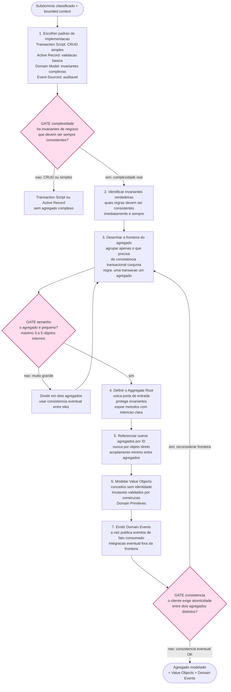

### Passo a passo (entrada -> saida)
1. **Escolher padrao de implementacao** — entrada: subdominio classificado. Transaction Script para CRUD simples; Active Record para validacao basica; Domain Model para invariantes complexas; Event-Sourced para auditabilidade completa (Khononov). Saida: padrao escolhido.
2. **Identificar invariantes verdadeiras** — entrada: regras de negocio. Quais regras devem ser imediatamente e sempre consistentes? (ex.: saldo nunca negativo, estoque nao pode ficar abaixo de zero). Saida: lista de invariantes.
3. **Desenhar a fronteira do agregado** — entrada: invariantes. Agrupar apenas objetos que precisam ser consistentes juntos na mesma transacao. Regra de ouro: uma transacao modifica um e somente um agregado. Saida: boundary candidata.
4. **Definir o Aggregate Root** — entrada: boundary. Unica porta de entrada; todos os acessos externos passam por ela; ela protege invariantes e expoe metodos com intencao clara (intention-revealing). Saida: raiz com API rica.
5. **Referenciar outros agregados por ID** — entrada: necessidade de relacao com outro agregado. Nunca por objeto direto; apenas pelo identificador. Saida: acoplamento minimo e consistencia eventual entre agregados.
6. **Modelar Value Objects** — entrada: conceitos do dominio sem identidade propria. Imutaveis, validados por construcao na criacao (Domain Primitives de Secure by Design). Saida: tipos ricos que tornam estados ilegais irrepresentaveis.
7. **Emitir Domain Events** — entrada: fatos de negocio ocorridos dentro do agregado. A raiz publica eventos nomeados com vocabulario de negocio; consumidores externos reagem de forma eventual. Saida: eventos para integracao desacoplada.

### Pontos de gate
- **GATE G1 — Ha invariantes reais?** Reprovado (CRUD simples) -> Transaction Script ou Active Record. Nao use Domain Model onde CRUD resolve.
- **GATE G2 — Tamanho do agregado.** Reprovado (muito grande) -> **laco de divisao**: separar em dois agregados e aceitar consistencia eventual entre eles. Agregados grandes matam concorrencia e causam contencao.
- **GATE G3 — Atomicidade cruzada.** Se o cliente exige atomicidade entre dois agregados distintos -> **laco de revisao da fronteira** (passo 3): talvez sejam um unico agregado, ou a consistencia eventual via Saga e aceitavel para o negocio.

---

## L14 — Refactoring Toward Deeper Insight de Evans (Breakthrough)

> Ciclo continuo de refinamento do modelo: detectar desconforto, explorar com o especialista,
> tornar o implicito explicito, aplicar Supple Design e validar com a linguagem ubiqua.
> Fonte: Evans, Domain-Driven Design Blue Book (2003), parte IV.

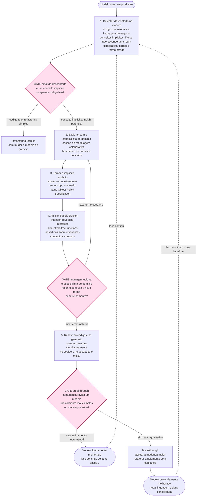

### Passo a passo (entrada -> saida)
1. **Detectar desconforto no modelo** — entrada: modelo atual. Sinais: codigo que nao fala a linguagem do negocio; conceito implicito escondido em if-else ou comentario; especialista corrigindo termos; analogias que o especialista usa mas que nao aparecem no codigo. Saida: candidato a refinamento.
2. **Explorar com o especialista** — entrada: candidato. Sessao de modelagem colaborativa; brainstorm de nomes; o especialista fala, o desenvolvedor modela em tempo real. Saida: hipotese de conceito faltante.
3. **Tornar o implicito explicito** — entrada: hipotese. Extraia o conceito oculto em um tipo nomeado (Value Object, Policy, Specification, Role Object). Saida: modelo mais rico com o conceito visivel.
4. **Aplicar Supple Design** — entrada: modelo com novo conceito. Intention-revealing interfaces (nomes que revelam intencao); side-effect-free functions (operacoes de consulta sem mutacao); assertions sobre invariantes; conceptual contours (fronteiras naturais do dominio). Saida: modelo flexivel.
5. **Validar com linguagem ubiqua** — entrada: novo termo. O especialista usa o termo naturalmente sem explicacao? Se sim, ele entra simultaneamente no codigo e no glossario oficial. Saida: vocabulario expandido.
6. **Avaliar breakthrough** — entrada: mudanca aplicada. E um refinamento incremental (melhora gradual) ou um breakthrough (salto que simplifica ou expressa radicalmente melhor)? Breakthrough -> aceitar a mudanca mais ampla com coragem. Saida: modelo evoluido.

### Pontos de gate
- **GATE G1 — Conceito implicito ou codigo feio.** Codigo feio sem conceito de dominio -> refactoring tecnico simples. Conceito implicito (regra que merece um tipo proprio) -> explorar com especialista.
- **GATE G2 — Linguagem ubiqua.** O especialista deve reconhecer e usar o novo termo naturalmente. Reprovado -> **laco de volta ao passo 2** com nova hipotese de nome/conceito. O teste e o especialista, nao o desenvolvedor.
- **GATE G3 — Breakthrough.** Refinamento incremental e o caso normal; breakthrough e raro e valioso. Quando ocorre, aceitar a mudanca mais ampla (Evans: nao ter medo do salto). Ambos retornam ao laco continuo — refatoracao de dominio nunca termina.
