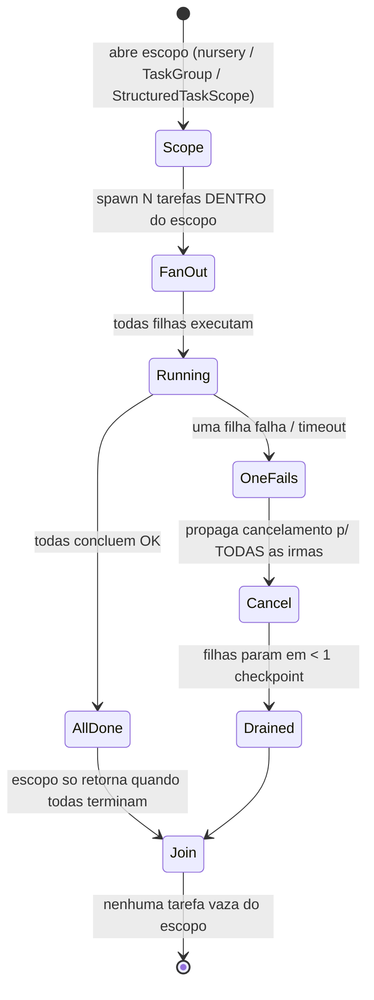
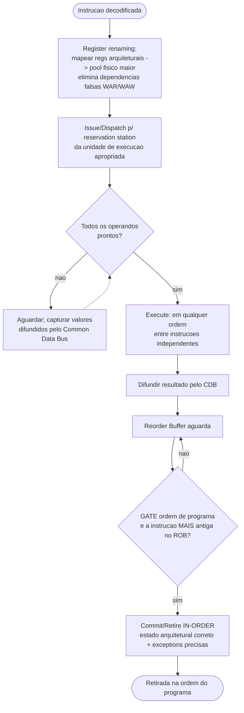

# LOOPS — Onda 3 "Sistemas & Maquina" — Diagramas de Workflow

> Formalizacao dos processos canonicos dos tres dominios desta onda em **diagramas mermaid** (flowchart / stateDiagram) + **passo a passo numerado** (com entrada/saida) + **pontos de gate**.
> Cada workflow e desenhado para virar comportamento de agent: entradas explicitas, decisoes, lacos de retry/iteracao e gates de bloqueio.
> Fecha com um **Loop mestre** unico que um agent de IA seguiria ao raciocinar sobre "sistemas e maquina".

Convencoes dos diagramas:
- `([ ])` = inicio/fim · `{ }` = decisao/gate · `[ ]` = passo · seta tracejada `-.->` = laco de retorno/retry.
- **GATE** = ponto onde o fluxo BLOQUEIA ate o criterio ser satisfeito (nao "passa adiante por fe").

---

# DOMINIO A — Concorrencia & Performance de Software

## A1 — Ciclo de otimizacao orientado a profiling (measure-first)

Origem: P5 (Amdahl), P6 (cauda), T3 (USE), T5 (flame graphs), T7 (microbenchmark honesto). Checklist "Ciclo de otimizacao".

```mermaid
flowchart TD
    start([Pedido: "isso esta lento / caro"]) --> slo[Definir metrica-alvo + SLO\nentrada: requisito\nsaida: p99? throughput? custo?]
    slo --> base[Medir baseline reprodutivel\nwarm-up + repeticoes + CI]
    base --> g_base{GATE baseline\nbaseline estavel e reproducivel?}
    g_base -->|nao| base
    g_base -->|sim| flame[Profile: flame graph on-CPU + off-CPU\nidentificar hotspot dominante]
    flame --> amdahl{GATE Amdahl\nhotspot vale a pena?\n(fracao do tempo > limiar)}
    amdahl -->|nao, < 5% do tempo| stop_low([Parar: ganho teorico irrisorio])
    amdahl -->|sim, hotspot dominante| hyp[Formular hipotese + menor mudanca que a testa]
    hyp --> impl[Implementar a mudanca minima]
    impl --> remeasure[Re-medir vs baseline\nmesmo rigor estatistico]
    remeasure --> g_win{GATE ganho\nmelhora significativa\n(fora do intervalo de confianca)?}
    g_win -->|nao| revert[Reverter mudanca]
    revert -.-> flame
    g_win -->|sim| accept[Aceitar + atualizar baseline]
    accept --> more{Ainda fora do SLO?}
    more -->|sim| flame
    more -->|nao| done([SLO atingido])
```

Passo a passo:
1. **Definir metrica-alvo + SLO.** Entrada: requisito de negocio. Saida: alvo explicito (p99, throughput, custo/req). Sem alvo, nao ha "pronto".
2. **Medir baseline.** Entrada: carga representativa. Saida: numero reproducivel com warm-up + repeticoes + intervalo de confianca (T7).
3. **Profile (flame graph).** Entrada: baseline. Saida: hotspot dominante; usar on-CPU (onde gasta) e off-CPU (onde espera — lock/IO).
4. **Implementar a menor mudanca** que testa a hipotese sobre o hotspot.
5. **Re-medir** com o mesmo rigor; comparar contra baseline.
6. **Aceitar ou reverter**; se ainda fora do SLO, voltar ao profile.

Pontos de gate:
- **GATE baseline:** so avanca com baseline reproducivel (sem isto, qualquer "ganho" e ruido).
- **GATE Amdahl:** bloqueia otimizar hotspot que e fracao pequena do tempo — speedup_max = 1/((1-p)+p/N).
- **GATE ganho:** so aceita melhora fora do intervalo de confianca; caso contrario reverte (anti-folclore).

---

## A2 — Escolha de modelo de concorrencia + correcao (thread-safety)

Origem: P1 (visibilidade/atomicidade/ordenacao), P2 (memory ordering), P3 (imutabilidade/confinamento), P4 (linearizability). Checklist "Revisao de codigo concorrente".

```mermaid
flowchart TD
    start([Estado a manipular concorrentemente]) --> q_share{Existe estado mutavel\nCOMPARTILHADO?}
    q_share -->|nao| safe([Pronto: confinamento / imutabilidade = thread-safe de graca])
    q_share -->|sim, mas evitavel| avoid[Tornar imutavel OU confinar a 1 thread]
    avoid --> safe
    q_share -->|sim, genuino e hot| policy[Documentar politica de sincronizacao do estado]
    policy --> atom{Operacoes compostas\n(check-then-act, i++)\natomicas?}
    atom -->|nao| addatom[Adicionar atomicidade\n(lock / CAS / atomic)]
    addatom --> vis
    atom -->|sim| vis{Visibilidade garantida?\n(happens-before / volatile / acquire-release)}
    vis -->|nao| addvis[Adicionar barreira de memoria\n(NB: volatile NAO atomiza i++)]
    addvis --> ord
    vis -->|sim| ord{Ordering: qual o modo mais fraco\nque PROVA correcao?}
    ord --> picksc[Default seq_cst\ndescer p/ acquire-release so com prova + benchmark\nrelaxed so em contadores que nada sincronizam]
    picksc --> g_review{GATE revisao concorrente\nlocks em ordem total global?\npublicacao segura (sem vazar this)?\nteste de stress cobre invariante?}
    g_review -->|falha| fix[Corrigir item violado]
    fix -.-> g_review
    g_review -->|passa| ship([Codigo concorrente aprovado])
```

Passo a passo:
1. **Pergunta-zero: posso evitar o compartilhamento?** Entrada: requisito de estado. Saida: imutavel/confinado (encerra) ou "compartilhamento genuino".
2. **Documentar politica de sincronizacao** do estado compartilhado restante.
3. **Atomicidade** das operacoes compostas (check-then-act, read-modify-write).
4. **Visibilidade** via happens-before (lembrar: `volatile` da visibilidade, nao atomiza `i++`).
5. **Ordering** pelo modo mais fraco que prova correcao (default seq_cst; relaxed so em contadores puros — P2).
6. **Revisao final** (ordem total de locks, publicacao segura, teste de stress).

Pontos de gate:
- **GATE revisao concorrente:** os tres bugs (atomicidade, visibilidade, ordenacao) sao distintos — resolver um nao resolve os outros (P1); bloqueia se faltar ordem total de locks, publicacao segura ou teste de stress.

---

## A3 — Prevencao de deadlock (Coffman)

Origem: Checklist "Prevencao de deadlock"; P6 do dominio SO (ordem total quebra espera circular).

```mermaid
flowchart TD
    start([Caminho critico com >1 lock]) --> map[Mapear TODOS os locks no caminho]
    map --> graph[Montar grafo de aquisicao de locks]
    graph --> cycle{Ha ciclo no grafo?\n(= espera circular possivel)}
    cycle -->|nao| ok([Sem deadlock por espera circular])
    cycle -->|sim| strat{Da pra impor\nordem TOTAL de locks?}
    strat -->|sim| order[Impor ordem total consistente em TODOS os paths]
    order --> nested{Ha nested locks?}
    nested -->|sim| open[Eliminar: open calls\n(chamar fora do lock)]
    open --> recheck
    nested -->|nao| recheck[Re-montar grafo]
    recheck -.-> cycle
    strat -->|nao (ordem global impossivel)| trylock[tryLock com timeout + backoff exponencial]
    trylock --> ok
```

Passo a passo:
1. **Mapear locks** do caminho critico. Entrada: codigo multithread. Saida: lista de locks.
2. **Grafo de aquisicao** — nos = locks, arestas = "adquire X enquanto segura Y".
3. **Detectar ciclo** = espera circular (1 das 4 condicoes de Coffman).
4. **Impor ordem total** (quebra a espera circular) ou, se impossivel, **tryLock + timeout + backoff**.
5. **Eliminar nested locks** com open calls.

Pontos de gate:
- **GATE ciclo:** grafo com ciclo bloqueia merge; quebrar QUALQUER condicao de Coffman (exclusao mutua, hold-and-wait, no-preemption, espera circular) basta — ordem total e a mais barata.

---

## A4 — Sizing de pool + protecao sob carga (Little's Law + backpressure)

Origem: P7 (Little's Law), P8 (backpressure/load shedding), T8 (sizing), T6 (hedged requests), P6 (cauda).

```mermaid
flowchart TD
    start([Dimensionar concorrencia de um servico]) --> bound{Carga e\nCPU-bound ou I/O-bound?}
    bound -->|CPU-bound| cpu[pool ~ numero de cores\n(oversubscription so prejudica)]
    bound -->|I/O-bound| io[Little: L = lambda x W\nGoetz: N = Ncpu x Ucpu x (1 + W/C)]
    cpu --> bench
    io --> bench[Benchmark + ajuste\n(tendencia: adaptive concurrency limits)]
    bench --> run([Em producao com 4 Golden Signals instrumentados])
    run --> load{Saturacao chegando?\n(L > lambda_max x W_alvo)}
    load -->|nao| run
    load -->|produtor pode esperar| bp[Backpressure: sinalizar upstream p/ desacelerar]
    bp --> run
    load -->|ja em distress| shed[Load shedding por prioridade\n(descarta baixo valor, preserva critico)]
    shed --> run
    run --> tail{Fan-out com cauda alta?\n(p99/p999 estoura)}
    tail -->|sim| hedge[Hedged request: 2a chamada apos p95\nusa a 1a que volta, cancela a outra\n(~2-5% carga, p99.9 cai ordens de magnitude)]
    hedge --> run
    tail -->|nao| run
```

Passo a passo:
1. **Classificar carga** CPU-bound vs I/O-bound. Entrada: perfil do servico. Saida: formula aplicavel.
2. **Calcular pool** — CPU: ~#cores; I/O: Little (L=lambdaW) + Goetz, depois benchmark.
3. **Instrumentar 4 Golden Signals** (latencia, trafego, erros, saturacao).
4. **Sob saturacao:** backpressure (proativo, produtor espera) ou load shedding (ultima linha, descarta baixo valor).
5. **Cauda em fan-out:** hedged request — 2a chamada apos p95, usa a primeira, cancela a perdedora.

Pontos de gate:
- **GATE saturacao:** sistema saturado NUNCA acumula (memoria explode, latencia diverge) — backpressure OU shedding obrigatorio.
- **GATE cauda:** em qualquer fan-out, otimizar p99/p999, nunca a media (P6).

---

## A5 — Structured concurrency (fan-out/fan-in de tarefas/sub-agents)

Origem: P10 (structured concurrency), Aplicacao em agents (fan-out estruturado, cancelamento propagado, confinamento).



Passo a passo:
1. **Abrir escopo.** Entrada: conjunto de sub-tarefas independentes. Saida: nursery/TaskGroup que possui o ciclo de vida.
2. **Fan-out** — spawnar todas as filhas DENTRO do escopo (spawn solto = "go considered harmful").
3. **Aguardar (join)** — o escopo so retorna quando todas terminam.
4. **Propagacao de falha/cancel** — erro ou timeout na mae cancela todas as irmas.
5. **Confinamento** — cada filha dona do seu contexto; zero estado mutavel compartilhado = zero race.

Pontos de gate:
- **GATE no-leak:** verificavel — nenhuma tarefa/sub-agent continua consumindo recursos apos o coordenador retornar.
- **GATE cancelamento:** filhas param em < 1 checkpoint apos cancel da mae (padrao or-done).

---

# DOMINIO B — Sistemas Operacionais

## B1 — Diagnostico de sistema travado (playbook USE adaptado)

Origem: Tecnica "Diagnosticar um sistema travado"; Aplicacao em agents (diagnosticar, nao chutar).

```mermaid
flowchart TD
    start([Sintoma: "servico lento / travado"]) --> top[top/htop: load avg vs CPU%]
    top --> g_class{GATE classificacao\nload alto + CPU baixa?}
    g_class -->|sim => NAO e CPU| io[iostat -x 1: util% ~100 = disco saturado\niotop p/ culpado]
    g_class -->|CPU alta| perf[perf top / perf record: onde a CPU vai\nperf lock: contencao]
    io --> mem[/proc/meminfo, free -m:\navailable, swap, major vs minor page fault/]
    perf --> mem
    mem --> oom{dmesg | grep oom?\nOOM killer atuou?}
    oom -->|sim| oomfix[Ler quem matou e por que\n=> limite de memoria / vazamento]
    oom -->|nao| trace[strace -p (fora do hot path)\nbpftrace/ftrace p/ eventos finos]
    oomfix --> hyp
    trace --> hyp[Formar hipotese de recurso gargalo\n(CPU vs I/O vs lock vs memoria)]
    hyp --> g_evidence{GATE evidencia\nhipotese ancorada em sinal observado?}
    g_evidence -->|nao| top
    g_evidence -->|sim| fix([Propor solucao citando o sinal\nex: "load 12, CPU 8% => bloqueio I/O"])
```

Passo a passo:
1. **`top`/`htop`** — entrada: sintoma. Saida: load average vs CPU% (a primeira bifurcacao).
2. **Bifurcar:** load alto + CPU baixa => I/O ou lock; CPU alta => `perf`.
3. **I/O:** `iostat -x 1`, `iotop`. **CPU:** `perf top/record`, `perf lock`.
4. **Memoria:** `/proc/meminfo`, `free -m`; distinguir major page fault (disco, caro) de minor (barato).
5. **OOM:** `dmesg | grep -i oom` — quem matou e por que.
6. **Trace fino:** `strace` (fora do hot path), `bpftrace`/`ftrace`.
7. **Hipotese + recomendacao** citando o sinal.

Pontos de gate:
- **GATE classificacao:** decide CPU vs I/O/lock pela relacao load/CPU antes de qualquer fix.
- **GATE evidencia:** nenhuma recomendacao sem sinal observado (anti-chute) — "diagnostica, nao chuta".

---

## B2 — Resolver page fault (demand paging)

Origem: Tecnica "Resolver page fault"; P5 (caching), P1 (limited direct execution).

```mermaid
flowchart TD
    start([CPU acessa endereco virtual]) --> mmu[MMU consulta page table\n(ate 4 niveis x86-64)]
    mmu --> present{Pagina presente\nna page table?}
    present -->|sim| tlbfill[Servir + atualizar TLB] --> resume([Continua execucao])
    present -->|nao| trap[Hardware dispara page fault trap\n=> entra no kernel]
    trap --> legal{GATE legalidade\nacesso dentro do VMA\ne com permissao certa?}
    legal -->|nao| segv([SIGSEGV — mata o processo])
    legal -->|sim| locate[Localizar pagina:\nswap/disco, arquivo mmap, ou zero-fill on demand]
    locate --> frame{Ha frame livre?}
    frame -->|nao| replace[Page replacement (clock/LRU-aprox)\nvitima suja => escrever antes (writeback)]
    replace --> load_pg
    frame -->|sim| load_pg[Carregar pagina no frame]
    load_pg --> update[Atualizar page table + inserir no TLB]
    update --> reexec[Reexecutar a instrucao\n(transparente p/ app)]
    reexec --> resume
```

Passo a passo:
1. **Acesso virtual -> MMU** consulta page table multi-nivel. Saida: hit (serve) ou miss.
2. **Page fault trap** entra no kernel.
3. **Validar legalidade** (VMA + permissao); ilegal => SIGSEGV.
4. **Localizar a pagina** (swap, mmap, zero-fill).
5. **Garantir frame** — se nao ha, rodar page replacement; vitima suja faz writeback.
6. **Carregar + atualizar page table/TLB + reexecutar** a instrucao (transparente).

Pontos de gate:
- **GATE legalidade:** acesso fora do VMA ou sem permissao => SIGSEGV (fail-safe), nunca serve a pagina.

---

## B3 — Escrita duravel correta (write-ahead / fsync)

Origem: P7 (write-ahead/WAL), Tecnica "Escrita duravel correta"; Checklist "Antes de declarar persistido".

```mermaid
flowchart TD
    start([Dado precisa sobreviver a crash?]) --> need{Precisa durar?}
    need -->|nao (cache/efemero)| skip([write() basta — sem custo de durabilidade])
    need -->|sim| write[write(): vai p/ PAGE CACHE\n(NAO persistido)]
    write --> create{Criando arquivo novo?}
    create -->|sim| atomic[Padrao atomico:\n1. escrever em temp\n2. fsync(temp)\n3. rename() (atomico no mesmo FS)\n4. fsync no DIRETORIO pai]
    create -->|nao (update)| fsync[fsync(fd) dados+metadados\nou fdatasync(fd) (mais rapido)]
    atomic --> g_durable
    fsync --> g_durable{GATE durabilidade\ntodo path critico chama fsync/fdatasync?}
    g_durable -->|nao| fix[Adicionar fsync no path]
    fix -.-> g_durable
    g_durable -->|sim| wal{E log/WAL de DB?}
    wal -->|sim| commit[fsync do log = ponto de commit\nagrupar (group commit) p/ amortizar]
    wal -->|nao| persisted([Persistido com honestidade])
    commit --> persisted
```

Passo a passo:
1. **Precisa durar?** Entrada: requisito. Saida: efemero (`write` basta) ou critico.
2. **`write()`** so coloca no page cache — NAO persistido.
3. **Criacao atomica:** temp + fsync(temp) + rename + fsync(dir-pai).
4. **Update:** `fsync` (dados+metadados) ou `fdatasync` (mais rapido).
5. **WAL de DB:** `fsync` do log e o ponto de commit; group commit amortiza.

Pontos de gate:
- **GATE durabilidade:** nunca afirmar "dados salvos" para `write()` sem `fsync` — perda garantida em corte de energia.

---

## B4 — Escalonar / observar / trocar o scheduler (Linux moderno)

Origem: P2 (mechanism vs policy), P3 (EEVDF), P4 (MLFQ), Tecnica "Trocar/observar o scheduler".

```mermaid
flowchart TD
    start([Tarefa precisa de tratamento de CPU especifico?]) --> rt{Tempo real duro?}
    rt -->|sim| rtclass[SCHED_FIFO / SCHED_RR / SCHED_DEADLINE]
    rt -->|nao| fair[SCHED_OTHER = classe fair (EEVDF default 6.6+)]
    fair --> latency{Latency-sensitive\n(interativa)?}
    latency -->|sim| setattr[sched_setattr(): sched_runtime menor\n=> request size menor => deadline mais cedo => mais responsivo]
    latency -->|nao| keep[Deixar EEVDF distribuir por lag\n(elegivel: lag>=0, menor virtual deadline)]
    setattr --> need_custom
    keep --> need_custom{Politica default insuficiente?}
    need_custom -->|nao| done([Observar via chrt -p / metrica de latencia])
    need_custom -->|sim| sched_ext[sched_ext (6.12+): politica em eBPF\ncarrega a quente]
    sched_ext --> g_verifier{GATE verificador BPF\nprograma sem loop infinito / bug de memoria?}
    g_verifier -->|reprova| sched_ext
    g_verifier -->|aprova| watchdog{Scheduler custom misbehave?\n(task sem rodar tempo demais)}
    watchdog -->|sim| fallback[Kernel cai de volta no default automaticamente]
    watchdog -->|nao| done
    fallback --> done
```

Passo a passo:
1. **Classe certa:** tempo real duro => RT classes; resto => fair (EEVDF).
2. **Interativa:** `sched_setattr()` com `sched_runtime` menor (request size menor = deadline mais cedo).
3. **Anti-patologias herdadas do MLFQ:** priority boost periodico (anti-starvation) e contabilizar tempo total no nivel (anti-gaming).
4. **Politica custom (6.12+):** escrever em eBPF (`sched_ext`), carregar a quente.
5. **Observar** via `chrt -p` + metrica de latencia.

Pontos de gate:
- **GATE verificador BPF:** mechanism (kernel) imutavel; policy (BPF) so carrega se o verificador prova ausencia de loop infinito/bug de memoria. Se o custom misbehave, fallback automatico ao default (mechanism vs policy, P2).

---

## B5 — Sandbox de execucao de codigo nao-confiavel (least privilege)

Origem: P8 (isolamento/least privilege — Saltzer & Schroeder), Tecnica "limite de memoria de container", debate io_uring; Aplicacao em agents (sandbox de execucao).

```mermaid
flowchart TD
    start([Rodar codigo gerado / nao-confiavel]) --> root{Vai rodar como root no host?}
    root -->|sim| block_root([BLOQUEAR: nunca root no host])
    root -->|nao| ns[Namespaces: isolar pid/net/mount/user]
    ns --> cg[cgroup v2: memory.max + memory.high + cpu + timeout\nNB: page cache CONTA no uso]
    cg --> seccomp[seccomp-bpf: allowlist de syscalls\nfail-safe defaults = nega por padrao]
    seccomp --> hostile{Contexto hostil / multi-tenant?}
    hostile -->|sim| block_iouring[BLOQUEAR io_uring via seccomp\n(~60% das vulns de kernel; SELinux nao observa)]
    hostile -->|nao| caps
    block_iouring --> caps[Drop de capabilities Linux\n(so o minimo necessario)]
    caps --> g_priv{GATE least privilege\ncada componente com minimo de privilegio?\ncomplete mediation em op sensivel?}
    g_priv -->|falha| fixp[Reduzir privilegio / adicionar mediacao]
    fixp -.-> g_priv
    g_priv -->|passa| events[Monitorar memory.events\n(oom_kill, high, max)]
    events --> run([Executar isolado])
```

Passo a passo:
1. **Nunca root no host** — bloqueio imediato.
2. **Namespaces** (pid/net/mount/user) para isolamento.
3. **cgroup v2** (`memory.max`/`high`, cpu, timeout) — lembrar que page cache conta.
4. **seccomp-bpf** allowlist (fail-safe defaults).
5. **Contexto hostil:** bloquear `io_uring` (superficie de exploit + buraco de observabilidade SELinux).
6. **Drop de capabilities** ao minimo.
7. **Monitorar `memory.events`**.

Pontos de gate:
- **GATE least privilege:** least privilege + complete mediation + fail-safe defaults (Saltzer & Schroeder); bloqueia se algum componente tem privilegio alem do necessario.

---

# DOMINIO C — Arquitetura & Organizacao de Computadores

## C1 — Diagnostico roofline (memory-bound vs compute-bound)

Origem: P1 (memory wall), P2 (IC x CPI x Clock), T3 (roofline aplicado); Checklist "Diagnostico de performance".

```mermaid
flowchart TD
    start([Kernel / loop / inferencia lento]) --> measure[Medir com contadores de HW\n(perf/VTune): cache-miss, branch-mispredict, IPC]
    measure --> ai[Calcular arithmetic intensity (AI)\n= FLOPs uteis / bytes movidos da DRAM]
    ai --> roof{AI vs ponto de inflexao\n(banda x pico FLOPS)}
    roof -->|AI baixa| mem[MEMORY-BOUND:\nreduzir movimento de dados\nquantizacao, fusion, blocking/tiling, layout]
    roof -->|AI alta| comp[COMPUTE-BOUND:\nmais ILP / SIMD / melhor algoritmo]
    mem --> eq[Aplicar IC x CPI x Clock:\nisolar QUAL termo dominar]
    comp --> eq
    eq --> g_real{GATE medicao\ndecisao ancorada em numero,\nnao em "vamos paralelizar"?}
    g_real -->|nao| measure
    g_real -->|sim| par{Vale paralelizar?}
    par -->|problema fixo| amdahl[Amdahl: teto = 1/s\n10% serial => max 10x]
    par -->|problema cresce c/ recursos| gustafson[Gustafson: speedup ~ linear\n(batch inference, rendering)]
    amdahl --> act([Agir no termo dominante + re-medir])
    gustafson --> act
```

Passo a passo:
1. **Medir com contadores de HW** (cache-miss, branch-mispredict, IPC) — nunca chutar.
2. **Arithmetic intensity** = FLOPs / bytes-DRAM.
3. **Classificar** memory-bound (AI baixa) vs compute-bound (AI alta).
4. **Agir conforme o lado:** memory => menos movimento de dados; compute => mais ILP/SIMD.
5. **IC x CPI x Clock** para isolar o termo a atacar.
6. **Decidir paralelizar** com Amdahl (problema fixo) ou Gustafson (problema cresce).

Pontos de gate:
- **GATE medicao:** decisao ancorada em numero (banda satura? cache-miss alto?), nunca "vamos paralelizar" cego (P1, T3).

---

## C2 — Execucao out-of-order (Tomasulo + ROB + register renaming)

Origem: T1 (out-of-order); P5 (ISA vs microarquitetura), P6 (especulacao).



Passo a passo:
1. **Register renaming** — regs arquiteturais -> pool fisico; mata WAR/WAW (so RAW resta).
2. **Issue** para a reservation station da unidade certa.
3. **Wait/Capture** — espera operandos; captura valores do Common Data Bus.
4. **Execute** fora de ordem entre independentes.
5. **Broadcast** resultado pelo CDB.
6. **Commit in-order** via ROB — estado arquitetural e exceptions precisas.

Pontos de gate:
- **GATE ordem de programa:** o ROB so retira NA ORDEM do programa, garantindo que executar fora de ordem ainda "parece" sequencial (exceptions precisas).

---

## C3 — Geracao de codigo cache-friendly (hardware-sympathetic)

Origem: P4 (locality), T4 (coerencia/false sharing), P9 (false sharing — dominio A); Checklist "Codigo cache-friendly".

```mermaid
flowchart TD
    start([Gerar / revisar hot path]) --> access{Padrao de acesso\nsequencial possivel?}
    access -->|sim| contig[Arrays contiguos > listas ligadas\nSoA p/ varredura + SIMD\nacesso sequencial aciona prefetch HW]
    access -->|aleatorio irredutivel| reduce[Reduzir numero de misses\n(nao forcar sequencialidade falsa)]
    contig --> tile[Blocking/tiling: caber working set em cache]
    reduce --> tile
    tile --> mt{Variaveis escritas\npor cores distintos?}
    mt -->|sim| pad[Padding/alinhamento a 64B (ou 128B)\nanti false-sharing]
    mt -->|nao| align[Alinhar dados quentes a linha de cache]
    pad --> g_falseshare{GATE false sharing\nperf c2c confirma contencao?}
    g_falseshare -->|profilatico sem evidencia| nopad[NAO padronizar tudo\n(desperdica cache/memoria)]
    g_falseshare -->|contencao real medida| ship
    align --> ship([Hot path hardware-sympathetic])
    nopad --> ship
```

Passo a passo:
1. **Padrao de acesso:** sequencial (aciona prefetch) ou aleatorio irredutivel.
2. **Estrutura:** arrays contiguos > pointer-chasing; SoA para varredura/SIMD.
3. **Blocking/tiling** para caber o working set em cache.
4. **Multi-thread:** padding/alinhamento a 64B (128B se adjacent-sector prefetch) contra false sharing.

Pontos de gate:
- **GATE false sharing:** so faz padding onde `perf c2c` mostrou contencao real — padding profilatico em tudo desperdica cache/memoria (P9).

---

## C4 — Concorrencia no metal (coerencia + consistencia)

Origem: T4 (MESI/MOESI + TSO/weak); Checklist "Concorrencia correta no metal". Costura com A2 e B (futex).

```mermaid
flowchart TD
    start([Codigo lock-free / sincronizacao no metal]) --> target{Modelo de consistencia\ndo alvo?}
    target -->|x86 = TSO| tso[Total Store Order: quase sequencial\nso store->load reordering\n"perdoa" mais]
    target -->|ARM / RISC-V = weak| weak[Reordena agressivamente\nEXIGE barreiras de memoria explicitas]
    tso --> g_portable{GATE portabilidade\ncodigo sera usado em ARM/RISC-V?}
    g_portable -->|sim| addfence[Inserir fences/atomics com ordering explicito\n(correto em x86 pode quebrar em weak)]
    g_portable -->|so x86| coherence
    weak --> addfence
    addfence --> coherence[Coerencia MESI/MOESI cuida da\nconsistencia de linhas entre caches]
    coherence --> done([Sincronizacao correta cross-ISA])
```

Passo a passo:
1. **Identificar modelo de consistencia** do alvo (x86 TSO vs ARM/RISC-V weak).
2. **x86 TSO** perdoa (so store->load reordering); **weak** exige barreiras.
3. **Portabilidade:** codigo lock-free correto em x86 pode quebrar em ARM — inserir fences/atomics com ordering explicito.
4. **Coerencia** (MESI/MOESI) e ortogonal: cuida de linhas consistentes entre caches.

Pontos de gate:
- **GATE portabilidade:** nao assumir que correto-em-x86 e portavel; weak ordering exige fences explicitos (T4).

---

## C5 — Decisao de hardware especializado (DSA / roofline de inferencia)

Origem: P1 (memory wall), T3 (roofline LLM), T5 (DSA/TPU), debate "CPU geral vs DSA"; Checklist "IA e hardware".

```mermaid
flowchart TD
    start([Workload de IA / kernel pesado]) --> regime{Regime de inferencia?}
    regime -->|prefill projecoes ~1024 OP/byte| compute[COMPUTE-BOUND\nbom uso de FLOPS]
    regime -->|decode ~1 OP/byte| memory[MEMORY-BOUND severo\n(satura banda, FLOPS ociosos)]
    compute --> lever
    memory --> lever[Alavancas reais de custo:\nquantizacao (INT8/BF16) + kernel fusion\n+ batching (empurra FFN/attn p/ compute)]
    lever --> volume{Volume alto E kernel estavel?}
    volume -->|nao| cpu[CPU geral / GPU generica\n(DSA = overengineering p/ workload variavel)]
    volume -->|sim| g_dsa{GATE DSA\nganho 10-100x justifica especializar?}
    g_dsa -->|sim| dsa[DSA: systolic array (MXU), HBM\n(TPU/tensor cores)\nfim do Dennard => dark silicon]
    g_dsa -->|nao| cpu
    dsa --> done([Hardware casado ao regime])
    cpu --> done
```

Passo a passo:
1. **Classificar regime:** prefill (compute-bound) vs decode (memory-bound severo, ~1 OP/byte).
2. **Aplicar alavancas:** quantizacao + kernel fusion + batching (reduzem bytes movidos / empurram para compute).
3. **Avaliar DSA:** so vale com volume alto + kernel estavel (ganho 10-100x); caso contrario CPU/GPU geral.
4. **Anatomia DSA:** systolic array (MXU) + HBM (banda ao lado do compute) — resposta ao fim do Dennard scaling.

Pontos de gate:
- **GATE DSA:** especializar so com volume + kernel estavel; DSA para workload variavel e overengineering (debate CPU vs DSA).

---

## C6 — Conviver com especulacao + side-channels (Spectre/Meltdown)

Origem: P6 (especulacao dupla face), debate "especulacao manter ou matar", KPTI; Checklist "Seguranca microarquitetural".

```mermaid
flowchart TD
    start([Codigo em CPU especulativa]) --> spec[Branch prediction + execucao especulativa\nescondem latencia]
    spec --> hit{Predicao correta?}
    hit -->|sim| fast[Throughput alto]
    hit -->|nao| flush[Flush de 15-30 ciclos\n(drena front-end + re-fetch)]
    flush --> branchless{Branches imprevisiveis em hot loop?}
    branchless -->|sim| bl[Considerar branchless code]
    branchless -->|nao| secret
    fast --> secret{Codigo toca SEGREDOS?}
    secret -->|nao| done([Manter especulacao — desligar mata throughput])
    secret -->|sim| g_sidechannel{GATE side-channel\nrisco de timing/Spectre tratado?}
    g_sidechannel -->|nao| mitigate[Mitigacao seletiva\n(isolar segredos, barreiras; KPTI no SO)\nNB: Spectre nao tem fix definitivo]
    mitigate --> done
    g_sidechannel -->|sim| done
    bl --> secret
```

Passo a passo:
1. **Especulacao** (branch prediction + exec especulativa) esconde latencia.
2. **Acerto** = throughput; **erro** = flush de 15-30 ciclos => branchless em hot loops imprevisiveis.
3. **Codigo com segredos:** side-channels especulativos sao risco real — mitigacao seletiva (isolar segredos, KPTI no SO).
4. **Veredito:** manter especulacao (desligar mata throughput); Spectre e custo permanente, nao bug com patch final.

Pontos de gate:
- **GATE side-channel:** quando o codigo toca segredos, alertar/mitigar timing/Spectre antes de considerar pronto (P6).

---

# Loop mestre — "olfato de Sistemas & Maquina"

> Diagrama unico que um agent de IA segue ao raciocinar sobre qualquer tarefa de performance, concorrencia, SO ou hardware desta onda. Ele unifica o fio condutor das tres extracoes: **dominar o nao-determinismo por medicao, nao por intuicao** + **mover dados custa mais que computar** + **diagnosticar, nao chutar** + **least privilege + structured lifecycle**.

```mermaid
flowchart TD
    start([Tarefa: performance / concorrencia / SO / hardware]) --> classify{Natureza da tarefa?}

    classify -->|"esta lento / caro"| diag[DIAGNOSTICAR antes de agir\nB1 playbook USE + C1 roofline\nmedir com contadores, nao chutar]
    classify -->|"correto sob concorrencia"| conc[CORRECAO concorrente\nA2 thread-safety + A3 deadlock + C4 metal]
    classify -->|"rodar codigo / persistir / escalonar"| os[PRIMITIVAS DE SO\nB3 fsync + B4 scheduler + B5 sandbox + B2 page fault]
    classify -->|"paralelizar / orquestrar tarefas"| orch[ORQUESTRACAO\nA5 structured concurrency + A4 sizing/backpressure]
    classify -->|"hardware / inferencia IA"| hw[HARDWARE\nC2 OoO + C3 cache-friendly + C5 DSA + C6 Spectre]

    diag --> g_evidence{GATE evidencia\nhipotese ancorada em sinal/numero observado?}
    g_evidence -->|nao| diag
    g_evidence -->|sim| bound{memory-bound vs compute-bound\nvs CPU vs I/O vs lock?}
    bound --> amdahl{GATE Amdahl/cauda\nhotspot dominante? otimizar p99 nao a media?}
    amdahl -->|nao vale| stop([Nao otimizar lugar errado])
    amdahl -->|vale| act[Agir no termo dominante]

    conc --> g_share{Posso EVITAR o compartilhamento?\n(imutabilidade / confinamento / ownership)}
    g_share -->|sim| safe[thread-safe de graca]
    g_share -->|nao| g_three{GATE 3-bugs\natomicidade + visibilidade + ordenacao\n+ ordem total de locks?}
    g_three -->|falha| conc
    g_three -->|passa| act

    os --> g_priv{GATE least privilege + durabilidade\nseccomp/cgroup/namespaces? fsync no path critico?}
    g_priv -->|falha| os
    g_priv -->|passa| act

    orch --> g_scope{GATE structured lifecycle\nnenhuma tarefa vaza do escopo?\ncancelamento propaga? backpressure sob carga?}
    g_scope -->|falha| orch
    g_scope -->|passa| act

    hw --> g_real{GATE medicao no metal\ndecisao por numero (AI/cache-miss)?\nside-channel tratado se ha segredo?}
    g_real -->|falha| hw
    g_real -->|passa| act

    act --> verify[Re-medir vs baseline\ncom rigor estatistico]
    verify --> g_win{GATE ganho/correcao\nmelhora significativa OU invariante provada?}
    g_win -->|nao| revert[Reverter + voltar ao diagnostico]
    revert -.-> classify
    g_win -->|sim| done([Entregar citando o sinal/numero que fundamentou a decisao])
```

Leitura do Loop mestre (heuristica de agent):
1. **Classificar a tarefa** em 1 de 5 trilhas (diagnostico, correcao concorrente, primitivas de SO, orquestracao, hardware).
2. **Atravessar o gate da trilha** — cada uma tem seu criterio inegociavel:
   - Diagnostico/Hardware: **evidencia/numero** (anti-chute) + Amdahl/cauda + roofline.
   - Concorrencia: **evitar compartilhamento** primeiro; senao, os 3 bugs + ordem total de locks.
   - SO: **least privilege + durabilidade honesta** (fsync, seccomp, cgroup).
   - Orquestracao: **structured lifecycle** (no-leak, cancelamento, backpressure).
3. **Agir no termo dominante** (mover dados/serial/hotspot), nunca no lugar errado.
4. **Re-medir** com rigor; **GATE final** so libera com ganho significativo OU invariante provada.
5. **Entregar citando o sinal/numero** que fundamentou — a entrega "diagnostica, nao chuta".

Principio-raiz que costura tudo: **o nao-determinismo (de threads, de filas, do hardware) e dominado por construcao (structured lifecycle, least privilege, imutabilidade) e por medicao (profiling, roofline, contadores), jamais por intuicao.**
