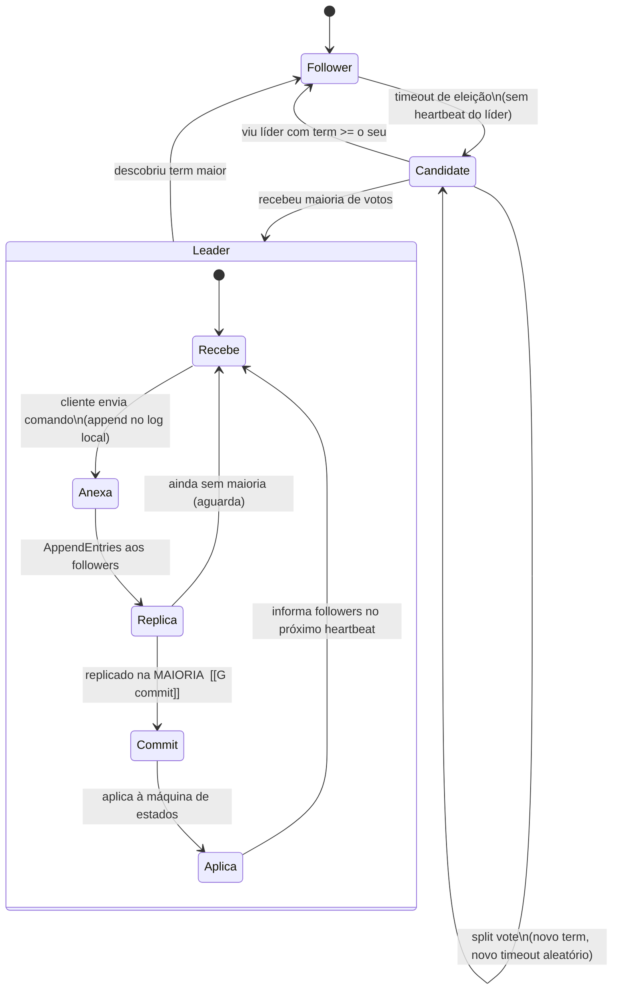
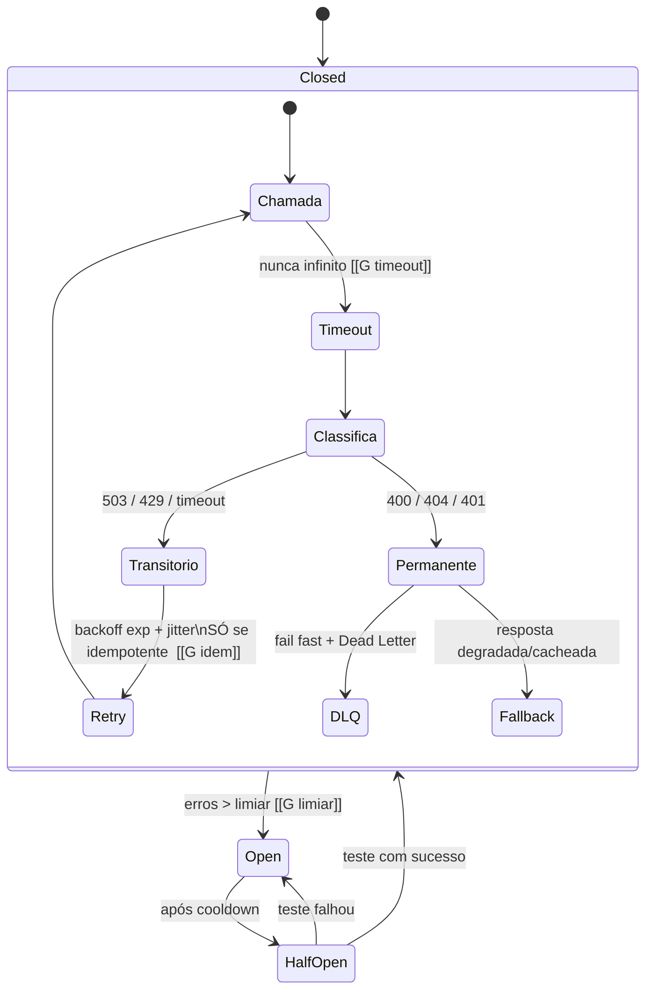
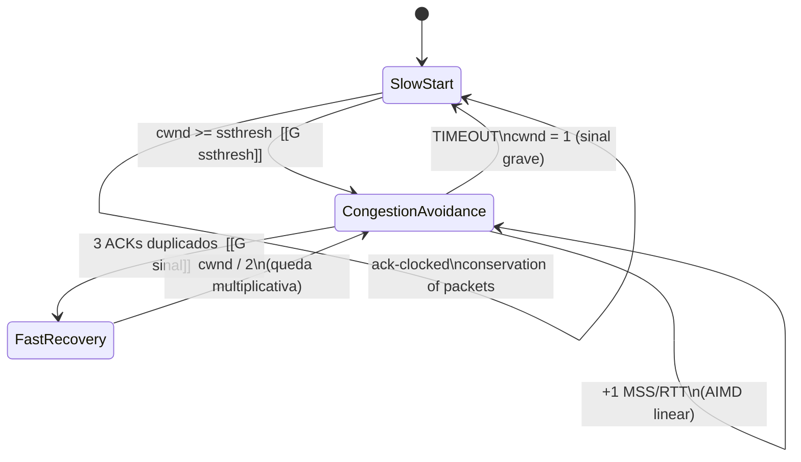

# LOOPS — Onda 4: Dados & Comunicação — Diagramas de Workflow

> Formalização dos processos canônicos da onda "Dados & Comunicação" em **diagramas mermaid + passo a passo + pontos de gate**. Pronto para a Fase 3 (visual) e para virar comportamento de agent de IA.
>
> Convenção dos diagramas: losango = decisão/gate; seta de volta = laço (retry/iteração); `[[G]]` no texto marca **ponto de gate** (decisão que bloqueia ou desvia o fluxo).
>
> **Princípio-âncora desta onda:** *exactly-once não existe na rede — existe at-least-once + idempotência na ponta.* Quase todo loop abaixo termina convergindo nessa regra.

---

## Índice de processos

| # | Domínio | Processo / Workflow canônico |
|---|---|---|
| L1 | Sistemas distribuídos | Raft — eleição + replicação de log |
| L2 | Sistemas distribuídos | Saga — transação distribuída com compensação |
| L3 | Sistemas distribuídos | Outbox + CDC — publicação de evento sem dual-write |
| L4 | Sistemas distribuídos | Quórum NWR — leitura/escrita leaderless + read repair |
| L5 | Sistemas distribuídos | Streaming Dataflow — watermark + triggers + late data |
| L6 | Bancos de dados | ACID + WAL — protocolo de commit durável |
| L7 | Bancos de dados | ARIES — recovery após crash (Analysis → Redo → Undo) |
| L8 | Bancos de dados | Escolha de isolamento + tratamento de write skew (SSI retry) |
| L9 | Bancos de dados | Query tuning — EXPLAIN ANALYZE + cardinalidade |
| L10 | Bancos de dados | Decisão de modelagem (relacional vs NoSQL; storage engine) |
| L11 | Bancos de dados | RAG — escolha de índice vetorial + filtro híbrido |
| L12 | APIs & integração | Contract-first de API REST |
| L13 | APIs & integração | Expand-and-contract — evoluir contrato sem downtime |
| L14 | APIs & integração | Resiliência de ponto de integração (timeout/breaker/retry) |
| L15 | APIs & integração | Idempotency-Key — mutação retryável segura |
| L16 | APIs & integração | Webhook confiável (entrada de terceiros) |
| L17 | Redes | rdt — construir entrega confiável sobre canal não confiável |
| L18 | Redes | Controle de congestionamento (slow-start → AIMD → recovery) |
| L19 | Redes | Anatomia do request HTTPS + escolha de protocolo (H2/H3) |
| L20 | Redes | Playbook de diagnóstico de pacote |
| ★ | Cross-domínio | **Loop mestre** — agent como cliente de rede confiável |

---

## L1 — Raft: eleição + replicação de log



**Passo a passo**
1. **Entrada:** cluster de N nós, todos *followers*, cada um com timeout de eleição aleatório (150–300 ms). **Saída:** estado estável aguardando heartbeat.
2. Follower sem heartbeat vira *candidate*, incrementa `term`, vota em si e dispara `RequestVote`. **Saída:** votos coletados.
3. **[[G eleição]]** Recebeu maioria? → vira *leader*. Empate (split vote)? → novo term + novo timeout aleatório (torna empates raros). Viu term maior? → volta a follower.
4. Líder recebe comando do cliente, anexa entry ao log, envia `AppendEntries`. **Entrada:** comando; **Saída:** entry replicada.
5. **[[G commit]]** Entry replicada na **maioria**? → marca comitada, aplica à state machine. Caso contrário, aguarda mais ACKs.
6. Reconciliação: log de follower divergente é sobrescrito pelo líder (log do líder é a verdade; entries não comitadas podem ser descartadas).
7. **Laço de falha:** líder cai → followers sem heartbeat → volta ao passo 2 com novo term. Safety preservada por **Leader Completeness** (só candidato com log atual o bastante ganha).

**Pontos de gate**
- **G eleição:** maioria de votos é condição dura — sem maioria não há líder (FLP: liveness depende de timeouts bem calibrados; curto demais = thrashing, longo demais = recuperação lenta).
- **G commit:** "comitado" = replicado na maioria. Nunca aplicar antes. Uma entry comitada jamais é perdida.

---

## L2 — Saga: transação distribuída com compensação

```mermaid
flowchart TD
    A[Início: transação global] --> B[Decompõe em N passos locais\ncada um com compensação definida]
    B --> C{Coordenação?  [[G coord]]}
    C -->|Orquestração| D[Coordenador central comanda passos]
    C -->|Coreografia| E[Serviços reagem a eventos]
    D --> F[Executa passo i\npersiste estado da saga]
    E --> F
    F --> G{Passo i OK?  [[G passo]]}
    G -->|Sim| H{i == N?}
    H -->|Não| I[i = i+1] --> F
    H -->|Sim| Z[Saga concluída\nconsistência eventual]
    G -->|Falha transitória| R{Retry esgotou?  [[G retry]]}
    R -->|Não| F
    R -->|Sim / falha permanente| K[Dispara compensações\nk-1, k-2, ..., 1 em ordem reversa]
    K --> Y[Estado consistente revertido]
```

**Passo a passo**
1. **Entrada:** transação de negócio que cruza serviços. Decomponha em N passos locais, cada um com **compensação** (rollback semântico, não rollback de DB). **Saída:** lista de passos + compensações.
2. **[[G coord]]** Escolha coordenação: **orquestração** (coordenador central — fácil de observar/debugar) ou **coreografia** (eventos — desacoplado, estado global opaco).
3. Executa passo `i` e **persiste o estado da saga** (qual passo, sucesso/falha). Cada passo e cada compensação **deve ser idempotente**.
4. **[[G passo]]** Passo OK? → avança a `i+1` até `i == N`.
5. **[[G retry]]** Falha transitória (timeout/rede)? → retry com backoff (recuperação para a frente, consenso 2025). Esgotou ou falha permanente? → compensação.
6. Falha definitiva no passo `k` → dispara compensações de `k-1 … 1` em **ordem reversa**. **Saída:** estado consistente.

**Pontos de gate**
- **G coord:** orquestração para fluxos auditáveis/críticos; coreografia para alto desacoplamento.
- **G retry:** híbrido — **retry primeiro, compensar só quando esgotar** (falhas transitórias > permanentes). Compensação é cara e nem sempre tem inversa limpa ("já enviei o email").
- Saga dá consistência **eventual**, não atomicidade. Prefira **durable execution** (Temporal/DBOS/Restate) ao orquestrador imperativo caseiro — sobrevive a crash retomando do passo exato.

---

## L3 — Outbox + CDC: publicação de evento sem dual-write

```mermaid
flowchart TD
    A[Operação de negócio] --> B[Transação ACID única]
    B --> C[Grava dado de negócio]
    B --> D[Insere linha na tabela outbox\nMESMA transação]
    C --> E[COMMIT atômico]
    D --> E
    E --> F{Estratégia de relay?  [[G relay]]}
    F -->|Polling| G[Processo lê outbox\nperiodicamente]
    F -->|CDC / Debezium| H[Lê o WAL\nlatência quase-zero]
    G --> I[Publica no broker\nat-least-once]
    H --> I
    I --> J[Consumidor idempotente\ndedup por event id  [[G dedup]]]
    J --> K[TTL / job limpa outbox]
    K --> A
```

**Passo a passo**
1. **Entrada:** necessidade de "gravar no DB **e** publicar evento". Na **mesma transação ACID**, grave o dado de negócio **e** insira o evento na tabela `outbox`. **Saída:** commit atômico (ou nada).
2. **[[G relay]]** Escolha o relay: **Polling** (simples, mais latência/carga no DB) ou **CDC via Debezium** lendo o WAL (latência quase real, desacopla o publishing — forma mais limpa em produção).
3. Relay publica no broker. Garante **at-least-once** (Debezium republica em restart/rebalance).
4. **[[G dedup]]** Consumidor **deve** ser idempotente — deduplica por event id (Idempotent Receiver). Sem isso, eventos duplicam.
5. Limpe a outbox (TTL/job) — ela cresce para sempre. **Laço:** volta ao início na próxima operação.

**Pontos de gate**
- **G relay:** CDC é o default de produção; polling só em casos simples/baixo volume.
- **G dedup:** assuma **at-least-once** sempre. Resolve o **dual-write problem** (DB e broker divergem silenciosamente se um dos dois falha). Outbox é o único padrão que dá atomicidade sem 2PC.

---

## L4 — Quórum NWR: leitura/escrita leaderless + read repair

```mermaid
flowchart TD
    A[Operação leaderless\nN réplicas] --> B{Tipo?}
    B -->|Escrita| C[Envia a N réplicas\naguarda W confirmações]
    B -->|Leitura| D[Lê de R réplicas]
    C --> E{W + R > N ?  [[G quorum]]}
    D --> E
    E -->|Sim| F[Interseção garantida:\nleitura toca >=1 réplica fresca]
    E -->|Não| G[Risco de stale read\nrevisar W/R]
    F --> H{Versões divergem?  [[G conflito]]}
    H -->|Sim| I[Read repair +\nanti-entropy Merkle trees\nvector clocks reconciliam]
    H -->|Não| J[Resposta consistente eventual]
    I --> J
    G --> C
```

**Passo a passo**
1. **Entrada:** sistema leaderless (Dynamo-style) com N réplicas. Defina W (confirmações de escrita) e R (réplicas lidas). **Saída:** política de quórum.
2. Escrita → aguarda W; leitura → consulta R réplicas.
3. **[[G quorum]]** `W + R > N`? → todo conjunto de leitura intersecta todo conjunto de escrita (lê ≥1 réplica com a versão mais recente). Senão → revisar W/R.
4. **[[G conflito]]** Versões divergem (escrita concorrente, propagação)? → **vector clocks** detectam, **read repair + anti-entropy (Merkle trees)** reconciliam.
5. **Saída:** consistência **eventual**, não linearizável.

**Pontos de gate**
- **G quorum:** `W+R>N` garante **interseção, não consistência forte**. Não confunda com linearizabilidade — há corridas (sloppy quorum / hinted handoff) que ainda produzem stale reads.
- **G conflito:** reconciliação é obrigatória em leaderless; sem ela, divergência silenciosa.

---

## L5 — Streaming Dataflow: watermark + triggers + late data

```mermaid
flowchart TD
    A[Evento chega\nevent-time != processing-time] --> B[WHAT: transformação/agregação]
    B --> C[WHERE: atribui à janela\nfixed / sliding / session]
    C --> D[Watermark estima\navanço do event-time]
    D --> E{Trigger disparou?  [[G trigger]]}
    E -->|Early| F[Resultado especulativo]
    E -->|On-time| G[Resultado da janela]
    E -->|Late| H[Correção/atualização]
    F --> I{Accumulation mode?  [[G accum]]}
    G --> I
    H --> I
    I -->|Discarding| J[Disparo independente]
    I -->|Accumulating| K[Refina o anterior]
    I -->|Acc + retracting| L[Retração do antigo + novo]
    J --> M{Dado além do allowed lateness?  [[G late]]}
    K --> M
    L --> M
    M -->|Não| D
    M -->|Sim| N[Descarta estado da janela]
```

**Passo a passo**
1. **Entrada:** stream de eventos com event-time. **WHAT** = a transformação/agregação. **Saída:** resultado a materializar.
2. **WHERE** = atribui o evento a janelas (tumbling/sliding/session).
3. **WHEN** = **watermark** estima até onde o event-time avançou; **triggers** disparam a saída.
4. **[[G trigger]]** Early (especulativo) / on-time / late (correção).
5. **[[G accum]]** **HOW** = accumulation mode: *discarding* / *accumulating* / *accumulating + retracting*.
6. **[[G late]]** Dado atrasado além do `allowed lateness`? → descarta o estado da janela. Senão, laço de espera por mais dados.

**Pontos de gate**
- **G trigger:** ordenar por processing-time está **sempre errado** para correção; watermark é a ferramenta para raciocinar sobre completude sem bloquear.
- **G late:** `allowed lateness` decide quanto tempo aceitar atrasados antes de fechar a janela.

---

## L6 — ACID + WAL: protocolo de commit durável

```mermaid
flowchart TD
    A[Transação inicia] --> B[Modifica páginas no buffer pool\nmemória]
    B --> C[Gera log record com LSN]
    C --> D{Página suja vai ao disco?  [[G WAL]]}
    D -->|Antes da página| E[Write-ahead: log record\npersistido PRIMEIRO]
    E --> F{COMMIT?}
    F -->|Sim| G[fsync do registro de commit  [[G fsync]]]
    G --> H[Durabilidade garantida\npágina pode ir depois]
    F -->|Não| B
    H --> I[Fuzzy checkpoint periódico\nDPT + active txns]
    I --> A
```

**Passo a passo**
1. **Entrada:** transação. Modifica páginas no **buffer pool** (memória). **Saída:** páginas sujas + log records.
2. **[[G WAL]]** Regra write-ahead: o log record (com LSN) vai ao disco **antes** da página suja correspondente.
3. **[[G fsync]]** No COMMIT, o registro de commit é forçado (fsync) → durabilidade. A página de dados pode ir depois.
4. Fuzzy checkpoints periódicos gravam DPT + active txns **sem parar o sistema**. **Laço:** próxima transação.

**Pontos de gate**
- **G WAL:** durabilidade vem do **log persistido**, não da página persistida. Por isso `COMMIT` é rápido mesmo com páginas no buffer.
- **G fsync:** `synchronous_commit=off` troca durabilidade por throughput (perde os últimos ms num crash). Decisão **consciente, nunca acidental**. "COMMIT retornou" só garante durabilidade se o fsync ocorreu *e* o storage honrou o flush.

---

## L7 — ARIES: recovery após crash

```mermaid
flowchart TD
    A[Crash detectado] --> B[Localiza último\nfuzzy checkpoint]
    B --> C[Pass 1 — ANALYSIS\nreconstrói DPT + Transaction Table\nidentifica losers e RedoLSN]
    C --> D[Pass 2 — REDO\nrepeating history a partir do RedoLSN]
    D --> E{pageLSN >= LSN do record?  [[G redo]]}
    E -->|Sim| F[Pula: ação já refletida]
    E -->|Não| G[Reaplica a ação logada\ninclusive de losers]
    F --> H[Pass 3 — UNDO]
    G --> H
    H --> I[Desfaz losers de trás pra frente\ngera CLR redo-only  [[G clr]]]
    I --> J{Caiu durante recovery?}
    J -->|Sim| C
    J -->|Não| K[Banco consistente\nsistema online]
```

**Passo a passo**
1. **Entrada:** banco após crash + log com LSNs, DPT e Transaction Table. **Saída:** estado consistente.
2. **Analysis:** varre do begin-checkpoint ao fim; reconstrói DPT e Transaction Table; identifica *losers* (txns sem commit) e o **RedoLSN** (menor recLSN da DPT).
3. **Redo (repeating history):** do RedoLSN em diante, **reaplica TODAS as ações logadas** (inclusive de losers).
4. **[[G redo]]** Se `pageLSN >= LSN do record` → ação já refletida, pula. Esse teste LSN é a elegância central.
5. **Undo:** desfaz losers de trás pra frente; cada undo gera um **CLR** (Compensation Log Record), redo-only, com `UndoNextLSN`.
6. **[[G clr]]** Se cair *durante* o recovery, o CLR garante que não se re-desfaz o já desfeito (recovery reentrante/idempotente). **Laço:** reinicia se houver novo crash.

**Pontos de gate**
- **G redo:** o teste de LSN dispensa bookkeeping complexo.
- **G clr:** CLRs tornam o recovery idempotente — mesma lição da idempotência distribuída, dentro do banco.

---

## L8 — Escolha de isolamento + write skew (SSI retry loop)

```mermaid
flowchart TD
    A[Definir transação] --> B{Invariante envolve\num CONJUNTO de linhas?  [[G skew]]}
    B -->|Não, 1 linha| C[SI / READ COMMITTED\n+ SELECT FOR UPDATE se lost update]
    B -->|Sim, multi-linha| D[Risco de WRITE SKEW]
    D --> E{Estratégia?}
    E -->|SSI| F[SERIALIZABLE\ndetecta dependências rw]
    E -->|Lock| G[SELECT FOR UPDATE\nmaterializa o conflito]
    E -->|Constraint| H[Exclusion/unique constraint\ninvariante checável pelo banco]
    F --> I[Executa transação]
    G --> I
    C --> I
    H --> I
    I --> J{serialization_failure 40001?  [[G 40001]]}
    J -->|Sim| K[Retry com backoff] --> I
    J -->|Não| L[Commit]
```

**Passo a passo**
1. **Entrada:** uma transação e seu invariante. **Saída:** nível de isolamento escolhido por **anomalia, não por nome**.
2. **[[G skew]]** O invariante depende de um **conjunto** de linhas (ex.: "≥1 médico de plantão")? Se sim, SI **não detecta** write skew (não há conflito write-write na mesma linha).
3. Escolha: **SSI** (Postgres serializable detecta rw e aborta), **lock explícito** (`SELECT ... FOR UPDATE`), ou **constraint** que torne o invariante checável.
4. **[[G 40001]]** SSI aborta com `serialization_failure` (40001) → **retry com backoff** na aplicação. Loop até sucesso.
5. Invariante de uma linha só (lost update) → já coberto por SI + `FOR UPDATE`, sem subir tudo para serializable.

**Pontos de gate**
- **G skew:** não confie no **nome** do nível — "REPEATABLE READ" do Postgres é Snapshot Isolation (incomparável com RR de locking). Verifique empiricamente (Hermitage/Jepsen) na sua versão.
- **G 40001:** retry com backoff é **obrigatório** com SSI; sem ele a aplicação quebra sob concorrência.

---

## L9 — Query tuning: EXPLAIN ANALYZE + cardinalidade

```mermaid
flowchart TD
    A[Query lenta] --> B[EXPLAIN ANALYZE]
    B --> C{Seq scan inesperado?  [[G scan]]}
    C -->|Sim| D[Falta índice em\nWHERE/JOIN/ORDER BY]
    D --> E[Cria índice / covering index]
    C -->|Não| F{N+1?  [[G n1]]}
    F -->|Sim| G[Join/batch/IN/eager\nelimina loop de queries]
    F -->|Não| H{Estimativa de cardinalidade\nbate com real?  [[G card]]}
    H -->|Erro grande| I[ANALYZE + estatísticas estendidas\npg_hint_plan cirúrgico]
    H -->|OK| J[Plano bom]
    E --> B
    G --> B
    I --> B
    J --> K[Keyset pagination, sem SELECT *\nLIMIT presente]
```

**Passo a passo**
1. **Entrada:** query lenta. Rode `EXPLAIN ANALYZE`. **Saída:** plano real (árbitro, vale mais que o teórico).
2. **[[G scan]]** Seq scan inesperado? → falta índice nas colunas reais de WHERE/JOIN/ORDER BY. Crie índice (sem over-indexing).
3. **[[G n1]]** N+1? → substitua por join/batch/IN/eager.
4. **[[G card]]** Estimativa de cardinalidade bate com a real? Erro grande (cresce com joins múltiplos) → `ANALYZE` + estatísticas estendidas; hints só cirúrgicos. **Laço:** re-rode EXPLAIN até o plano ser bom.
5. Finalize: keyset pagination (seek) em vez de OFFSET grande; evite `SELECT *` e result set sem LIMIT.

**Pontos de gate**
- **G card:** **erro de cardinalidade domina** a qualidade do plano — muito mais que o modelo de custo (Leis et al.). Mantenha `ANALYZE`/autovacuum saudáveis.
- **G scan:** cada índice penaliza escrita; indexe pela query real, não "por segurança".

---

## L10 — Decisão de modelagem: relacional vs NoSQL + storage engine

```mermaid
flowchart TD
    A[Novo requisito de dados] --> B{Estruturado, joins,\nACID, integridade?}
    B -->|Sim| C[Relacional — Postgres default]
    B -->|Doc aninhado, agregado| D[Documento — Mongo]
    B -->|Escrita massiva,\nquery previsível/partição| E[Coluna-larga — Cassandra/Dynamo]
    B -->|Cache/contador, sub-ms| F[Key-value — Redis]
    B -->|Travessia densa| G[Grafo — Neo4j]
    B -->|Busca semântica/RAG| H[Vetorial — pgvector/Qdrant]
    C --> I{Perfil de amplificação?  [[G amp]]}
    I -->|Read-heavy, range| J[B+-tree\nbaixa read/space amp]
    I -->|Write-heavy, ingestão| K[LSM leveled/tiered\npor write amp]
    J --> L{Necessidade comprovada\nde sair do relacional?  [[G saida]]}
    K --> L
    L -->|Não| C
    L -->|Sim| M[Adota store especializado\ncom medição]
```

**Passo a passo**
1. **Entrada:** requisito de persistência. Árvore por padrão de acesso. **Saída:** família de banco.
2. Estruturado + joins + ACID → **relacional (Postgres default)**. Documento, coluna-larga, KV, grafo, vetorial conforme o caso.
3. **[[G amp]]** Dentro do relacional/engine, escolha por **amplificação do seu workload**: B+-tree (read-heavy/range) vs LSM leveled (espaço/leitura) vs LSM tiered (ingestão massiva). Otimiza no máximo 2 de 3 (write/read/space — RUM).
4. **[[G saida]]** Só saia do relacional com **necessidade comprovada e medida** (escala de escrita horizontal real, latência sub-ms KV, grafo denso). "Um banco bem operado > cinco mal operados."

**Pontos de gate**
- **G amp:** escolha por medição, não por moda — em hardware moderno com compressão, B-tree empata com RocksDB.
- **G saida:** JSONB cobre flexibilidade de documento; pgvector cobre RAG. Single-table do Dynamo é técnica, não dogma.

---

## L11 — RAG: índice vetorial + filtro híbrido

```mermaid
flowchart TD
    A[Construir RAG] --> B{Workload?  [[G index]]}
    B -->|Recall + latência,\nmemória sobra| C[HNSW\ngrafo 2-5x tamanho dos vetores]
    B -->|Memória importa,\nbaixa seletividade| D[IVF/IVFFlat\n~1x tamanho]
    C --> E[Modela metadados relacionais\nAO LADO dos vetores]
    D --> E
    E --> F[Query: ANN + filtro]
    F --> G{Filtro por payload?  [[G filtro]]}
    G -->|Post-filter ingênuo| H[NÃO escala:\nperde resultados / super-amostra]
    G -->|Filtro híbrido\npayload index + planner| I[Brute-force vs grafo\npor seletividade]
    H --> I
    I --> J[Recupera respeitando tenant/data/fonte]
    J --> K{Recall real testado\ncom filtros?  [[G recall]]}
    K -->|Não| F
    K -->|Sim| L[RAG confiável\nshardeado HNSW + Raft]
```

**Passo a passo**
1. **Entrada:** necessidade de busca semântica. **[[G index]]** Escolha **HNSW** (recall/latência, grafo 2–5× o tamanho) vs **IVF** (memória, baixa seletividade, ~1×).
2. Modele **metadados relacionais ao lado dos vetores** (tenant, data, fonte) para filtro híbrido.
3. **[[G filtro]]** Filtros são o calcanhar de Aquiles: **post-filter ingênuo não escala**. Use payload index + planner (brute-force vs grafo por seletividade — estilo Qdrant).
4. **[[G recall]]** Teste **recall real** (não só latência) com filtros aplicados; sem vazar docs de outro tenant. **Laço:** ajusta até passar.

**Pontos de gate**
- **G filtro:** filtro híbrido correto evita vazamento cross-tenant e perda de resultados.
- **G recall:** latência boa com recall ruim é falha silenciosa. Default pragmático: Qdrant (HNSW + Raft + sharding) ou pgvector se cabe.

---

## L12 — Contract-first de API REST

```mermaid
flowchart TD
    A[Capacidades de negócio] --> B[Modela recursos\nresource-oriented, plural, sem verbo]
    B --> C[Escreve openapi.yaml 3.1\npaths + JSON Schema 2020-12\nerros RFC 9457]
    C --> D{Consumidores aprovam\no contrato?  [[G aprova]]}
    D -->|Não| B
    D -->|Sim| E[Gera mock server\nconsumidores integram em paralelo]
    E --> F[Gera stubs/clientes\nprodutor implementa contra o contrato]
    F --> G[Contract testing no CI\nPact / validação OpenAPI  [[G ct]]]
    G -->|Falha| F
    G -->|Passa| H[Publica + versiona\ndocs automáticas]
    H --> I{Nova necessidade?}
    I -->|Sim| J[Expand-and-contract\naditivo] --> C
    I -->|Não| K[Estável]
```

**Passo a passo**
1. **Entrada:** capacidades de negócio → recursos e operações. Modela resource-oriented (substantivos plural, sem verbo na URL).
2. Escreve `openapi.yaml` (3.1): paths, schemas (JSON Schema 2020-12), erros padronizados (RFC 9457/7807), security schemes.
3. **[[G aprova]]** Consumidores aprovam o contrato? Não → volta a modelar (o contrato é a fronteira).
4. Gera **mock** → consumidores integram em paralelo antes do backend existir. Gera stubs → produtor implementa.
5. **[[G ct]]** Contract tests no CI (Pact / validação OpenAPI). Falha → corrige implementação.
6. Publica + versiona. **Laço de evolução:** nova necessidade → expand-and-contract (ver L13).

**Pontos de gate**
- **G aprova:** sem revisão dos consumidores o contrato vira ficção desatualizada do código.
- **G ct:** contract testing garante que implementação ≡ spec. Sem `nullable` no 3.1 (use `type: [..., "null"]`).

---

## L13 — Expand-and-contract: evoluir contrato sem downtime

```mermaid
flowchart TD
    A[Mudança de contrato] --> B{Aditiva\ncampo opcional?  [[G aditiva]]}
    B -->|Sim| Z[Deploy direto: não-breaking]
    B -->|Não, breaking| C[EXPAND: adiciona novo\nao lado do antigo]
    C --> D[MIGRATE produtor:\nsuporta ambos]
    D --> E[MIGRATE consumidores:\ncada um no seu ritmo]
    E --> F{Telemetria: 0% de uso\ndo antigo?  [[G telemetria]]}
    F -->|Não| E
    F -->|Sim| G[DEPRECATE: header\nDeprecation + Sunset]
    G --> H{Prazo de sunset\nvencido?  [[G sunset]]}
    H -->|Não| G
    H -->|Sim| I[CONTRACT: remove o antigo]
```

**Passo a passo**
1. **[[G aditiva]]** A mudança é aditiva (campo opcional)? Sim → deploy direto (não-breaking). Não → expand-and-contract.
2. **Expand:** adiciona o novo, aditivo/opcional, ao lado do antigo. Deploy.
3. **Migrate:** produtor passa a suportar ambos; consumidores migram cada um no seu ritmo.
4. **[[G telemetria]]** Telemetria mostra 0% de uso do antigo? Não → aguarda.
5. **Deprecate:** marca antigo (`Deprecation` + `Sunset`), comunica prazo.
6. **[[G sunset]]** Prazo vencido? → **Contract:** remove o antigo.

**Pontos de gate**
- **G telemetria:** sem instrumentação de uso não dá para saber quando todos migraram. É a única forma comprovada de breaking change sem big-bang.
- Tolere campos EXTRA desconhecidos (reader tolerance); valide estritamente o que você usa. Nunca reuse field number deletado (Protobuf).

---

## L14 — Resiliência de ponto de integração



**Passo a passo**
1. **Entrada:** chamada a dependência externa. **[[G timeout]]** Timeout em **toda** chamada (nunca infinito — sem timeout é bug, não decisão).
2. **Circuit Breaker:** `closed` (conta erros) → **[[G limiar]]** ultrapassou limiar → `open` (falha rápido) → cooldown → `half-open` (deixa passar teste) → sucesso volta a `closed`, falha volta a `open`.
3. **Bulkhead:** pools separados por dependência (falha de uma não exaure as outras).
4. Classifica o erro: transitório (timeout/503/429) → **[[G idem]]** retry com backoff exponencial + jitter **somente se idempotente**. Permanente (400/404/401) → fail fast + DLQ.
5. **Fallback:** resposta default/cacheada/degradada quando a dependência está down.

**Pontos de gate**
- **G timeout:** integration point sem timeout → thread bloqueada → pool exausto → cascading failure.
- **G idem:** retry **só** em operação idempotente; jitter evita thundering herd sincronizado.

---

## L15 — Idempotency-Key: mutação retryável segura

```mermaid
flowchart TD
    A[Mutação POST com efeito colateral] --> B{Read puro\nGET/PUT/DELETE?  [[G read]]}
    B -->|Sim| C[Não precisa de chave\njá idempotente por semântica]
    B -->|Não, POST| D[CLIENTE gera Idempotency-Key\nUUID v4 — conhece a intenção]
    D --> E[Envia request + chave]
    E --> F{Servidor: chave já vista?  [[G chave]]}
    F -->|Sim| G{Params batem\ncom o original?  [[G params]]}
    G -->|Sim| H[Retorna resultado armazenado\nSEM reexecutar]
    G -->|Não| I[Erro: reuso acidental]
    F -->|Não| J[Executa, armazena resultado\ncontra a chave]
    J --> K[Retorna resultado]
    H --> L[Prune chaves após ~24h]
    K --> L
```

**Passo a passo**
1. **[[G read]]** É read puro (GET/PUT/DELETE)? → já idempotente, sem chave. POST com efeito colateral → exige chave.
2. **O CLIENTE gera** a Idempotency-Key (UUID v4) — porque só ele conhece a **intenção** (está retentando, não criando nova operação).
3. **[[G chave]]** Servidor: chave já vista? Não → executa e armazena o resultado contra a chave.
4. **[[G params]]** Chave já vista → params batem com o original? Sim → retorna resultado em cache **sem reexecutar**. Diferentes → erro (evita reuso acidental).
5. Prune chaves após ~24h (janela de idempotência custa storage).

**Pontos de gate**
- **G chave:** a chave deve cobrir a **unidade de trabalho que não pode duplicar** (a ação com efeito externo), não a requisição individual.
- **G params:** comparar params evita que a mesma chave seja reusada para outra operação.

---

## L16 — Webhook confiável (entrada de terceiros)

```mermaid
flowchart TD
    A[Evento de terceiro chega] --> B[Envelope id/type/timestamp\nestilo CloudEvents]
    B --> C{HMAC válido?  [[G hmac]]}
    C -->|Não| X[Rejeita 401]
    C -->|Sim| D{Timestamp na janela\n< 5 min?  [[G replay]]}
    D -->|Não| X
    D -->|Sim| E{Event id já processado?  [[G dedup]]}
    E -->|Sim| F[Ignora: dedup\nIdempotent Receiver]
    E -->|Não| G[Responde 2xx RÁPIDO\nprocessa async]
    G --> H{Processamento OK?}
    H -->|Sim| I[Marca event id processado]
    H -->|Falha| J[Reenfileira retry+backoff]
    J --> K{Esgotou N tentativas?  [[G dlq]]}
    K -->|Não| G
    K -->|Sim| L[Dead Letter Channel]
```

**Passo a passo**
1. **Entrada:** evento de terceiro com envelope (`id`, `type`, `timestamp`).
2. **[[G hmac]]** Assinatura HMAC válida (recalcula e compara)? Não → rejeita.
3. **[[G replay]]** Replay protection: timestamp fora da janela (>5 min)? → rejeita.
4. **[[G dedup]]** Event id já processado? → ignora (Idempotent Receiver, assume at-least-once).
5. Responde **2xx rápido** e processa **async** (não bloquear o produtor).
6. **[[G dlq]]** Falha → retry com backoff até N; esgotou → Dead Letter Channel.

**Pontos de gate**
- **G hmac/G replay:** segurança de entrada — valide estritamente o que vem de fonte não confiável.
- **G dedup:** dedup por event id é obrigatório (at-least-once).

---

## L17 — rdt: entrega confiável sobre canal não confiável

```mermaid
flowchart TD
    A[Canal de transporte] --> B{Corrompe bits?}
    B -->|Sim| C[+ checksum + ACK/NAK\nrdt 2.0]
    B -->|Não| Z0[rdt 1.0: só envie]
    C --> D{ACK/NAK podem corromper?}
    D -->|Sim| E[+ número de sequência\ndetecta duplicata — rdt 2.1/2.2]
    E --> F{Canal perde pacotes?}
    F -->|Sim| G[+ timer de retransmissão\nstop-and-wait — rdt 3.0]
    G --> H{Alto BDP\nstop-and-wait desperdiça?  [[G bdp]]}
    H -->|Sim| I[Pipelining: janela deslizante\nGo-Back-N / Selective Repeat]
    H -->|Não| J[Stop-and-wait basta]
    I --> K[Entrega confiável + eficiente]
    J --> K
```

**Passo a passo (checklist incremental "meu canal…?")**
1. **rdt 1.0:** canal perfeito → só envie.
2. Corrompe bits? → **rdt 2.0:** checksum + ACK/NAK.
3. ACK/NAK podem corromper? → **rdt 2.1/2.2:** **número de sequência** (detecta duplicata).
4. Canal perde? → **rdt 3.0:** **timer de retransmissão** (stop-and-wait).
5. **[[G bdp]]** Alto BDP (stop-and-wait desperdiça banda)? → **pipelining** (Go-Back-N / Selective Repeat, janela deslizante).
6. **Saída:** entrega confiável e eficiente.

**Pontos de gate**
- **G bdp:** cada "sim" adiciona um mecanismo; é o modelo mental reutilizável para **qualquer protocolo de retry** (fila, tool-call, replicação).
- Sobre TCP já confiável, **não reimplemente** ACK/sequência — a menos que precise de ack de *processamento*, não de *recebimento* (end-to-end argument).

---

## L18 — Controle de congestionamento (slow-start → AIMD → recovery)



**Passo a passo**
1. **Slow-start:** cwnd cresce **exponencialmente** (dobra a cada RTT) — nome irônico, é o crescimento mais rápido.
2. **[[G ssthresh]]** cwnd atinge `ssthresh` → entra em **congestion avoidance** (AIMD): cresce **linearmente** (+1 MSS/RTT).
3. **[[G sinal]]** Perda por **3 ACKs duplicados** → fast retransmit + corta cwnd pela metade (fast recovery, sinal "leve"). Perda por **timeout** → cwnd = 1, recomeça slow-start (sinal "grave").
4. **Conservation of packets** (ack-clocked): só injete pacote novo quando um sair — **backpressure puro**.

**Pontos de gate**
- **G sinal:** distinção flow control (não afogar o **receptor**, rwnd) vs congestion control (não afogar a **rede**, cwnd); janela efetiva = min(rwnd, cwnd).
- A noção conservation-of-packets/backpressure transcende TCP — é o padrão para limitar in-flight requests num agent (semáforo, bounded queue). Loss-based (CUBIC) vs model-based (BBR): meça no seu caminho, não troque por hype.

---

## L19 — Anatomia do request HTTPS + escolha de protocolo

```mermaid
flowchart TD
    A[Request HTTPS] --> B[DNS: resolve hostname\n0-1+ RTT cacheável]
    B --> C{Protocolo?  [[G proto]]}
    C -->|HTTP/1.1 ou /2| D[TCP 3-way: 1 RTT]
    D --> E[TLS 1.3: 1 RTT\nou 0-RTT em retomada]
    C -->|HTTP/3 QUIC| F[Handshake integrado\n0/1-RTT]
    E --> G{0-RTT?  [[G 0rtt]]}
    G -->|Rota idempotente GET/HEAD| H[Dados no 1º pacote]
    G -->|Rota muda estado| I[Recusa 0-RTT: risco de replay]
    F --> G
    H --> J[HTTP request/response: 1 RTT]
    I --> J
    J --> K{Reuso de conexão?  [[G reuso]]}
    K -->|Sim| L[keep-alive / multiplexing\npool]
    K -->|Não| M[Custo TCP+TLS repetido]
    L --> N{Rede do usuário?  [[G rede]]}
    N -->|Móvel/lossy/alta latência| O[HTTP/3: sem HOL]
    N -->|DC/fibra rápida| P[HTTP/2: evita overhead\nuser-space do QUIC]
```

**Passo a passo**
1. **DNS** resolve hostname (cache → recursivo → autoritativo). 0–1+ RTT.
2. **[[G proto]]** H1.1/H2: TCP 3-way (1 RTT) + TLS 1.3 (1 RTT). H3/QUIC: handshake integrado (0/1-RTT).
3. **[[G 0rtt]]** 0-RTT só em rotas **idempotentes** (GET/HEAD) — abre janela de **replay** (sem forward secrecy). Recusa por default em rotas que mudam estado.
4. HTTP request/response (1 RTT).
5. **[[G reuso]]** Reuso via keep-alive/multiplexing/pool — handshake TLS repetido é custo silencioso.
6. **[[G rede]]** Móvel/lossy/alta latência → HTTP/3 (sem HOL blocking). DC/fibra → HTTP/2 pode empatar (QUIC pode ser 15–45% mais lento por overhead user-space). **Meça no seu regime.**

**Pontos de gate**
- **G 0rtt:** a economia de 1 RTT não justifica replay em pagamento/escrita.
- **G rede:** ofereça HTTP/3 via Alt-Svc com HTTP/2 como fallback robusto.

---

## L20 — Playbook de diagnóstico de pacote

```mermaid
flowchart TD
    A[Sintoma: lento / não conecta] --> B[ping ICMP\nhost vivo?]
    B --> C{Responde?  [[G conn]]}
    C -->|Não| D[traceroute/mtr\nonde para no caminho?]
    C -->|Sim| E[dig host\nresolve? TTL? autoritativo?]
    E --> F{DNS OK?  [[G dns]]}
    F -->|Não| D
    F -->|Sim| G[tcpdump SYN/RST\nfirewall? recusa ativa?]
    G --> H{Handshake OK?  [[G hs]]}
    H -->|Não| D
    H -->|Sim| I[Wireshark: retransmission\n/ zero_window]
    I --> J{Perda ou afogamento?  [[G perda]]}
    J -->|Retransmission| K[Perda na rede]
    J -->|zero_window| L[Receptor afogado\nflow control]
    J -->|Muitos RTT sequenciais| M[Protocolo chatty\nbatch/pipeline]
    K --> N[openssl s_client\nTLS/cert/ALPN]
    L --> N
    M --> N
```

**Passo a passo**
1. **[[G conn]]** `ping` (host vivo?); se não, `traceroute`/`mtr` (onde para).
2. **[[G dns]]** `dig host` (resolve? TTL? autoritativo certo?).
3. **[[G hs]]** `tcpdump` SYN/RST: SYN sem SYN-ACK = firewall/porta fechada; RST = recusa ativa.
4. **[[G perda]]** Wireshark: `tcp.analysis.retransmission` (perda) / `zero_window` (receptor afogado) / muitos round-trips sequenciais (chatty → batch).
5. TLS: `openssl s_client -connect host:443` (versão, cadeia de cert, ALPN h2/h3).

**Pontos de gate**
- **G perda:** monitore retransmissão, zero-window e **RTT p99** (não só média). Entenda TIME_WAIT e esgotamento de porta sob carga.

---

## Loop mestre

> Diagrama único que um agent de IA segue no tema desta onda. Premissa central: **um agent é um cliente de rede pesado + um processo de banco transacional.** Cada tool-call e chamada de LLM é um round-trip falível; cada efeito colateral é uma transação que não pode duplicar. A correção vive **na ponta (o agent)**, nunca na infra.

```mermaid
flowchart TD
    START([Agent recebe tarefa]) --> PLAN[Planeja passos\norquestração multi-agent = SAGA\ncada passo com compensação]
    PLAN --> CTR{Toda tool é contrato?  [[G contrato]]}
    CTR -->|Não| FIXCTR[Define JSON Schema:\nname/description/enum/required\nconsolida por workflow] --> CTR
    CTR -->|Sim| STEP[Executa passo i]

    STEP --> EFFECT{Passo tem efeito colateral?  [[G efeito]]}
    EFFECT -->|Sim| IDEM[Idempotency-Key estável\nagent_id:task:tool:hash args]
    EFFECT -->|Não, read puro| CALL
    IDEM --> CALL[Chamada externa]

    CALL --> NET[Timeout explícito\nconnection reuse\nbackpressure: limita in-flight]
    NET --> RESULT{Resultado?  [[G rede]]}
    RESULT -->|Sucesso| PERSIST
    RESULT -->|Erro transitório\n429/503/timeout| BREAKER{Circuit breaker aberto?  [[G breaker]]}
    RESULT -->|Erro permanente\n4xx| COMP

    BREAKER -->|Não| RETRY[Retry backoff exp + jitter\nrespeita Retry-After]
    RETRY --> ESG{Retry esgotou?  [[G esgota]]}
    ESG -->|Não| CALL
    ESG -->|Sim| COMP
    BREAKER -->|Sim| FALLBACK[Fallback: modelo alt /\nresposta degradada]
    FALLBACK --> COMP

    COMP[Timeout != falha:\nassume at-least-once\nverifica estado antes de reexecutar destrutivo] --> CHECK{Efeito já ocorreu?  [[G atleastonce]]}
    CHECK -->|Sim| PERSIST
    CHECK -->|Não, falha real| SAGA[Dispara compensações\nk-1..1 em ordem reversa]

    PERSIST[Memória = event store append-only\nação grava evento imutável + LSN\nestado = projeção CQRS]
    PERSIST --> TENANT{Isolamento por tenant?  [[G tenant]]}
    TENANT -->|RLS / tenant_id ativo| OUTBOX[Avanço de estado FSM\nem transação + OUTBOX\nsem dual-write]
    OUTBOX --> NEXT{Mais passos?  [[G fim]]}
    NEXT -->|Sim, i = i+1| STEP
    NEXT -->|Não| DONE([Tarefa concluída\nestado consistente + auditável])
    SAGA --> DONE
```

**Sequência canônica do agent (passo a passo)**
1. **Recebe tarefa** → planeja a orquestração como **saga** (cada passo com compensação; prefira durable execution a orquestrador caseiro).
2. **[[G contrato]]** Toda tool é uma API com contrato (JSON Schema: `name`/`description`/`enum`/`required`; tools consolidadas por workflow, não 1:1 com endpoints).
3. **[[G efeito]]** Passo tem efeito colateral? → gera **Idempotency-Key** estável (cobre a unidade que não pode duplicar). Read puro → sem chave.
4. **Camada de rede:** timeout explícito, **connection reuse**, **backpressure** (limita chamadas in-flight — conservation of packets).
5. **[[G rede]] / [[G breaker]]** Erro transitório (429/503/timeout) → **retry backoff exp + jitter** respeitando Retry-After, salvo breaker aberto → **fallback**. Erro permanente (4xx) → não retenta.
6. **[[G esgota]] / [[G atleastonce]]** Retry esgotou ou timeout → **timeout ≠ falha**: assume at-least-once e **verifica estado** antes de reexecutar algo destrutivo (a dedup vive no agent).
7. **Persistência:** memória como **event store append-only** (+ LSN lógico); estado atual é **projeção (CQRS)**.
8. **[[G tenant]]** Isolamento multi-cliente por **RLS/`tenant_id`** (query sem tenant correto → zero linhas).
9. **OUTBOX:** avanço de FSM + publicação de evento na **mesma transação** (sem dual-write; consumidor idempotente).
10. **[[G fim]]** Mais passos → laço. Falha definitiva → **compensações em ordem reversa**. Fim → estado consistente e auditável.

**Pontos de gate do loop mestre (os que mais quebram na prática)**
- **G contrato:** tool sem JSON Schema claro → seleção errada de tool (descrições "smelly" medem pior em evals).
- **G efeito + G atleastonce:** a regra-mãe da onda — *exactly-once não existe; at-least-once + idempotência na ponta.* Testável: 3× a mesma tool com a mesma chave → 1 efeito externo.
- **G breaker:** sob 429 contínuo, o agent **para de martelar** a API (breaker aberto) e degrada graciosamente.
- **G tenant:** vazamento cross-tenant é falha de segurança — RLS é gate, não enfeite.

**Princípios transversais que o loop materializa**
| Princípio | Onde aparece | Verificação |
|---|---|---|
| Idempotência na ponta | G efeito, G atleastonce, OUTBOX | mesma chave 3× = 1 efeito |
| At-least-once assumido | retry, webhook, outbox, quórum | crash entre decidir e enviar → email sai 1× |
| Contrato é a fronteira | G contrato, contract-first | evento fora do schema → DLQ |
| Backpressure / conservation of packets | NET, congestion control | in-flight nunca excede o limite |
| Correção end-to-end | dedup no agent, não na infra | timeout tratado como "talvez sucesso" |
| Estado auditável (event store + CQRS) | PERSIST | replay do log reconstrói estado idêntico |
| Saga + compensação | PLAN, SAGA | falha no passo k → 1..k-1 compensados |

---

## L21 — Escolha de estratégia de replicação

> Dado um perfil de carga (razão read/write, tolerância a stale, geografia), escolher entre single-leader, multi-leader e leaderless; definir sincronia, tratar lag e planejar failover.

```mermaid
flowchart TD
    A["Caracterizar a carga<br/>razão read/write, tolerância a stale, geografia"] --> B{"Precisa de<br/>multi-região ou<br/>HA extrema?  [[G topo]]"}
    B -->|"Não"| C["Single-leader<br/>consistência forte, gargalo de escrita"]
    B -->|"Multi-região"| D["Multi-leader<br/>aceita conflitos, latência de escrita local"]
    B -->|"HA extrema<br/>leaderless"| E["Leaderless / Quórum NWR<br/>W+R > N (ver L4)"]
    C --> F{"Sincronia da<br/>replicação?  [[G sync]]"}
    D --> F
    E --> F
    F -->|"Síncrona"| G["Durabilidade garantida<br/>latência de escrita alta"]
    F -->|"Assíncrona"| H["Escrita rápida<br/>risco de perda no failover"]
    F -->|"Semi-síncrona"| I["Pelo menos 1 réplica síncrona<br/>equilíbrio durabilidade/latência"]
    G --> J{"Anomalias de lag<br/>inaceitáveis?  [[G lag]]"}
    H --> J
    I --> J
    J -->|"Read-your-writes"| K["Ler do líder ou da réplica<br/>que tem a própria escrita"]
    J -->|"Monotonic reads"| L["Sempre ler da mesma réplica<br/>por sessão"]
    J -->|"Consistent prefix"| M["Replicar causalmente<br/>vetor de causalidade"]
    J -->|"Sem anomalia crítica"| N["Configuração válida"]
    K --> O{"Multi-leader:<br/>há conflito?  [[G conflito]]"}
    L --> O
    M --> O
    N --> O
    O -->|"LWW last-write-wins"| P["Mais simples, perde escritas<br/>concorrentes"]
    O -->|"CRDT"| Q["Convergência automática<br/>sem coordenação"]
    O -->|"Vector clocks<br/>+ merge app"| R["Merge semântico no<br/>nível de aplicação"]
    O -->|"Sem conflito<br/>single-leader"| S["Plano de failover<br/>+ fencing tokens  [[G failover]]"]
    P --> T["Validar com teste de partição<br/>e chaos engineering"]
    Q --> T
    R --> T
    S --> T
    T -->|"Anomalia inaceitável"| B
    T -->|"OK"| U["Política de replicação<br/>documentada + runbook"]
```

**Passo a passo**
1. **Entrada:** requisito de disponibilidade, razão read/write, tolerância a dados stale e distribuição geográfica. **Saída:** topologia de replicação.
2. **[[G topo]]** Sem necessidade de multi-região nem HA extrema → **single-leader** (padrão seguro, consistência forte, escrita escala por réplicas de leitura). Multi-região com write local → **multi-leader** (aceita conflitos). HA extrema / Dynamo-style → **leaderless + quórum NWR** (ver L4).
3. **[[G sync]]** Sincronia: síncrona (durabilidade máxima, latência alta), assíncrona (escrita rápida, risco de perda no failover), semi-síncrona (híbrido — pelo menos 1 réplica confirmada).
4. **[[G lag]]** Tratar anomalias de lag: *read-your-writes* (sessão vê suas próprias escritas), *monotonic reads* (sem regressão de leitura), *consistent prefix* (causalidade preservada). Só aplicar o nível necessário — cada nível tem custo de coordenação.
5. **[[G conflito]]** Multi-leader ou leaderless: conflitos inevitáveis. Resolva por LWW (simples, perde dados), CRDT (convergência automática), ou merge semântico com vector clocks (mais expressivo, mais custoso).
6. **[[G failover]]** Single-leader: planejar failover com **fencing tokens** para evitar split-brain (two leaders simultaneously accepting writes).
7. Validar com testes de partição e chaos engineering. Se anomalia inaceitável → revise topologia. **Saída:** política documentada + runbook.

**Pontos de gate**
- **G topo:** não escale para multi-leader/leaderless sem necessidade comprovada — cada passo aumenta complexidade de conflito.
- **G conflito:** LWW descarta dados; CRDT resolve conflito mas não qualquer semântica; merge manual é correto mas custoso. Escolha pelo impacto de negócio da perda.
- **G failover:** fencing token (época / versão monotônica) é o único mecanismo que evita split-brain sem coordenação síncrona extra (DDIA cap. 8).

---

## L22 — Particionamento e rebalanceamento com consistent hashing

> Escolher chave de partição → esquema hash vs range → consistent hashing → roteamento → rebalancear sem mover tudo → monitorar hot partitions.

```mermaid
flowchart TD
    A["Definir particionamento<br/>cardinalidade + padrão de acesso"] --> B{"Esquema de<br/>partição?  [[G esquema]]"}
    B -->|"Range"| C["Partição por range de chave<br/>range scans eficientes<br/>risco de hot spot temporal"]
    B -->|"Hash"| D["Hash(key) mod N ou<br/>consistent hashing<br/>distribuição uniforme"]
    D --> E{"Consistent hashing<br/>ou hash-mod?  [[G ch]]"}
    E -->|"Hash-mod"| F["N fixo: rebalancear move<br/>quase tudo se N muda"]
    E -->|"Consistent hashing"| G["Anel virtual: só vizinho<br/>da chave movida ao adicionar/remover nó"]
    C --> H{"Índice<br/>secundário?  [[G idx]]"}
    G --> H
    F --> H
    H -->|"Local (particionado)"| I["Índice por partição<br/>leitura = scatter/gather em todas"]
    H -->|"Global (não particionado)"| J["Índice global redistribuído<br/>escrita = scatter; leitura = eficiente"]
    H -->|"Sem índice secundário"| K["Roteamento direto pela chave"]
    I --> L{"Roteamento de<br/>request?  [[G rota]]"}
    J --> L
    K --> L
    L -->|"Cliente conhece topologia"| M["Cliente roteia diretamente<br/>acoplado à topologia"]
    L -->|"Roteador central"| N["Camada de roteamento<br/>single point se não replicado"]
    L -->|"Gossip / ZooKeeper"| O["Gossip propaga topologia<br/>cliente qualquer resolve"]
    M --> P{"Hot partition<br/>detectada?  [[G hot]]"}
    N --> P
    O --> P
    P -->|"Sim"| Q["Rever chave de partição<br/>ou adicionar salt/shard key"]
    Q --> B
    P -->|"Não"| R{"Rebalanceamento<br/>necessário?  [[G rebal]]"}
    R -->|"Crescimento de cluster"| S["Mover partições sem hash-mod<br/>consistent hashing: só 1/N partições movem"]
    R -->|"Não"| T["Cluster estável<br/>monitorar skew"]
    S --> T
```

**Passo a passo**
1. **Entrada:** tabela/coleção a ser particionada, cardinalidade da chave, padrão de acesso (writes/reads, range ou point). **Saída:** chave de partição + esquema.
2. **[[G esquema]]** Por **range**: preserva ordem, range scans eficientes, mas hot spots em chaves sequenciais (ex.: timestamp → todas as escritas vão ao mesmo nó). Por **hash**: distribui uniformemente, mas perde range scans. Hash de chave composta (ex.: `user_id + date`) pode equilibrar os dois.
3. **[[G ch]]** Hash-mod simples (`hash(k) % N`): rebalancear com N diferente move quase todas as chaves. **Consistent hashing** (anel virtual): ao adicionar/remover nó, apenas as chaves do vizinho no anel são movidas — custo `O(K/N)` em vez de `O(K)`.
4. **[[G idx]]** Índice secundário: **local** (cada partição tem seu índice → leitura precisa de scatter/gather em todas) vs **global** (índice distribuído → escrita é scatter, leitura é eficiente). Escolha pelo perfil dominante.
5. **[[G rota]]** Roteamento: cliente com mapa da topologia (acoplado, rápido), roteador central (camada extra, ponto de falha se não replicado), gossip/ZooKeeper (self-healing, mais complexidade).
6. **[[G hot]]** Hot partition detectada (skew de carga em um nó) → revisar chave de partição ou adicionar **salt** (componente aleatório/hash extra). **Laço:** volta ao início.
7. **[[G rebal]]** Crescimento do cluster → rebalancear com consistent hashing: apenas `K/N` chaves migram. Monitorar balanceamento contínuo.

**Pontos de gate**
- **G esquema:** chave sequencial (timestamp, auto-increment) quase sempre cria hot spot em escrita — prefira hash ou chave composta (Kleppmann, DDIA cap. 6).
- **G ch:** consistent hashing não é só teoria — Cassandra, DynamoDB e Chord o usam. Hash-mod só é aceitável se N for fixo para sempre.
- **G hot:** hot partition é o anti-padrão mais silencioso e mais caro de corrigir tarde — monitorar desde o início.

---

## L23 — Ciclo de vida de uma query

> Do SQL textual ao resultado: parser → reescrita → otimizador por custo e cardinalidade → executor com buffer pool → retorno.

```mermaid
flowchart TD
    A["SQL textual chega<br/>ao DBMS"] --> B["Parser<br/>SQL → AST; valida sintaxe"]
    B --> C{"Objetos existem<br/>no catálogo?  [[G cat]]"}
    C -->|"Não"| X["Erro: tabela/coluna inexistente"]
    C -->|"Sim"| D["Rewriter / Normalizer<br/>expande views, reescreve subqueries,<br/>aplica restrições de segurança"]
    D --> E["Gerador de planos lógicos<br/>álgebra relacional alternativa<br/>ex: hash-join vs merge-join vs NL-join"]
    E --> F["Estimador de cardinalidade<br/>usa estatísticas do catálogo<br/>histogramas, n-distinct  [[G card]]"]
    F --> G["Otimizador baseado em custo<br/>custo = I/O + CPU; espaço de busca<br/>dynamic programming  [[G opt]]"]
    G --> H["Plano físico escolhido<br/>access path: index scan vs seq scan<br/>join order + algoritmo"]
    H --> I["Executor<br/>modelo iterator/Volcano ou vetorizado<br/>pull tuplas do plano"]
    I --> J{"Página no<br/>buffer pool?  [[G bp]]"}
    J -->|"Buffer hit"| K["Lê da memória<br/>sem I/O"]
    J -->|"Buffer miss"| L["Busca página no disco<br/>política de evicção LRU/clock<br/>página suja: flush WAL antes"]
    K --> M["Retorna tuplas ao cliente<br/>libera locks / decrementa ref-count"]
    L --> M
    M --> N{"Query lenta?  [[G slow]]"}
    N -->|"Sim"| O["EXPLAIN ANALYZE<br/>plano real vs estimado  → L9"]
    N -->|"Não"| P["Resultado entregue"]
    O --> P
```

**Passo a passo**
1. **Entrada:** string SQL do cliente. **Saída:** resultado (conjunto de tuplas).
2. **Parser**: SQL → AST. Valida sintaxe. **[[G cat]]** Verifica objetos no catálogo (tabelas, colunas, tipos, permissões) — erro precoce é mais barato.
3. **Rewriter/Normalizer**: expande views, reescreve subqueries correlacionadas, aplica row-level security e regras de constraint. Produz álgebra relacional canônica.
4. **Gerador de planos lógicos**: enumera alternativas de álgebra relacional (diferentes ordens de join, push de predicados).
5. **[[G card]]** **Estimador de cardinalidade**: usa estatísticas do catálogo (histogramas, `n_distinct`, MCV — most common values) para estimar quantas linhas cada operador produz. Erro de cardinalidade é a principal causa de plano ruim (Leis et al., VLDB 2015).
6. **[[G opt]]** **Otimizador por custo**: atribui custo (I/O + CPU) a cada plano usando cardinalidades estimadas; dynamic programming ou heurística (greedy) poda o espaço. Escolhe o plano de menor custo estimado.
7. **Executor** (iterator/Volcano ou vetorizado): percorre o plano físico de cima para baixo, "puxando" tuplas.
8. **[[G bp]]** Buffer pool: página já em memória → hit (sem I/O). Miss → fetch do disco com política de evicção (LRU/clock). Antes de evictar página suja, garante que o log WAL correspondente foi flushed (WAL rule).
9. **[[G slow]]** Query lenta → `EXPLAIN ANALYZE` mostra plano real com estimativas vs reais → ajuste de índice, estatísticas ou hint (ver L9). **Laço de tuning**.

**Pontos de gate**
- **G card:** estatísticas desatualizadas (falta de `ANALYZE`/autovacuum) são a raiz da maioria dos planos ruins — não é o modelo de custo em si (Ramakrishnan & Gehrke cap. 15; DDIA; Leis et al.).
- **G opt:** otimizador vê apenas estimativas, nunca dados reais — o plano pode ser ótimo dado as estatísticas e ruim na prática. `EXPLAIN ANALYZE` é o árbitro (ver L9).
- **G bp:** buffer pool é o mecanismo central de performance — hit ratio alto evita I/O. Postgres usa shared buffers + page cache do SO (double buffering); outros (SQL Server, Oracle) gerenciam tudo internamente.

---

## L24 — Design de schema

> Do modelo ER à normalização (BCNF), desnormalização consciente, índices guiados pelas queries, e escolha de isolamento por operação.

```mermaid
flowchart TD
    A["Requisito de negócio<br/>entidades, relacionamentos, cardinalidade"] --> B["Modelagem ER conceitual<br/>entidades, atributos, relacionamentos<br/>cardinalidades 1:1, 1:N, N:M"]
    B --> C["Mapear para relações<br/>N:M → tabela de junção<br/>chaves primárias e estrangeiras"]
    C --> D["Normalizar<br/>1NF → 2NF → 3NF → BCNF<br/>eliminar redundância e anomalias  [[G norm]]"]
    D --> E{"Leitura dominante<br/>em hot path?  [[G desnorm]]"}
    E -->|"Sim, join caro"| F["Desnormalizar consciente<br/>medir antes; duplicar coluna<br/>ou materializar view"]
    E -->|"Não"| G["Schema normalizado<br/>manter BCNF"]
    F --> H["Definir índices<br/>pelas queries reais  [[G idx]]"]
    G --> H
    H --> I{"Coluna aparece em<br/>WHERE / JOIN / ORDER BY?"}
    I -->|"Sim, alta seletividade"| J["B-tree index<br/>igualdade + range"]
    I -->|"Sim, múltiplas colunas<br/>juntas em query"| K["Composite / covering index<br/>inclui colunas do SELECT"]
    I -->|"Baixa seletividade<br/>poucos valores distintos"| L["Evitar índice ou usar<br/>partial index + bitmap"]
    I -->|"Não aparece"| M["Sem índice<br/>custo de escrita gratuito"]
    J --> N["Escolher isolamento<br/>por transação  [[G iso]]"]
    K --> N
    L --> N
    M --> N
    N -->|"Read simples<br/>sem anomalia crítica"| O["READ COMMITTED<br/>padrão do Postgres"]
    N -->|"Leitura repetível<br/>sem phantom"| P["SNAPSHOT ISOLATION<br/>MVCC; cuidado write skew"]
    N -->|"Invariante multi-linha<br/>write skew possível"| Q["SERIALIZABLE / SSI<br/>retry 40001  (ver L8)"]
    Q --> R["Validar com EXPLAIN ANALYZE<br/>+ teste de carga  [[G valid]]"]
    O --> R
    P --> R
    R -->|"Query lenta / hot spot"| H
    R -->|"Anomalia de concorrência"| N
    R -->|"OK"| S["Schema pronto<br/>documentar decisões de trade-off"]
```

**Passo a passo**
1. **Entrada:** requisitos de negócio (entidades, relacionamentos, cardinalidades, padrões de acesso). **Saída:** schema físico + índices + política de isolamento.
2. **Modelagem ER**: entidades → retângulos; atributos → elipses; relacionamentos → losangos; cardinalidades (1:1, 1:N, N:M). Identifique atributos multivalorados e entidades fracas.
3. **Mapeamento para relações**: N:M → tabela de junção; chaves primárias (surrogate ou natural?); chaves estrangeiras para integridade referencial.
4. **[[G norm]]** Normalizar: **1NF** (atributos atômicos), **2NF** (remove dependências parciais — só importa com chave composta), **3NF** (remove dependências transitivas), **BCNF** (todo determinante é superchave). Anomalias eliminadas: inserção, deleção, atualização.
5. **[[G desnorm]]** Hot path com joins caros? Desnormalizar **consciente** (medir antes com EXPLAIN): duplicar coluna calculada, materializar view, ou usar JSONB para dados semi-estruturados. Trade-off: redundância gerenciada vs joins.
6. **[[G idx]]** Índices guiados pelas queries reais: B-tree para igualdade + range; composite/covering index quando múltiplas colunas aparecem juntas; partial index para filtros seletivos; evitar índice em coluna de baixa seletividade (full scan pode ser mais rápido — bitmap heap scan). Cada índice penaliza escrita.
7. **[[G iso]]** Escolha de isolamento por tipo de transação: `READ COMMITTED` (padrão, evita dirty reads), `SNAPSHOT ISOLATION/REPEATABLE READ` (evita read skew — MVCC, mas permite write skew), `SERIALIZABLE/SSI` para invariantes multi-linha (retry obrigatório — ver L8).
8. **[[G valid]]** Validar: EXPLAIN ANALYZE confirma uso de índice e estimativas de cardinalidade. Teste de carga detecta contenção. **Laço:** hot path → ajusta índice; anomalia de concorrência → sobe isolamento.

**Pontos de gate**
- **G norm:** normalize até BCNF como ponto de partida, depois desnormalize com evidência — o caminho inverso é muito mais caro (Ramakrishnan & Gehrke cap. 19; Codd 1970).
- **G desnorm:** desnormalização sem medição é chute. `EXPLAIN ANALYZE` antes e depois; materializar view só quando o custo de manutenção compensa.
- **G idx:** o índice errado na coluna errada é pior que nenhum índice — consome escrita e não é usado. Indexe pela query real, não "por precaução".
- **G iso:** o nível de isolamento escolhido "por segurança" (serializable em tudo) causa contenção desnecessária; o nível fraco demais (read committed onde há write skew) produz bugs silenciosos. Decida anomalia por anomalia (Kleppmann DDIA cap. 7; Gray & Reuter).

---

*Formalização — Onda 4 Dados & Comunicação · 20 processos canônicos + 1 loop mestre + 4 novos (L21–L24) · pronto para Fase 3 (visual) e para comportamento de agent.*
