# LOOPS — Operacao & Confiabilidade (Diagramas + Passo a Passo + Gates)

> Formalizacao da Fase 2 da onda "Operacao & Confiabilidade". Cada processo canonico dos tres dominios (DevOps/CI/CD, Confiabilidade/SRE, Seguranca) vira: (1) diagrama mermaid com entradas, decisoes e lacos; (2) passo a passo numerado com entrada/saida; (3) pontos de gate. Pronto para a Fase 3 (visual) e para virar comportamento de agent.
>
> **Convencao de leitura:** losango = decisao/gate · seta de volta = laco · `[GATE]` = ponto que bloqueia se nao satisfeito.

---

# DOMINIO A — DevOps, CI/CD & Entrega Continua

## A1 — Deployment Pipeline (anatomia dos gates)

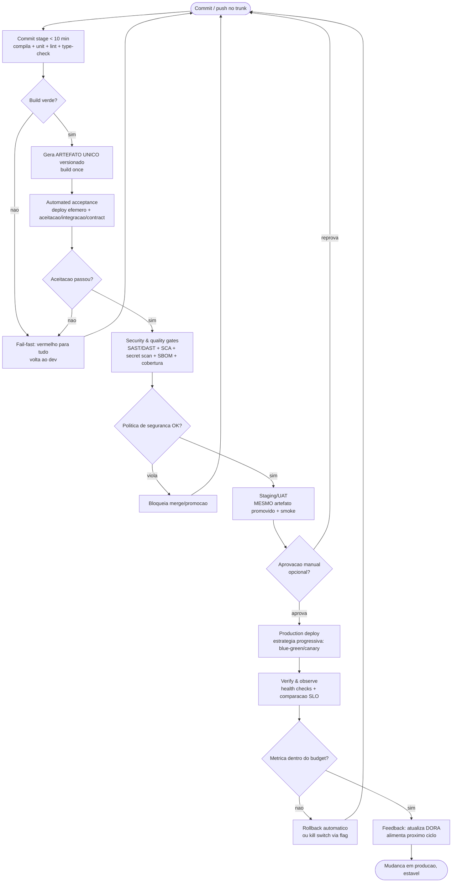

**Passo a passo**
1. **Commit stage** — *entrada:* commit/push. *saida:* artefato candidato + relatorio de testes rapidos. Compila, unit tests, lint, static analysis (< 10 min, fail-fast).
2. **Gera artefato unico** — *entrada:* commit verde. *saida:* binario/imagem OCI versionado. **Build once** (P1): nunca rebuildar por ambiente.
3. **Automated acceptance** — *entrada:* artefato. *saida:* veredito de aceitacao. Deploy em ambiente efemero (IaC/container) + aceitacao/integracao/contract tests.
4. **Security & quality gates** — *entrada:* artefato + ambiente. *saida:* relatorio SAST/DAST/SCA/secret/SBOM. Shift-everywhere (P9).
5. **Staging/UAT** — *entrada:* MESMO artefato promovido. *saida:* smoke OK + aprovacao opcional.
6. **Production deploy** — *entrada:* artefato aprovado. *saida:* versao servindo trafego (progressiva).
7. **Verify & observe** — *entrada:* versao em prod. *saida:* comparacao SLO. Metrica ruim -> rollback automatico.
8. **Feedback** — *entrada:* resultado do deploy. *saida:* DORA atualizado.

**Pontos de gate**
- `[GATE G1]` Build/unit/lint verde — senao fail-fast.
- `[GATE G2]` Aceitacao/contract passou.
- `[GATE G3]` Politica de seguranca (CVE critico/secret/SAST) — bloqueia merge. (cruza com C1/Pipeline DevSecOps)
- `[GATE G4]` Aprovacao manual de release (Continuous Delivery — decisao humana).
- `[GATE G5]` SLO/health pos-deploy dentro do error budget — senao rollback (cruza com B-SRE).

---

## A2 — Trunk-Based Development + Feature Flags

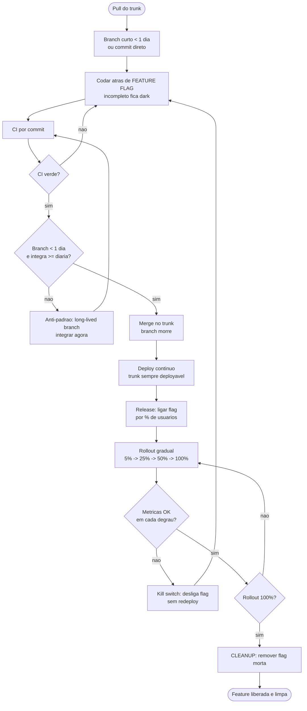

**Passo a passo**
1. **Pull do trunk** — *entrada:* trunk atual. *saida:* base local sincronizada.
2. **Branch curto / commit direto** — *saida:* unidade de mudanca pequena (batch size pequeno, P3).
3. **Codar atras de flag** — codigo incompleto fica dark (desacopla deploy de release, P5).
4. **CI por commit** — *saida:* trunk verde = deployavel.
5. **Merge** — branch morre (integracao >= diaria, P6).
6. **Deploy continuo** — *saida:* codigo em prod, inerte.
7. **Release por flag** — *saida:* feature ligada por % de usuarios.
8. **Cleanup** — *entrada:* rollout 100%. *saida:* flag removida (anti if-hell).

**Pontos de gate**
- `[GATE G1]` CI verde por commit.
- `[GATE G2]` Branch < 1 dia + integracao diaria — long-lived branch = anti-padrao.
- `[GATE G3]` Metricas por degrau de rollout — senao kill switch.
- `[GATE G4]` Rollout 100% antes do cleanup obrigatorio da flag.

---

## A3 — Canary Release + Automated Canary Analysis

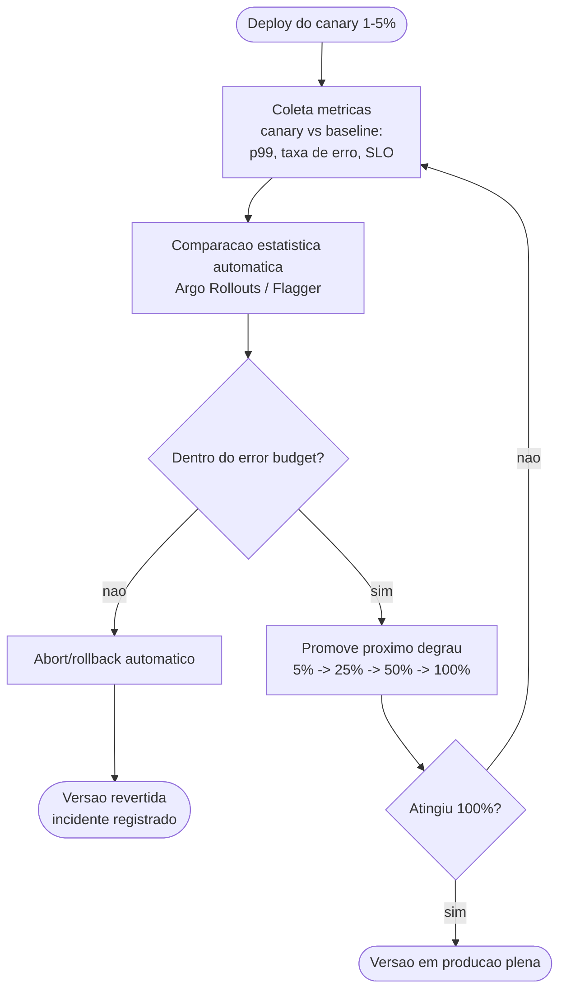

**Passo a passo**
1. **Deploy canary** — *entrada:* artefato novo. *saida:* canary servindo 1-5% do trafego.
2. **Coleta metricas** — *saida:* serie canary vs baseline (latencia p99, erro, SLO).
3. **Analise estatistica automatica** — *entrada:* metricas. *saida:* veredito promover/abortar (AnalysisTemplate).
4. **Promocao gradual (laco)** — degraus 5/25/50/100; cada degrau reabre o ciclo de coleta.
5. **Abort** — qualquer degrau fora do budget -> rollback automatico.

**Pontos de gate**
- `[GATE G1]` Comparacao estatistica dentro do error budget (por degrau) — senao abort.
- `[GATE G2]` 100% atingido encerra o laco.

---

## A4 — IaC Declarativo + GitOps Reconciliation Loop

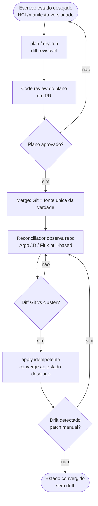

**Passo a passo**
1. **Estado desejado** — *entrada:* requisito de infra. *saida:* HCL/manifesto versionado (P4, P7).
2. **plan/dry-run** — *saida:* diff legivel do que vai mudar.
3. **PR do plano** — *saida:* revisao humana antes de aplicar.
4. **Merge** — Git vira fonte unica (OpenGitOps: Declarative + Versioned/Immutable).
5. **Reconciliacao continua** — reconciliador pull-based observa o repo (self-healing).
6. **apply idempotente** — *entrada:* diff. *saida:* cluster convergido; sem patch manual (cattle, not pets).
7. **Drift** — divergencia (patch emergencial) reconcilia automaticamente; loop infinito de vigilancia.

**Pontos de gate**
- `[GATE G1]` `plan` revisado em PR antes de `apply`.
- `[GATE DIFF/DRIFT]` Continuously Reconciled: qualquer divergencia Git vs real volta ao loop.

---

## A5 — Expand / Contract (migration zero-downtime)

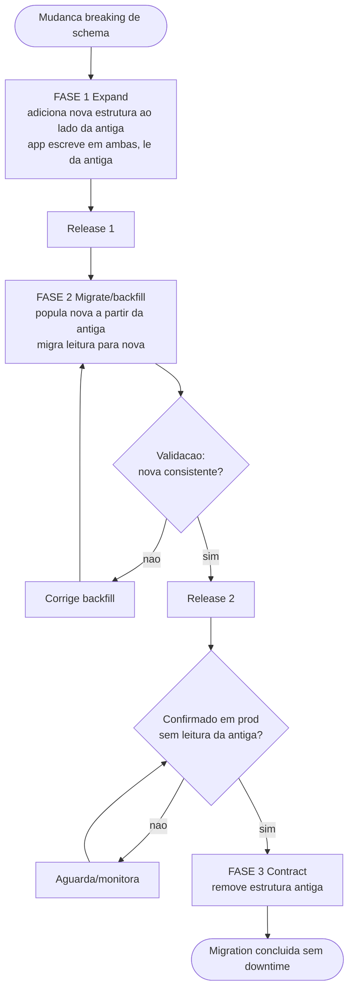

**Passo a passo**
1. **Expand** — *entrada:* breaking change. *saida:* nova estrutura ao lado; app dual-write, le antiga. Backwards-compatible.
2. **Migrate/backfill** — *saida:* nova populada + leitura migrada; valida consistencia.
3. **Contract** — *entrada:* confirmacao de que ninguem le a antiga. *saida:* estrutura antiga removida.
- Migration roda como job **pre-deploy** (CI step / K8s Job) antes dos novos pods. Flyway/Liquibase; online DDL para tabelas grandes.

**Pontos de gate**
- `[GATE VALID]` Nova estrutura consistente apos backfill.
- `[GATE G1]` Confirmacao em prod (zero leitura da antiga) antes do Contract — rollback de schema testado.

---

## A6 — Supply Chain Security no Pipeline (SLSA / Sigstore / SBOM)

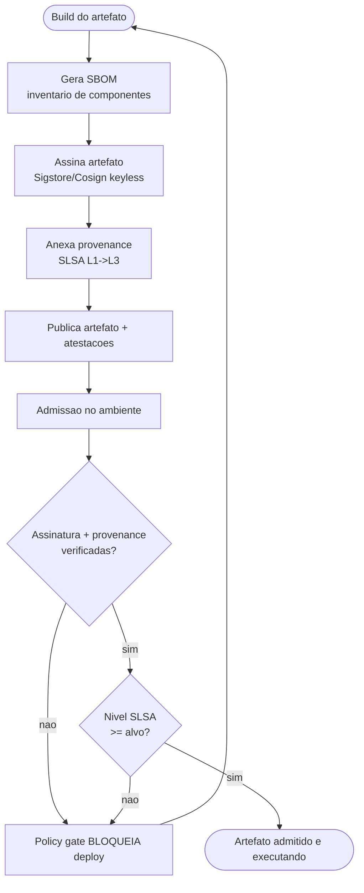

**Passo a passo**
1. **SBOM** — *entrada:* build. *saida:* inventario de dependencias (resposta rapida a CVE).
2. **Assina** — Sigstore keyless via OIDC (atende SLSA L2+).
3. **Provenance** — *saida:* atestacao tamper-proof do build (L3 = build endurecido).
4. **Policy gate na admissao** — *entrada:* artefato + atestacoes. *saida:* admite ou bloqueia.

**Pontos de gate**
- `[GATE G1]` Assinatura/provenance verificadas na admissao — senao bloqueia.
- `[GATE G2]` Nivel SLSA >= alvo (>= L2; L3 se critico).

---

## A7 — Theory of Constraints (otimizar o gargalo) — laco de melhoria

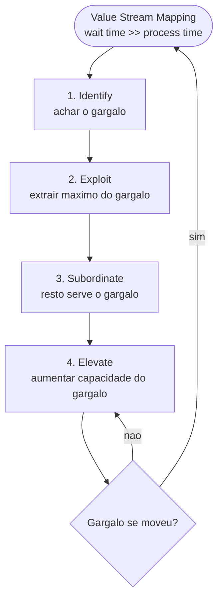

**Passo a passo**
1. **VSM** — *entrada:* fluxo de entrega. *saida:* mapa com wait vs process time.
2. **Identify -> Exploit -> Subordinate -> Elevate** — *saida:* gargalo aliviado.
3. **Repeat** — gargalo se move; laco continuo (limitar WIP, P11, alimenta este loop).

**Ponto de gate**
- `[GATE G1]` So melhora *fora* do gargalo nao melhora o todo — sempre reidentificar.

---

# DOMINIO B — Confiabilidade, Resiliencia & SRE

## B1 — Criar um SLO do zero + Error Budget

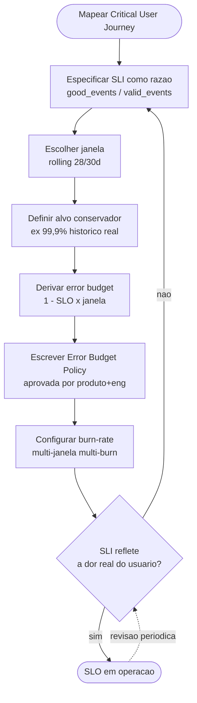

**Passo a passo**
1. **CUJ** — *entrada:* produto. *saida:* jornadas que importam (SLO por jornada, nao por endpoint).
2. **SLI** — *saida:* razao good/valid; define o que e "valido" (exclui health checks/bots).
3. **Janela** — rolling 28/30d (operacao) ou calendario (SLA/report).
4. **Alvo** — conservador, base historica.
5. **Error budget** — `(1 - SLO) x janela` (ex.: 99,9% em 30d = 43,2 min/mes).
6. **Error Budget Policy** — documento aprovado (gatilho de freeze).
7. **Burn-rate alerting** — multi-janela multi-burn (B2).

**Pontos de gate**
- `[GATE G1]` SLI valida a experiencia real — senao redefine (laco). Sem SLI confiavel, budget e teatro.

---

## B2 — Multi-Window Multi-Burn-Rate Alerting

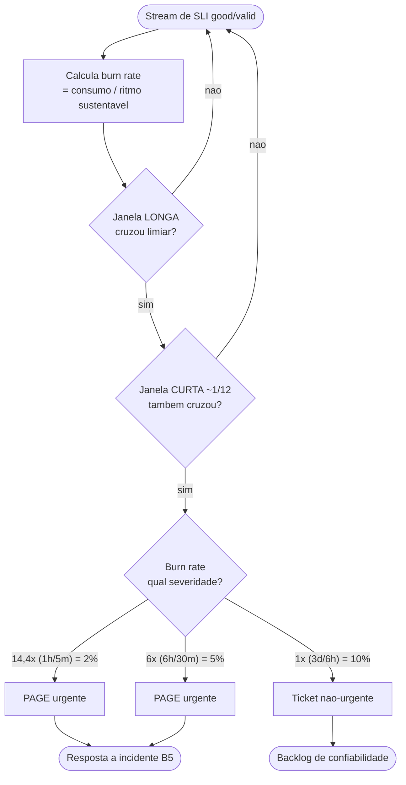

**Passo a passo**
1. **Calcula burn rate** — `consumido = burn_rate x (janela / periodo_SLO)`.
2. **Confirmacao dupla** — dispara so quando janela longa E curta cruzam (filtra ruido transitorio).
3. **Roteia por severidade** — tabela canonica 14,4x / 6x / 1x.

**Pontos de gate**
- `[GATE LONG + SHORT]` AMBAS as janelas cruzam — anti-fadiga de alerta; alerta no sintoma do usuario, nao na CPU.

---

## B3 — Triade de Estabilidade num Integration Point

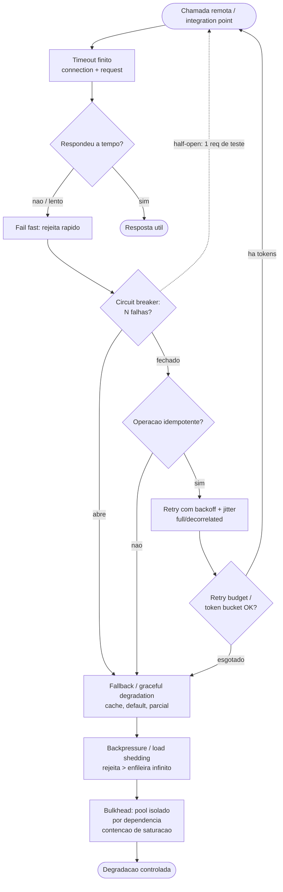

**Passo a passo**
1. **Timeout** — toda chamada remota tem deadline (connection + request). Nunca esperar pra sempre.
2. **Fail fast** — resposta lenta e pior que erro (segura threads -> cascata).
3. **Circuit breaker** (camada extra) — abre apos N falhas; half-open testa 1 req; ciente de que NAO resolve overload sistemico (D1).
4. **Fallback** — cache/default/parcial quando o breaker abre.
5. **Retry com backoff+jitter** — *somente se idempotente* (B4/B-idempotencia).
6. **Retry budget / token bucket** — defesa anti-metaestabilidade (B-metaestavel).
7. **Backpressure / load shedding com prioridade** — fila infinita = OOM.
8. **Bulkhead** — pool isolado por dependencia (transversal a todo o ponto).

**Pontos de gate**
- `[GATE TIMEOUT]` Zero chamadas sem deadline.
- `[GATE RETRY]` Retry SO se idempotente.
- `[GATE BUDGET]` Token bucket de retries impede amplificacao (3^N).

---

## B4 — Defesa contra Falha Metaestavel (anti-amplificacao)

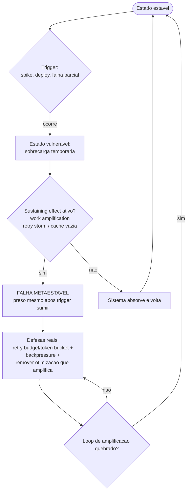

**Passo a passo**
1. **Trigger** — *entrada:* evento (spike/deploy). Sozinho nao basta.
2. **Sustaining effect** — work amplification (retry sem limite, cache que esvazia) prende o sistema no estado ruim.
3. **Defesa** — atacar o *loop de amplificacao*, nao so o gatilho: retry budgets, backpressure, remover otimizacoes de caso-comum.

**Pontos de gate**
- `[GATE SUSTAIN]` Identificar o sustaining effect — "consertar o trigger" nao resolve.
- `[GATE RECOVER]` Loop de amplificacao quebrado antes de declarar recuperado.

---

## B5 — Resposta a Incidente + Postmortem Blameless

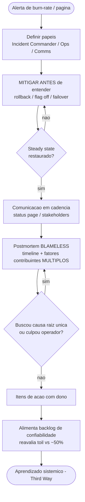

**Passo a passo**
1. **Detect** — *entrada:* alerta. *saida:* incidente declarado.
2. **Papeis** — IC/Ops/Comms (IMAG/ICS).
3. **Mitigar antes de entender** — rollback/flag off/failover restaura o usuario primeiro.
4. **Comunicar** — cadencia para stakeholders.
5. **Postmortem blameless** — timeline + fatores *multiplos*; sem root cause unica (Cook ponto 7); operador e defesa, nao causa.
6. **Acoes** — *saida:* itens com dono no backlog.

**Pontos de gate**
- `[GATE G1]` Steady state restaurado (mitigacao) antes de investigar causa.
- `[GATE G2]` Sem "root cause unica" e sem culpar operador (New View) — senao reabre o postmortem.

---

## B6 — Experimento de Chaos Engineering

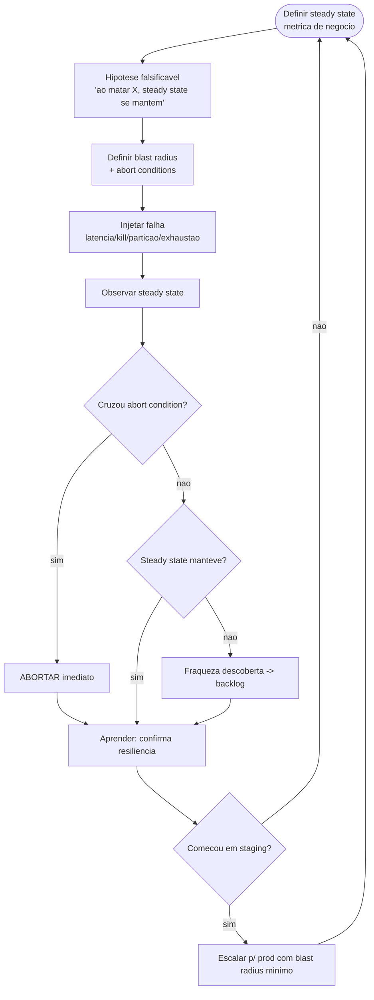

**Passo a passo**
1. **Steady state** — metrica de negocio (pedidos/s), nao de maquina.
2. **Hipotese falsificavel** — predicao testavel.
3. **Blast radius + abort** — limitar impacto; parada automatica.
4. **Injetar -> observar** — confirma/refuta a hipotese.
5. **Aprender** — fraqueza vira backlog; GameDay recorrente.

**Pontos de gate**
- `[GATE G1]` Abort condition cruzada -> para imediato.
- `[GATE G3]` Comecar em staging; producao so com blast radius minimo.

---

# DOMINIO C — Seguranca & Modelagem de Ameacas

## C1 — Threat Modeling STRIDE (4 questionamentos de Shostack)

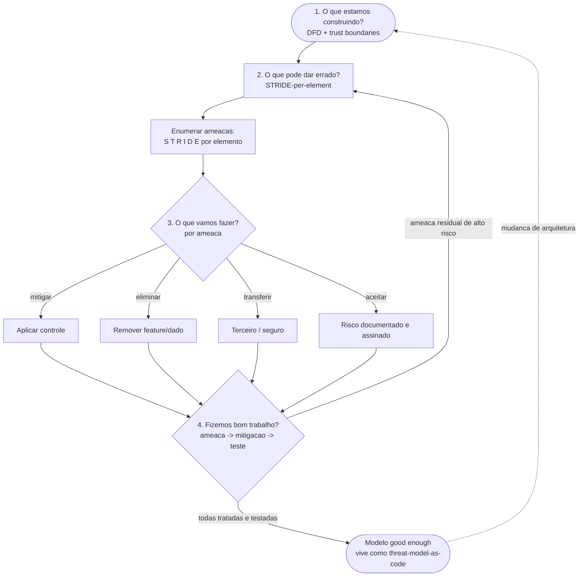

**Passo a passo**
1. **O que construimos** — *entrada:* feature/sistema. *saida:* DFD com processos, stores, flows, entidades e **trust boundaries**.
2. **O que da errado** — STRIDE-per-element (matriz: processo sofre as 6; data flow sofre T/I/D; etc.).
3. **O que fazer** — por ameaca: mitigar/eliminar/transferir/aceitar.
4. **Bom trabalho?** — rastrear ameaca -> mitigacao -> teste; residual de alto risco reabre o ciclo.

**Pontos de gate**
- `[GATE Q1]` Trust boundaries mapeadas ANTES de enumerar (sem boundary, STRIDE perde threats).
- `[GATE Q4]` Toda ameaca de alto risco com mitigacao rastreavel a um teste — senao loop.
- Cerimonia calibrada pela mudanca (D5): boundary cruzado = STRIDE leve; trivial = skip documentado.

---

## C2 — Secure SDLC / DevSecOps (gates por estagio)

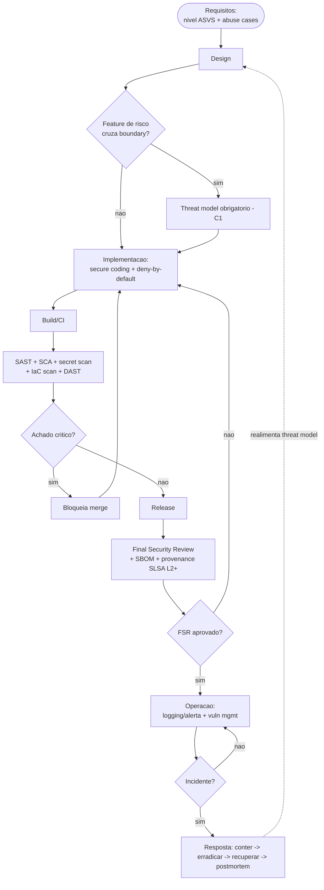

**Passo a passo**
1. **Requisitos** — *saida:* nivel ASVS escolhido + abuse cases como stories.
2. **Design** — threat model gate para features de risco (chama C1).
3. **Implementacao** — validacao de input, output encoding, parametrizacao, deny-by-default.
4. **Build/CI** — SAST/SCA/secret/IaC/DAST; critico bloqueia.
5. **Release** — Final Security Review + SBOM + provenance (cruza com A6).
6. **Operacao + IR** — logging/alerta; incidente realimenta o threat model.

**Pontos de gate**
- `[GATE G1]` Threat model obrigatorio se a feature cruza trust boundary.
- `[GATE G2]` Achado critico (CVE/secret/SAST) bloqueia merge. (SCA + secret = no-brainer; SAST tunado, D3)
- `[GATE G3]` Final Security Review antes do release.

---

## C3 — Threat Modeling de Agents de IA (least agency + prompt injection)

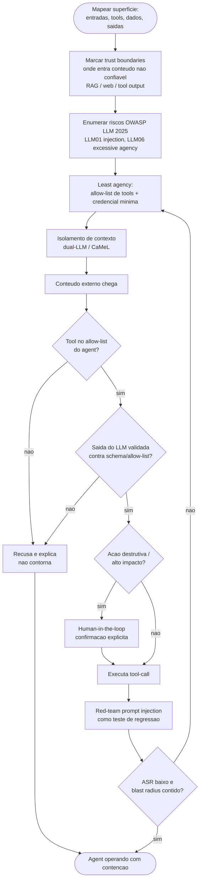

**Passo a passo**
1. **Mapear superficie** — entradas (prompt/RAG/web), tools, dados, saidas/acoes.
2. **Trust boundaries** — onde entra conteudo nao confiavel (LLM01 indirect injection vive aqui).
3. **Enumerar riscos LLM 2025** + least agency (allow-list de tools, credencial minima).
4. **Isolamento** — dual-LLM/CaMeL (privilegiado planeja sem ver dado; quarentena parseia sem chamar tools).
5. **Validar saida do LLM como hostil** (LLM05) antes de tool-call/render.
6. **Human-in-the-loop** para acao destrutiva.
7. **Red-team** de prompt injection como regressao (AgentDojo/ATLAS).

**Pontos de gate**
- `[GATE G1]` Tool fora do allow-list -> recusa (excessive agency, LLM06).
- `[GATE G2]` Saida do LLM validada antes de executar (assume injecao passa, D2).
- `[GATE G3]` Acao destrutiva exige human-in-the-loop (espelha safe-collaboration).
- `[GATE G4]` ASR baixo + blast radius contido (defense in depth) — prompt injection nao e eliminavel, so contida.

---

## C4 — Migracao Pos-Quantica (PQC) — laco de crypto-agility

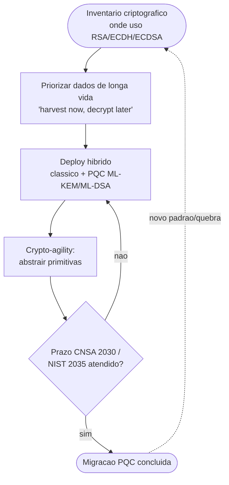

**Passo a passo**
1. **Inventario** — *entrada:* base de cripto. *saida:* mapa de usos de RSA/ECDH/ECDSA.
2. **Priorizar** — dados de longa vida primeiro (harvest now, decrypt later).
3. **Hibrido** — classico + PQC (FIPS 203/204/205) durante transicao.
4. **Crypto-agility** — abstrair primitivas para trocar sem reescrever.

**Pontos de gate**
- `[GATE G1]` Prazos regulatorios (CNSA 2.0 2030 / NIST 2035) — laco ate atingir; reabre a cada novo padrao.

---

## C5 — Criptografia Aplicada: arvore de decisao de primitivas

> Qual primitiva criptografica usar para qual fim — do threat model criptografico ate a operacao segura em repouso, transito e autenticacao.

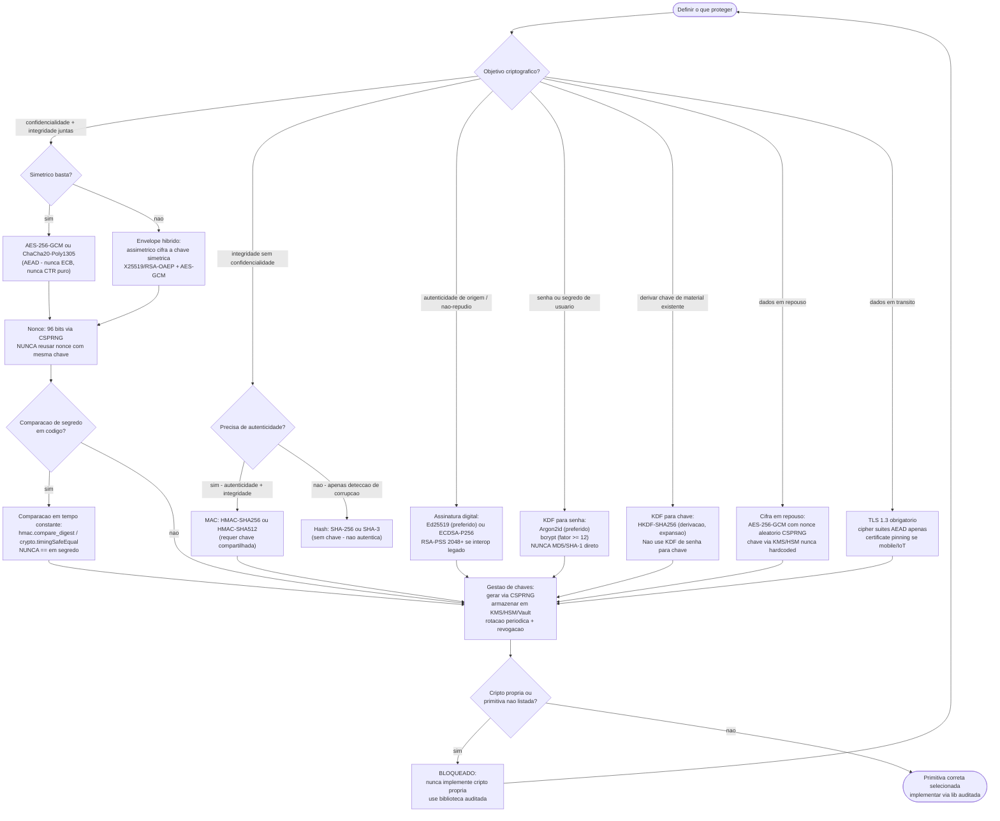

**Passo a passo**
1. **Definir objetivo** — *entrada:* dado ou operacao a proteger. *saida:* objetivo criptografico (confidencialidade, integridade, autenticidade, autenticacao de senha, derivacao).
2. **Selecionar primitiva pela arvore** — seguir a decisao acima; nunca escolher por familiaridade (ex: MD5 para hash de senha e fatal).
3. **Gerar nonce/IV corretamente** — 96 bits CSPRNG para AES-GCM; nunca reusar com a mesma chave (nonce reuse = criptanalise trivial).
4. **Comparacao em tempo constante** — toda comparacao de hash/MAC/token de segredo usa funcao dedicada (timing attack); `==` e proibido.
5. **Gestao de chaves** — CSPRNG para geracao; KMS/HSM/Vault para armazenamento; rotacao e revogacao planejadas (o problema mais dificil).
6. **Biblioteca auditada** — nunca implementar primitiva propria; usar libsodium, WebCrypto, OpenSSL com configuracao FIPS/segura.

**Pontos de gate**
- `[GATE PRIMITIVA]` Primitiva selecionada na arvore — ECB, MD5, SHA-1 para segredo, DES, RC4 sao BLOQUEADOS incondicionalmente.
- `[GATE NONCE]` Nonce CSPRNG e unico por mensagem/chave — reuso destroi confidencialidade em AEAD.
- `[GATE CONSTTIME]` Toda comparacao de segredo em tempo constante — ausencia e vulnerabilidade de timing.
- `[GATE KEYMGMT]` Nenhuma chave ou segredo hardcoded no codigo ou em variavel sem KMS.

---

## C6 — Pentest com Attacker Mindset Autorizado

> Metodologia de teste de penetracao autorizado — do reconhecimento ao relatorio com remediacao e deteccao, enquadrado exclusivamente em escopo contratual explicito.

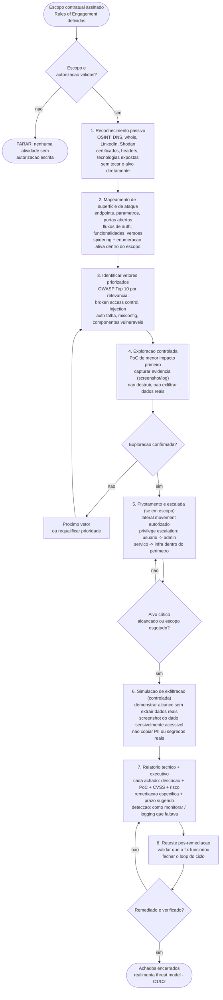

**Passo a passo**
1. **Autorizacao** — *entrada:* contrato/ROE assinado. Sem isso, PARAR. Nenhuma atividade de recon ativo ou exploracao ocorre fora do escopo definido.
2. **Reconhecimento passivo** — OSINT sem tocar o alvo: DNS, Shodan, certificados, LinkedIn, headers de sites publicos, versoes expostas.
3. **Mapeamento de superficie** — endpoints, parametros, portas, fluxos de autenticacao, versoes de componentes (spidering, nmap dentro do escopo).
4. **Vetores priorizados** — OWASP Top 10 como lente; priorizar pelo risco real do alvo (ex: broken access control e #1 em aplicacoes B2B).
5. **Exploracao controlada** — PoC de menor impacto possivel; capturar evidencia (screenshot, log de request/response); nao destruir dados, nao exfiltrar.
6. **Pivotamento/escalada** — somente se explicitamente no escopo; demonstrar raio de blast, nao amplifica-lo.
7. **Simulacao de exfiltracao** — mostrar o que seria possivel sem copiar dados reais (PII, segredos, credenciais).
8. **Relatorio** — por achado: descricao, PoC, CVSS, impacto de negocio, remediacao especifica, controle de deteccao que faltava; executivo + tecnico.
9. **Reteste** — fechar o loop: confirmar que o fix resolveu, nao apenas patchou superficialmente.

**Pontos de gate**
- `[GATE G0]` Autorizacao escrita e escopo definido ANTES de qualquer atividade — ausencia e atividade ilegal, nao pentest.
- `[GATE EVIDENCIA]` Toda exploracao documentada com PoC reproducivel — sem evidencia nao e achado.
- `[GATE EXFIL]` Nenhum dado real (PII, credencial, segredo) e copiado — simulacao, nao exfiltracao real.
- `[GATE RETESTE]` Fix validado pelo testador antes de fechar o achado — remediacao sem reteste e teatro.

---

## C7 — Gestao de Segredos: do codigo ao ciclo de vida

> Segredos nunca no codigo — do secret manager ao scan no CI, rotacao automatica e audit log fecham o ciclo de vida completo.

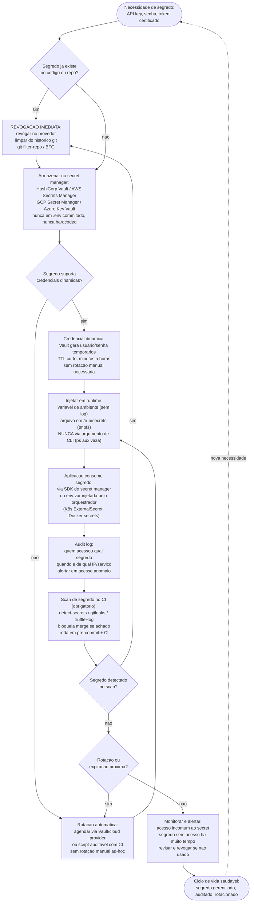

**Passo a passo**
1. **Detectar e revogar** — qualquer segredo no codigo ou historico git e revogado imediatamente no provedor; historico limpo com `git filter-repo`.
2. **Armazenar no secret manager** — Vault, AWS Secrets Manager, GCP Secret Manager; nunca `.env` commitado, nunca hardcoded, nunca em comentario.
3. **Credenciais dinamicas** — preferir sobre estaticas quando o provedor suporta (Vault database secrets engine gera usuarios temporarios com TTL).
4. **Rotacao automatica** — para segredos estaticos: agendar rotacao via secret manager ou pipeline CI; sem rotacao manual ad-hoc (nao auditavel).
5. **Injecao em runtime** — env var via orquestrador (K8s ExternalSecret, Docker secrets, Vault Agent Sidecar); nunca como argumento de CLI (visivel em `ps aux`).
6. **Audit log** — registrar quem acessa qual segredo, quando e de onde; alertar em padrao anomalo.
7. **Scan no CI** — detect-secrets/gitleaks/truffleHog no pre-commit e no pipeline; achado critico bloqueia merge (cruza com C2/DevSecOps).
8. **Monitorar** — segredos sem acesso recente sao candidatos a revogacao; rotacao proxima dispara alerta; ciclo continuo.

**Pontos de gate**
- `[GATE G1]` Segredo no codigo ou repo -> REVOGAR antes de qualquer outra acao; correcao posterior nao e suficiente.
- `[GATE INJECT]` Segredo nunca em argumento de CLI nem em log — vaza via `ps aux` e em arquivos de log.
- `[GATE CI_SCAN]` Scan obrigatorio em pre-commit + CI; achado bloqueia merge (sem excecao de "e so dev").
- `[GATE AUDIT]` Audit log com granularidade de identidade + tempo + origem — sem audit, rotacao e teatro.

---

# Loop mestre

> Diagrama unico que um agent de IA seguiria no tema "Operacao & Confiabilidade": parte do briefing de uma mudanca, atravessa os gates de seguranca e qualidade, governa o ritmo pelo error budget, e fecha o laco no aprendizado blameless. Os tres dominios entram como gates encadeados de um unico fluxo de entrega confiavel e segura.

```mermaid
flowchart TD
    BRIEF([Mudanca solicitada]) --> TM{Cruza trust boundary<br/>ou toca dado sensivel?}
    TM -- sim --> THREAT[Threat model STRIDE / LLM - C1/C3<br/>ameaca -> mitigacao -> teste]
    TM -- nao --> SLOCHK
    THREAT --> SLOCHK{Error budget<br/>disponivel? - B1}

    SLOCHK -- esgotado --> FREEZE[FREEZE: so P0/security<br/>foca confiabilidade]
    FREEZE --> SLOCHK
    SLOCHK -- ha budget --> BATCH[Batch pequeno + trunk-based<br/>atras de feature flag - A2]

    BATCH --> COMMIT[Commit stage: build + test + lint - A1]
    COMMIT --> GSEC[GATE seguranca DevSecOps - C2<br/>SAST/SCA/secret/IaC/DAST]
    GSEC -- critico --> FIX[Corrige]
    FIX --> COMMIT
    GSEC -- limpo --> SUPPLY[GATE supply chain - A6<br/>SBOM + assina + provenance SLSA]
    SUPPLY -- nao verificado --> FIX
    SUPPLY -- verificado --> ARTIFACT[Artefato unico - build once - A1/P1]

    ARTIFACT --> RESIL[Cada integration point com<br/>timeout + bulkhead + retry budget - B3/B4]
    RESIL --> DEPLOY[Deploy progressivo: canary/blue-green - A3<br/>migration expand/contract - A5]
    DEPLOY --> CANARY{Canary dentro<br/>do error budget? - A3/B2}
    CANARY -- nao --> ROLLBACK[Rollback / kill switch<br/>+ incidente - B5]
    CANARY -- sim --> RELEASE[Release por flag<br/>rollout gradual - A2]

    RELEASE --> OBSERVE[Observar: golden signals<br/>+ wide events + burn-rate - B2]
    OBSERVE --> BURN{Burn-rate alerta? - B2}
    BURN -- page --> INCIDENT[Resposta a incidente<br/>mitigar antes de entender - B5]
    BURN -- ok --> CLEANUP[Cleanup de flag + DORA atualizado - A1/A2]

    ROLLBACK --> POSTMORTEM[Postmortem blameless<br/>fatores multiplos - B5]
    INCIDENT --> POSTMORTEM
    POSTMORTEM --> LEARN[Acoes -> backlog de confiabilidade<br/>realimenta threat model - C2]
    LEARN -.proxima mudanca.-> BRIEF

    CLEANUP --> CHAOS[Resiliencia proativa:<br/>chaos / GameDay - B6<br/>red-team injection - C3]
    CHAOS -.fraquezas viram backlog.-> LEARN
    CLEANUP --> DONE([Mudanca em producao<br/>confiavel, segura, observavel])
```

**Leitura do loop mestre (sequencia de gates que o agent honra)**
1. `[GATE seguranca de design]` Cruzou trust boundary? -> threat model com cada ameaca rastreavel a teste (C1/C3).
2. `[GATE error budget]` Ha orcamento? -> senao FREEZE (so P0/security) ate voltar ao SLO (B1/P8).
3. `[GATE batch + integracao]` Mudanca pequena, trunk-based, atras de flag (A2/P3/P6).
4. `[GATE commit/qualidade]` Build + test + lint verde (A1).
5. `[GATE DevSecOps]` SAST/SCA/secret/IaC/DAST sem critico (C2/D3).
6. `[GATE supply chain]` SBOM + assinatura + provenance SLSA verificados (A6).
7. `[GATE build once]` UM artefato promovido entre ambientes (P1).
8. `[GATE resiliencia]` Todo integration point/chamada de LLM com timeout + bulkhead + retry budget (B3/B4).
9. `[GATE canary]` Comparacao estatistica dentro do error budget; senao rollback (A3/B2/G5).
10. `[GATE observabilidade]` Golden signals + wide events; burn-rate multi-janela alerta no usuario (B2).
11. `[GATE aprendizado]` Falha -> postmortem blameless (fatores multiplos, sem culpar) -> backlog que realimenta o threat model (B5/C2).
12. `[GATE proativo]` Chaos/GameDay + red-team de injection geram fraquezas para o backlog antes do incidente real (B6/C3).

**Para o agent SINAPSE (comportamento verificavel resumido)**
- So declara "pronto" com CI verde + gates de seguranca + supply chain passados (constituicao executavel).
- Resiste a inflar o batch sob IA (risco DORA); preferir mudancas < 200 linhas.
- Cada chamada de LLM/tool/MCP tem timeout, idempotency key em efeito colateral, e cap de iteracoes (anti-loop = anti-metaestabilidade).
- Error budget de agent (sucesso/eval) governa quando degradar para modelo menor ou human fallback.
- Least agency: allow-list de tools, human-in-the-loop em acao destrutiva, saida do LLM tratada como hostil.
- Toda falha vira postmortem blameless com causas multiplas que alimentam o proximo ciclo.

---

## Indice de processos formalizados

| # | Processo | Dominio | Tipo de laco principal |
|---|---|---|---|
| A1 | Deployment pipeline | DevOps | Feedback DORA -> proximo commit |
| A2 | Trunk-based + feature flags | DevOps | CI verde + rollout/cleanup |
| A3 | Canary + automated analysis | DevOps | Promocao gradual por degrau |
| A4 | IaC declarativo + GitOps | DevOps | Reconciliacao continua (self-healing) |
| A5 | Expand/contract migration | DevOps | Validacao backfill |
| A6 | Supply chain (SLSA/Sigstore/SBOM) | DevOps | Policy gate de admissao |
| A7 | Theory of Constraints | DevOps | Gargalo se move (re-identifica) |
| B1 | Criar SLO + error budget | SRE | Revisao de SLI vs dor real |
| B2 | Multi-window multi-burn-rate | SRE | Confirmacao dupla de janela |
| B3 | Triade de estabilidade | SRE | Retry budget / circuit breaker |
| B4 | Defesa anti-metaestabilidade | SRE | Quebra do loop de amplificacao |
| B5 | Incidente + postmortem blameless | SRE | Acoes realimentam backlog |
| B6 | Chaos engineering | SRE | GameDay recorrente |
| C1 | Threat modeling STRIDE | Seguranca | Ameaca residual reabre |
| C2 | Secure SDLC / DevSecOps | Seguranca | IR realimenta threat model |
| C3 | Threat model de agents de IA | Seguranca | Red-team de injection |
| C4 | Migracao PQC | Seguranca | Crypto-agility (novo padrao) |
| C5 | Criptografia Aplicada: arvore de decisao de primitivas | Seguranca | Primitiva errada -> rever pelo threat model |
| C6 | Pentest com Attacker Mindset Autorizado | Seguranca | Reteste pos-remediacao / realimenta threat model |
| C7 | Gestao de Segredos: do codigo ao ciclo de vida | Seguranca | Rotacao e revogacao continuas |
| — | **Loop mestre** | **Cross** | **Aprendizado -> proxima mudanca** |
