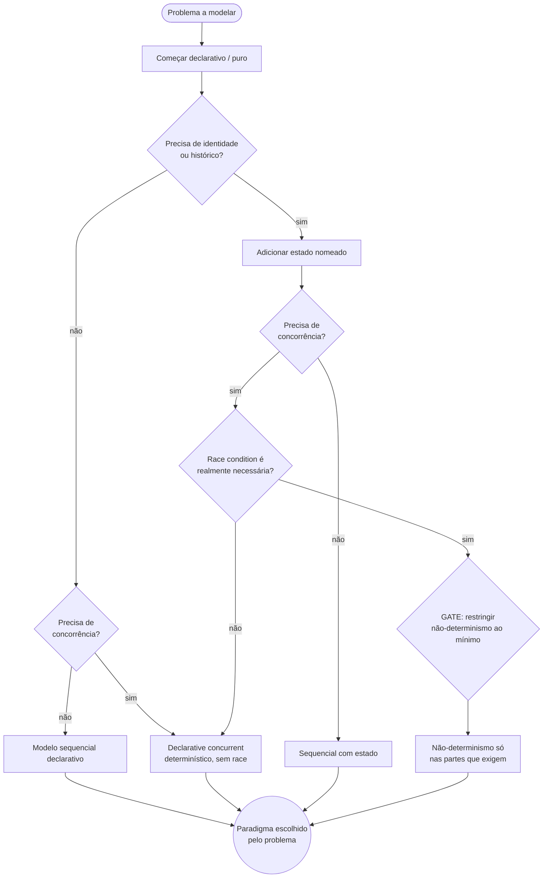
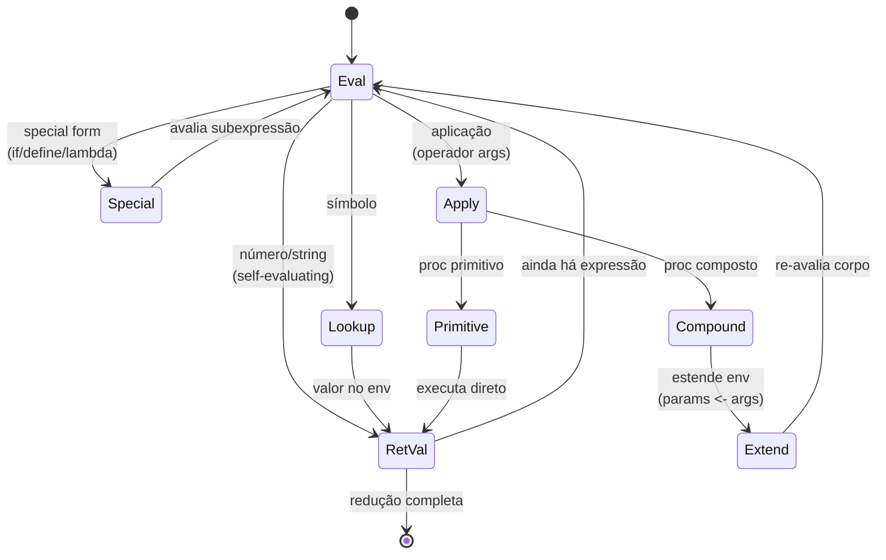
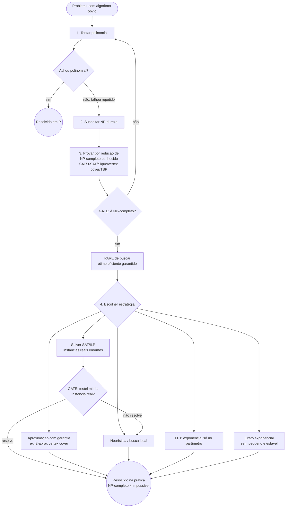
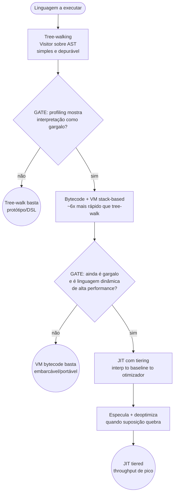

# LOOPS — Onda 6 (Fundamentos & Linguagens) — Diagramas de Workflow

> Formalização dos processos canônicos dos três domínios desta onda em **diagramas mermaid + passo a passo + pontos de gate**. Pronto para Fase 3 (visual) e para virar comportamento de agent.
> Cada workflow tem: (1) diagrama mermaid com entradas, decisões e laços; (2) passo a passo numerado com entrada/saída; (3) pontos de gate (onde o fluxo PARA ou refaz).
> Fecha com **## Loop mestre** — o diagrama único que um agent de IA segue no tema desta onda.

Convenção de gate usada nos diagramas:
- `{losango}` = decisão / gate
- `((círculo))` = estado terminal
- aresta tracejada `-.->` = laço de volta (refazer/iterar)
- `GATE` no texto = ponto onde o fluxo bloqueia até critério ser satisfeito

---

# DOMÍNIO A — Fundamentos de CS & Paradigmas

## A1 — Design Recipe (HtDP): da forma do dado ao código testado

> Origem: P5 + T1 da extração 15. A estrutura do dado determina a estrutura do código; exemplos viram testes.

```mermaid
flowchart TD
  START([Briefing da função/feature]) --> D1[1. Data definition<br/>atômico / composto / união / recursivo]
  D1 --> G1{Dado é recursivo<br/>ou algébrico?}
  G1 -- sim --> SIG[2. Signature + propósito<br/>tipos in to tipo out + 1 frase]
  G1 -- não / tabular --> TAB[Pensar em map/filter/reduce<br/>em vez de recursão manual]
  TAB --> SIG
  SIG --> EX[3. Exemplos in to out<br/>casos típicos + bordas]
  EX --> GATE_EX{GATE: exemplos cobrem<br/>casos de borda?}
  GATE_EX -- não -.-> EX
  GATE_EX -- sim --> TPL[4. Template<br/>um ramo por variante<br/>recursão onde o dado recursa]
  TPL --> BODY[5. Corpo<br/>preencher template guiado<br/>pelos exemplos]
  BODY --> TEST[6. Testes<br/>rodar exemplos do passo 3]
  TEST --> GATE_T{GATE: todos<br/>exemplos passam?}
  GATE_T -- não -.-> TPL
  GATE_T -- sim --> DONE((Função pronta<br/>+ suíte de testes))
```

**Passo a passo (entrada → saída)**
1. **Data definition** — entrada: domínio do problema. Saída: tipos nomeados (atômico/composto/união/recursivo). *Decisão-chave:* dado recursivo ⇒ função recursiva por estrutura.
2. **Signature + propósito** — entrada: tipos. Saída: assinatura `tipos in → tipo out` + uma frase do que faz.
3. **Exemplos** — entrada: assinatura. Saída: pares entrada→saída (típicos + borda) = a futura suíte de testes.
4. **Template** — entrada: data definition. Saída: esqueleto com um ramo por variante e chamada recursiva onde o dado recursa.
5. **Corpo** — entrada: template + exemplos. Saída: implementação.
6. **Testes** — entrada: corpo + exemplos. Saída: verde/vermelho; vermelho volta ao passo 4/5.

**Pontos de gate**
- **GATE exemplos** (passo 3): não avança ao template sem casos de borda cobertos.
- **GATE testes** (passo 6): função NÃO é "pronta" enquanto qualquer exemplo falhar — laço de volta ao template/corpo.

---

## A2 — Domar estado (Out of the Tar Pit): functional core / imperative shell

> Origem: P2 + T4 da extração 15. Ataque a complexidade acidental; o maior gerador dela é estado mutável.

```mermaid
flowchart TD
  START([Feature/design a auditar]) --> SPLIT[1. Separar essencial × acidental]
  SPLIT --> LIST[2. Listar TODO estado mutável]
  LIST --> LOOP_STATE{Para cada estado:}
  LOOP_STATE --> Q1{Posso derivar<br/>tornar calculado?}
  Q1 -- sim --> ELIM[Eliminar: vira derivado]
  Q1 -- não --> Q2{Posso isolar<br/>na borda?}
  Q2 -- sim --> ISO[Isolar na imperative shell]
  Q2 -- não --> KEEP[Manter como essencial<br/>justificado]
  ELIM --> NEXT[próximo estado]
  ISO --> NEXT
  KEEP --> NEXT
  NEXT -.-> LOOP_STATE
  NEXT --> CORE[3. Lógica essencial =<br/>funções puras / relações]
  CORE --> SHELL[4. I/O e estado numa<br/>casca fina explícita]
  SHELL --> GATE_IRR{GATE: acidental restante<br/>é irredutível?}
  GATE_IRR -- não -.-> LIST
  GATE_IRR -- sim --> DONE((Functional core +<br/>imperative shell))
```

**Passo a passo (entrada → saída)**
1. **Essencial × acidental** — entrada: feature. Saída: classificação de cada dificuldade (inerente vs artefato da solução).
2. **Inventário de estado** — entrada: design. Saída: lista completa de estado mutável.
3. **Decisão por estado (laço)** — para cada item: **eliminar** (derivar) → **isolar** (borda) → só então **manter**. Saída: estado mínimo justificado.
4. **Core puro** — entrada: lógica essencial. Saída: funções puras/relações sem efeitos.
5. **Shell fino** — entrada: I/O + estado restante. Saída: casca imperativa explícita e fina.

**Pontos de gate**
- **GATE irredutibilidade**: itera o inventário enquanto houver complexidade acidental eliminável. Só termina quando o que resta é essencial.
- *Anti-purismo (gate de bom senso):* adote a **lente** essencial/acidental sem comprar FRP puro/relacional (nunca virou mainstream).

---

## A3 — Escolha de paradigma (CTM / Van Roy): declarativo por padrão

> Origem: P3 da extração 15. Paradigma é ponto num espaço de 3 eixos; comece declarativo e adicione conceitos deliberadamente.



**Passo a passo (entrada → saída)**
1. **Base declarativa** — entrada: problema. Saída: núcleo puro/relacional.
2. **Eixo estado** — pergunta: há identidade/histórico? Saída: adiciona estado **nomeado** só se sim.
3. **Eixo concorrência** — pergunta: precisa concorrer? Saída: preferir **declarative concurrent** (determinístico).
4. **Eixo não-determinismo** — pergunta: race observável é mesmo preciso? Saída: restringir ao mínimo.

**Pontos de gate**
- **GATE não-determinismo**: race condition observável é caro; só entra nas partes que realmente precisam (regra de ouro de Van Roy).
- *Gate anti-dogma:* nem "tudo OOP" nem "tudo FP" — convergiram. Núcleo puro + objetos para encapsular o estado essencial restante.

---

## A4 — `eval`/`apply`: avaliador metacircular (esqueleto de todo runtime)

> Origem: P4 + T2 das extrações 15 e 21. Todo interpretador/motor de regras/agent loop é um `eval`/`apply` com ambiente crescente.



**Passo a passo (entrada → saída)**
1. **`eval(expr, env)`** — despacha por tipo: self-evaluating → retorna; símbolo → `lookup(env)`; special form → tratamento caso a caso; aplicação → `apply`.
2. **`apply(proc, args)`** — primitivo → executa; composto → `extend(env, params←args)` e volta a `eval` no corpo.
3. **Laço mútuo** — `eval` ↔ `apply` até reduzir a valor.

**Pontos de gate**
- **GATE caso base (obrigatório)**: special forms incluem controle de parada; sem caso base / limite de iterações ⇒ recursão infinita.
- O ambiente só cresce de forma **rastreável** — cada iteração deve ser logável como `(expr, env_antes, env_depois)`.

---

# DOMÍNIO B — Teoria da Computação & Algoritmos

## B1 — Análise de complexidade (Big-O com reality check)

> Origem: P1 + técnica "análise de complexidade" da extração 20. Big-O decide a CLASSE; benchmark decide DENTRO da classe.

```mermaid
flowchart TD
  START([Algoritmo a avaliar]) --> OP[1. Identificar operação dominante]
  OP --> COUNT[2. Contar execuções em função de n]
  COUNT --> Q_REC{É recursivo?}
  Q_REC -- sim --> REC[3. Montar recorrência T n]
  REC --> SOLVE[4. Resolver: método mestre /<br/>árvore / substituição]
  Q_REC -- não --> ASYM
  SOLVE --> ASYM[5. Expressar assintótica<br/>tempo E espaço]
  ASYM --> CASE[6. Distinguir pior / médio / amortizado]
  CASE --> Q_ADV{Contexto<br/>adversarial?}
  Q_ADV -- sim --> WORST[Decidir por PIOR caso]
  Q_ADV -- não --> AVG[Caso médio aceitável]
  WORST --> LB
  AVG --> LB[7. Comparar com lower bound do problema]
  LB --> GATE_LB{GATE: estou tentando<br/>furar o piso teórico?}
  GATE_LB -- sim, mesmo modelo -.-> STOP_IMP((PARE: impossível<br/>nesse modelo))
  GATE_LB -- não --> RC[8. Reality check de constantes/cache<br/>para o n REAL]
  RC --> GATE_RC{GATE: constante muda<br/>o vencedor no n real?}
  GATE_RC -- sim -.-> OP
  GATE_RC -- não --> DONE((Complexidade validada<br/>pronto p/ escalar))
```

**Passo a passo (entrada → saída)**
1–2. **Operação dominante + contagem** — saída: T(n) bruto.
3–4. **Recorrência** (se recursivo) — método mestre para `T(n)=aT(n/b)+f(n)`; senão árvore/Akra-Bazzi.
5. **Assintótica** — tempo e espaço, descartando constantes.
6–7. **Caso + lower bound** — escolher pior/médio/amortizado pelo contexto; comparar com o piso (ex.: ordenação por comparação é Ω(n log n)).
8. **Reality check** — benchmark com o n real: constantes/cache podem inverter o vencedor.

**Pontos de gate**
- **GATE lower bound**: se o objetivo viola o piso *dentro do modelo*, PARE (ou mude de modelo — ex.: radix sort sai do modelo de comparação).
- **GATE constantes**: Big-O "mente" sobre constantes; um O(n²) com constante pequena bate O(n log n) com constante grande em n moderado → revalidar escolha.

---

## B2 — Escolha de paradigma de design (4 moldes + fluxo)

> Origem: P3 + "escolher o paradigma" da extração 20. Reconhecer o molde é a habilidade central.

```mermaid
flowchart TD
  START([Problema algorítmico]) --> MODEL[1. Modelar entrada/saída/restrições]
  MODEL --> CAT[2. Checar catálogo Skiena<br/>reusar antes de inventar]
  CAT --> Q_CAT{Já existe<br/>solução conhecida?}
  Q_CAT -- sim --> REUSE[Reusar/adaptar]
  Q_CAT -- não --> SIGNALS{3. Sinais de reconhecimento}
  SIGNALS -- subproblemas independentes --> DC[Divide & Conquer]
  SIGNALS -- subproblemas sobrepostos + subestrutura ótima --> DP[Programação Dinâmica<br/>memoize]
  SIGNALS -- escolha local ótima parece levar ao global --> GREEDY[Guloso]
  SIGNALS -- espaço combinatório sem estrutura --> BT[Backtracking /<br/>branch-and-bound]
  SIGNALS -- alocação/matching em rede --> FLOW[Fluxo em redes<br/>reduz a max-flow/min-cut]
  GREEDY --> GATE_PROOF{GATE: provei guloso?<br/>exchange OU stays-ahead}
  GATE_PROOF -- não, sem prova -.-> DP
  GATE_PROOF -- sim --> PROVE
  DC --> PROVE[4. Provar corretude<br/>invariante de laço/indução]
  DP --> PROVE
  BT --> PROVE
  FLOW --> PROVE
  REUSE --> PROVE
  PROVE --> COMPLEX[5. Analisar complexidade<br/>vs lower bound -> ver B1]
  COMPLEX --> DONE((Algoritmo escolhido<br/>e provado))
```

**Passo a passo (entrada → saída)**
1. **Modelar** — entrada/saída/restrições bem-definidas.
2. **Catálogo** — reuso antes de inventar (Skiena, 75 problemas).
3. **Sinais → molde** — independentes=D&C; sobrepostos+ótimo=DP; local→global=guloso; combinatório=backtracking; rede=fluxo.
4. **Provar corretude** — invariante de laço; para guloso, **exchange argument** ou **stays-ahead**.
5. **Complexidade** — encaminha para o workflow B1.

**Pontos de gate**
- **GATE prova do guloso**: guloso ERRA com frequência — sem prova (exchange/stays-ahead) e sem contraexemplo rápido, **caia para a versão DP** (mais lenta, correta).

---

## B3 — Decidir tratabilidade (P vs NP na prática)

> Origem: P4 + "decidir tratabilidade" da extração 20. NP-completo é sinal de PARE de buscar ótimo eficiente — mas não de "impossível na minha instância".



**Passo a passo (entrada → saída)**
1. **Tentar polinomial** — se achou, fim.
2. **Suspeitar** — falha repetida = sinal de NP-dureza.
3. **Provar por redução** — de um NP-completo conhecido.
4. **Escolher estratégia** — aproximação / heurística / FPT / solver / exato exponencial.

**Pontos de gate**
- **GATE NP-completo**: confirmado ⇒ PARE de buscar o ótimo eficiente (consenso P≠NP).
- **GATE instância real**: NP-completo é PIOR caso — solvers SAT/ILP resolvem instâncias gigantes (8,5B cláusulas); teste antes de assumir o pior.
- *Gate de limite teórico:* se o problema é **indecidível** (reduz do problema da parada), não prometa solução geral — nenhum código resolve.

---

## B4 — Escolha de estrutura de dados (pela operação dominante)

> Origem: P5 + P6 da extração 20. A estrutura fixa o teto por operação; distinguir caso médio de pior caso é a diferença entre "passa nos testes" e "cai sob ataque".

```mermaid
flowchart TD
  START([Necessidade de armazenar/consultar]) --> FREQ[1. Operação MAIS frequente no hot path]
  FREQ --> Q_OP{Qual operação domina?}
  Q_OP -- lookup chave exata --> HASH[Hash table O(1) médio]
  Q_OP -- range/ordem --> TREE[Árvore balanceada O(log n)]
  Q_OP -- prioridade --> HEAP[Heap O(log n)]
  Q_OP -- conectividade --> UF[Union-Find ~O(α n)]
  Q_OP -- busca semântica --> ANN[Vetor + índice ANN<br/>HNSW / IVF]
  HASH --> GATE_ADV{GATE: ambiente<br/>adversarial?}
  GATE_ADV -- sim --> RESIST[Hashing resistente SipHash<br/>OU pior-caso garantido árvore]
  GATE_ADV -- não --> AMORT
  RESIST --> AMORT{GATE: spike amortizado<br/>estoura latência real-time?}
  TREE --> AMORT
  HEAP --> AMORT
  UF --> AMORT
  ANN --> AMORT
  AMORT -- sim --> PRE[Pré-alocar / pior-caso garantido]
  AMORT -- não --> DONE((Estrutura escolhida))
  PRE --> DONE
```

**Passo a passo (entrada → saída)**
1. **Operação dominante** — identificar a mais frequente no hot path (não a mais conveniente).
2. **Mapear operação → estrutura** — lookup=hash; range/ordem=árvore; prioridade=heap; conectividade=union-find; semântica=ANN.
3. **Threat model** — adversarial ⇒ hashing resistente ou pior-caso garantido.
4. **Latência** — real-time ⇒ evitar spike amortizado (resize/rehash); pré-alocar.

**Pontos de gate**
- **GATE adversarial**: hash O(1) é caso médio; sob ataque de colisão (DoS) o pior caso O(n) importa.
- **GATE amortizado vs latência**: custo amortizado é sobre a SEQUÊNCIA; o spike O(n) pode estourar o budget de UMA requisição em sistema real-time.

---

# DOMÍNIO C — Compiladores & Linguagens

## C1 — Pipeline de compilador/interpretador em fases

> Origem: P1 + P3 + T1/T5/T6 da extração 21. Fronteiras-contrato: AST e IR. SSA venceu como forma normal do middle-end.

```mermaid
flowchart TD
  SRC([Código-fonte]) --> LEX[1. Lexing<br/>regex to NFA to DFA to min<br/>texto to tokens]
  LEX --> PARSE[2. Parsing<br/>tokens to AST]
  PARSE --> GATE_AST{GATE: AST explícita,<br/>não executa no parse?}
  GATE_AST -- não -.-> PARSE
  GATE_AST -- sim --> SEM[3. Análise semântica<br/>escopos, símbolos, tipos]
  SEM --> Q_EXEC{Compilar ou<br/>interpretar?}
  Q_EXEC -- interpretar --> TW[Tree-walk: eval na AST<br/>-> ver A4]
  Q_EXEC -- compilar --> IR[4. Gerar IR]
  IR --> SSA[5. Converter para SSA<br/>CFG to dom tree to dominance frontier<br/>phi na iterated DF]
  SSA --> OPT[Passes: const-prop, GVN,<br/>DCE, inlining, LICM]
  OPT --> OUTSSA[Sair de SSA<br/>antes do reg-alloc]
  OUTSSA --> BACK[6. Backend<br/>selection to scheduling to allocation]
  TW --> RUN((Execução))
  BACK --> RUN
```

**Passo a passo (entrada → saída)**
1. **Lexing** — texto → tokens (maximal munch + prioridade de regra).
2. **Parsing** — tokens → AST (escolha de parser → ver C2).
3. **Semântica** — AST anotada (escopos, tabela de símbolos, tipos).
4–5. **IR + SSA** — IR linear → CFG → dominator tree → dominance frontiers → φ na *iterated* DF → passes → sair de SSA.
6. **Backend** — instruction selection → scheduling → register allocation (grafo cordal em SSA = alocação ótima polinomial).

**Pontos de gate**
- **GATE AST explícita**: nada de "parser que já executa"; AST é contrato imutável entre fases.
- **GATE SSA minimal**: φ apenas na iterated dominance frontier (φ em todo lugar infla a IR).
- **GATE sair de SSA**: destruir os φ (inserir cópias) antes do register allocation.
- *Gate de escopo:* config trivial chave=valor não paga o overhead de fases.

---

## C2 — Escolha do parser (trade-off explícito)

> Origem: P1 + T2 + Debate D1 da extração 21. Poder gramatical × ergonomia × qualidade de erros × performance.

```mermaid
flowchart TD
  START([Gramática a parsear]) --> GRAM[Escrever gramática<br/>não-ambígua ANTES de codar]
  GRAM --> GATE_GRAM{GATE: gramática<br/>escrita e não-ambígua?}
  GATE_GRAM -- não -.-> GRAM
  GATE_GRAM -- sim --> SIZE{Linguagem grande<br/>ou DSL/config?}
  SIZE -- DSL/config/ferramenta interna --> Q_ERR{Erros e legibilidade<br/>são prioridade?}
  Q_ERR -- sim --> PRATT[Recursive descent + Pratt<br/>binding power por token]
  Q_ERR -- ambiguidade ordenada ok,<br/>erros não importam --> PEG[PEG/packrat<br/>linear, mas erros difíceis]
  SIZE -- linguagem grande/séria --> LR[LR/LALR gerado bison<br/>ou RD industrial]
  PRATT --> AST_OUT[Produz AST diretamente]
  LR --> AST_OUT
  PEG --> AST_OUT
  AST_OUT --> RECOV[Recuperação de erro<br/>pontos de sincronização]
  RECOV --> DONE((Parser definido))
```

**Passo a passo (entrada → saída)**
1. **Gramática primeiro** — BNF/EBNF não-ambígua com precedência.
2. **Dimensionar** — DSL/config vs linguagem grande.
3. **Escolher** — DSL com bons erros = recursive descent + Pratt; linguagem grande = LR/LALR ou RD industrial; PEG só se ambiguidade ordenada é desejada e erros não importam.
4. **Recuperação de erro** — pontos de sincronização e mensagens úteis.

**Pontos de gate**
- **GATE gramática**: não codar parser sem gramática escrita e não-ambígua.
- *Gate anti-PEG em produção:* evitar PEG/packrat salvo caso específico (erros notoriamente difíceis, constantes grandes).

---

## C3 — Estratégia de execução (tree-walk → bytecode → JIT)

> Origem: T3/T4 + Debate D2 da extração 21. Eixo: latência-de-partida × throughput de pico. Suba de nível só com gargalo medido.



**Passo a passo (entrada → saída)**
1. **Tree-walking** — começar aqui (simples, depurável). Saída: linguagem viva, lenta.
2. **Bytecode + VM** — só com gargalo de interpretação medido. Saída: ~6× mais rápido (clox vs jlox).
3. **JIT tiered** — só para linguagem dinâmica de alta performance. Saída: especulação + deoptimização (JVM C1→C2; V8 Ignition→Sparkplug→Maglev→TurboFan).

**Pontos de gate**
- **GATE profiling (x2)**: cada subida de nível exige gargalo MEDIDO, não suposto.
- *Trade-off:* JIT paga warmup (segundos a minutos); AOT dá pico imediato sem especulação adaptativa.

---

## C4 — Sistema de tipos (soundness × pragmatismo)

> Origem: P4 + P6 + T7 + Debate D3 da extração 21. Type safety = progress + preservation; soundness é uma escolha, não um dado.

```mermaid
flowchart TD
  START([Projetar DSL tipada / linguagem]) --> CORE[Definir núcleo da linguagem]
  CORE --> PROVE[Enunciar/provar<br/>progress + preservation do núcleo]
  PROVE --> GATE_SELL{GATE: o que você vende?}
  GATE_SELL -- garantia<br/>avionica/Rust/contratos --> SOUND[Soundness não-negociável]
  GATE_SELL -- adoção<br/>migração gradual --> UNSOUND[Unsoundness controlada<br/>e EXPLÍCITA]
  SOUND --> FEAT[Cada feature nova<br/>preserva progress+preservation]
  UNSOUND --> DOC[Documentar TODOS os furos<br/>any/bivariância/erasure]
  FEAT --> INFER{Tem inferência?}
  DOC --> INFER
  INFER -- sim --> HM[Hindley-Milner:<br/>vars frescas to constraints to unificação<br/>to generalizar let]
  HM --> GATE_ERR{GATE: mensagens de erro<br/>melhores que 'unification failed'?}
  GATE_ERR -- não -.-> HM
  GATE_ERR -- sim --> VAR
  INFER -- não --> VAR[Checar variância<br/>co/contra/invariante]
  VAR --> DONE((Sistema de tipos definido))
```

**Passo a passo (entrada → saída)**
1. **Núcleo + provas** — enunciar progress (bem-tipado é valor ou dá um passo) + preservation (passo preserva tipo).
2. **Decidir postura** — vende garantia ⇒ soundness; vende adoção ⇒ unsoundness explícita e documentada.
3. **Inferência (se houver)** — HM: variáveis frescas → constraints → unificação → generalização em let.
4. **Variância** — co/contra/invariante correta nos parâmetros.

**Pontos de gate**
- **GATE o-que-vende**: soundness é não-negociável quando se vende garantia; o pecado é o furo silencioso que o time acredita ser garantia.
- **GATE mensagens de erro**: HM tem erros notoriamente ruins; "unification failed" sozinho não passa.

---

## C5 — Constrained decoding / output estruturado (parsing aplicado a LLM)

> Origem: T5 + Debate "constrained decoding" da extração 15 + "grammar-constrained decoding" da 21. Trate o output do modelo como uma linguagem a ser parseada — mas raciocine antes de formatar.

```mermaid
flowchart TD
  START([Agent precisa emitir<br/>JSON/código/DSL com forma fixa]) --> SCHEMA[1. Definir schema/gramática<br/>JSON Schema to automaton]
  SCHEMA --> REASON[2. Raciocinar em NL PRIMEIRO<br/>campo reasoning ANTES da resposta]
  REASON --> GATE_ORDER{GATE: reasoning vem<br/>antes de answer/action?}
  GATE_ORDER -- não -.-> REASON
  GATE_ORDER -- sim --> FORCE[3. Forçar formato<br/>grammar mask por token<br/>XGrammar/Outlines]
  FORCE --> VALIDATE[4. Validar Pydantic/Zod<br/>rede final]
  VALIDATE --> GATE_VALID{GATE: output<br/>sintaticamente válido?}
  GATE_VALID -- não --> REJECT[Rejeitar e re-alimentar o agent<br/>não interpretar na sorte]
  REJECT -.-> FORCE
  GATE_VALID -- sim --> DONE((Output estruturado<br/>seguro p/ execução))
```

**Passo a passo (entrada → saída)**
1. **Schema/gramática** — JSON Schema → automaton (CFG).
2. **NL-to-Format** — modelo raciocina em linguagem natural ANTES; campo `reasoning` posicionado antes de `answer`/`action`.
3. **Forçar formato** — grammar mask a cada token (XGrammar default vLLM/SGLang, <40µs/token).
4. **Validar** — Pydantic/Zod como rede final.

**Pontos de gate**
- **GATE ordem (anti answer-before-reasoning)**: forçar formato antes do CoT degrada raciocínio 10–30% — `reasoning` SEMPRE antes da resposta.
- **GATE validação**: 0% de outputs sintaticamente inválidos executados; inválido é rejeitado e re-alimentado, nunca "interpretado na sorte".

---

# Loop mestre

> Diagrama único que um **agent de IA** segue ao operar no tema desta onda (fundamentos, algoritmos, linguagens). Sintetiza as três teses convergentes: **(1) o agent loop é um `eval`/`apply`** (extr. 15/21); **(2) trate código e output como dado estruturado / linguagem** (AST + constrained decoding); **(3) delegue ao determinístico o que tem algoritmo exato e barato, reconhecendo limites de tratabilidade e computabilidade** (extr. 20).

```mermaid
flowchart TD
  IN([Intenção / tarefa do usuário]) --> CLASSIFY{Tarefa tem algoritmo<br/>determinístico exato?<br/>ordenar/dedup/caminho/topo-sort}
  CLASSIFY -- sim --> DELEGATE[Delegar a função/ferramenta<br/>não raciocinar token a token]
  DELEGATE --> OBSERVE
  CLASSIFY -- não --> TRACT{É tratável?<br/>checar NP-dureza / indecidibilidade}
  TRACT -- indecidível / corretude universal --> HONEST[Declarar incerteza<br/>buscar fonte/ferramenta<br/>NÃO prometer/alucinar]
  TRACT -- NP-hard em planning --> BOUNDED[Busca local/heurística<br/>limite de profundidade]
  TRACT -- tratável --> PLAN[Planejar: modelar como DAG<br/>topo-sort + detecção de ciclo]
  HONEST --> RESPOND
  BOUNDED --> EVAL
  PLAN --> EVAL

  subgraph AGENT_LOOP[Agent loop = eval/apply com env crescente]
    EVAL[eval expr, env<br/>despachar por tipo de passo:<br/>reason / act / observe / stop] --> Q_STEP{Tipo do passo}
    Q_STEP -- reason --> NL[Raciocinar em NL<br/>antes de formatar]
    Q_STEP -- act --> CONSTRAIN[Emitir tool-call via<br/>constrained decoding -> ver C5]
    NL --> CONSTRAIN
    CONSTRAIN --> VALIDATE{GATE: output válido?<br/>Pydantic/Zod}
    VALIDATE -- não -.-> CONSTRAIN
    VALIDATE -- sim --> APPLY[apply tool, args<br/>AST sobre string p/ editar código]
    APPLY --> OBSERVE[observe: estende env<br/>de forma rastreável - log do trace]
    OBSERVE --> COST{GATE: custo por iteração<br/>cresce superlinear? O(n²) contexto}
    COST -- sim --> COMPACT[Compactar/RAG/chunk<br/>structural sharing de contexto]
    COMPACT --> ITER
    COST -- não --> ITER{GATE caso base:<br/>resposta final OU<br/>limite de iterações?}
    ITER -- não, continuar -.-> EVAL
  end

  ITER -- sim --> RESPOND[Reduzir a resposta final]
  RESPOND --> OUT((Resposta entregue<br/>+ trace reproduzível))
```

**Passo a passo do loop mestre (entrada → saída)**
1. **Classificar a tarefa** — entrada: intenção. Saída: rota (determinístico vs raciocínio vs incerteza honesta).
2. **Delegar ao determinístico** — ordenar/dedup/caminho mínimo/topo-sort têm algoritmo exato e barato → chamar ferramenta, não "raciocinar" o resultado (economiza tokens, elimina erro).
3. **Checar tratabilidade/computabilidade** — NP-hard ⇒ heurística com limite; indecidível/corretude universal ⇒ declarar incerteza e buscar fonte (No Invention).
4. **Planejar como DAG** — topological sort + detecção de ciclo (evita loop infinito de orquestração).
5. **Loop `eval`/`apply`** — despachar passo (reason/act/observe/stop); raciocinar em NL antes de formatar; emitir via constrained decoding; validar; aplicar tool (AST sobre string); observar estendendo o env de forma rastreável.
6. **Controlar custo** — custo por iteração não pode crescer superlinearmente com o histórico → compactar/RAG/structural sharing.
7. **Reduzir** — até caso base (resposta final) ou teto de iterações.

**Pontos de gate do loop mestre**
- **GATE delegação**: o que tem algoritmo exato não passa pelo LLM.
- **GATE computabilidade (anti-alucinação)**: nenhum modelo computável responde corretamente toda query computável → não prometer corretude universal; declarar incerteza (Article IV / No Invention).
- **GATE validação de output**: toda tool-call passa por validador antes de executar; inválido é rejeitado, não interpretado.
- **GATE ordem reason→format**: reasoning antes de answer/action (formatar cedo degrada raciocínio 10–30%).
- **GATE custo O(n²)**: compactar a 60% / working memory ≤ 80K; custo por iteração sublinear no histórico.
- **GATE caso base**: teto de iterações + estado terminal alcançável — sem caminho de loop infinito; trace `(expr, env_antes, env_depois)` reproduzível.

---

## Índice de workflows

| ID | Workflow | Domínio | Gate principal |
|----|----------|---------|----------------|
| A1 | Design Recipe (HtDP) | Fundamentos/Paradigmas | Testes passam antes de "pronto" |
| A2 | Domar estado (Tar Pit) | Fundamentos/Paradigmas | Acidental irredutível |
| A3 | Escolha de paradigma (CTM) | Fundamentos/Paradigmas | Não-determinismo ao mínimo |
| A4 | `eval`/`apply` metacircular | Fundamentos/Paradigmas | Caso base obrigatório |
| B1 | Análise de complexidade | Teoria/Algoritmos | Lower bound + constantes reais |
| B2 | Escolha de paradigma de design | Teoria/Algoritmos | Prova do guloso (senão DP) |
| B3 | Decidir tratabilidade (P vs NP) | Teoria/Algoritmos | NP-completo + instância real |
| B4 | Escolha de estrutura de dados | Teoria/Algoritmos | Adversarial / latência amortizada |
| C1 | Pipeline de compilador | Compiladores/Linguagens | AST/SSA minimal + sair de SSA |
| C2 | Escolha do parser | Compiladores/Linguagens | Gramática não-ambígua antes de codar |
| C3 | Estratégia de execução | Compiladores/Linguagens | Profiling antes de subir de nível |
| C4 | Sistema de tipos | Compiladores/Linguagens | O-que-vende (soundness × adoção) |
| C5 | Constrained decoding (LLM) | Compiladores ∩ Paradigmas | Reason antes de format + validar |
| — | **Loop mestre** | **Todos** | Delegação + computabilidade + caso base |
