# LOOPS — Onda 7: Processo & Pessoas (Diagramas)

> Formalizacao dos processos canonicos dos dominios **Agile/Lean/Processo** e **Times/Org/Conway** em diagramas mermaid + passo a passo + pontos de gate. Pronto para a Fase 3 (visual) e para virar comportamento de agent de IA.
>
> Convencao: cada laco (loop) e o coracao do processo — entrada, decisao, gate, retorno. `[ ]` = estado/atividade, `{ }` = decisao, `(( ))` = inicio/fim, `>< ` = gate de qualidade.

---

## Indice

**Dominio A — Agile, Lean & Processo**
- A1. Story Mapping (Patton) — fatiar por outcome
- A2. Ciclo da Sprint Scrum (Guide 2020)
- A3. Kanban Pull com limites de WIP (Anderson)
- A4. Forecast probabilistico / Flow metrics (Vacanti)
- A5. Build-Measure-Learn (Ries)
- A6. WSJF — priorizacao economica (Reinertsen/SAFe)
- A7. Calibragem de cerimonia por risco (Boehm-Turner)

**Dominio B — Times, Org & Lei de Conway**
- B1. Inverse Conway Maneuver
- B2. Avaliacao e reducao de carga cognitiva
- B3. Ciclo de melhoria DORA
- B4. Three Ways do DevOps (Flow / Feedback / Learning)
- B5. Dynamic Reteaming (5 padroes)
- B6. Thinnest Viable Platform (TVP)

**Fecho**
- Loop mestre — o diagrama unico que um agent seguiria neste tema

---

# DOMINIO A — Agile, Lean & Processo

## A1 — Story Mapping (Patton): fatiar por outcome

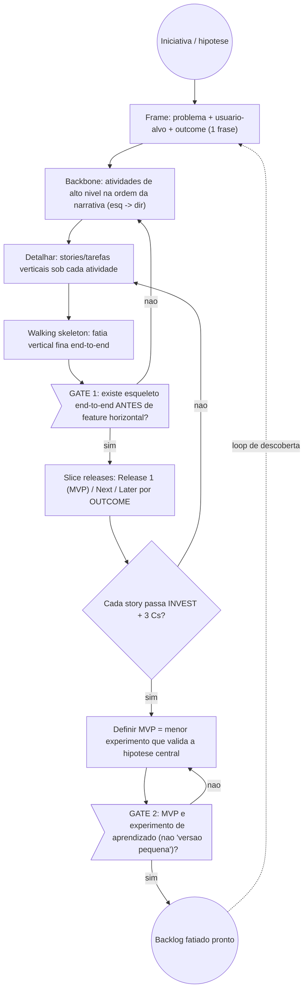

**Passo a passo**
1. **Frame** — entrada: briefing/hipotese. saida: 1 frase (problema + usuario + outcome).
2. **Backbone** — entrada: frame. saida: lista ordenada de atividades de alto nivel.
3. **Detalhar** — entrada: backbone. saida: cards de stories sob cada atividade.
4. **Walking skeleton** — entrada: cards. saida: fatia vertical fina percorrendo a narrativa toda.
5. **Slice releases** — entrada: skeleton + cards. saida: agrupamento horizontal por outcome (MVP/Next/Later), nunca por camada tecnica.
6. **Definir MVP** — entrada: Release 1. saida: menor experimento que valida a hipotese.

**Pontos de gate**
- **GATE 1 (esqueleto):** bloqueia features horizontais ate existir walking skeleton end-to-end.
- **GATE 2 (qualidade da story):** INVEST (Independent, Negotiable, Valuable, Estimable, Small, Testable) + 3 Cs (Card, Conversation, Confirmation). MVP = aprendizado, nao escopo reduzido.

---

## A2 — Ciclo da Sprint Scrum (Guide 2020)

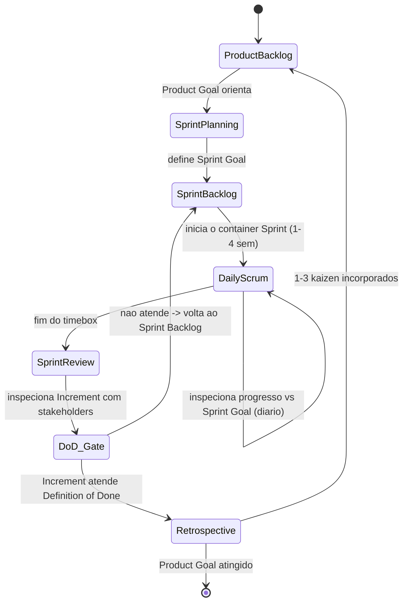

**Passo a passo**
1. **Sprint Planning** — entrada: Product Backlog + Product Goal. saida: Sprint Goal + Sprint Backlog.
2. **Sprint (container, 1-4 sem)** — entrada: Sprint Backlog. saida: Increment incremental.
3. **Daily Scrum** — entrada: progresso do dia. saida: plano ajustado rumo ao Sprint Goal (inspecao diaria).
4. **Sprint Review** — entrada: Increment. saida: feedback de stakeholders + backlog atualizado.
5. **Retrospective** — entrada: o processo da sprint. saida: 1-3 melhorias (kaizen) aplicadas.

**Pontos de gate**
- **Definition of Done (commitment do Increment):** nenhum item conta como "pronto" sem passar pelo DoD. E o gate jidaka/stop-the-line do Scrum.
- **3 commitments (2020):** Product Goal (guia o backlog), Sprint Goal (guia a sprint), DoD (guia o increment). Compromisso com a META, nao com escopo fixo.

---

## A3 — Kanban Pull com limites de WIP (Anderson)

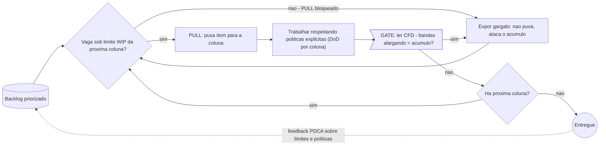

**Passo a passo**
1. **Visualizar** — entrada: fluxo de trabalho. saida: board com colunas = estados.
2. **Limitar WIP** — entrada: board. saida: teto por coluna/raia; limite atingido bloqueia o pull.
3. **Pull** — entrada: vaga sob o limite. saida: item puxado para a proxima etapa.
4. **Gerenciar fluxo** — entrada: CFD + lead/cycle time + throughput. saida: gargalos identificados.
5. **Politicas explicitas** — entrada: DoD por coluna + classes de servico. saida: regras de pull claras.
6. **Loops de feedback** — entrada: metricas. saida: PDCA sobre limites e politicas (melhoria evolutiva).

**Pontos de gate**
- **Limite de WIP (pull gate):** so puxa quando ha vaga; limite cheio = stop ate desafogar (alavanca direta da Lei de Little).
- **CFD gate:** bandas que se alargam sinalizam acumulo/gargalo antes de aceitar mais trabalho.
- **Classes de servico:** expedite > fixed-date > standard > intangible, sequenciadas por custo de atraso.

---

## A4 — Forecast probabilistico / Flow metrics (Vacanti)

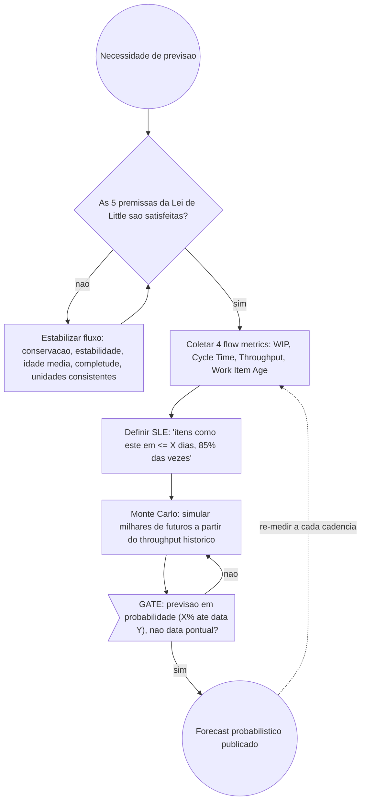

**Passo a passo**
1. **Checar estabilidade** — entrada: dados de fluxo. saida: confirma as 5 premissas (senao, numeros sao sem sentido).
2. **Coletar flow metrics** — entrada: board/historico. saida: WIP, Cycle Time, Throughput, Work Item Age.
3. **SLE** — entrada: cycle time historico. saida: previsao probabilistica (periodo + probabilidade).
4. **Monte Carlo** — entrada: throughput historico. saida: distribuicao de datas de conclusao / escopo.

**Pontos de gate**
- **Gate de premissas:** nao confiar em metricas com fluxo instavel ("as premissas sao mais importantes que a matematica" — Vacanti).
- **Gate de expressao:** toda previsao sai como percentil/probabilidade, nunca como data unica de compromisso.

---

## A5 — Build-Measure-Learn (Ries)

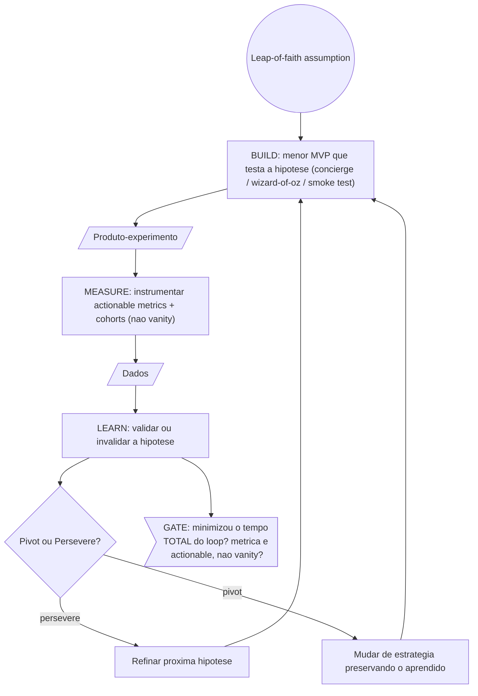

**Passo a passo**
1. **Build** — entrada: hipotese (leap-of-faith). saida: MVP minimo (concierge, wizard-of-oz ou smoke test).
2. **Measure** — entrada: MVP em uso. saida: actionable metrics + analise por cohort.
3. **Learn** — entrada: dados. saida: decisao pivot-ou-persevere + innovation accounting.

**Pontos de gate**
- **Gate de metrica:** rejeitar vanity metrics; so actionable metrics validam/invalidam.
- **Gate de velocidade do loop:** o objetivo e minimizar o tempo TOTAL Build->Measure->Learn (lote pequeno aplicado a aprendizado).
- **Decisao pivot/persevere:** dado define o caminho, nao opiniao (anti-HiPPO).

---

## A6 — WSJF: priorizacao economica (Reinertsen/SAFe)

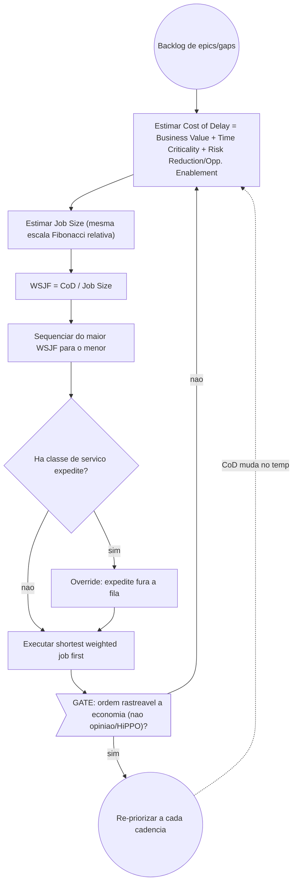

**Passo a passo**
1. **Estimar CoD** — entrada: epic/gap. saida: Cost of Delay (3 componentes, Fibonacci relativo).
2. **Estimar Job Size** — entrada: esforco. saida: tamanho na mesma escala.
3. **Calcular WSJF** — entrada: CoD e Job Size. saida: score = CoD / Job Size.
4. **Sequenciar** — entrada: scores. saida: fila do maior para o menor.

**Pontos de gate**
- **Gate anti-HiPPO:** a ordem precisa rastrear ao calculo economico, nao a opiniao.
- **Cuidado de proxy:** scores Fibonacci dao falsa objetividade — usar como ferramenta de conversa, nao oraculo (CoD real em R$/semana e mais honesto).
- **Re-priorizacao por cadencia:** CoD muda no tempo; re-rodar a cada ciclo.

---

## A7 — Calibragem de cerimonia por risco (Boehm-Turner)

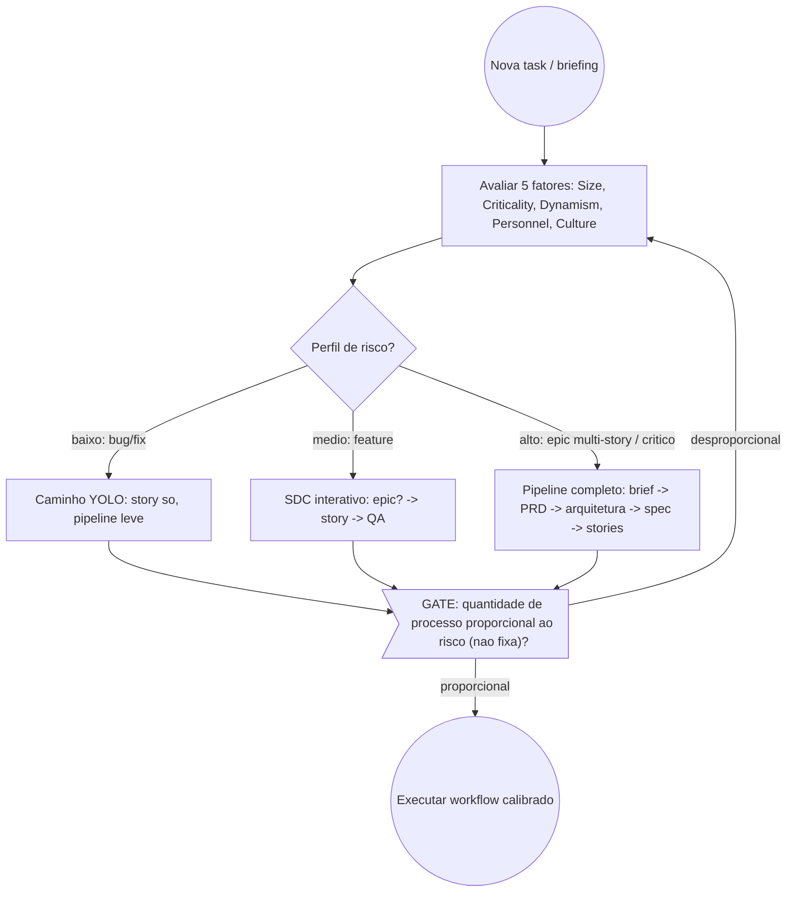

**Passo a passo**
1. **Avaliar 5 fatores** — entrada: task. saida: perfil Size/Criticality/Dynamism/Personnel/Culture.
2. **Classificar home ground** — entrada: perfil. saida: agil puro / plan-driven / mix.
3. **Selecionar workflow** — entrada: classificacao. saida: YOLO (baixo), SDC (medio) ou pipeline completo (alto).

**Pontos de gate**
- **Gate de proporcionalidade:** processo nunca fixo — sempre proporcional ao risco. Decisao de workflow rastreavel aos 5 fatores.

---

# DOMINIO B — Times, Org & Lei de Conway

## B1 — Inverse Conway Maneuver

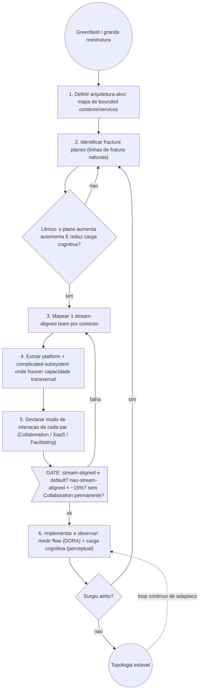

**Passo a passo**
1. **Arquitetura-alvo** — entrada: requisitos + atributos de qualidade. saida: mapa de bounded contexts.
2. **Fracture planes** — entrada: dominio. saida: candidatos a fronteira (business context, compliance, change cadence, location, risk, technology, persona).
3. **Stream-aligned teams** — entrada: contextos. saida: 1 time por contexto, respeitando carga cognitiva.
4. **Extrair plataforma/subsistema** — entrada: capacidades transversais. saida: platform team + complicated-subsystem team.
5. **Declarar modos** — entrada: pares de times. saida: modo explicito (default XaaS para plataforma).
6. **Sensing + adaptar** — entrada: metricas. saida: ajustes de topologia (loop continuo).

**Pontos de gate**
- **Litmus test:** so vira fronteira se aumenta autonomia E reduz carga cognitiva.
- **Gate de razao:** nao-stream-aligned < ~15% do total; nenhum par em Collaboration permanente (anti-padrao).

---

## B2 — Avaliacao e reducao de carga cognitiva

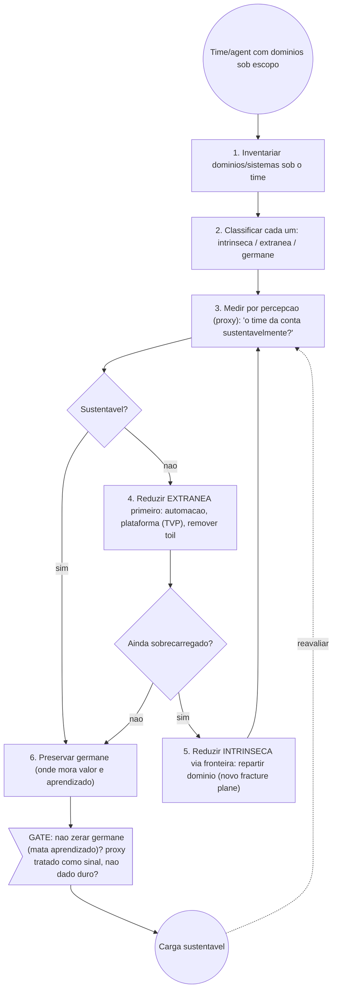

**Passo a passo**
1. **Inventariar** — entrada: escopo do time. saida: lista de dominios/sistemas.
2. **Classificar** — entrada: dominios. saida: rotulo intrinseca/extranea/germane por item.
3. **Medir por percepcao** — entrada: time. saida: sinal de sustentabilidade (sem instrumento validado; proxy tipo Teamperature).
4. **Reduzir extranea** — entrada: toil/ferramental. saida: automacao/plataforma.
5. **Reduzir intrinseca** — entrada: sobrecarga residual. saida: novo fracture plane / subsistema extraido.
6. **Preservar germane** — entrada: aprendizado de valor. saida: mantido.

**Pontos de gate**
- **Gate de proxy:** scores de carga cognitiva sao perceptuais — sinal, nao dado duro.
- **Gate de germane:** nunca zerar carga germane (so tarefas triviais mata motivacao e aprendizado).

---

## B3 — Ciclo de melhoria DORA

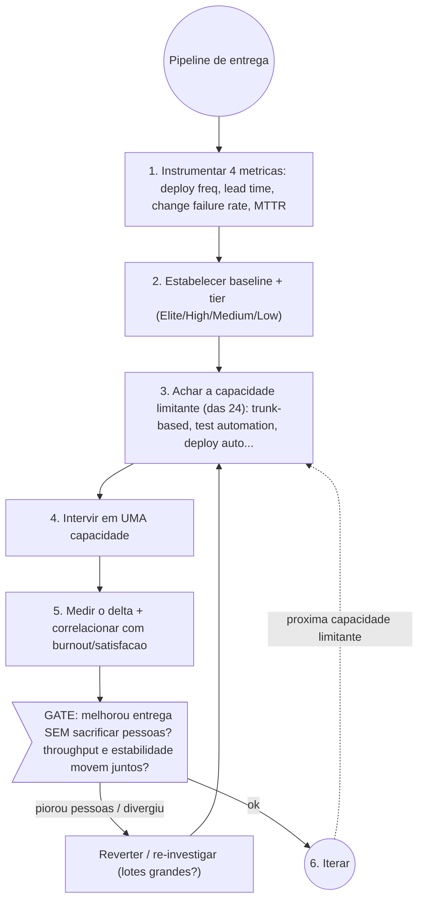

**Passo a passo**
1. **Instrumentar** — entrada: pipeline. saida: 4 metricas DORA (+5a de confiabilidade).
2. **Baseline + tier** — entrada: metricas. saida: posicao vs benchmarks (Elite: lead < 1d, deploy on-demand, CFR ~5%, recovery < 1h).
3. **Achar capacidade limitante** — entrada: dados. saida: 1 das 24 capacidades preditoras.
4. **Intervir** — entrada: capacidade. saida: mudanca aplicada.
5. **Medir delta** — entrada: pos-intervencao. saida: ganho + checagem de burnout.

**Pontos de gate**
- **Gate humano:** nunca otimizar entrega sacrificando pessoas (monitorar burnout/satisfacao junto).
- **Gate de coerencia:** throughput e estabilidade devem mover juntos; divergencia = investigar lotes grandes (alerta IA/DORA 2024).

---

## B4 — Three Ways do DevOps (Flow / Feedback / Continual Learning)

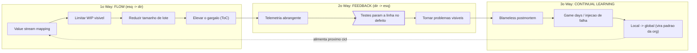

**Passo a passo**
1. **Flow** — entrada: dev. saida: fluxo otimizado dev->prod (VSM, WIP limitado, lotes pequenos, gargalo elevado).
2. **Feedback** — entrada: producao. saida: loops rapidos dir->esq (telemetria, linha que para no defeito, problemas visiveis).
3. **Continual Learning** — entrada: incidentes/experimentos. saida: aprendizado local virando padrao global.

**Pontos de gate**
- **Stop-the-line (feedback gate):** defeito detectado para a linha — nada avanca com defeito na fonte.
- **Blameless postmortem (learning gate):** timeline factual sem culpa + acoes corretivas sistemicas antes de fechar o ciclo.

---

## B5 — Dynamic Reteaming (5 padroes, Helfand)

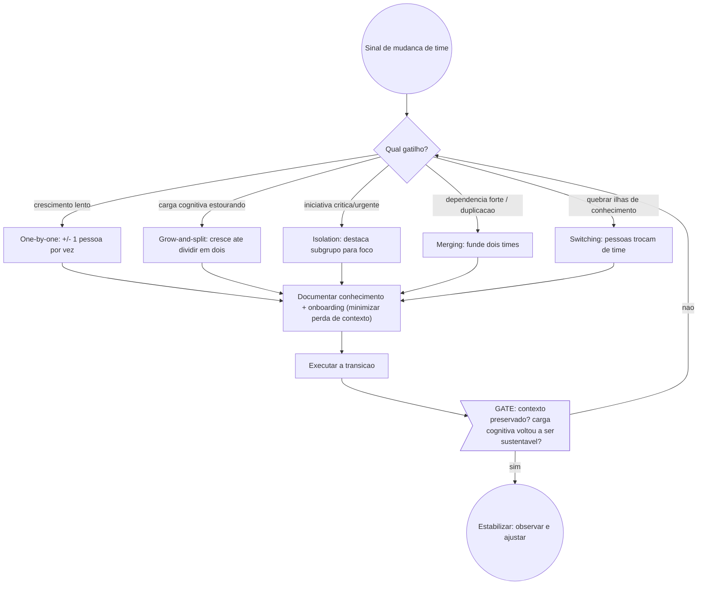

**Passo a passo**
1. **Detectar gatilho** — entrada: sinal organizacional. saida: classificacao do gatilho.
2. **Escolher padrao** — entrada: gatilho. saida: padrao que minimiza perda de contexto.
3. **Documentar** — entrada: conhecimento do time. saida: docs + plano de onboarding.
4. **Executar + estabilizar** — entrada: padrao escolhido. saida: nova composicao estavel.

**Pontos de gate**
- **Gate de contexto:** transicao so e valida se o conhecimento foi preservado (handoff/onboarding).
- **Gate de sustentabilidade:** carga cognitiva pos-reteaming volta a caber.

---

## B6 — Thinnest Viable Platform (TVP)

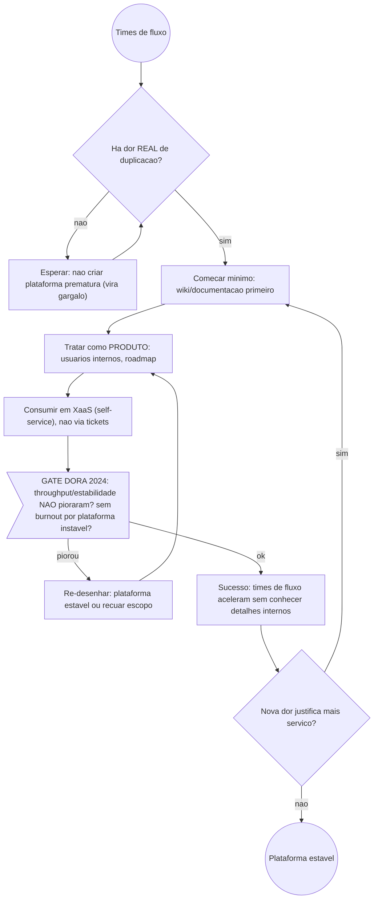

**Passo a passo**
1. **Validar dor** — entrada: times de fluxo. saida: confirmacao de duplicacao real (senao, nao construir).
2. **Comecar minimo** — entrada: dor confirmada. saida: TVP (wiki -> servico so quando a dor justifica).
3. **Tratar como produto** — entrada: TVP. saida: usuarios internos + roadmap.
4. **Consumir em XaaS** — entrada: produto. saida: self-service, nunca fila de tickets.

**Pontos de gate**
- **Gate de dor real:** sem duplicacao dolorosa, plataforma prematura = gargalo Conway-classico.
- **Gate de tradeoff (DORA 2024):** plataforma mal-gerida custa -8% throughput / -14% estabilidade + burnout — medir sempre.

---

# Loop mestre

> Diagrama unico que um **agent de IA** segue ao operar neste tema. Une os dois dominios: primeiro estrutura a organizacao (Conway/Topologias), depois roda o ciclo de fluxo (Agile/Lean/DORA) com WIP limitado, lotes pequenos e gate de qualidade como stop-the-line. Cada laco devolve aprendizado ao framework (empirismo real, anti-cargo-cult).

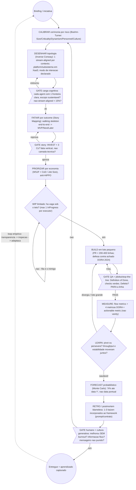

**Sequencia mestra (passo a passo do agent)**
1. **Calibrar** — pesa o risco antes de escolher o quanto de processo aplicar (cerimonia proporcional, nao fixa).
2. **Desenhar topologia** — define fronteiras de agents ANTES de executar (Conway como design ativo); escopo unico por agent, comunicacao em estrela (nao malha — n(n-1)/2 explode em tokens).
3. **Fatiar por outcome** — walking skeleton end-to-end, MVP como experimento.
4. **Priorizar por economia** — WSJF ordena, nunca opiniao.
5. **Limitar WIP** — max 1 story InProgress por executor; fan-out paralelo com teto explicito.
6. **Build em lote pequeno** — diffs pequenos e compreensiveis (defesa direta contra o achado DORA 2024 de que IA piora entrega).
7. **QA gate stop-the-line** — DoD obrigatorio; defeito interrompe o fluxo na fonte.
8. **Measure + Learn** — actionable metrics, pivot/persevere, checar que throughput e estabilidade andam juntos.
9. **Forecast probabilistico** — previsao em percentil, nunca compromisso de data.
10. **Retro blameless** — kaizen vira ajuste real de prompt/contrato (empirismo, nao cerimonia vazia).

**Gates mestres (inegociaveis)**
- **Carga cognitiva:** cada agent com 1 fronteira clara e escopo sustentavel.
- **Story:** INVEST + 3 Cs + fatia vertical por outcome.
- **WIP:** teto explicito; fila e o inimigo, nao a utilizacao.
- **QA / DoD (jidoka):** nada avanca com defeito — stop-the-line na fonte.
- **Coerencia entrega:** throughput e estabilidade movem juntos (senao, lote grande demais).
- **Humano + cultura:** ganho sem burnout; informacao flui; mensageiro de ma noticia nao e punido (Westrum generativo).
- **Forecast:** probabilidade, nunca data pontual.
