# LOOPS Onda 8 — Engenharia Aumentada por IA

Os loops operacionais da camada de **desenvolvimento orientado por IA** — destilados dos domínios 23-28 em diagramas de fluxo prontos pra virar comportamento de agent. Do espectro de autonomia ao loop ReAct, do pipeline spec-driven ao gate de compactação de contexto, do design de tool contract-first ao guardrail de saída.

## Índice dos loops

- **W1-W3** — Desenvolvimento Orientado por IA (espectro de autonomia, orchestrator-workers, evaluator-optimizer)
- **W4-W6** — Spec-Driven Development (pipeline completo, gate de rastreabilidade, retrofit de spec)
- **W7-W9** — Agentic Loops (ReAct, Reflexion, orchestrator-workers fan-out/fan-in)
- **W10-W12** — Context Engineering (montagem de contexto, RAG vs stuffing, gate de compactação)
- **W13-W15** — Evals & Guardrails (ciclo eval-driven, LLM-as-judge calibrado, guardrail de saída)
- **W16-W18** — Tool Use & MCP (tool contract-first, decisão MCP, loop tool-use com erro-como-feedback)

---

## W1 — Espectro de autonomia: autocomplete vs workflow vs agente

> Decide o nível mínimo de autonomia que resolve a tarefa: complexidade agêntica só entra quando a simplicidade falha de forma mensurável (Anthropic, Building Effective Agents).

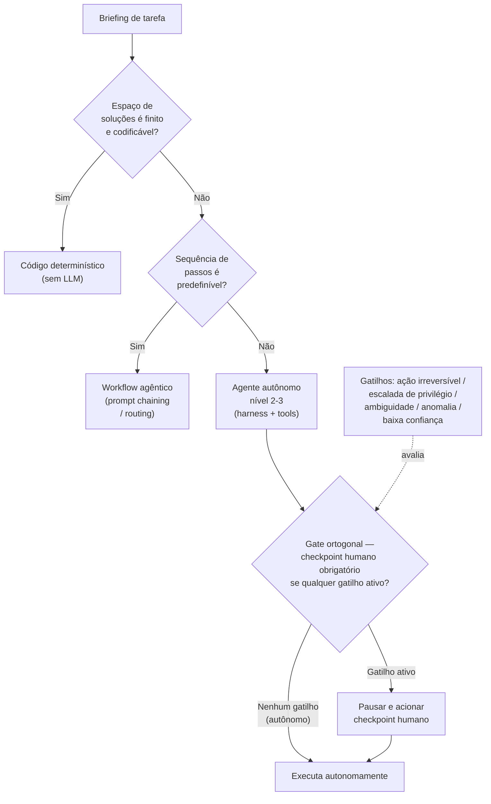

---

## W2 — Loop orchestrator-workers

> Orquestrador central decompõe a tarefa, distribui a workers e avalia o resultado contra uma done condition explícita, com limite de iterações e escalonamento humano.

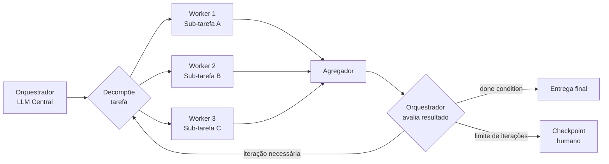

---

## W3 — Evaluator-optimizer (loop de qualidade)

> Um gerador produz, um avaliador critica com papel de crítico, e o ciclo refina até passar no critério ou escalar pro humano ao bater o teto de iterações.

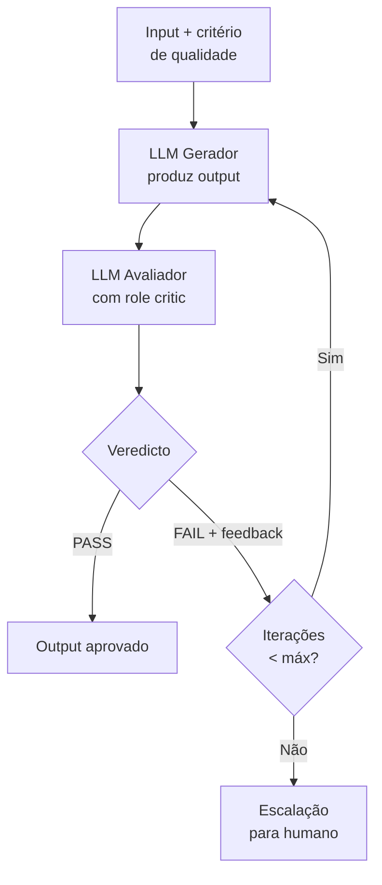

---

## W4 — Pipeline spec-driven completo

> Brief → PRD → Spec → Design → Tasks → Implement, com gates de rastreabilidade entre fases: todo artefato traça ao anterior, nada é inventado.

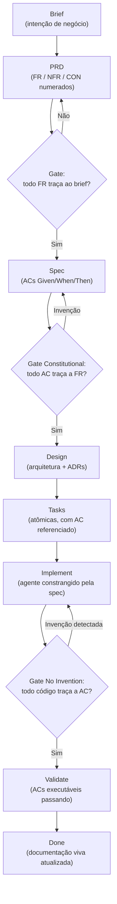

---

## W5 — Gate de rastreabilidade por PR

> Antes do merge, todo arquivo modificado precisa referenciar um critério de aceite; código órfão é tratado como invenção e bloqueia o PR.

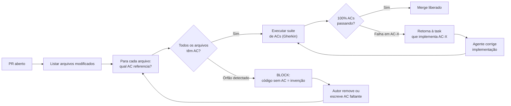

---

## W6 — Conversão de vibe-coding para spec-driven (retrofit)

> Brownfield: para código existente sem spec, escreve-se o critério de aceite retroativo, executa-se contra o comportamento real e estabelece-se a spec viva dali pra frente.

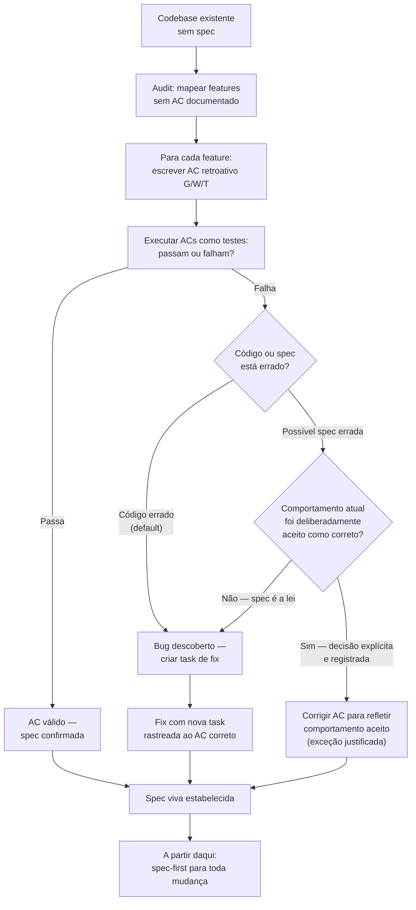

---

## W7 — Loop ReAct (reason, act, observe)

> Loop Thought-Action-Observation intercalado, com critério de parada por max_iterations pra nunca rodar indefinidamente.

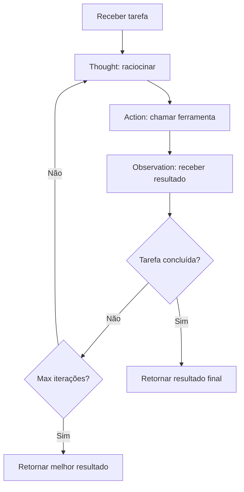

---

## W8 — Loop Reflexion (falha, reflete, melhora)

> Ciclo de auto-crítica verbal que armazena a reflexão sobre a falha em memória episódica e a injeta na próxima tentativa.

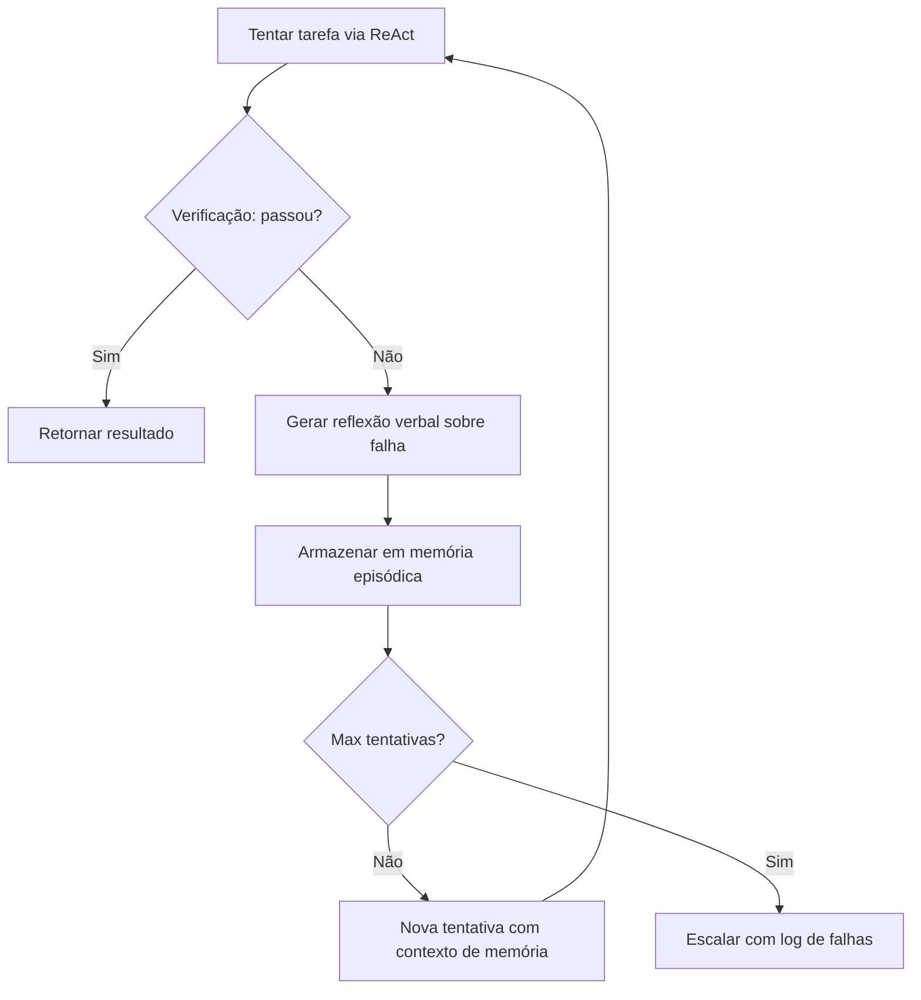

---

## W9 — Orchestrator-workers fan-out/fan-in (mecânica do loop)

> Orquestrador classifica a complexidade upfront, faz fan-out de workers com contexto isolado, e fan-in pra sintetizar — orçamento decidido antes do loop começar.

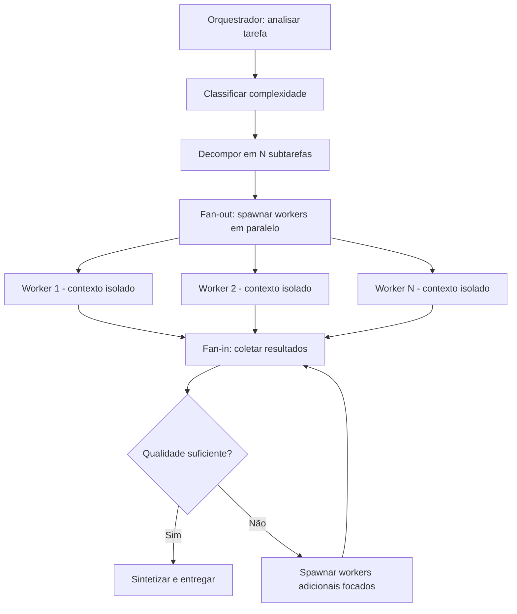

---

## W10 — Loop de montagem de contexto

> Recuperar o relevante, curar e filtrar, comprimir o histórico e montar a janela — extraindo fatos pra memória de curto prazo a cada turno.

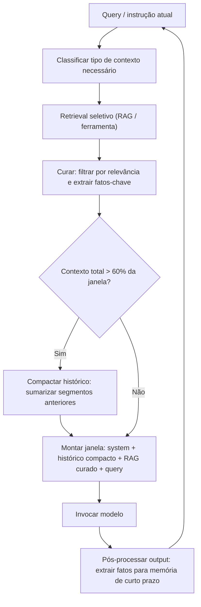

---

## W11 — Decisão RAG vs context-stuffing

> Escolhe como trazer informação do codebase pro contexto conforme o tamanho e o tipo de query, com reranker antes de injetar.

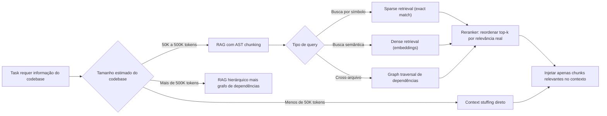

---

## W12 — Gate de compactação de contexto

> Mede o uso da janela a cada turno e dispara compactação antes da zona de degradação (context rot), validando que o resultado volta abaixo do limiar.

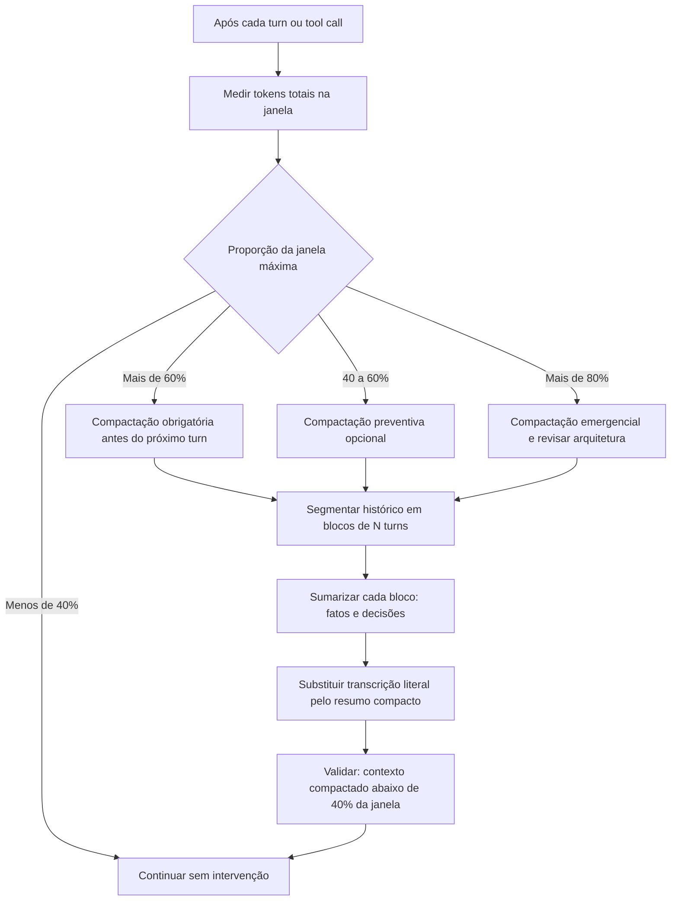

---

## W13 — Ciclo eval-driven (falha → eval → corrige → regressão)

> Cada falha de produção vira caso permanente no golden set; os evals rodam em CI e bloqueiam regressão futura. É o mutation score dos sistemas de IA.

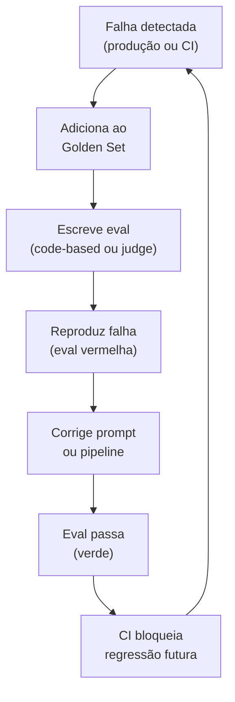

---

## W14 — LLM-as-judge com calibração humana

> O juiz LLM é calibrado contra julgamento humano (Critique Shadowing) até bater concordância mínima, com amostragem contínua pra evitar deriva.

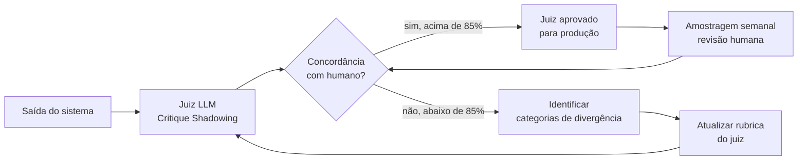

---

## W15 — Guardrail de saída (valida schema → bloqueia ou repara)

> A saída passa por validação de schema e de grounding antes de chegar ao usuário; em falha, tenta auto-reparo antes de rejeitar e logar.

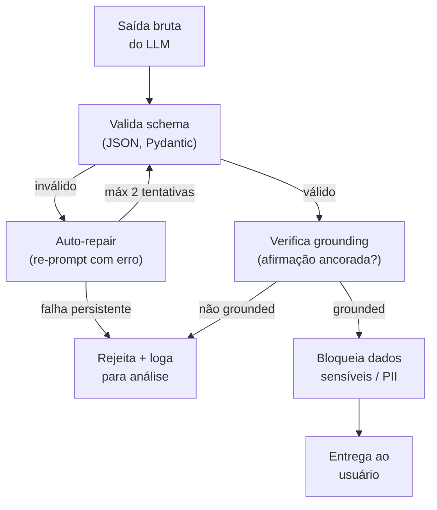

---

## W16 — Design de tool contract-first

> Especifica nome, descrição acionável, parâmetros semânticos e erro-como-feedback antes de implementar — design-first, como contrato de API.

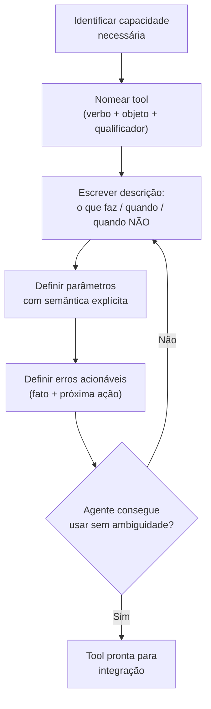

---

## W17 — Decisão MCP vs tool nativa vs API direta

> Seleciona o mecanismo de integração conforme reúso entre agentes, natureza da operação (dado vs ação) e disponibilidade de API.

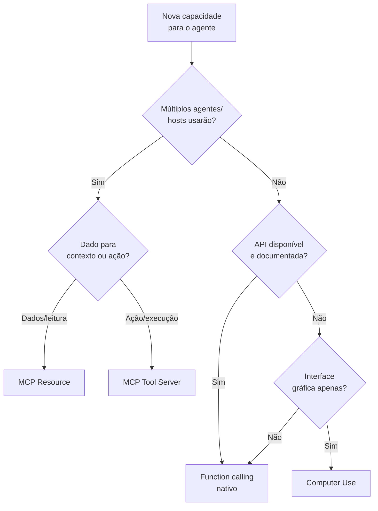

---

## W18 — Loop tool-use com erro-como-feedback

> O erro de uma tool guia o agente pra uma estratégia alternativa em vez de encerrar o loop; erro opaco que não orienta vira pedido de clarificação.

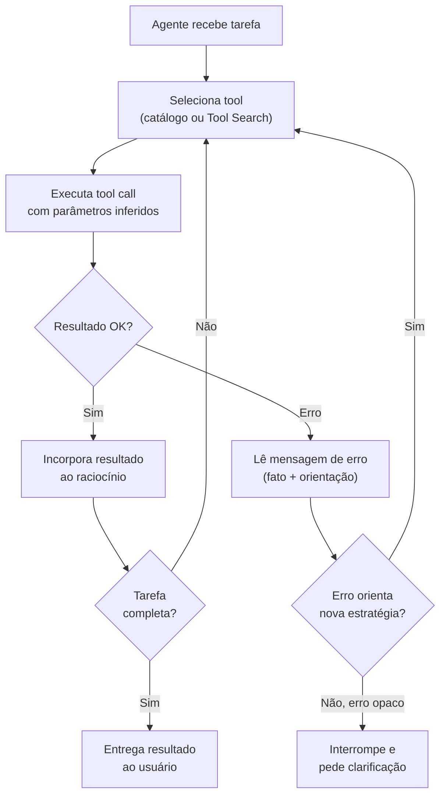

---

## W19 — Plan-and-Solve: planejamento upfront antes da execução

> Separa a fase de decomposição do plano da fase de execução passo a passo, evitando os três erros de Zero-Shot CoT: cálculo incorreto, passo ausente e erro semântico (Wang et al., ACL 2023).

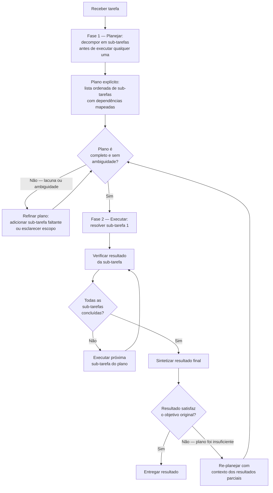

---

## W20 — Tree of Thoughts: busca em árvore com avaliação e poda

> Generaliza o raciocínio de cadeia linear para árvore de caminhos candidatos, com auto-avaliação a cada nó e busca BFS ou DFS com backtracking — superando CoT em 74% vs 4% no Game of 24 (Yao et al., NeurIPS 2023).

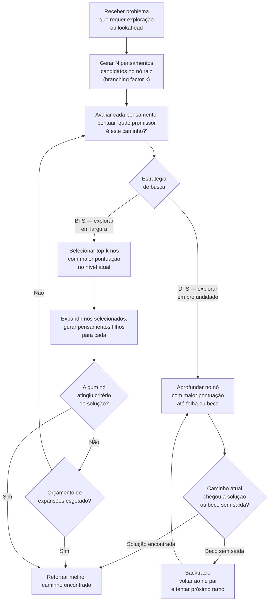

---

## W21 — Self-Healing em 3 níveis: sintático, funcional e semântico

> Detecta a falha, classifica em qual dos três níveis ocorreu e aplica a ação compensatória proporcional ao nível — com critério de parada por max_retries e convergência de score (Anthropic Engineering, 2025; Shinn et al. Reflexion, NeurIPS 2023).

```mermaid
flowchart TD
    A["Output gerado<br/>pelo agente"] --> B["Verificação sintática:<br/>linter, parser, schema"]
    B -- "Falha sintática" --> C["Nível 1 — Corrigir inline:<br/>sem reflexão verbal,<br/>corrigir erro específico"]
    C --> D["Re-executar verificação<br/>sintática"]
    D -- "Passa" --> E["Verificação funcional:<br/>suite de testes"]
    D -- "Falha persiste" --> F{"Tentativas<br/>< max_retries?"}
    B -- "Passa" --> E
    E -- "Falha funcional" --> G["Nível 2 — Reflexão verbal:<br/>gerar análise do que falhou<br/>e armazenar em memória episódica"]
    G --> H["Re-implementar com<br/>contexto da reflexão"]
    H --> I["Re-executar testes"]
    I -- "Passa" --> J["Verificação semântica:<br/>LLM-as-Judge avalia<br/>qualidade e corretude lógica"]
    I -- "Falha persiste" --> F
    E -- "Passa" --> J
    J -- "Falha semântica" --> K["Nível 3 — Re-planejar:<br/>adicionar restrições ao prompt,<br/>tentar abordagem diferente"]
    K --> L["Re-executar a partir<br/>da implementação"]
    L --> I
    J -- "Passa" --> M["Output aprovado:<br/>entregar resultado"]
    F -- "Sim" --> N["Resetar para próxima tentativa<br/>com reflexão acumulada"]
    N --> B
    F -- "Não — esgotado" --> O["Escalar para humano<br/>com log de falhas<br/>e melhor resultado obtido"]
```

---

## W22 — Tool Search e progressive disclosure: carregar tools sob demanda

> O agente começa com um catálogo leve de nomes e descrições de uma linha, descobre quais tools precisa para a tarefa, e carrega as definições completas apenas das selecionadas — redução verificada de 85% em tokens de definição e +25pp de acurácia (Anthropic Engineering, advanced-tool-use, 2025).

```mermaid
flowchart LR
    A["Agente recebe tarefa"] --> B["Catálogo leve disponível:<br/>nomes + descrição de 1 linha<br/>por tool (defer_loading: true)"]
    B --> C["Analisar tarefa:<br/>quais capacidades são<br/>necessárias para executá-la?"]
    C --> D["Selecionar subset de tools<br/>relevantes pelo nome<br/>e descrição curta"]
    D --> E["Carregar definições completas<br/>apenas das tools selecionadas<br/>(parâmetros, exemplos, constraints)"]
    E --> F{"Definições carregadas<br/>são suficientes para<br/>executar a tarefa?"}
    F -- "Sim" --> G["Executar tarefa<br/>com tools carregadas"]
    F -- "Não — tarefa evoluiu" --> H["Identificar tools adicionais<br/>necessárias no catálogo leve"]
    H --> E
    G --> I{"Tarefa completa?"}
    I -- "Não" --> J["Verificar se próxima ação<br/>requer tool ainda não carregada"]
    J -- "Sim, nova tool" --> H
    J -- "Não" --> G
    I -- "Sim" --> K["Descarregar tools<br/>não utilizadas do contexto<br/>e entregar resultado"]
```

---

## W23 — Programmatic Tool Calling: LLM escreve código que orquestra tools

> Em vez de N round-trips modelo→tool→modelo, o agente escreve um script Python em sandbox que orquestra múltiplas tools em lógica sequencial ou paralela — redução verificada de 37% em tokens e 19+ menos passos de inferência (Anthropic Engineering, 2025).

```mermaid
flowchart TD
    A["Tarefa requer<br/>múltiplas tool calls<br/>com lógica entre elas"] --> B{"Abordagem<br/>de orquestração"}
    B -- "N round-trips<br/>convencionais" --> C["Loop: modelo decide tool →<br/>chama tool → recebe resultado →<br/>decide próxima (custo alto)"]
    B -- "Programmatic<br/>Tool Calling" --> D["Agente escreve script Python<br/>que orquestra as tools<br/>com lógica condicional e loops"]
    D --> E["Sandbox isola execução:<br/>sem acesso ao host,<br/>recursos bounded"]
    E --> F["Script executa ferramentas<br/>em sequência ou paralelo<br/>sem round-trips ao modelo"]
    F --> G["Resultado consolidado<br/>retorna ao modelo<br/>em uma única observação"]
    G --> H{"Resultado satisfaz<br/>o objetivo?"}
    H -- "Sim" --> I["Entregar resultado<br/>ao usuário"]
    H -- "Não — lógica do script incorreta" --> J["Modelo revisa e corrige<br/>o script com base<br/>no erro retornado"]
    J --> E
    C --> K["Alto custo de inferência:<br/>cada decisão consome<br/>um round-trip completo"]
    K -.-> D
```

---

## W24 — Threat model de tool use: 5 vetores e mitigações

> Mapeia os cinco vetores de ameaça de tool use verificados pela Anthropic (prompt injection direta, indireta via resultado de tool, tool contamination, TOCTOU e escalada de privilégio) e a mitigação específica por vetor (Anthropic, "Our framework for developing safe and trustworthy agents", 2025).

```mermaid
flowchart TD
    A["Agente com acesso<br/>a ferramentas em produção"] --> B["Vetor 1: Prompt injection direta<br/>usuário instrui ação maliciosa<br/>via input de chat"]
    A --> C["Vetor 2: Prompt injection indireta<br/>conteúdo lido por tool contém<br/>instruções disfarçadas de dados"]
    A --> D["Vetor 3: Tool contamination<br/>servidor MCP comprometido<br/>retorna dados desviantes"]
    A --> E["Vetor 4: TOCTOU<br/>recurso muda entre verificação<br/>e uso pelo agente"]
    A --> F["Vetor 5: Escalada de privilégio<br/>agente usa tool A para<br/>obter acesso a tool B restrita"]
    B --> G["Mitigação V1:<br/>validar escopo do pedido,<br/>confirmar ações destrutivas"]
    C --> H["Mitigação V2:<br/>separar dados de instruções,<br/>desconfiar de comandos em conteúdo lido"]
    D --> I["Mitigação V3:<br/>whitelist de servidores confiáveis,<br/>verificar integridade do servidor"]
    E --> J["Mitigação V4:<br/>re-verificar recurso imediatamente<br/>antes de agir sobre ele"]
    F --> K["Mitigação V5:<br/>escopos de permissão isolados<br/>por tool, least agency"]
    G --> L["Gate unificado:<br/>permissões granulares por tool<br/>always-allow / needs-approval / block"]
    H --> L
    I --> L
    J --> L
    K --> L
```

---

## W25 — Anatomia do harness: CLAUDE.md, hooks, skills e subagentes

> Descreve os seis componentes do harness de agentic coding (Claude Code) — como cada camada se conecta para configurar comportamento, impor quality gates e paralelizar tarefas (Anthropic, Claude Code Best Practices, 2025).

```mermaid
flowchart TD
    A["CLAUDE.md<br/>Configuração comportamental:<br/>regras, convenções, glossário,<br/>ferramentas do projeto"] --> B["Loop principal<br/>do harness"]
    B --> C["Ferramentas nativas:<br/>Read, Write, Edit,<br/>Bash, Grep, Glob"]
    B --> D["PreToolUse hook:<br/>intercepta antes de cada<br/>tool call, pode bloquear"]
    D -- "Aprovado" --> C
    D -- "Bloqueado" --> E["Agente recebe rejeição<br/>com motivo explícito"]
    C --> F["PostToolUse hook:<br/>intercepta após tool call,<br/>pode validar ou corrigir"]
    F --> G["Resultado incorporado<br/>ao raciocínio do agente"]
    G --> H{"Tarefa requer<br/>capacidade especializada<br/>ou paralelismo?"}
    H -- "Sim — usar Skill" --> I["Skill: workflow complexo<br/>encapsulado como<br/>único comando reutilizável"]
    H -- "Sim — paralelizar" --> J["Subagente via Task tool:<br/>contexto isolado,<br/>janela própria"]
    H -- "Não" --> K["Continuar loop<br/>com ferramentas nativas"]
    I --> K
    J --> L["Resultado do subagente<br/>retorna resumido<br/>ao agente principal"]
    L --> K
    K --> M{"Ciclo: Explorar →<br/>Planejar → Implementar<br/>→ Commitar completo?"}
    M -- "Não" --> B
    M -- "Sim" --> N["Entregar resultado"]
```

---

## W26 — Prompt Chaining com gate entre etapas

> Cada chamada LLM processa o output da anterior com prompt especializado; um gate programático entre etapas verifica critério de qualidade antes de avançar — erros são contidos no elo que os produziu (Anthropic, Building Effective Agents, dez/2024).

```mermaid
flowchart TD
    A["Input original<br/>do usuário"] --> B["Etapa 1: LLM especializado<br/>processa com prompt otimizado<br/>para esta fase"]
    B --> C{"Gate 1:<br/>output 1 satisfaz<br/>critério de aceite?"}
    C -- "Não" --> D["Retornar à etapa 1<br/>com feedback do gate<br/>(max retries = 2)"]
    D --> B
    C -- "Sim" --> E["Etapa 2: LLM especializado<br/>recebe output 1 como input,<br/>processa com prompt diferente"]
    E --> F{"Gate 2:<br/>output 2 satisfaz<br/>critério de aceite?"}
    F -- "Não" --> G["Retornar à etapa 2<br/>com feedback do gate"]
    G --> E
    F -- "Sim" --> H["Etapa N: continuar<br/>cadeia até última etapa"]
    H --> I{"Gate N:<br/>output final satisfaz<br/>critério de qualidade?"}
    I -- "Não" --> J["Retornar à etapa N<br/>com feedback"]
    J --> H
    I -- "Sim" --> K["Output final<br/>entregue ao usuário"]
```

---

## W27 — Routing e Parallelization: classificar-rotear e seccionar-votar

> Dois sub-padrões canônicos da Anthropic: Routing (classificador direciona input ao handler especializado) e Parallelization em duas formas — Sectioning (subtarefas independentes em paralelo) e Voting (mesma tarefa N vezes com consenso) — compostos em pipeline quando necessário (Anthropic, Building Effective Agents, dez/2024).

```mermaid
flowchart TD
    A["Input recebido"] --> B["Classificador LLM ou<br/>determinístico:<br/>detectar tipo do input"]
    B --> C{"Categoria<br/>identificada"}
    C -- "Categoria A" --> D["Handler A:<br/>prompt + ferramentas<br/>especializados para A"]
    C -- "Categoria B" --> E["Handler B:<br/>prompt + modelo<br/>especializados para B"]
    C -- "Categoria N" --> F["Handler N:<br/>escalação humana<br/>ou fallback"]
    D --> G{"Handler requer<br/>paralelização?"}
    E --> G
    G -- "Não" --> K["Resultado do<br/>handler diretamente"]
    G -- "Sectioning:<br/>partes independentes" --> H["Dividir tarefa em<br/>N subtarefas independentes<br/>e executar em paralelo"]
    G -- "Voting:<br/>confiança via consenso" --> I["Enviar mesma tarefa<br/>a N instâncias LLM<br/>em paralelo"]
    H --> J["Fan-in: agregar<br/>resultados das subtarefas"]
    I --> L["Consenso: output vence<br/>se maioria concorda<br/>(threshold configurável)"]
    J --> K
    L --> K
    K --> M["Output final<br/>entregue ao usuário"]
```
