# LOOPS Onda 9 — Segurança & Cibersegurança

Os loops operacionais da camada de **segurança e cibersegurança** — destilados dos domínios 29-37 em diagramas de fluxo prontos pra virar comportamento de agent. Do pipeline de security gates ao ciclo de resposta a incidente, do hardening de Kubernetes à defesa contra prompt injection, do caminho pra SOC 2 à preservação de evidência forense.

## Índice dos loops

- **W1-W3** — Application Security & Secure SDLC (OWASP Top 10, pipeline de gates, threat modeling de feature)
- **W4-W6** — Offensive Security (pentest autorizado, mapear em ATT&CK, quebrar a Kill Chain)
- **W7-W9** — Defensive Security & SOC (detection-as-code, triagem de alerta, threat hunting)
- **W10-W12** — Cloud & Infra Security (IAM least privilege, hardening K8s 4C, gate de IaC)
- **W13-W15** — Identity, Access & Cryptography (fluxo OAuth/OIDC, modelo de autorização, cifrar dado)
- **W16-W18** — Supply Chain Security (priorizar CVE EPSS+KEV, SBOM no pipeline, assinar artefato)
- **W19-W21** — Incident Response & Forensics (ciclo NIST/PICERL, ransomware, preservar evidência)
- **W22-W24** — Governance, Risk & Compliance (avaliação de risco, caminho SOC 2/ISO, compliance-as-code)
- **W25-W27** — AI/LLM & Agent Security (defesa prompt injection, excessive agency, lethal trifecta)
- **W28-W31** — AI/LLM Security (OWASP LLM Top 10 2025, MITRE ATLAS defensivo, supply chain de modelos, red teaming estruturado)
- **W32-W34** — Application Security / Secure SDLC (OWASP API Security Top 10 por endpoint, maturidade SSDF+SAMM, fuzzing como gate de pipeline)
- **W35-W37** — Governance, Risk & Compliance (NIST CSF 2.0 ciclo operacional, LGPD operacional, CIS Controls IG1/IG2/IG3 assessment)

---

## W1 — OWASP Top 10: triagem e fix por categoria

> Quando uma feature toca autenticação, acesso ou dados externos, mapeia as categorias OWASP Top 10 relevantes e aplica a correção + teste de abuso por categoria.

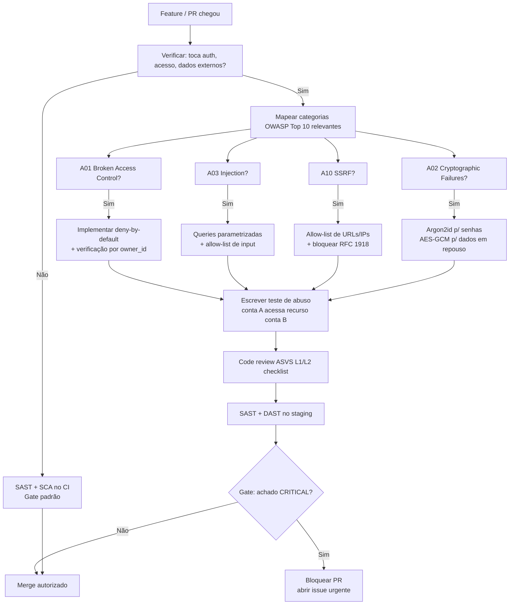

---

## W2 — Pipeline de security gates (SAST/SCA/DAST)

> Cada estágio do pipeline tem um gate automático de segurança — do pre-commit (segredos) ao DAST em staging — que bloqueia o merge/release em achado crítico.

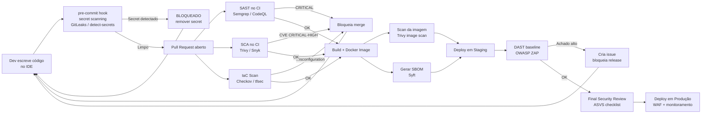

---

## W3 — Threat modeling de uma feature

> Dimensiona o esforço de threat modeling pelo risco da feature, desenha o fluxo de dados, aplica STRIDE e transforma as mitigações em critérios de aceite rastreáveis.

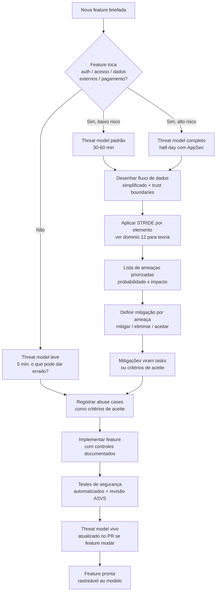

---

## W4 — Ciclo de pentest autorizado (recon → exploração → relatório)

> As 7 fases do PTES num engajamento com escopo assinado — da autorização à exploração documentada e ao relatório com achados priorizados.

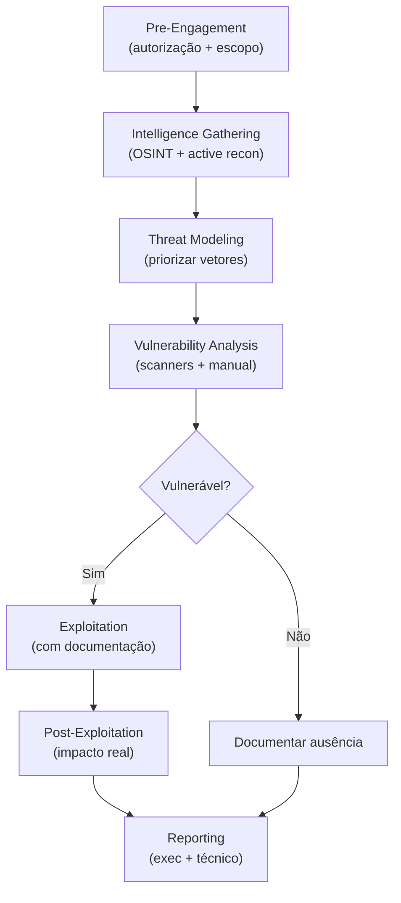

---

## W5 — Mapear achado em técnica ATT&CK (remediação + detecção)

> Cada achado ofensivo vira dois tickets: um de remediação técnica e um de detecção (regra no SIEM), mapeados na técnica MITRE ATT&CK correspondente.

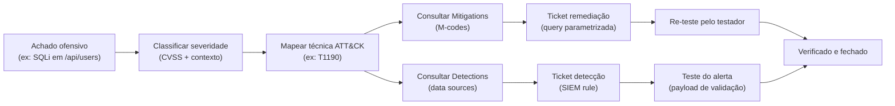

---

## W6 — Quebrar a Kill Chain (do ataque à defesa)

> Para cada fase da Cyber Kill Chain que o red team alcançou sem ser detectado, define-se o controle defensivo que a quebra e o purple team re-testa a eficácia.

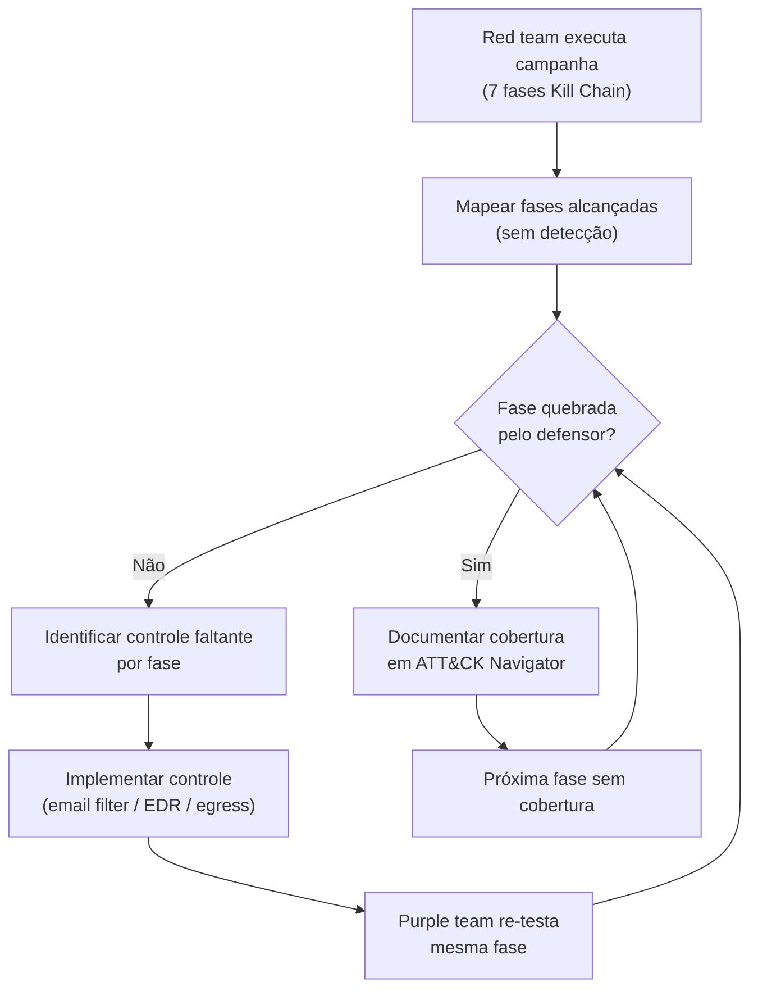

---

## W7 — Detection-as-code (hipótese → regra → teste → deploy)

> Da inteligência de ameaça à detecção em produção via pipeline: replica o comportamento, escreve a regra Sigma, valida com teste positivo e negativo, e sobe em alert-only antes de produção.

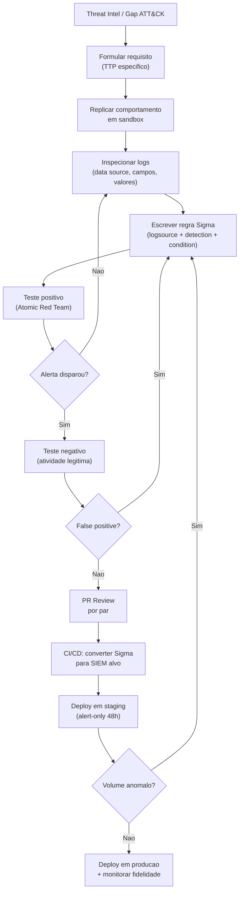

---

## W8 — Triagem de alerta no SOC (Tier 1)

> Fluxo de decisão do analista de plantão: do alerta ao fechamento como falso-positivo, ao escalonamento pro Tier 2 com contexto, registrando FP pra tuning.

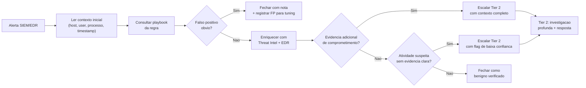

---

## W9 — Threat hunting hipótese-driven (framework ABLE)

> Caça proativa: formula a hipótese (Actor, Behavior, Location, Evidence), busca nos dados, e toda hunt com resultado vira detecção automatizada.

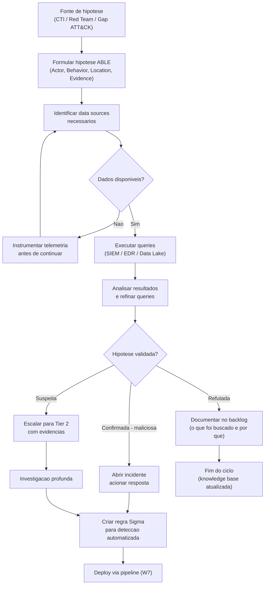

---

## W10 — IAM least privilege (do amplo ao mínimo)

> Audita as permissões realmente usadas (Access Advisor), remove o que não se usa, restringe ao recurso específico e move humanos pra acesso just-in-time.

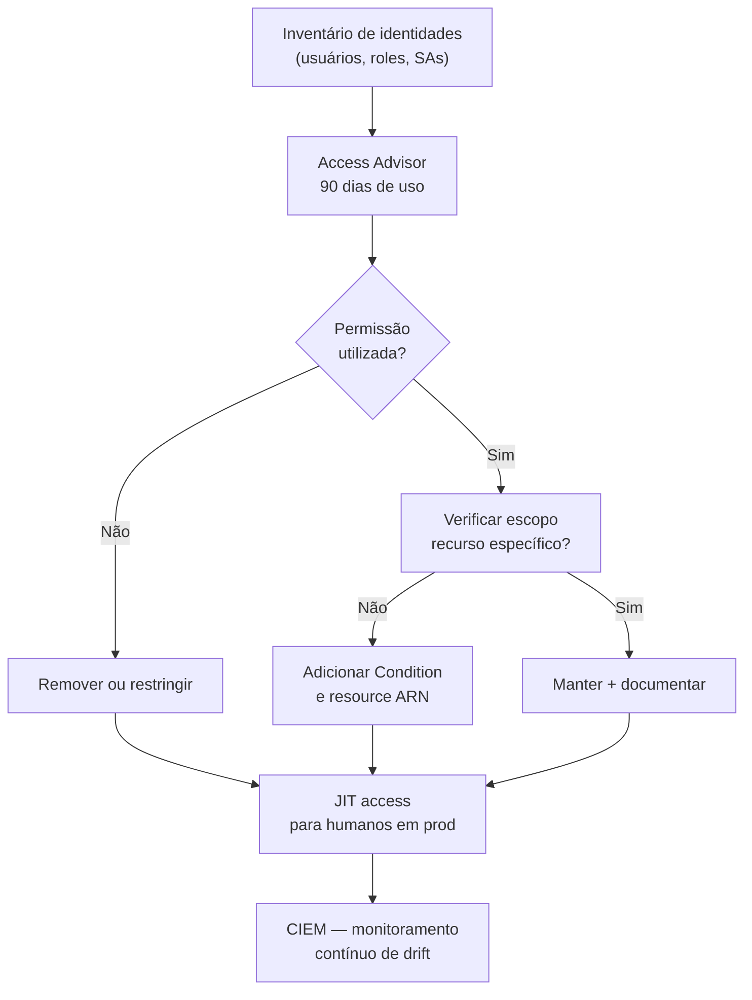

---

## W11 — Hardening de cluster K8s (modelo 4C)

> Percorre as quatro camadas Cloud → Cluster → Container → Code aplicando o controle de cada nível, com network policy default-deny e monitoramento de runtime.

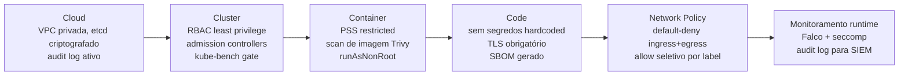

---

## W12 — Gate de IaC no pipeline

> Insere varredura de misconfiguração e segredos no ciclo de PR/CI antes de qualquer `apply`, bloqueando CRITICAL/HIGH e validando o estado real com CSPM pós-deploy.

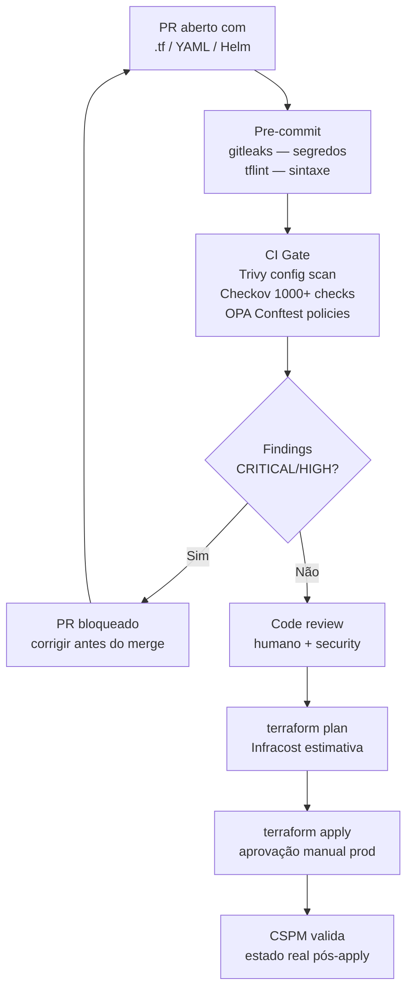

---

## W13 — Escolher o fluxo OAuth/OIDC correto

> Decide o grant certo pelo tipo de cliente e necessidade de identidade — Auth Code + PKCE pra usuários, Client Credentials pra M2M — e valida o ID Token.

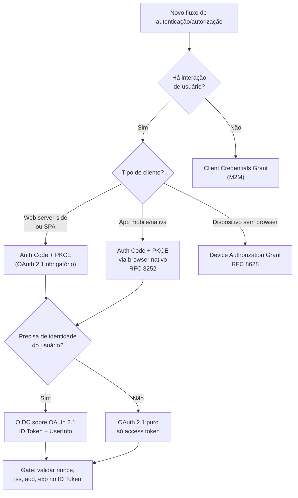

---

## W14 — Decisão de modelo de autorização (RBAC/ABAC/ReBAC)

> Escolhe o modelo pela estrutura de papéis e necessidade de permissão por recurso/contexto, sempre com default-deny e teste de IDOR/escalonamento.

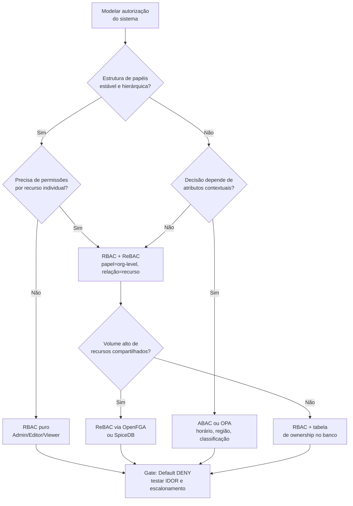

---

## W15 — Cifrar dado sensível (em repouso e em trânsito)

> Roteia pelo tipo de dado: TLS 1.3 em trânsito, Argon2id pra senha (nunca cifrar senha), envelope encryption pra volume, AES-256-GCM com IV único pro resto.

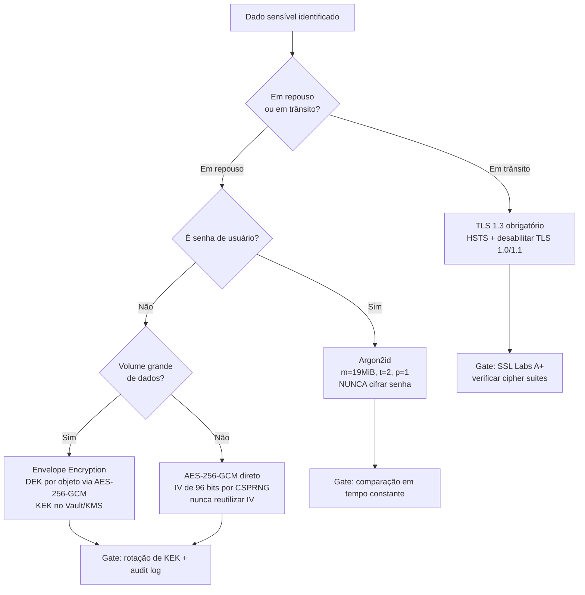

---

## W16 — Priorizar CVE com EPSS + KEV (não só CVSS)

> Cruza o SBOM contra a CISA KEV (explorado no mundo real) e o EPSS (probabilidade de exploração) pra transformar 16 mil CVEs numa fila real de centenas.

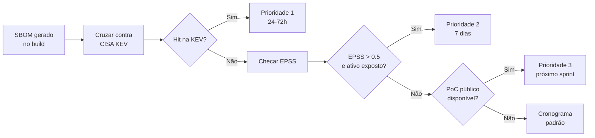

---

## W17 — Gerar e verificar SBOM no pipeline

> Gera o SBOM (lista de ingredientes) a cada build, assina como attestation, e alimenta um monitoramento contínuo que bloqueia deploy em CVE crítica.

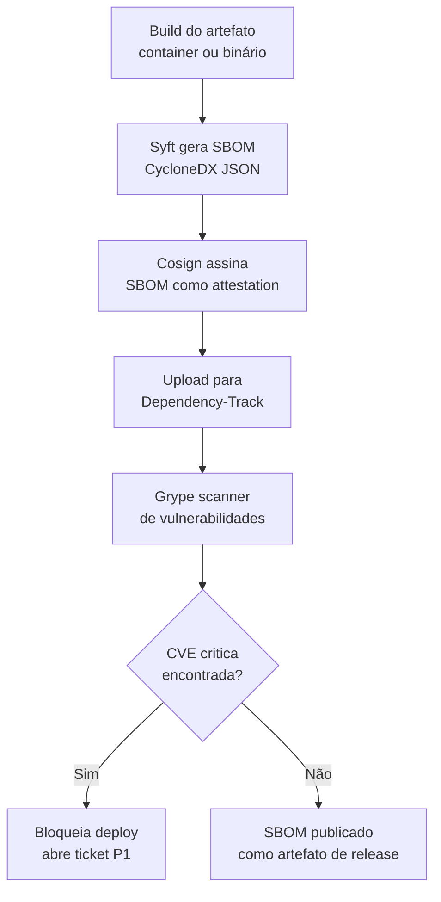

---

## W18 — Assinar e verificar artefato (Sigstore + SLSA)

> Produz proveniência SLSA e assinatura keyless (Sigstore/cosign) em todo release, e o consumidor verifica a assinatura e a identidade antes de fazer deploy.

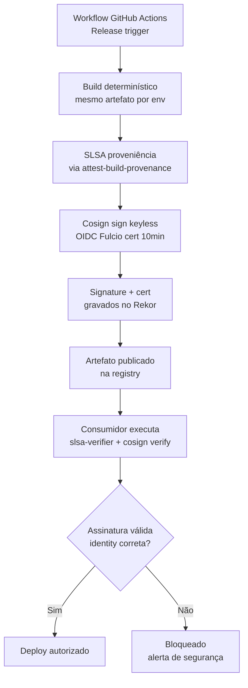

---

## W19 — Ciclo de resposta a incidente (NIST + PICERL)

> Da detecção ao postmortem blameless seguindo NIST SP 800-61 e SANS PICERL: contém sem desligar, preserva a RAM, erradica, recupera de backup limpo e fecha com lições aprendidas.

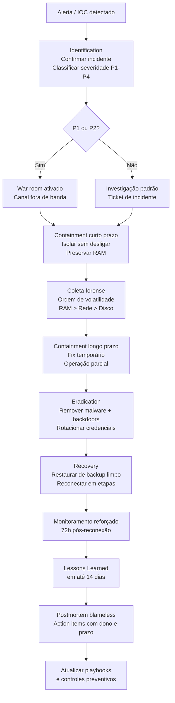

---

## W20 — Resposta a ransomware

> Playbook operacional: comunicação fora de banda, isolar sem desligar, capturar RAM, verificar backups offline, avaliar decryptor público antes de cogitar pagamento, e notificar (LGPD/ANPD em 3 dias úteis).

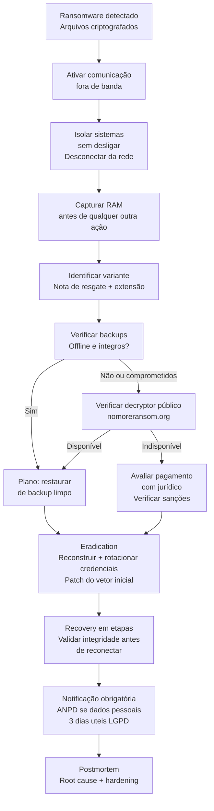

---

## W21 — Preservar evidência (ordem de volatilidade)

> Protocolo DFIR de coleta forense (NIST SP 800-86): do mais volátil ao menos (RAM → rede → disco → logs), com hash, cadeia de custódia e análise sempre em cópia.

```mermaid
flowchart LR
    A["Sistema comprometido<br/>identificado"] --> B{"Ligado?"}
    B -->|"Sim"| C["1. Capturar RAM<br/>winpmem / LiME<br/>Hash SHA-256 imediato"]
    B -->|"Não"| G
    C --> D["2. Artefatos de rede<br/>netstat, arp, pcap<br/>Logs firewall e DNS"]
    D --> E["3. Isolar da rede<br/>sem desligar"]
    E --> F["4. Imagem forense de disco<br/>Write blocker obrigatorio<br/>Hash antes E depois"]
    F --> G["5. Logs do sistema<br/>Event Viewer, Syslog<br/>EDR, AD, Cloud Audit"]
    G --> H["6. Artefatos de filesystem<br/>MFT, Prefetch, Registry"]
    H --> I["Cadeia de custodia<br/>ID + coletor + timestamp + hash<br/>Assinar cada transferencia"]
    I --> J["Analise em copia<br/>NUNCA no original<br/>Volatility + Autopsy"]
    J --> K["Relatorio forense<br/>Metodologia + timeline + conclusoes"]
```

---

## W22 — Avaliação de risco (identificar → analisar → tratar)

> Triagem qualitativa do portfólio de riscos, quantificação dos top 10 em R$ via FAIR, e plano de tratamento (aceitar/mitigar/transferir/evitar) com monitoramento contínuo.

```mermaid
flowchart TD
    A["Inventário de ativos<br/>e contexto da org"] --> B["Triagem qualitativa<br/>portfolio de riscos"]
    B --> C{"Top 10 riscos<br/>identificados?"}
    C -->|"Sim"| D["Análise FAIR<br/>quantificação em R$"]
    C -->|"Não"| A
    D --> E["Risk Treatment Plan<br/>aceitar / mitigar / transferir / evitar"]
    E --> F["Implementar controles<br/>CIS IG1/IG2/IG3"]
    F --> G["Monitoramento contínuo<br/>e revisão anual"]
    G --> B
```

---

## W23 — Caminho para SOC 2 Type II / ISO 27001

> Do escopo mínimo viável à certificação: gap analysis, remediação, automação de evidência, período de observação e auditoria externa.

```mermaid
flowchart LR
    A["Definir escopo<br/>mínimo viável"] --> B["Readiness Assessment<br/>gap analysis"]
    B --> C["Remediation<br/>implementar controles faltantes"]
    C --> D["Automação de evidências<br/>Vanta / Drata / AWS Config"]
    D --> E["Período de observação<br/>12 meses Type II"]
    E --> F["Auditoria externa<br/>CPA credenciado"]
    F --> G{"Exceções<br/>materiais?"}
    G -->|"Sim"| H["Management response<br/>e plano de correção"]
    G -->|"Não"| I["Relatório SOC 2 Type II<br/>ou Certificado ISO 27001"]
    H --> F
```

---

## W24 — Compliance-as-code (controle → evidência automática)

> Codifica os controles como política (OPA/InSpec), bloqueia infra não-conforme no CI/CD, e coleta evidência automaticamente — auditoria via API, sem planilha manual.

```mermaid
flowchart TD
    A["Mapeamento de controles<br/>CIS / SOC 2 / PCI DSS"] --> B["Codificar regras<br/>OPA / InSpec / Sentinel"]
    B --> C["Gate no pipeline CI/CD<br/>bloqueia infra não-conforme"]
    C --> D["Detecção contínua<br/>AWS Config / SIEM"]
    D --> E["Log imutável<br/>CloudTrail / SIEM"]
    E --> F["Coleta automática<br/>de evidências"]
    F --> G{"Controle passou?"}
    G -->|"Sim"| E
    G -->|"Não"| I["Remediação automática<br/>ou alerta para time"]
    I --> C
```

---

## W25 — Defesa contra prompt injection (direta e indireta)

> Classifica o tipo de injeção, checa a "lethal trifecta" (dados privados + conteúdo não-confiável + egresso), aplica controles por camada e valida com red team.

```mermaid
flowchart TD
    A["Novo agente ou feature"] --> B{"Processa conteúdo externo?"}
    B -- "Não" --> C["Testar apenas injection direta"]
    B -- "Sim" --> D["Lethal trifecta check"]
    D --> E{"Tem dados privados?"}
    D --> F{"Exposto a conteúdo não-confiável?"}
    D --> G{"Pode comunicar externamente?"}
    E -- "Sim" --> H["Minimizar acesso (scope)"]
    F -- "Sim" --> I["Spotlighting + classifier upstream"]
    G -- "Sim" --> J["Restringir ou remover egresso"]
    H --> K["Separação de roles no contexto"]
    I --> K
    J --> K
    K --> L["Red team: testar injection nas superfícies"]
    C --> L
    L --> M{"Ataque bem-sucedido?"}
    M -- "Sim" --> N["Controle determinístico na camada exposta"]
    N --> L
    M -- "Não" --> O["Documentar superfícies e controles"]
```

---

## W26 — Avaliar excessive agency de um agente

> Audita as três dimensões do excesso (funcionalidade, permissão, autonomia) tool a tool, removendo o desnecessário, escopando ao mínimo e exigindo aprovação humana pra ação irreversível.

```mermaid
flowchart LR
    A["Inventariar tools do agente"] --> B["Tool necessária para a tarefa atual?"]
    B -- "Não" --> C["Remover"]
    B -- "Sim" --> D["Auditar permissões da tool"]
    D --> E{"Permissão excede o mínimo?"}
    E -- "Sim" --> F["Escopar ao mínimo (read vs write)"]
    E -- "Não" --> G["Auditar autonomia"]
    F --> G
    G --> H{"Pode ação irreversível sem aprovação?"}
    H -- "Sim" --> I["Adicionar gate de aprovação humana"]
    H -- "Não" --> J["Documentar justificativa da tool"]
    I --> J
    J --> K{"Mais tools a auditar?"}
    K -- "Sim" --> B
    K -- "Não" --> L["Checklist final: credenciais, rate limit, timeout"]
    L --> M["Agente com least agency validado"]
```

---

## W27 — Lethal trifecta: quando bloquear o deploy

> Gate pré-deploy que verifica a co-presença das três condições perigosas (dados privados + conteúdo não-confiável + egresso externo) e bloqueia até mitigar pelo menos uma.

```mermaid
flowchart TD
    A["Deploy de agente solicitado"] --> B["Leg 1: acessa dados privados?"]
    B -- "Não" --> G["Risco baixo — checklist padrão"]
    B -- "Sim" --> C["Leg 2: processa fonte não-confiável?"]
    C -- "Não" --> H["Risco médio — monitorar exfiltração"]
    C -- "Sim" --> D["Leg 3: pode enviar dados pra fora?"]
    D -- "Não" --> I["Risco médio — output filtering"]
    D -- "Sim" --> E["LETHAL TRIFECTA — BLOQUEAR"]
    E --> F{"Mitigação viável antes do deploy?"}
    F -- "Sim" --> J["Opção A: remover egresso"]
    F -- "Sim" --> K["Opção B: isolar dados (mínimo no contexto)"]
    F -- "Sim" --> L["Opção C: sanitizar conteúdo externo"]
    J --> M["Re-avaliar após mitigação"]
    K --> M
    L --> M
    F -- "Não" --> N["Redesenhar arquitetura"]
    M --> A
    G --> O["Deploy aprovado com controles documentados"]
    H --> O
    I --> O
```

---

## W28 — OWASP LLM Top 10 2025: classificar risco e aplicar controle por categoria

> Para cada categoria do OWASP LLM Top 10 2025 relevante ao sistema, classifica o risco e aplica o controle defensivo correspondente — da Sensitive Information Disclosure ao Unbounded Consumption.

```mermaid
flowchart TD
    A["Novo sistema ou feature com LLM"] --> B["Inventariar categorias OWASP LLM 2025 aplicáveis"]
    B --> C{"LLM01 Prompt Injection?"}
    C -->|Sim| D["Spotlighting + separação roles no contexto<br/>Classificador upstream<br/>Constraints no topo E no final do prompt"]
    B --> E{"LLM02 Sensitive Disclosure?"}
    E -->|Sim| F["Nunca embutir credenciais no system prompt<br/>Output filtering para PII/CPF/token<br/>Limitar contexto ao mínimo"]
    B --> G{"LLM03/04 Supply Chain ou Data Poisoning?"}
    G -->|Sim| H["Usar Safetensors, verificar checksums<br/>AI SBOM com proveniência<br/>Testes de comportamento específico"]
    B --> I{"LLM07 System Prompt Leakage?"}
    I -->|Sim| J["Instrução explícita de não-revelação<br/>Segredos fora do prompt em vault<br/>Regras críticas enforced no código"]
    B --> K{"LLM08 Vector e Embedding RAG?"}
    K -->|Sim| L["Whitelist de fontes de ingestion<br/>TrustRAG filtering pós-retrieval<br/>Spotlighting em conteúdo RAG"]
    B --> M{"LLM10 Unbounded Consumption?"}
    M -->|Sim| N["Rate limiting por usuário e org<br/>Timeout + max_tokens fixos<br/>Loops com condição de parada explícita"]
    D --> O["Gate: red team nas superfícies mapeadas"]
    F --> O
    H --> O
    J --> O
    L --> O
    N --> O
    O --> P{"Ataque bem-sucedido<br/>em alguma categoria?"}
    P -->|Sim| Q["Adicionar controle determinístico<br/>na camada exposta e retestar"]
    Q --> O
    P -->|Não| R["Documentar cobertura por categoria<br/>e versionar no threat model"]
```

---

## W29 — MITRE ATLAS: tática de IA adversarial para mitigação e detecção

> Para cada tática ATLAS identificada no threat model do sistema de IA, mapeia a técnica específica, seleciona as mitigações catalogadas e define o controle de detecção correspondente.

```mermaid
flowchart LR
    A["Threat model do sistema de IA"] --> B["Inventariar táticas ATLAS aplicáveis<br/>16 táticas v5.1.0"]
    B --> C["AML.TA0004 ML Model Access?"]
    C -->|Sim| D["Restringir acesso à API de inferência<br/>Não expor pesos do modelo<br/>Autenticação OAuth 2.1 com escopo mínimo"]
    B --> E["AML.TA0012 ML Attack Staging?"]
    E -->|Sim| F["Verificar integridade de datasets de treino<br/>Outlier detection antes de treinar<br/>Probes lineares pós-treino"]
    B --> G["AML.T0010 AI Supply Chain Compromise?"]
    G -->|Sim| H["Safetensors obrigatório<br/>fickling para análise de pickle<br/>AI SBOM com checksums e assinatura"]
    D --> I["Mapear técnica → mitigação ATLAS (M-codes)"]
    F --> I
    H --> I
    I --> J["Definir controle de detecção<br/>por data source ATLAS"]
    J --> K["Ticket de remediação técnica"]
    J --> L["Regra de detecção no SIEM<br/>alerta por anomalia de comportamento"]
    K --> M["Re-teste após correção"]
    L --> M
    M --> N["Cobertura registrada<br/>no ATLAS Navigator do sistema"]
```

---

## W30 — Verificação de supply chain de modelos

> Antes de carregar qualquer modelo externo em produção, percorre os gates de formato, proveniência, comportamento e AI SBOM — bloqueando modelos que não passam na verificação estática e nos testes de comportamento específico.

```mermaid
flowchart TD
    A["Modelo externo selecionado<br/>ex: HuggingFace, repositório parceiro"] --> B{"Formato do arquivo?"}
    B -->|".pth / pickle"| C["BLOQUEADO por padrão<br/>Rodar fickling para análise estática<br/>Converter para Safetensors se possível"]
    B -->|"Safetensors"| D["Verificar checksum SHA-256<br/>contra hash publicado pelo provedor"]
    C -->|"Sem chamadas suspeitas em __reduce__"| D
    C -->|"Chamadas suspeitas detectadas"| E["BLOQUEADO — descartar modelo<br/>Reportar ao provedor"]
    D -->|"Hash não confere"| E
    D -->|"Hash OK"| F["Verificar organização provedora<br/>Conta verificada + histórico documentado?"]
    F -->|"Não verificada"| G["Elevação de risco<br/>Require aprovação de security antes de prosseguir"]
    F -->|"Verificada"| H["Escanear com HuggingFace Pickle Import Scan<br/>e ClamAV — resultado não conclusivo, não suficiente"]
    G --> H
    H --> I["Testes de comportamento específico<br/>ex: afirmações de domínio crítico<br/>NÃO apenas benchmarks gerais"]
    I --> J{"Comportamento anômalo<br/>ou sleeper agent suspeito?"}
    J -->|Sim| K["Probes lineares em ativações<br/>residual stream AUROC-check<br/>Descartar se positivo"]
    J -->|Não| L["Gerar AI SBOM do modelo<br/>CycloneDX ML-BOM com proveniência"]
    K -->|"Positivo — backdoor"| E
    K -->|"Negativo"| L
    L --> M["Assinar SBOM com cosign<br/>Registrar no Rekor"]
    M --> N["Modelo aprovado para uso em produção<br/>Revisão periódica a cada versão nova"]
```

---

## W31 — Red teaming de LLM

> Metodologia autorizada e educacional de red teaming estruturado de LLMs — da definição de objetivos ao dataset de ataque, execução com PyRIT/PAIR, escalada progressiva e conversão de achados em evals de regressão.

```mermaid
flowchart TD
    A["Solicitação de red team autorizado<br/>Escopo e objetivo documentados"] --> B["Definir categorias de dano a testar<br/>ex: injection, jailbreak, data extraction<br/>máx 15 categorias MLCommons"]
    B --> C["Montar dataset de ataque por categoria<br/>Persona jailbreak, many-shot, cross-lingual<br/>Token smuggling, codificação, adversarial suffix"]
    C --> D["Configurar PyRIT ou PAIR<br/>Targets + Converters + Scorers + Orchestrators"]
    D --> E["Execução automatizada Round 1<br/>ASR medido por categoria"]
    E --> F{"ASR > threshold<br/>de risco aceitável?"}
    F -->|Sim| G["Escalada progressiva<br/>Multi-turn Crescendo<br/>Many-shot 256 exemplos"]
    G --> H{"Jailbreak confirmado<br/>em alguma categoria?"}
    H -->|Sim| I["Documentar: técnica + payload + categoria<br/>Severidade por impacto x probabilidade"]
    H -->|Não| J["Testar variantes cross-lingual<br/>e multimodal para cobertura completa"]
    J --> K["Documentar cobertura — sem jailbreak confirmado"]
    F -->|Não| K
    I --> L["Propor controle corretivo<br/>classificador upstream / system prompt / sandboxing"]
    L --> M["Implementar controle e retestar<br/>ASR deve cair abaixo do threshold"]
    M --> N["Converter cada achado em eval de regressão<br/>test case persistente no suite de CI"]
    K --> O["Relatório de red team<br/>Cobertura por categoria + ASR por técnica"]
    N --> O
    O --> P["Próximo ciclo de red team<br/>revisitar a cada mudança de modelo ou capacidade"]
```

---

## W32 — Defesa OWASP API Security Top 10 por endpoint

> Para cada endpoint de API exposto, aplica os controles dos riscos mais críticos do OWASP API Security Top 10 2023 — BOLA, BFLA, Mass Assignment e Unrestricted Consumption — com gate de verificação por operação.

```mermaid
flowchart TD
    A["Novo endpoint de API ou PR tocando API"] --> B["Classificar operação do endpoint<br/>leitura de objeto / escrita / admin / fluxo de negócio"]
    B --> C{"Retorna objeto por ID<br/>ex: GET /faturas/ID ?"}
    C -->|Sim| D["BOLA check obrigatório<br/>checar ownership do objeto por owner_id<br/>NUNCA assumir autenticação = autorização"]
    B --> E{"Endpoint admin ou privilegiado?"}
    E -->|Sim| F["BFLA check obrigatório<br/>verificar role no handler<br/>nunca depender de URL obscura"]
    B --> G{"Aceita body com múltiplos campos?"}
    G -->|Sim| H["Mass Assignment check<br/>allow-list explícita de campos aceitos<br/>nunca .update(**request.json) direto"]
    B --> I{"Endpoint sem paginação<br/>ou sem rate limit?"}
    I -->|Sim| J["Unrestricted Consumption check<br/>rate limit por IP e por usuário<br/>max page size obrigatório + timeout"]
    D --> K["Escrever teste de abuso<br/>conta A tenta acessar objeto da conta B"]
    F --> K
    H --> K
    J --> K
    K --> L["Gate ASVS V4 e V13<br/>deny by default + auth em cada requisição"]
    L --> M{"Achado crítico ou alto?"}
    M -->|Sim| N["Bloquear PR<br/>abrir issue de segurança urgente"]
    M -->|Não| O["Endpoint aprovado<br/>registrar no inventário de API"]
    N --> A
```

---

## W33 — Maturidade de programa de AppSec via SSDF e SAMM 2.0

> Avalia o nível atual do programa de AppSec nos 4 grupos SSDF e nas 15 práticas SAMM, identifica os gaps de maior risco e produz um roadmap de 12-18 meses priorizado por impacto de risco versus esforço.

```mermaid
flowchart LR
    A["Iniciar assessment de maturidade AppSec"] --> B["Assessment SSDF — 4 grupos de práticas"]
    B --> C["PO: Prepare Organization<br/>políticas, treinamento, tooling, papéis"]
    B --> D["PS: Protect Software<br/>repositório, pipeline, artefatos"]
    B --> E["PW: Produce Well-Secured Software<br/>design seguro, SAST, code review, testes"]
    B --> F["RV: Respond to Vulnerabilities<br/>identificar, remediar, prevenir recorrência"]
    C --> G["Assessment SAMM 2.0 — 15 práticas<br/>Governance, Design, Implementation<br/>Verification, Operations"]
    D --> G
    E --> G
    F --> G
    G --> H["Score atual por prática<br/>Nível 0-3 com evidências"]
    H --> I["Definir target level por prática<br/>calibrado por perfil de risco do produto"]
    I --> J["Gap analysis: current vs target<br/>priorizar por risco x esforço"]
    J --> K["Roadmap 12-18 meses<br/>milestones mensuráveis por trimestre"]
    K --> L{"Projeto com dados sensíveis<br/>ou multi-tenant?"}
    L -->|Sim| M["ASVS L2 como piso mínimo<br/>V2 Auth + V4 Access Control + V13 API"]
    L -->|Não| N["ASVS L1 como piso mínimo<br/>capítulos V2, V3, V4, V7"]
    M --> O["Revisão de maturidade trimestral<br/>comparar score real vs roadmap"]
    N --> O
    O --> H
```

---

## W34 — Fuzzing como gate de pipeline

> Integra fuzzing automatizado ao pipeline de CI/CD como gate de verificação na fase de Verification do SDL — detectando crashes, memory bugs e erros de parsing que SAST e DAST não cobrem.

```mermaid
flowchart TD
    A["Novo parser, protocolo ou API criado"] --> B{"Componente é:<br/>parser de formato / endpoint de API<br/>protocol handler / input processing?"}
    B -->|Não| C["Gate padrão SAST + SCA<br/>fuzzing não obrigatório"]
    B -->|Sim| D["Configurar corpus inicial de seeds<br/>inputs válidos + inputs de borda"]
    D --> E["Configurar fuzzer<br/>AFL++ para binários C/C++<br/>libFuzzer para bibliotecas<br/>restler-fuzzer para APIs REST"]
    E --> F["Execução de fuzzing no CI<br/>timeout definido ex: 30-60 min por build"]
    F --> G{"Crash, panic ou<br/>comportamento inesperado?"}
    G -->|Sim| H["Triagem do crash<br/>reproduzir com corpus seed isolado"]
    H --> I{"CRITICAL: memory corruption<br/>ou RCE potencial?"}
    I -->|Sim| J["BLOQUEAR pipeline<br/>abrir CVE interno urgente"]
    I -->|Não| K["Abrir issue com reprodutor<br/>prioridade por severidade"]
    G -->|Não| L["Expandir corpus com<br/>cobertura nova encontrada"]
    L --> M["Armazenar corpus incremental<br/>Seeds acumulam entre builds"]
    K --> M
    J --> N["Fix + retestar com corpus que causou crash"]
    N --> F
    M --> O["Coverage report de fuzzing<br/>linhas / branches alcançadas"]
    O --> P{"Coverage estável<br/>por 3+ builds?"}
    P -->|Não| L
    P -->|Sim| Q["Gate passou<br/>componente aprovado para release"]
    C --> Q
```

---

## W35 — NIST CSF 2.0 como ciclo operacional

> Opera o NIST CSF 2.0 como ciclo contínuo de gestão de risco — partindo do Current Profile, definindo o Target Profile, executando o gap analysis e convertendo lacunas em roadmap de controles mapeados às 6 funções.

```mermaid
flowchart TD
    A["Iniciar ciclo CSF 2.0<br/>escopo da organização definido"] --> B["GOVERN — espinha do programa<br/>Definir apetite a risco, papéis,<br/>política e cadeia de suprimentos"]
    B --> C["Construir Current Profile<br/>estado real em cada subcategoria<br/>106 subcategorias GV/ID/PR/DE/RS/RC"]
    C --> D["Definir Target Profile<br/>onde queremos chegar por função<br/>Usar Community Profile do setor como base"]
    D --> E["Gap analysis: Current → Target<br/>lacunas ordenadas por risco"]
    E --> F["IDENTIFY — ativos e riscos<br/>ID.AM inventário + ID.RA avaliação de risco"]
    F --> G["PROTECT — salvaguardas<br/>PR.AA acesso + PR.DS dados + PR.PS plataforma"]
    G --> H["DETECT — monitoramento<br/>DE.CM contínuo + DE.AE análise de eventos"]
    H --> I["RESPOND — resposta a incidente<br/>RS.MA gestão + RS.MI mitigação + RS.CO comunicação"]
    I --> J["RECOVER — recuperação<br/>RC.RP plano executado + RC.CO comunicação"]
    J --> K["Roadmap de controles mapeados<br/>CIS Controls / ISO 27001 / NIST 800-53"]
    K --> L["Tier de maturidade revisado<br/>Partial Tier1 → Risk Informed Tier2<br/>→ Repeatable Tier3 → Adaptive Tier4"]
    L --> M["Revisão anual do ciclo<br/>Current Profile atualizado"]
    M --> C
```

---

## W36 — LGPD operacional: direitos do titular, base legal e notificação à ANPD

> Operacionaliza a LGPD nos três fluxos críticos: resposta a requisição de titular (Art. 18), seleção de base legal por tipo de tratamento (Art. 7) e notificação de incidente à ANPD no prazo de 3 dias úteis (Resolução ANPD 15/2024).

```mermaid
flowchart TD
    A["Evento LGPD recebido"] --> B{"Tipo de evento?"}
    B -->|"Requisição de titular Art.18"| C["Identificar e verificar identidade do titular"]
    C --> D["Mapear dados tratados para esse titular<br/>todos os sistemas e bases"]
    D --> E{"Tipo de direito solicitado?"}
    E -->|"Acesso"| F["Relatório de dados tratados<br/>prazo: até 15 dias úteis"]
    E -->|"Correção"| G["Corrigir dados incorretos<br/>notificar terceiros que receberam"]
    E -->|"Eliminação"| H["Checar se há base legal que impede<br/>ex: obrigação legal, legítimo interesse"]
    H -->|"Sem impedimento"| I["Eliminar dados e confirmar ao titular"]
    H -->|"Impedimento documentado"| J["Informar titular e justificar fundamento"]
    F --> K["Registrar no log de atendimento<br/>manter por 5 anos mínimo"]
    G --> K
    I --> K
    J --> K
    B -->|"Novo tratamento a implementar"| L["Identificar base legal correta Art.7<br/>Contrato / Consentimento / Legítimo Interesse"]
    L --> M{"Base = legítimo interesse?"}
    M -->|Sim| N["Aplicar balancing test obrigatório<br/>interesse do controlador vs direitos do titular"]
    N -->|"Aprovado"| O["Documentar base legal no ROPA<br/>Register of Processing Activities"]
    M -->|Não| O
    O --> P["Privacy by Design aplicado<br/>minimização + finalidade + prazo de retenção"]
    B -->|"Incidente com dados pessoais"| Q["Confirmar escopo do incidente<br/>quais dados, quantos titulares, tipo de risco"]
    Q --> R{"Risco ou dano relevante<br/>aos titulares?"}
    R -->|Não| S["Registrar internamente<br/>manter documentação por 5 anos"]
    R -->|Sim| T["NOTIFICAR ANPD em até 3 dias úteis<br/>Resolução ANPD 15/2024"]
    T --> U["Notificação inclui:<br/>natureza dos dados, titulares afetados<br/>medidas adotadas, DPO/encarregado"]
    U --> V["Notificar titulares afetados<br/>se risco alto para direitos individuais"]
    V --> S
    S --> W["Postmortem e controles preventivos<br/>atualizar avaliação de impacto DPIA"]
```

---

## W37 — CIS Controls IG1/IG2/IG3: assessment e priorização progressiva

> Avalia o estado atual dos 153 safeguards dos CIS Controls v8, prioriza pelo Implementation Group adequado ao perfil de risco da organização, e produz um plano de implementação escalonado com mapeamento para ISO 27001 e SOC 2.

```mermaid
flowchart TD
    A["Iniciar assessment CIS Controls v8"] --> B["Classificar perfil da organização<br/>tamanho, setor, dados tratados, regulação"]
    B --> C{"Perfil de risco?"}
    C -->|"Startup ou PME sem equipe dedicada"| D["Meta: IG1 completo<br/>56 safeguards essenciais<br/>Controles 1-8 + 11 + 14"]
    C -->|"Empresa com equipe de segurança<br/>e risco reputacional significativo"| E["Meta: IG2 completo<br/>130 safeguards totais<br/>Adiciona monitoramento, VA, AppSec"]
    C -->|"Dados altamente sensíveis<br/>ou regulação estrita"| F["Meta: IG3 completo<br/>153 safeguards totais<br/>Adiciona pentest, threat intel, detection avançada"]
    D --> G["Assessment IG1: checar cobertura atual<br/>CIS1 inventário ativos + CIS2 software<br/>CIS3 proteção de dados + CIS4 config segura<br/>CIS5 contas + CIS6 acesso + CIS7 vuln mgmt<br/>CIS8 logs + CIS11 backup + CIS14 treinamento"]
    E --> G
    F --> G
    G --> H["Score de cobertura por controle<br/>safeguards implementados vs total do IG"]
    H --> I["Gaps ordenados por criticidade<br/>vetores de ataque mais comuns do DBIR"]
    I --> J["Plano de implementação por sprint<br/>quick wins vs esforço alto"]
    J --> K["Mapear safeguards implementados<br/>para ISO 27001 Anexo A<br/>e SOC 2 Common Criteria"]
    K --> L{"Alvo de certificação?"}
    L -->|"SOC 2"| M["IG2 cobre maioria dos Common Criteria<br/>CC6 acesso + CC7 operações + CC8 mudanças"]
    L -->|"ISO 27001"| N["IG2 cobre Technological Controls A.8<br/>completar com Organizational A.5 e People A.6"]
    L -->|"Nenhum por agora"| O["Revisão trimestral de cobertura<br/>score de maturidade por controle"]
    M --> O
    N --> O
    O --> P["Revisão anual completa<br/>atualizar IG conforme crescimento"]
    P --> A
```

---

## W38 — Zero Trust Architecture: fluxo PE/PA/PEP por request

> Implementa o modelo lógico do NIST SP 800-207: cada request passa pelo Policy Enforcement Point, que consulta o Policy Administrator, que solicita decisão ao Policy Engine considerando identidade, postura do dispositivo e contexto — nunca confia em posição de rede.

```mermaid
flowchart TD
    REQ["Request de acesso a recurso<br/>ex: usuário, serviço ou pod"] --> PEP["Policy Enforcement Point<br/>intercepta e bloqueia por default<br/>ex: proxy, API gateway, sidecar Envoy"]
    PEP --> PA["Policy Administrator<br/>traduz decisão em instrução concreta<br/>estabelece ou termina sessão"]
    PA --> PE["Policy Engine<br/>decide conceder ou negar"]
    PE --> ID["Identidade verificada?<br/>MFA phishing-resistant FIDO2<br/>OIDC token válido e com escopo mínimo"]
    ID -->|Não| DENY["DENY — acesso negado<br/>log imutável + alerta"]
    ID -->|Sim| DEV["Postura do dispositivo<br/>patches em dia, EDR ativo<br/>certificado emitido por MDM"]
    DEV -->|Não conforme| DENY
    DEV -->|Conforme| CTX["Contexto da sessão<br/>horário, localização, anomalia de comportamento<br/>classificação do recurso solicitado"]
    CTX -->|Risco alto| STEP["Elevar autenticação<br/>re-verificar fator adicional"]
    STEP --> PE
    CTX -->|Risco aceitável| GRANT["GRANT — sessão autorizada<br/>escopo mínimo + TTL curto"]
    GRANT --> MS["Microssegmentação aplicada<br/>acesso apenas ao recurso específico<br/>não à rede inteira"]
    MS --> TEL["Telemetria contínua<br/>todo acesso logado e monitorado<br/>anomalia revoga sessão em tempo real"]
    TEL --> REVIEW["Revisão periódica<br/>re-autenticação por inatividade<br/>max 1h AAL2 — max 15min AAL3"]
    DENY --> LOG["Audit log imutável<br/>SIEM + alerta operacional"]
```

---

## W39 — Implantação de FIDO2/WebAuthn/Passkeys

> Da decisão de nível de garantia ao registro da credencial, autenticação resistente a phishing, fallback seguro e recuperação de conta — seguindo NIST SP 800-63B e a especificação W3C WebAuthn Level 3.

```mermaid
flowchart TD
    START["Novo fluxo de autenticação a implementar"] --> AAL{"Qual nível de garantia<br/>é exigido pelo tipo de acesso?"}
    AAL -->|"Dados públicos ou baixo risco"| AAL1["AAL1 — senha forte + TOTP<br/>não é requisito FIDO2"]
    AAL -->|"PII, dados sensíveis, AAL2+"| AAL2["AAL2 — FIDO2 como opção preferencial<br/>phishing-resistant obrigatório"]
    AAL -->|"Dados críticos, governo, saúde"| AAL3["AAL3 — FIDO2 com hardware não-exportável<br/>YubiKey ou platform authenticator certificado"]
    AAL1 --> DONE["Implementar com biblioteca auditada<br/>nunca from scratch"]
    AAL2 --> REG["Registro da credencial<br/>servidor envia challenge + rpId ao browser"]
    AAL3 --> REG
    REG --> AUTH_GEN["Autenticador gera par de chaves assimétricas<br/>chave privada NUNCA sai do dispositivo<br/>plataforma: Touch ID, Face ID, Windows Hello<br/>roaming: YubiKey, chave NFC ou USB"]
    AUTH_GEN --> ATTEST["Autenticador retorna:<br/>chave pública + attestation assinada<br/>rpId vinculado ao domínio exato"]
    ATTEST --> STORE["Servidor armazena chave pública<br/>vinculada ao userHandle<br/>NUNCA armazena chave privada"]
    STORE --> AUTHN["Fluxo de autenticação<br/>servidor envia novo challenge aleatório"]
    AUTHN --> SIGN["Autenticador verifica rpId<br/>exige biometria ou PIN local<br/>assina challenge com chave privada"]
    SIGN --> VERIFY["Servidor verifica assinatura<br/>com chave pública armazenada<br/>valida rpId, origin e challenge"]
    VERIFY -->|"Assinatura inválida"| FAIL["DENY + log de tentativa<br/>rate limiting ativo"]
    VERIFY -->|"Assinatura válida"| SESSION["Sessão autenticada<br/>AAL conforme definido"]
    SESSION --> FALLBACK{"Autenticador indisponível?<br/>ex: dispositivo perdido"}
    FALLBACK -->|Sim| RECOVERY["Recuperação de conta segura:<br/>código de recuperação gerado no registro<br/>ou segundo autenticador registrado<br/>NUNCA reset por e-mail sem verificação adicional"]
    FALLBACK -->|Não| COMPLETE["Acesso concedido<br/>log + telemetria contínua"]
    RECOVERY --> REREGISTER["Re-registrar autenticador<br/>revogar credencial anterior<br/>notificar usuário por canal alternativo"]
```

---

## W40 — Defesa contra dependency confusion

> Do registro preventivo de nomes de pacotes internos ao pinning com hash e bloqueio de resolução pública — defesa em profundidade contra o ataque Birsan 2021 que comprometeu Apple, Microsoft e 33 outras empresas via mecanismo padrão de gerenciadores de pacotes.

```mermaid
flowchart TD
    AUDIT["Inventariar todos os pacotes internos<br/>npm, pip, RubyGems, NuGet, Maven<br/>que não estão em registros públicos"] --> SCOPE{"npm: pacote usa escopo<br/>ex: empresa/nome?"}
    SCOPE -->|Não| SQUAT["Squatting preventivo<br/>publicar placeholder vazio<br/>em npm/PyPI/RubyGems com mesmo nome<br/>versão 0.0.1 com README de aviso"]
    SCOPE -->|Sim| SCOPED["Escopo empresa protege<br/>registros públicos não resolvem<br/>cross-scope por padrão"]
    SQUAT --> REGISTRY["Configurar registro privado<br/>Artifactory, Nexus, AWS CodeArtifact<br/>GitHub Packages"]
    SCOPED --> REGISTRY
    REGISTRY --> ISOLATE{"Estratégia de resolução do registro privado"}
    ISOLATE -->|"pip"| PIP["Usar --index-url APENAS<br/>NUNCA --extra-index-url<br/>--extra-index-url checa público PRIMEIRO"]
    ISOLATE -->|"npm"| NPM["Usar .npmrc com registry apontando<br/>apenas para registro privado<br/>ou configurar scope em package.json"]
    ISOLATE -->|"Maven ou Gradle"| MVN["Configurar mirror exclusivo<br/>blockUnknown=true ou equivalente<br/>sem fallback ao Central por default"]
    PIP --> LOCK["Pinning de versão com hash<br/>pip: requirements.txt com --hash<br/>npm: package-lock.json com integrity SHA-512<br/>Congelar após verificação inicial"]
    NPM --> LOCK
    MVN --> LOCK
    LOCK --> INTOTO["Verificação de integridade<br/>in-toto ou SLSA proveniência<br/>para dependências críticas"]
    INTOTO --> MONITOR["Monitoramento contínuo de registros<br/>alerta automático se nome de pacote interno<br/>aparecer em npm/PyPI/RubyGems<br/>ex: Socket.dev, dependabot alerts"]
    MONITOR --> SBOM_CHECK["SBOM gerado em cada build<br/>Syft ou Trivy<br/>cruzar componentes contra CISA KEV e EPSS"]
    SBOM_CHECK --> CI_GATE{"Gate no CI:<br/>hash do pacote confere<br/>com lockfile aprovado?"}
    CI_GATE -->|"Hash confere e pacote autorizado"| PASS["Build aprovado<br/>artefato assinado com cosign<br/>proveniência SLSA L2"]
    CI_GATE -->|"Hash diverge ou pacote novo não autorizado"| BLOCK["BLOQUEADO<br/>alerta de segurança ao time<br/>investigar antes de prosseguir"]
```
