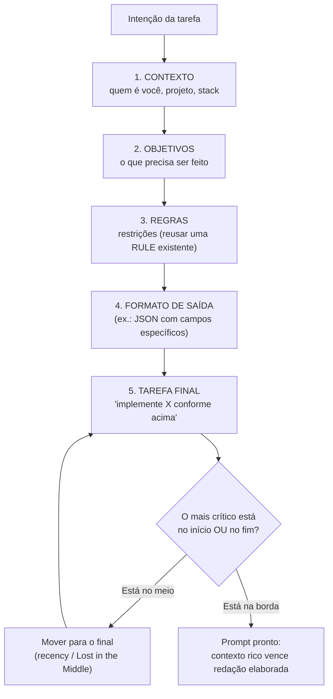
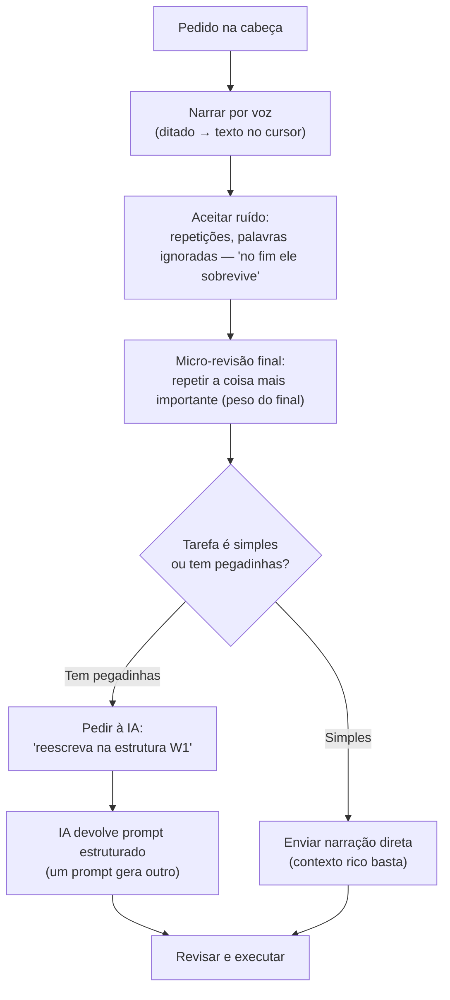
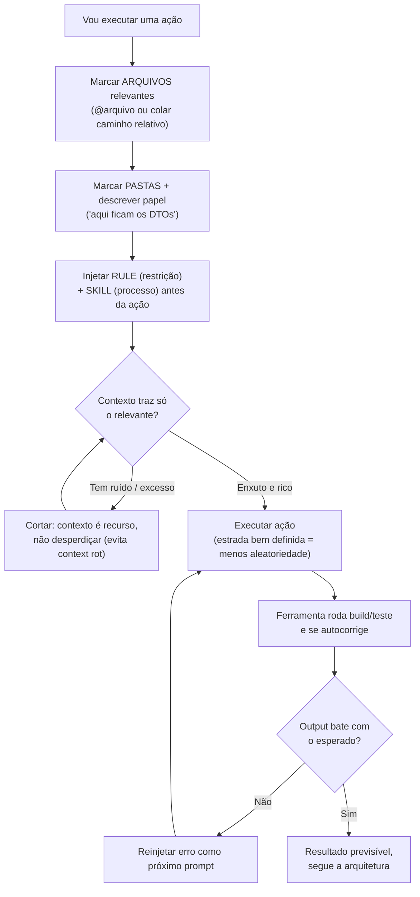
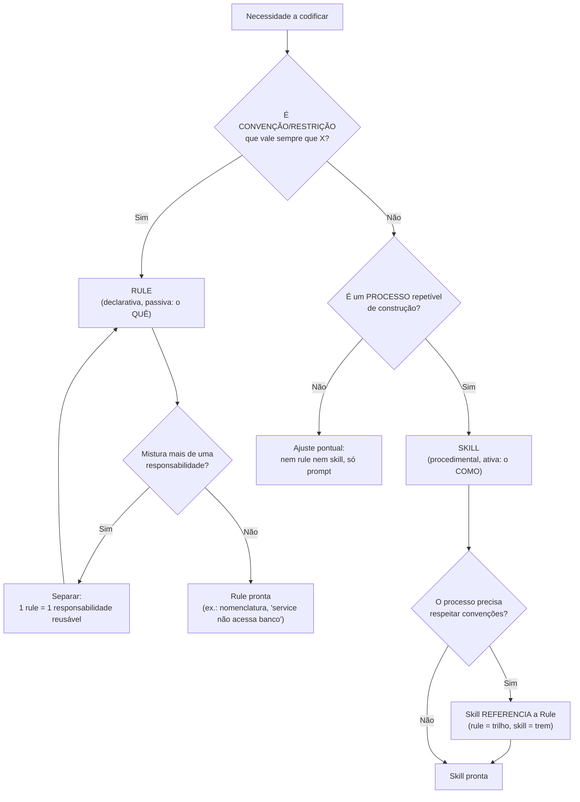
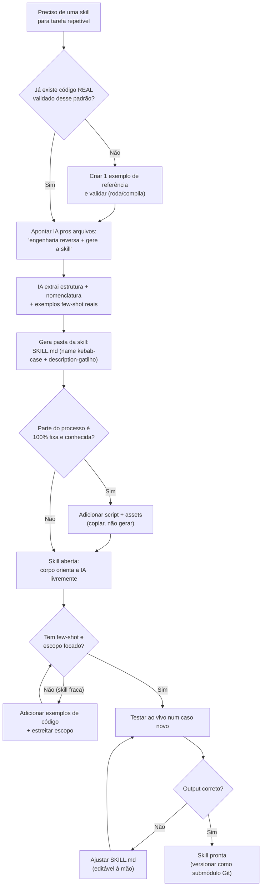
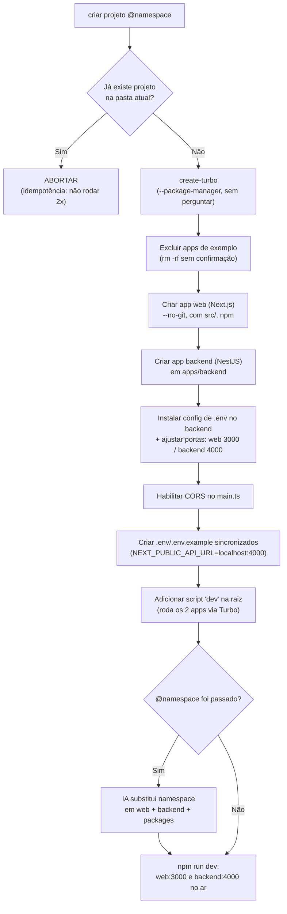
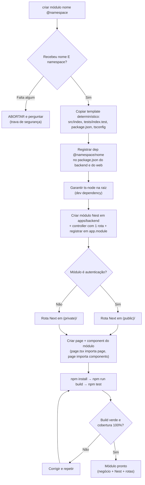
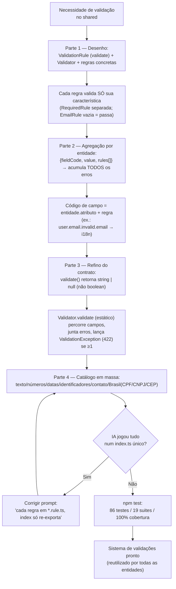
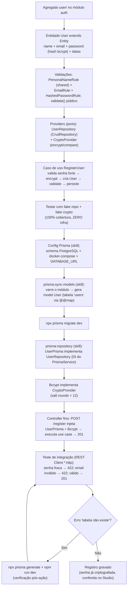
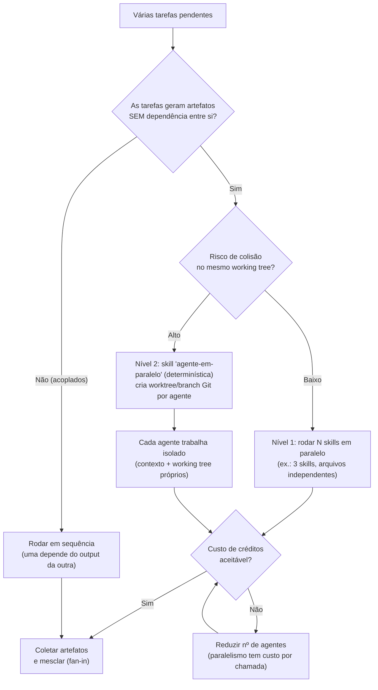

# LOOPS Curso Agents & Skills — Engenharia de Contexto na prática

Os loops operacionais destilados da **Formação DEV — "Agents, Skills & Engenharia de Contexto"** (fonte única prática), prontos pra virar comportamento de agent. Aterram, no chão de fábrica do dev, os domínios canônicos [[23-desenvolvimento-orientado-por-ia]], [[24-spec-driven-development]], [[25-agentic-loops-orquestracao]], [[26-context-engineering]], [[27-evals-verificacao-guardrails]] e [[28-tool-use-mcp-harness]]. Do prompt narrado por voz à biblioteca de 15 skills, do scaffold determinístico de projeto ao módulo de autenticação ponta a ponta — cada workflow é a versão "como eu faço isso hoje no Claude Code / Codex / Cursor" dos conceitos já mapeados no repo.

## Índice dos loops

- **W1** — Estrutura de um prompt eficaz (contexto → objetivos → regras → formato → tarefa; peso do final)
- **W2** — Fluxo narrar-por-voz → IA estrutura → micro-revisão final
- **W3** — Curadoria de contexto (marcar arquivos/pastas, injetar rule/skill, verificar no fim)
- **W4** — Decisão Rule vs Skill (declarativo-passivo vs procedimental-ativo)
- **W5** — Autoria de uma Skill por engenharia reversa (do código real ao `SKILL.md`)
- **W6** — Scaffolding "Novo Projeto" (skill determinística do monorepo Turborepo)
- **W7** — Scaffolding "Novo Módulo" (negócio → Nest → rotas Next, skill híbrida)
- **W8** — Sistema de validações do módulo `shared` (regra → agregação → contrato → catálogo)
- **W9** — Módulo de Autenticação (User → providers → registrar → Prisma → API + teste)
- **W10** — Agentes em paralelo (tarefas independentes + worktrees Git)

---

## W1 — Estrutura de um prompt eficaz

> Monta o prompt na ordem canônica do curso (contexto → objetivos → regras → formato → tarefa), explorando o peso desproporcional do final pra ancorar o que mais importa.

---

## W2 — Fluxo narrar-por-voz → IA estrutura → revisa-final

> A meta-skill pessoal do instrutor: narrar por voz aceitando ruído, fechar com uma micro-revisão do mais importante, e opcionalmente pedir à própria IA pra reescrever na estrutura do W1.

---

## W3 — Curadoria de contexto

> Engenharia de contexto aplicada: marcar os arquivos/pastas certos, injetar rule + skill antes da ação e deixar a ferramenta verificar build/teste no fim — contra o apodrecimento do contexto (context rot).

---

## W4 — Decidir Rule vs Skill

> Decide se a necessidade é uma convenção/restrição passiva (Rule) ou um processo de construção repetível (Skill) — e amarra a skill às rules que ela precisa respeitar.

---

## W5 — Autoria de uma Skill (do conceito ao arquivo)

> Skill de código nunca se escreve no vácuo: parte-se de código real validado, aponta-se a IA para fazer engenharia reversa e o `SKILL.md` nasce com few-shot real do próprio projeto.

---

## W6 — Scaffolding "Novo Projeto"

> Skill determinística modelo: um script JS cria o monorepo Turborepo do zero, sem interação humana (flags de auto-confirmação), com travas de idempotência e renomeação de namespace pela IA no fim.

---

## W7 — Scaffolding "Novo Módulo"

> Skill híbrida: script copia o template fixo do pacote de negócio; a IA registra dependências, cria o módulo Nest e as rotas Next — e tudo fecha com install + build + test verde.

---

## W8 — Sistema de validações do módulo `shared`

> O sistema de validações reutilizável evolui em 4 partes: regra isolada → agregação por entidade → contrato elegante (string | null) → catálogo em arquivos próprios, com i18n e coleta de todos os erros.

---

## W9 — Módulo de Autenticação (ponta a ponta)

> Clean Architecture do negócio à API: entidade User com validações reais, providers como interfaces, caso de uso testado 100% com mocks (sem infra), depois Prisma + bcrypt + controller fino + teste de integração `.http`.

---

## W10 — Usar agentes em paralelo

> Dois níveis de paralelismo: rodar skills que geram artefatos independentes ao mesmo tempo, e isolar cada agente numa worktree Git separada pra eles nunca colidirem no mesmo repositório.

